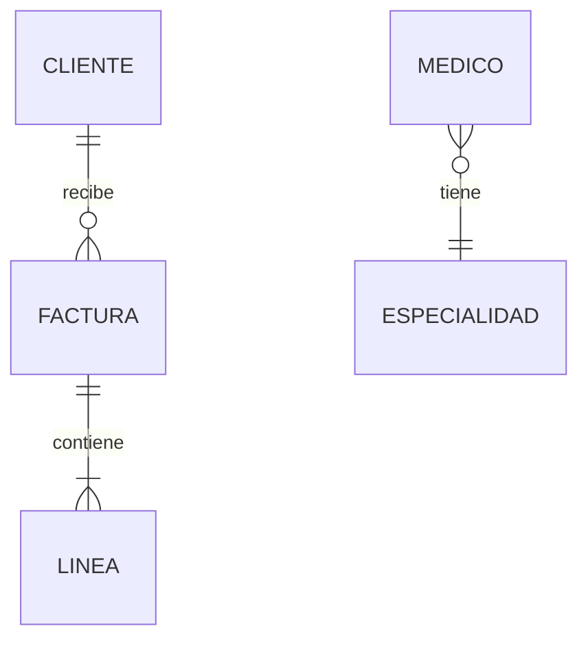

# UD02 · Prácticas



| Práctica | Tipo | Nivel | CE principales |
|---|---|---|---|
| [2.1 Biblioteca municipal: del enunciado al diagrama](#práctica-21--biblioteca-municipal-del-enunciado-al-diagrama) | Guiada | ●○○ | RA6.a, RA6.d, RA6.e |
| [2.2 Leer y escribir cardinalidades](#práctica-22--leer-y-escribir-cardinalidades) | Guiada | ●○○ | RA6.d |
| [2.3 Plataforma de streaming](#práctica-23--plataforma-de-streaming) | Autónoma | ●●○ | RA6.a, RA6.d, RA6.e |
| [2.4 Clínica veterinaria con jerarquías](#práctica-24--clínica-veterinaria-con-jerarquías) | Autónoma | ●●○ | RA6.d, RA6.e, RA6.h |
| [2.5 Revisión de un diseño defectuoso](#práctica-25--revisión-de-un-diseño-defectuoso) | Reto | ●●● | RA6.d, RA6.h |
| [2.6 Autoescuela: ternaria o agregación](#práctica-26--autoescuela-ternaria-o-agregación) | Reto | ●●● | RA6.d |
| [2.7 Almazara: la entrevista que no lo dice todo](#práctica-27--almazara-la-entrevista-que-no-lo-dice-todo) | Reto | ●●● | RA6.a, RA6.d, RA6.e, RA6.h |
| [2.8 Alquiler de coches: el modelo que recuerda](#práctica-28--alquiler-de-coches-el-modelo-que-recuerda) | Reto | ●●● | RA6.d, RA6.e, RA6.h |
| [2.9 Ingeniería inversa: del albarán a las entidades](#práctica-29--ingeniería-inversa-del-albarán-a-las-entidades) | Reto | ●●● | RA6.a, RA6.d, RA6.h |
| [2.10 Dos diseños, un ganador](#práctica-210--dos-diseños-un-ganador) | Reto | ●●● | RA6.d, RA6.h |
| [2.11 Festival de música: ediciones, escenarios y actuaciones](#práctica-211--festival-de-música-ediciones-escenarios-y-actuaciones) | Reto | ●●● | RA6.a, RA6.d, RA6.e, RA6.h |
| [2.12 Editorial: obras, traducciones y derechos de autor](#práctica-212--editorial-obras-traducciones-y-derechos-de-autor) | Reto | ●●● | RA6.a, RA6.d, RA6.e, RA6.h |
| [2.13 Taller aeronáutico: aeronaves, órdenes de trabajo y habilitaciones](#práctica-213--taller-aeronáutico-aeronaves-órdenes-de-trabajo-y-habilitaciones) | Reto | ●●● | RA6.a, RA6.d, RA6.e, RA6.h |
| [2.14 Comunidad de propietarios: inmuebles, juntas y votaciones](#práctica-214--comunidad-de-propietarios-inmuebles-juntas-y-votaciones) | Reto | ●●● | RA6.a, RA6.d, RA6.e, RA6.h |
| [Proyecto EduGest · UD02](#proyecto-edugest--ud02-modelo-conceptual) | Proyecto | ●●○ | RA6.a, RA6.d, RA6.e, RA6.h |
| [Banco · Fundamentos (ejercicios 1-5)](#bloque-1--fundamentos) | Autónoma | ●○○ | RA6.a, RA6.d, RA6.e, RA6.h |
| [Banco · Intermedio (ejercicios 6-15)](#bloque-2--intermedio) | Autónoma | ●●○ | RA6.a, RA6.d, RA6.e, RA6.h |
| [Banco · Intermedio: integración (ejercicios 16-23)](#bloque-3--intermedio-integración) | Autónoma | ●●○ | RA6.a, RA6.d, RA6.e, RA6.h |
| [Banco · Intermedio: EER (ejercicios 24-30)](#bloque-4--intermedio-eer) | Autónoma | ●●○ |
| [Banco · Consolidación (ejercicios 31-35)](#bloque-5--consolidación) | Autónoma | ●●● | RA6.a, RA6.d, RA6.e, RA6.h |

> [!NOTE]
> **Cómo están organizadas estas páginas.** El enunciado se presenta como lo contaría una persona del negocio, no como una lista de entidades: **decidir qué es una entidad, un atributo o una relación forma parte del trabajo**. Las tareas, la comprobación y los errores habituales están plegados: despliégalos cuando los necesites, no antes de pensar.

> [!IMPORTANT]
> **Retos de requisitos (2.11 a 2.14).** Los enunciados de estas cuatro prácticas están escritos como un **documento de requisitos**: varios párrafos, reglas dispersas, datos que no pertenecen al sistema y frases que admiten más de una lectura. Nadie te dice cuáles son las entidades ni qué es una relación ternaria. Dedica la primera sesión a leer, subrayar y **escribir tus preguntas y supuestos** antes de dibujar nada.

> [!TIP]
> **Método para todos los ejercicios.** (1) Subraya sustantivos y verbos; (2) decide entidades e identificadores; (3) relaciones y cardinalidades en **los dos sentidos**; (4) atributos, incluidos los de las relaciones; (5) revisa redundancias y escribe los **supuestos** que hayas tenido que hacer.

---

## Práctica 2.1 · Biblioteca municipal: del enunciado al diagrama



#### Objetivo

Aplicar la metodología de cinco pasos para construir un diagrama E/R completo a partir de un relato de una persona del negocio.

#### Contexto

La biblioteca de un barrio quiere dejar el cuaderno y pasar a una base de datos. Su responsable te cuenta cómo trabaja.

#### Enunciado

> «Cuando llega un libro nuevo lo apunto con su ISBN, el título, la editorial y el año. Hay libros escritos por varias personas y autores con muchos libros en nuestro catálogo; de cada autor anoto cómo se llama y de dónde es, y a los que se repiten les pongo un código para no confundirlos.
>
> De cada libro suelo comprar varias copias. Las distingo con un número que les pego en el lomo (la 1, la 2, la 3...), y ese número empieza otra vez en cada libro. Apunto también si la copia está nueva, usada o deteriorada.
>
> Los vecinos se hacen socios con su DNI, su nombre y un teléfono, y les doy un número de carné. Cuando alguien se lleva una copia a casa, anoto el día que se la lleva, hasta cuándo puede tenerla y el día en que la devuelve de verdad. Hay libros que llevan meses prestados y otros que nunca han salido. A algunos socios los tengo que llamar muchas veces.»

#### Desarrollo

Sigue los cinco pasos y responde a las preguntas antes de abrir las respuestas.

{}

1. **Entidades.** Subraya sustantivos y verbos. ¿Cuáles tienen propiedades propias? ¿Hay algún «hecho» que parezca una entidad pero en realidad relacione otras dos cosas?

2. **Identificadores.** Para cada entidad, ¿qué dato la distingue de las demás? ¿Alguna se identifica con un número que se repite de unas a otras? ¿Qué dato candidato queda como alternativa?

3. **Relaciones y cardinalidades.** Para cada pareja, formula las dos preguntas, una en cada sentido, y decide el mínimo y el máximo. ¿Qué dice el relato sobre libros que «nunca han salido»?

4. **Atributos de las relaciones.** ¿A qué pertenecen las fechas? ¿Puede el mismo socio llevarse la misma copia en dos ocasiones? ¿Qué implica eso para identificar cada préstamo?

5. **Dibuja** el diagrama en draw.io con la notación de Chen (*Más formas* → *Entity Relation*) y compáralo con la solución.

{}





{}

{}
- [ ] Hay 4 entidades y `EJEMPLAR` está marcada como débil (doble rectángulo en Chen).
- [ ] Las dos relaciones N:M tienen la cardinalidad máxima N en los dos lados.
- [ ] Las fechas del préstamo están en la relación, no en `SOCIO` ni en `EJEMPLAR`.
- [ ] Has descartado la información que no genera datos.
- [ ] Has escrito al menos tres supuestos semánticos.
{}

{}

{}

> [!WARNING]
> - Relacionar `SOCIO` con `LIBRO` en lugar de con `EJEMPLAR`. Lo que se presta es una copia física, no la obra.
> - Poner `fecha_prestamo` como atributo de `SOCIO`. Un socio tiene muchos préstamos, así que ese atributo solo podría guardar uno.

{}

#### Ampliación

La biblioteca quiere gestionar **reservas**: un socio puede reservar un **libro** (no un ejemplar concreto) y se guarda la fecha de reserva. Añade esta relación y justifica por qué se relaciona con `LIBRO` y no con `EJEMPLAR`.

---

## Práctica 2.2 · Leer y escribir cardinalidades



#### Objetivo

Determinar las cardinalidades mínima y máxima de una relación a partir de frases del lenguaje natural, y al revés.

#### Desarrollo

Para cada frase, escribe la relación en notación (mín, máx) en los **dos sentidos** y el tipo de correspondencia (1:1, 1:N o N:M). Despliega la solución para comprobarla.

| # | Frase |
|---|---|
| a | Todo empleado trabaja en un único departamento; un departamento puede no tener empleados todavía. |
| b | Cada país tiene una capital; cada capital lo es de un único país. |
| c | Un pedido contiene al menos un producto; un producto puede no haberse pedido nunca o aparecer en muchos pedidos. |
| d | Un empleado puede supervisar a varios empleados; todo empleado salvo el director tiene un supervisor. |
| e | Un vehículo de empresa puede estar asignado a un empleado como máximo; un empleado puede no tener vehículo y nunca tiene más de uno. |



#### Segunda parte: del diagrama a la frase

Escribe en lenguaje natural lo que expresa cada diagrama:



---

## Práctica 2.3 · Plataforma de streaming



#### Contexto

Tres amigos preparan el lanzamiento de un servicio de vídeo bajo demanda y te piden el modelo conceptual. Este es el correo que te mandan.

#### Enunciado

> «Hola. Os cuento cómo queremos que funcione *Cinefilia*.
>
> La gente se registra con su NIF, su nombre y apellidos, un correo (no queremos dos cuentas con el mismo) y una dirección de facturación: calle, código postal y ciudad. Habrá tres tarifas —básica, estándar y premium— que se diferencian en lo que cuestan al mes y en cuántas pantallas se pueden usar a la vez. Cada cliente tiene contratada una.
>
> En el catálogo, cada película tiene su título, año y duración. La clasificamos por géneros porque la gente busca «comedia romántica» o «ciencia ficción», y también queremos que se pueda buscar por actor y que en la ficha se vea quién hace de quién.
>
> Necesitamos saber qué ve cada cliente y cuándo —a qué hora empezó y hasta qué minuto llegó— para ofrecer «continuar viendo». Sí, hay quien ve tres veces la misma peli. Y los clientes podrán puntuarlas de 1 a 5 estrellas, pero una sola vez por película, que si no se manipulan las medias.»

{}

1. Diagrama E/R completo en la notación que prefieras (indica cuál).
2. **Diccionario de datos**: tabla con entidad o relación, atributo, descripción, tipo de dato conceptual (texto, número, fecha...) y si es obligatorio.
3. Lista de **supuestos semánticos**.
4. Dos **restricciones** que el diagrama no pueda expresar.

{}

{}

{}
- [ ] `género` está modelado como **entidad** o como **atributo multivaluado**, y justificas la elección.
- [ ] `personaje` es un atributo de la relación actor–película.
- [ ] *Visualización* y *valoración* son relaciones **distintas**: una se repite y la otra no.
- [ ] La dirección aparece como atributo **compuesto**.
- [ ] La tarifa es una entidad con sus propios datos, no un texto en el cliente.
- [ ] Entre las restricciones textuales está «la puntuación está entre 1 y 5» u otra similar.
{}

{}

{}

Las dos relacionan `CLIENTE` y `PELICULA`, pero la visualización puede repetirse (se identifica también por la fecha y hora), mientras que la valoración es única por pareja cliente-película. Son dos hechos distintos: dos relaciones distintas.

{}

#### Ampliación

Añade **series**, compuestas por temporadas (1, 2, 3...) y episodios numerados dentro de cada temporada. ¿Cuántas entidades débiles aparecen? ¿De quién depende cada una?

---

## Práctica 2.4 · Clínica veterinaria con jerarquías



#### Contexto

Una clínica veterinaria de tamaño medio estrena sistema de gestión. La gerente describe su día a día.

#### Enunciado

> «Aquí trabajamos once personas, y de todas guardo el DNI, el nombre, el teléfono y el día que empezaron. Los que pasan consulta son veterinarios, con su número de colegiado y su especialidad; los auxiliares tienen una titulación; y en el mostrador están los administrativos, de los que apunto los idiomas que hablan porque los extranjeros lo agradecen. Nadie hace dos cosas: o es una o es otra.
>
> A los clientes los conocemos por sus mascotas: chip, nombre, fecha de nacimiento y especie. Cada mascota es de un cliente, aunque un cliente puede traer varias. De los perros anoto la raza y si la ley los considera potencialmente peligrosos; de los gatos, si están esterilizados. Con el resto (conejos, tortugas...) no hace falta nada especial.
>
> Cada consulta la pasa un veterinario a una mascota un día concreto. Anoto el motivo, el diagnóstico y lo que receta, con la dosis de cada medicamento (nombre comercial y un código interno). A veces un auxiliar echa una mano.»

{}

1. Diagrama EER con todas las jerarquías.
2. Clasifica cada jerarquía como total/parcial y disyunta/solapada y **justifícalo con una frase del texto**.
3. Decide si `CONSULTA` es una entidad o una relación. Razona las dos opciones.
4. Escribe las restricciones que no puede recoger el diagrama (por ejemplo, sobre la dosis o sobre quién puede recetar).
5. Identifica qué información del texto **no** da lugar a ningún dato que haya que guardar.

{}

{}

{}
- [ ] La jerarquía de empleados es **total y disyunta**.
- [ ] La jerarquía de mascotas es **parcial y disyunta**.
- [ ] Los atributos comunes están en la superclase y solo los específicos en las subclases.
- [ ] El cliente aparece como entidad aunque el texto «lo conoce por sus mascotas».
- [ ] La dosis es un atributo de la relación consulta–medicamento.
{}

{}



#### Ampliación

¿Cómo cambiaría el modelo si un empleado pudiera ser a la vez auxiliar y administrativo? ¿Y si se quisiera guardar el **historial de puestos** de cada empleado con sus fechas?

---

## Práctica 2.5 · Revisión de un diseño defectuoso



#### Contexto

Un compañero ha diseñado el modelo de un **gimnasio** y te pide que lo revises antes de pasar a tablas. El enunciado es: *«Los socios se apuntan a actividades (spinning, yoga...) que se imparten en salas. Cada sesión de una actividad tiene día, hora, sala y monitor. Un socio reserva plaza en sesiones concretas. Cada socio tiene una cuota mensual»*.



#### Enunciado

Haz la revisión como la haría un compañero senior: no sabes cuántos problemas hay. Para cada uno que encuentres indica el elemento afectado, el tipo de error, su consecuencia y la corrección. Después dibuja el diagrama corregido y decide si hay algo que **no** puedes corregir sin preguntar al cliente.

{}
Identificadores inestables, atributos derivados, atributos multivaluados escondidos en un texto, atributos colocados en la entidad equivocada, entidades que no tienen identificador, conceptos que deberían ser entidades (monitor, sesión), relaciones redundantes.
{}



---

## Práctica 2.6 · Autoescuela: ternaria o agregación



#### Enunciado

> «En nuestra autoescuela cada alumno da las prácticas con el profesor que le asignamos, siempre en uno de nuestros coches (cada uno con su matrícula, marca y modelo). Apuntamos el día y la hora de cada clase y los kilómetros que hacen. A lo largo del curso un alumno puede dar clase con varios profesores, y un profesor puede dar clase en varios coches.
>
> Cuando un alumno ha terminado con un profesor y este lo considera preparado, pedimos examen ante la DGT: se anota la fecha y si aprueba o suspende. Hay alumnos que nunca llegan a presentarse, y los que se presentan pueden hacerlo más de una vez.»

{}

1. Modela las clases prácticas como una relación **ternaria** alumno–profesor–vehículo. Calcula la cardinalidad de cada entidad fijando las otras dos.
2. Modela el examen. Explica por qué una **agregación** de la relación alumno–profesor es mejor que una ternaria con `EXAMEN`, y qué cambia porque pueda repetirse.
3. Explica qué información se perdería si sustituyes la ternaria del punto 1 por tres relaciones binarias.

{}

{}

{}
- [ ] La ternaria incluye la fecha y la hora como atributos y justificas su cardinalidad (con varios alumnos, profesores y vehículos suele ser N:M:P).
- [ ] La agregación permite que haya parejas alumno–profesor **sin** examen.
- [ ] Has identificado cada examen con algo más que la pareja alumno–profesor (la fecha).
- [ ] Se explica con un ejemplo concreto la pérdida de información de las binarias.
{}

{}



---

## Práctica 2.7 · Almazara: la entrevista que no lo dice todo



#### Contexto

Una cooperativa de aceite quiere registrar la trazabilidad de su producción. Esta es la transcripción de la reunión con el gerente. Como ocurre en la realidad, **el cliente no te lo cuenta todo, se contradice y mezcla cosas que no son de tu sistema**.

#### Enunciado

> **Gerente:** Somos unos ciento veinte socios. Cada uno tiene sus fincas, aunque hay fincas que son de dos hermanos y entonces cada uno tiene su parte. Una finca se identifica por su polígono y su parcela, y está en un término municipal.
>
> **Tú:** ¿Qué entregan los socios?
>
> **Gerente:** En campaña, que va de octubre a enero, traen la aceituna en remolque. Se pesa a la entrada y se les da un albarán con su número. Normalmente es de una sola finca, pero a veces un socio mezcla dos fincas en el mismo viaje. Lo que no queremos es que se mezcle aceituna de variedades distintas, eso se rechaza.
>
> **Tú:** ¿Y después?
>
> **Gerente:** Se muele por lotes. En cada lote entra lo de varios socios, a veces de varios días. Del lote queremos saber cuánto aceite ha salido, que se nos pregunta mucho por el rendimiento. El aceite va a un depósito, y de ahí se envasa en botellas de distinto tamaño. Cada tanda de envasado la anoto con su fecha y el número de botellas.
>
> **Tú:** ¿La venta también va en el sistema?
>
> **Gerente:** No, eso lo llevamos con el programa de facturación. Pero sí me importa que, si un cliente se queja de una botella, yo pueda decir de qué fincas viene el aceite que lleva. Eso nos lo exige la inspección.
>
> **Tú:** ¿Y el aceite de un lote puede acabar en varios depósitos?
>
> **Gerente:** Pues… depende. Casi siempre uno, pero si el depósito se llena, se pasa al siguiente.

{}

1. Redacta una lista de **al menos cinco preguntas** que harías al gerente porque la entrevista deja cabos sueltos. Para cada una, indica qué decisión de diseño depende de la respuesta.
2. Delimita el **alcance**: qué parte de la conversación **no** pertenece a tu modelo y por qué.
3. Elabora el diagrama E/R eligiendo la opción más razonable en cada ambigüedad y recogiéndola como **supuesto**.
4. Demuestra la **trazabilidad**: escribe, como una secuencia de relaciones, el camino que recorres en tu diagrama desde una botella hasta las fincas de origen. ¿Qué parte del camino pierde precisión?
5. Escribe tres restricciones que tu diagrama no puede expresar (por ejemplo, sobre la variedad o sobre quién entrega de qué finca).

{}

{}

{}
- [ ] Hay una relación entre `SOCIO` y `FINCA` que admite el reparto del porcentaje de propiedad.
- [ ] La entrega y la molturación son **relaciones N:M con atributos**: una entrega puede alimentar varios lotes y un lote recoge varias entregas.
- [ ] La relación entre lote y depósito se ha justificado con una pregunta al cliente.
- [ ] La venta y la facturación no aparecen en el diagrama.
- [ ] Has identificado el tramo del camino botella → finca que pierde precisión y por qué.
{}

{}





---

## Práctica 2.8 · Alquiler de coches: el modelo que recuerda



#### Contexto

Un diseño que solo guarda «lo que es verdad ahora» olvida lo que ya pasó. Una empresa de alquiler de coches necesita poder explicar una factura de hace tres años.

#### Enunciado

> «Tenemos varias sucursales y una flota de coches. Cada coche está asignado a una sucursal, aunque lo movemos entre ellas según la temporada; para las auditorías necesitamos saber dónde estuvo cada coche en cada momento.
>
> Los coches se agrupan por categoría (económico, familiar, de lujo) y cada categoría tiene una tarifa diaria que revisamos cada año. Cuando un cliente firma un contrato, se queda con el precio que había ese día, aunque luego suba. Si alguien reclama, tenemos que demostrar qué tarifa estaba vigente.
>
> De los clientes guardamos nombre, documento y la dirección donde se les envían las facturas. Las facturas deben mostrar la dirección que tenía el cliente cuando se emitieron, no la actual.
>
> Los empleados tienen una categoría profesional (agente, supervisor, director) que puede cambiar con los años; el sueldo depende de ella. Nos piden informes del tipo «cuántos supervisores había en marzo de 2024».
>
> Un contrato es de un cliente, para un coche, entre dos fechas, y lo gestiona un empleado de la sucursal desde la que se entrega el coche.»

{}

1. Localiza **todas las frases** del enunciado que exigen conservar el pasado y clasifícalas: relación que cambia, atributo que cambia, o valor que debe «congelarse» en un documento.
2. Para cada una, decide cómo se modela (atributos de fecha en la relación, entidad histórica, copia del valor en el documento) y cómo cambia la **cardinalidad** al incorporar el tiempo (por ejemplo, una relación 1:N ahora, ¿qué es a lo largo del tiempo?).
3. Escribe la restricción que **no puedes expresar** con el diagrama y que garantiza que los periodos de una misma entidad no se solapan.
4. Elabora el diagrama E/R final.
5. Razona en qué caso se acepta **repetir** un dato (el precio en el contrato) y por qué eso no se considera redundancia dañina.

{}

{}

{}
- [ ] La asignación coche–sucursal es una relación **N:M con fecha de inicio y de fin** (o una entidad histórica), no un atributo del coche.
- [ ] La tarifa es una entidad vinculada a la categoría con una fecha de vigencia, y el contrato guarda su propia copia del precio.
- [ ] La dirección de facturación está versionada, o copiada en la factura.
- [ ] La categoría profesional del empleado tiene historial.
- [ ] Has escrito la restricción de no solapamiento de periodos.
{}

{}



---

## Práctica 2.9 · Ingeniería inversa: del albarán a las entidades



#### Contexto

En muchas empresas no hay requisitos escritos: hay **documentos** (albaranes, facturas, hojas de cálculo) y la gente que los usa. Un buen analista sabe leer un documento y deducir el modelo que hay detrás.

#### Enunciado

Una distribuidora de bebidas para hostelería te entrega dos documentos reales con los datos sensibles sustituidos.

**Documento A: albarán de entrega**

| | |
|---|---|
| **Distribuciones Marina S. L.** · CIF B-12345678 | **Albarán n.º 2026/004871** |
| Fecha: 14/09/2026 | Ruta: R-03 (Costa Norte) · Repartidor: M. Soler · Furgoneta 4512-KLM |
| **Cliente:** 00418 · Bar La Gamba · CIF B-98765432 | **Entregar en:** C/ del Puerto, 12 · 03700 Dénia |

| Ref. | Descripción | Formato | Uds. | Precio | Dto. | Importe |
|---|---|---|---:|---:|---:|---:|
| 1021 | Cerveza rubia 33 cl | Caja 24 | 10 | 17,40 | 0 % | 174,00 |
| 1045 | Agua mineral 50 cl | Pack 12 | 6 | 3,90 | 0 % | 23,40 |
| 2310 | Ginebra premium 70 cl | Botella | 4 | 19,50 | 10 % | 70,20 |
| 2310 | Ginebra premium 70 cl (promoción 3×2) | Botella | 2 | 0,00 | 0 % | 0,00 |

Base imponible: 267,60 € · IVA 10 % sobre 23,40 €: 2,34 € · IVA 21 % sobre 244,20 €: 51,28 € · **Total: 321,22 €** · Pago: transferencia a 30 días · Recibí del cliente: firma y DNI

**Documento B: hoja de ruta del repartidor (fragmento de hoja de cálculo)**

| Fecha | Repartidor | Furgoneta | Cliente | Hora llegada | Hora salida | Incidencias |
|---|---|---|---|---|---|---|
| 14/09 | M. Soler | 4512-KLM | 00418 | 09:42 | 09:58 | – |
| 14/09 | M. Soler | 4512-KLM | 00533 | 10:15 | 10:31 | Cliente cerrado, se deja en vecino |
| 15/09 | M. Soler | 7781-HTB | 00418 | 09:30 | 09:41 | Faltan 2 cajas |

{}

1. Deduce las **entidades** que hay detrás de los dos documentos y sus identificadores. ¿Qué entidades aparecen en los dos?
2. Distingue en el albarán los **atributos básicos** de los **derivados** (que se calculan a partir de otros) y los que son **copia** de un dato que podría cambiar (por ejemplo, el precio).
3. Identifica el **grupo repetido** del albarán y decide si es un atributo multivaluado o una entidad/relación.
4. Descubre al menos **dos inconsistencias o preguntas** que el documento deja abiertas (por ejemplo, el IVA).
5. Dibuja el diagrama E/R y escribe el diccionario de datos con una columna «derivado / copia / básico».

{}

{}

{}
- [ ] El albarán es una entidad y sus líneas forman una relación N:M con atributos entre albarán y producto (o una entidad débil de línea).
- [ ] `importe`, `base imponible`, `IVA` y `total` están marcados como derivados.
- [ ] El precio de la línea se trata como copia del precio de catálogo en el momento de la entrega.
- [ ] Repartidor, furgoneta y ruta forman un conjunto que se repite en los dos documentos y no se repite como texto.
- [ ] Has señalado qué hace que los dos documentos describan dos hechos distintos (entrega y visita).
{}

{}



---

## Práctica 2.10 · Dos diseños, un ganador



#### Contexto

Un buen diseño no se valora por cómo se ve, sino por si **soporta las situaciones reales** del negocio. Una técnica útil es escribir casos de prueba y comprobar si el diseño puede representarlos.

#### Enunciado

Un club de pádel ha recibido dos propuestas de modelo y no sabe cuál elegir. El club describe así su operativa:

> «Los socios reservan una pista para una hora concreta. En cada reserva juegan cuatro personas, pero a veces solo dos. Los que no son socios son invitados, y de ellos solo apuntamos el nombre. Cada jugador paga su parte, aunque a veces uno paga por todos. Con el tiempo, algunos invitados acaban haciéndose socios. Queremos poder contestar a: ¿cuántas veces ha jugado cada persona?, ¿quién juega habitualmente con quién? y ¿qué debe cada uno?»

**Propuesta A**



**Propuesta B**



{}

1. Escribe una tabla con **al menos ocho casos de prueba** extraídos del enunciado (por ejemplo: partido de dos jugadores, invitado que se hace socio, pagos cruzados…) y marca, para cada propuesta, si puede representarlo, si lo representa con dificultad o si no puede.
2. Responde, para cada pregunta del club, qué diseño la resuelve sin esfuerzo y cuál no.
3. Redacta las **tres correcciones** que haría falta incorporar a la propuesta ganadora para soportar todos los casos.
4. Dibuja el diseño final.

{}

{}

{}
- [ ] Has detectado que A contiene un grupo repetido (`jugador1..4`) y que no admite partidos de dos ni de cinco.
- [ ] Has visto que B resuelve «¿cuántas veces ha jugado cada persona?», pero no distingue quién pagó por quién.
- [ ] Tu diseño final trata a socios e invitados como **especialización** de persona (o con un atributo de condición).
- [ ] Has propuesto cómo registrar que un invitado se hace socio sin perder su historial.
{}

{}



---

## Práctica 2.11 · Festival de música: ediciones, escenarios y actuaciones



#### Contexto

Una asociación cultural organiza varios festivales al año y lleva su programación en hojas de cálculo que ya nadie entiende. Te han enviado el apartado de **requisitos** de la licitación. Como en un documento real, **hay datos repetidos, frases ambiguas y partes que no pertenecen al sistema**. Tu trabajo es separar lo que hay que modelar de lo que no, y dejar por escrito cada decisión que tomes.

#### Enunciado

> **1. Festivales y ediciones.** La asociación organiza actualmente tres festivales (*Sonora Rock*, *Sonora Jazz* y *Sonora Folk*), pero prevé abrir más. Cada festival tiene un nombre y una descripción corta. Cada año se celebra una **edición** de cada festival, con sus fechas de inicio y de fin, la ciudad sede y el presupuesto aprobado. Las ediciones se identifican siempre por el festival y por el año: la asociación habla de «el Sonora Jazz de 2026», nunca de «la edición 17». No se guardan ediciones futuras que no tengan presupuesto aprobado.
>
> **2. Recintos y escenarios.** Cada edición se celebra en un recinto, que puede cambiar de un año a otro. De cada escenario se guarda el nombre, el aforo máximo y el **punto de acceso**, que el personal de seguridad necesita descrito en tres partes: la zona del recinto (norte, sur, central…), la puerta y las indicaciones de llegada. Los escenarios se numeran dentro de cada edición (escenario 1, escenario 2…); el «escenario 1» de 2025 no tiene nada que ver con el de 2026, aunque esté en el mismo sitio. Toda edición tiene al menos un escenario.
>
> **3. Artistas.** Un artista puede ser un **solista** o una **agrupación**; no se admiten otros tipos y nadie es las dos cosas a la vez (si un solista monta una banda, se da de alta como agrupación aparte). De todos se guarda el nombre artístico, el país de origen, los **géneros** que toca (puede ser más de uno) y los datos del **representante**: nombre, teléfono y correo, que se manejan siempre juntos. De los solistas interesa su nombre real y su fecha de nacimiento; de las agrupaciones, el año de formación y el número de componentes. Los componentes de una agrupación son músicos de los que se guarda el nombre, el instrumento principal y, para cada agrupación a la que pertenecen, la fecha en que entraron y el instrumento con el que tocan en ella. Un mismo músico puede estar en varias agrupaciones.
>
> **4. Programación.** El día se divide en **franjas** de treinta minutos que empiezan a la hora en punto o y media. Cada actuación consiste en que un artista toca en un escenario durante una o varias franjas consecutivas; se anota la franja de inicio, la duración en minutos y el caché pactado. Un artista puede actuar varias veces en una misma edición, incluso en escenarios distintos y días distintos, pero **no puede estar en dos escenarios a la vez** y un escenario **no puede acoger dos actuaciones simultáneas**. La asociación quiere consultar la programación de un escenario o la de un artista de un golpe de vista.
>
> **5. Personal.** Todo el personal de una edición se identifica por su DNI y tiene nombre, teléfono y talla de camiseta. Se distinguen técnicos (con su especialidad: sonido, iluminación o escenario), personal de seguridad (con su número de habilitación) y voluntarios (con los días de la semana en que están disponibles). Hay personal de producción que no encaja en ninguna de las tres categorías, y es habitual que un voluntario con formación técnica trabaje también como técnico, por lo que la misma persona puede figurar en dos categorías. Cada persona se asigna a un escenario en un turno concreto (mañana, tarde o noche) de una edición; puede cubrir varios turnos y varios escenarios, pero solo de ediciones en las que esté contratada.
>
> **6. Fuera de alcance.** La venta de entradas la gestiona una plataforma externa y no forma parte de este sistema; solo se recibirá al final de cada día el total de asistentes por escenario. Tampoco se gestionan los pagos a proveedores ni la contabilidad de la asociación.

{}

1. Extrae del texto las **entidades candidatas** y descarta las que no pertenecen al sistema, justificándolo con una frase del apartado 6. Indica cuáles son débiles y cuál es el **identificador completo** de cada una.
2. Clasifica las dos jerarquías (artistas y personal) como totales o parciales y disyuntas o solapadas, citando la frase del texto que lo justifica. Decide qué atributos van en la superclase.
3. Modela la actuación como relación **ternaria** (artista, escenario, franja). Calcula la cardinalidad de cada entidad fijando las otras dos y explica cómo las dos prohibiciones del apartado 4 reducen una de ellas.
4. Marca todos los atributos **compuestos**, **multivaluados** y **derivados** y explica cómo los representarías. ¿`duración` es un atributo de la relación o se deduce de otra cosa?
5. Escribe **al menos seis restricciones** que el diagrama no puede expresar (solapamientos, coherencia entre ediciones, aforo…).
6. Redacta cinco **preguntas al cliente** sobre las partes ambiguas del texto y cómo cambiaría tu modelo según la respuesta.

{}

{}

{}
- [ ] `EDICIÓN` es débil de `FESTIVAL` (festival + año) y `ESCENARIO` es débil de `EDICIÓN` (festival + año + número).
- [ ] La franja pertenece a la edición o es un dato general; has justificado cuál de las dos opciones eliges.
- [ ] La jerarquía de artistas es **total y disyunta**; la del personal es **parcial y solapada**.
- [ ] `punto de acceso` y `representante` son atributos compuestos; `géneros` y `días disponibles` son multivaluados.
- [ ] La relación entre agrupación y músico es N:M y lleva `fecha_entrada` e `instrumento`.
- [ ] La asignación de personal tiene el turno como parte de su identificación.
- [ ] La venta de entradas no aparece en el diagrama.
{}

{}

{}

> [!WARNING]
> - Identificar la edición con un número correlativo global: el texto dice que se identifica por festival y año.
> - Poner `escenario` como un texto dentro de la actuación: tiene aforo, punto de acceso y personal asignado, así que es una entidad.
> - Convertir la ternaria en tres binarias y perder qué artista toca en qué escenario en qué franja.
> - Poner `edad` en lugar de `fecha_nacimiento`, o `número_componentes` como dato introducido en vez de derivado de la relación con los músicos.
> - Olvidar que el personal puede estar en dos categorías a la vez y declarar la jerarquía disyunta.

{}

#### Ampliación

La asociación quiere una **lista de espera de voluntarios** por edición y que un voluntario pueda recomendar a otro. ¿Es una relación reflexiva? ¿Qué cardinalidad tiene y qué restricción necesitas para evitar que alguien se recomiende a sí mismo?



---

## Práctica 2.12 · Editorial: obras, traducciones y derechos de autor



#### Contexto

Una editorial independiente publica novela, poesía y cómic, traduce obras de otros idiomas y compila antologías. Hoy lleva el catálogo y los contratos en documentos de texto sueltos y ha tenido problemas porque **nadie sabía qué porcentaje de derechos correspondía a cada persona de una obra**. Te entregan este resumen de requisitos.

#### Enunciado

> **1. Obras.** Una **obra** es el texto en sí, independientemente de cómo se publique. Cada obra tiene un código interno, el título, el año de primera publicación y el idioma original. Hay tres clases de obras con datos propios: las **novelas** (número de capítulos y si pertenecen a una saga, en cuyo caso se anota el nombre de la saga y el volumen), los **poemarios** (número de poemas y métrica predominante) y los **cómics** (número de páginas y si son en color o en blanco y negro). Hay obras de divulgación y de ensayo que no encajan en ninguna de las tres clases y solo guardan los datos comunes. Una obra no puede ser a la vez novela y cómic, aunque tenga adaptación: la adaptación es otra obra distinta.
>
> **2. Relaciones entre obras.** Una obra puede ser una **traducción** de otra obra de la editorial (la original). De la traducción interesa su idioma, que no coincide con el de la original, y quién la tradujo. Una obra original puede tener muchas traducciones, pero una traducción lo es de una sola original. Además, la editorial publica **antologías**: obras que reúnen fragmentos o piezas completas de otras obras. En una antología importa el orden en que aparece cada pieza y las páginas que ocupa. Una obra puede aparecer en varias antologías, y una antología no puede incluirse a sí misma.
>
> **3. Personas y funciones.** Quienes participan en una obra son personas: autores, traductores, ilustradores y prologuistas. De cada persona se guarda el nombre civil, la nacionalidad, la fecha de nacimiento y, si ha fallecido, la fecha de fallecimiento; también uno o varios **seudónimos** bajo los que ha publicado. La **dirección fiscal** se conserva desglosada en calle, número, código postal, localidad y país, porque se utiliza para emitir las retenciones. Una persona puede tener distintas funciones en distintas obras (autor de una, traductor de otra) e incluso más de una en la misma. Para cada función se anota el **porcentaje de derechos** que le corresponde sobre la obra.
>
> **4. Contratos y representación.** Antes de publicar una obra se firma un **contrato** de cesión de derechos por cada persona que participa en ella con una función concreta: se guarda la fecha de firma, el anticipo y la duración en años. Algunas personas tienen un **agente literario** que negocia en su nombre; el agente tiene nombre, agencia y teléfono, y puede representar a muchas personas. El contrato refleja si lo ha negociado un agente y quién fue; los contratos de personas sin agente se firman directamente.
>
> **5. Ediciones e impresiones.** Una obra se publica en una o varias **ediciones**: cada una con su ISBN (que la identifica en todo el mundo), formato (tapa dura, rústica o libro electrónico), número de páginas y precio. Cada edición se imprime en **tiradas** numeradas dentro de la edición (primera, segunda…), con fecha de impresión, número de ejemplares e imprenta. Una tirada no tiene sentido sin su edición y si se retira una edición se retiran sus tiradas. Los libros electrónicos no tienen tiradas.
>
> **6. Librerías.** La editorial envía ejemplares de cada tirada a librerías (CIF, nombre, dirección y teléfono), indicando la fecha de envío y la cantidad. Una librería puede recibir varias veces ejemplares de la misma tirada. Las **ventas** al público las gestiona el distribuidor y quedan fuera del alcance.

{}

1. Dibuja el diagrama EER en notación de Chen. Justifica por qué la **obra** y la **edición** son entidades distintas.
2. Clasifica la jerarquía de obras. ¿Qué cambia si el texto dijera que «toda obra es novela, poemario o cómic»?
3. Representa las relaciones *traduce* e *incluye* como **reflexivas** sobre obra: escribe sus roles, cardinalidades y atributos, y las restricciones de integridad que necesitan.
4. Modela la participación de las personas en las obras como relación **ternaria** (persona, obra, función) o como binaria con la función como entidad. Compara las dos opciones y elige una.
5. Representa el contrato mediante una **agregación** de la participación y explica por qué una simple relación entre persona y obra no basta.
6. Identifica las entidades débiles y sus identificadores. ¿Por qué el ISBN no convierte la edición en entidad débil y la tirada sí lo es?
7. Escribe al menos cinco restricciones textuales y señala dos datos que sean **derivados**.

{}

{}

{}
- [ ] La jerarquía de obras es **parcial y disyunta**, con atributos propios en cada subclase.
- [ ] *Traduce* es una reflexiva 1:N con los roles *original* y *traducción*; *incluye* es una reflexiva N:M con `orden` y `páginas`.
- [ ] La participación de personas lleva el porcentaje de derechos y admite varias funciones de la misma persona en la misma obra.
- [ ] El contrato se modela como agregación de la participación, con el agente como relación opcional.
- [ ] `TIRADA` es una entidad débil de `EDICIÓN`; `EDICIÓN` tiene identificador propio (ISBN).
- [ ] `seudónimos` es multivaluado, `dirección fiscal` es compuesto y «dominio público» o «en vida» es derivado de las fechas.
{}

{}

{}

> [!WARNING]
> - Fundir obra y edición en una sola entidad: se repite el título, el autor y los derechos en cada edición.
> - Poner `traductor` como atributo de texto en la obra: es una persona con datos y con un porcentaje de derechos.
> - Modelar la antología como una entidad aparte con una relación a obra: es una obra más, y su relación con otras obras es reflexiva.
> - Poner el porcentaje de derechos en la persona o en la obra: pertenece a la **participación** (persona, obra, función).
> - Hacer del agente un atributo del contrato: el agente es una entidad con datos propios y muchas representaciones.

{}

#### Ampliación

Algunas obras tienen **coautoría**. ¿Cambia algo en el modelo? Añade ahora que los derechos de una persona sobre una obra pasan a sus herederos al fallecer: ¿qué relación necesitas y qué problema aparece con las fechas?



---

## Práctica 2.13 · Taller aeronáutico: aeronaves, órdenes de trabajo y habilitaciones



#### Contexto

Un taller de mantenimiento aeronáutico trabaja bajo una normativa estricta: **cada tarea debe poder demostrar quién la hizo, con qué habilitación y sobre qué pieza concreta**. El responsable de calidad te entrega la descripción de lo que el sistema debe registrar. Parte de las reglas están escritas como «debe» y otras aparecen de pasada: **ambas son requisitos**.

#### Enunciado

> **1. Aeronaves y modelos.** El taller revisa aeronaves de muchas compañías. Cada aeronave se identifica por su matrícula y es de un **modelo** (por ejemplo, ATR 72-600), del que se conoce el fabricante, la denominación, la categoría de mantenimiento y las horas de vuelo entre revisiones mayores. De la aeronave se guarda la fecha de fabricación y las horas de vuelo acumuladas, que se actualizan en cada entrada al taller. Hay tres tipos: **aviones** (número de motores y envergadura), **helicópteros** (número de palas del rotor principal y si tienen rotor de cola) y otras aeronaves ligeras que no necesitan datos específicos. Una aeronave es siempre de un único tipo.
>
> **2. Propietarios.** Cada aeronave pertenece en cada momento a una persona física o jurídica, de la que se guarda un nombre o razón social, un NIF y una **dirección de contacto** desglosada en calle, número, código postal, localidad y país. Con la compraventa y el arrendamiento una aeronave cambia de propietario a lo largo de su vida, y la normativa exige conservar **todo el historial**: quién fue el propietario y desde qué fecha hasta qué fecha. Un propietario puede tener muchas aeronaves y una aeronave no puede tener dos propietarios al mismo tiempo.
>
> **3. Órdenes de trabajo.** Cada vez que una aeronave entra en el taller se abre una **orden de trabajo**, que se numera de forma correlativa dentro de cada año (la orden 17 de 2026). Se guardan la fecha de entrada, la fecha prevista y la real de salida, el tipo de revisión (A, B, C o D) y las observaciones del cliente. Una orden se descompone en **tareas** numeradas dentro de la orden: cada tarea tiene una descripción, las horas estimadas y su estado (pendiente, en curso o terminada). Algunas tareas no pueden empezar hasta que se han terminado otras de la misma orden, y esas dependencias deben quedar registradas. Una tarea no se reutiliza en otra orden: si se repite el trabajo, se crea una tarea nueva.
>
> **4. Personal técnico y habilitaciones.** Los técnicos tienen un código de empleado, un nombre y una fecha de contratación. Para trabajar sobre un modelo concreto necesitan una **habilitación**, que se concede por **categoría de licencia** (B1 mecánica, B2 aviónica o C certificación) y tiene una fecha de caducidad. Un técnico puede tener varias habilitaciones: puede ser B1 en el ATR 72 y B2 en el Airbus A320, o B1 y B2 a la vez en el mismo modelo. Para el mismo modelo y la misma categoría hay una única habilitación por técnico. Cada tarea la realizan uno o varios técnicos; se anotan las horas reales que dedica cada uno y la fecha en que firma su parte. Solo los técnicos con categoría C pueden **certificar** la conformidad de una orden completa.
>
> **5. Almacén y piezas.** El almacén gestiona piezas identificadas por su número de parte, con la descripción, la unidad de medida y el stock mínimo. Hay dos clases de piezas: los **consumibles** (tornillos, juntas, aceites) de los que solo se controla la cantidad en almacén, y los **rotables** (motores, trenes de aterrizaje) que tienen número de serie propio, las horas acumuladas y una vida útil máxima. Las piezas son de una de las dos clases, nunca de ambas. Cada pieza se compra a uno o varios proveedores, con un precio por proveedor y un plazo de entrega; un proveedor puede suministrar muchas piezas.
>
> **6. Uso de piezas.** Una tarea consume piezas (cantidad para los consumibles) o instala y desmonta rotables concretos en una aeronave. De cada instalación se guarda la fecha de montaje y, cuando se retira, la de desmontaje; un rotable no puede estar instalado en dos aeronaves al mismo tiempo, pero a lo largo de su vida pasa por varias. El taller necesita poder responder a «qué rotables llevaba la aeronave EC-XYZ el 3 de marzo» y «en qué aeronaves ha estado instalado este motor».
>
> **7. Fuera de alcance.** La facturación al cliente y la nómina de los técnicos se llevan en otros programas.

{}

1. Identifica las entidades, indica las **débiles** con su identificador completo y dibuja la cadena orden → tarea. ¿Por qué la matrícula identifica a la aeronave pero el número de orden no identifica a la orden?
2. Clasifica las dos jerarquías (aeronaves y piezas) y justifica cada clasificación con una frase del texto.
3. Modela la habilitación como relación **ternaria** técnico–modelo–categoría y calcula las cardinalidades. ¿Por qué no basta una binaria técnico–modelo?
4. Modela el historial de propietarios, el de instalación de rotables y la dependencia entre tareas. Indica en cada caso qué atributo hace que la misma pareja de entidades pueda repetirse.
5. Decide cómo representar la **certificación** de una orden y qué restricción exige que el técnico sea de categoría C.
6. Escribe al menos siete restricciones de integridad que el diagrama no puede recoger.
7. Enumera tres consultas del taller que tu diagrama debe poder contestar y recorre el camino de relaciones que usaría cada una.

{}

{}

{}
- [ ] `ORDEN` se identifica por (año, número) y `TAREA` por (año, número de orden, número de tarea).
- [ ] La jerarquía de aeronaves es **parcial y disyunta**; la de piezas, **total y disyunta**.
- [ ] La habilitación es una ternaria con la fecha de caducidad como atributo.
- [ ] El historial de propiedad y el de instalación llevan fecha de inicio como parte de su identificación.
- [ ] La dependencia entre tareas es una N:M reflexiva sin atributos.
- [ ] La relación tarea–técnico es N:M con `horas_reales` y `fecha_firma`.
- [ ] `dirección de contacto` aparece como atributo compuesto.
{}

{}

{}

> [!WARNING]
> - Guardar el propietario como atributo de la aeronave: se pierde el historial que exige la normativa.
> - Identificar la tarea solo por su número dentro de la orden, sin heredar la identificación de la orden.
> - Confundir `rotable` (con número de serie e historial) con `consumible` (solo cantidad) y poner las horas acumuladas en todas las piezas.
> - Resolver la habilitación con dos binarias (técnico–modelo y técnico–categoría): no se sabe qué categoría tiene sobre qué modelo.
> - Dar a las tareas dependientes una relación 1:N: una tarea puede esperar a varias y ser requisito de varias.

{}

#### Ampliación

La autoridad aeronáutica exige que cada **certificación de orden** quede firmada por un técnico de categoría C, con la fecha y un número de certificado único. Modela la certificación y decide si es una entidad, una relación con atributos o una agregación. Después añade la posibilidad de que una certificación sea **anulada** y sustituida por otra.



---

## Práctica 2.14 · Comunidad de propietarios: inmuebles, juntas y votaciones



#### Contexto

Un administrador de fincas gestiona decenas de comunidades de propietarios con hojas de cálculo y papel. Quiere un sistema que le permita saber **quién es dueño de qué en cada momento, qué se votó en cada junta y quién debe dinero**. Esta es la descripción del cliente. Como suele ocurrir, mezcla reglas legales con costumbres de la casa, y no todas tienen el mismo peso.

#### Enunciado

> **1. Comunidades e inmuebles.** El administrador lleva varias comunidades. Cada comunidad tiene un CIF, un nombre, una dirección (calle, número, código postal y localidad) y una cuenta bancaria en la que se ingresan las cuotas. Una comunidad se compone de uno o varios **portales**, numerados dentro de la comunidad (portal 1, portal 2…), y cada portal contiene **inmuebles** que se identifican por su planta y su letra dentro del portal (3.º B). El «3.º B del portal 1» de una comunidad nada tiene que ver con el «3.º B del portal 1» de otra.
>
> **2. Tipos de inmuebles.** Todo inmueble tiene su superficie en metros cuadrados y un **coeficiente de participación** (el tanto por ciento que le corresponde en los gastos y en los votos); la suma de coeficientes de una comunidad es siempre el 100 %. Los inmuebles son viviendas (número de dormitorios y si tienen terraza), locales comerciales (actividad que se desarrolla y número de licencia) o plazas de garaje (número de plaza y planta del sótano). Un inmueble es siempre de un único tipo. Algunos garajes están **vinculados** a una vivienda concreta y se transmiten con ella; un garaje solo puede estar vinculado a una vivienda de su misma comunidad, y una vivienda puede tener varios garajes vinculados.
>
> **3. Propietarios.** Los propietarios pueden ser personas físicas (DNI, nombre y apellidos) o jurídicas (CIF, razón social y persona de contacto, con su nombre y teléfono). Los dos tipos comparten un teléfono y un correo de notificación. Un inmueble puede pertenecer a varias personas a la vez, cada una con su **porcentaje de propiedad** (el 50 % cada uno si lo compran dos hermanos). La propiedad cambia con ventas y herencias, y se debe conservar el **historial**: quién fue propietario de qué inmueble, con qué porcentaje y entre qué fechas. Si no se conoce la fecha de fin, el propietario sigue siéndolo.
>
> **4. Juntas.** Cada comunidad celebra juntas, ordinarias o extraordinarias, numeradas por año dentro de la comunidad (la junta 2 de 2026). De cada una se guardan la fecha, el lugar, si se celebró en primera o en segunda convocatoria y el acta (un texto largo). Cada junta tiene un **orden del día** compuesto por puntos numerados dentro de la junta; cada punto tiene un título, una descripción y el resultado de la votación (aprobado, rechazado o sin votación). Los puntos no existen fuera de su junta.
>
> **5. Asistencia, delegación y voto.** A cada junta asisten propietarios, bien en persona, bien **representados** por otro propietario de la misma comunidad a quien han delegado su voto; de cada asistente se anota si estuvo presente o representado. Un propietario puede delegar su voto en una junta concreta en otro, que a su vez puede acumular varias delegaciones, pero nadie puede delegar en sí mismo ni delegar un voto que ya ha recibido por delegación. Cuando un punto se somete a votación, cada propietario presente o representado vota **a favor, en contra o se abstiene**, y el voto cuenta con el coeficiente del inmueble. Se desea saber cómo votó cada propietario en cada punto.
>
> **6. Cuotas, derramas y recibos.** Cada inmueble paga una cuota mensual de gastos proporcional a su coeficiente. Además, la junta puede aprobar **derramas extraordinarias** (una obra, por ejemplo) en un punto del orden del día; la derrama se reparte entre los inmuebles según el coeficiente y tiene un importe total, un concepto y unas fechas de pago. Todos los cobros se emiten como **recibos** a nombre del propietario actual del inmueble, numerados dentro de cada inmueble; en un recibo se anotan el concepto, el importe, la fecha de emisión y, cuando se paga, la fecha de pago. Un recibo es moroso si pasan treinta días desde la emisión sin haberse pagado.
>
> **7. Fuera de alcance.** La contabilidad general de la comunidad, las incidencias de mantenimiento y los contratos con proveedores se tratarán en una fase posterior.

{}

1. Dibuja la **cadena de entidades débiles** comunidad → portal → inmueble y escribe el identificador completo de cada una. Explica por qué no se puede usar un código global de inmueble sin perder información.
2. Clasifica la jerarquía de inmuebles y la de propietarios. Justifica cada clasificación con una frase del texto y decide qué atributos van en cada nivel.
3. Modela el vínculo entre garajes y viviendas. ¿Es una reflexiva? ¿Qué cardinalidad tiene desde cada lado?
4. Modela la **propiedad con historial** (inmueble, propietario, porcentaje, fechas) y justifica qué atributo forma parte del identificador.
5. Modela la **delegación de voto** como relación **ternaria** (propietario que delega, propietario representante, junta). Calcula sus cardinalidades y escribe las tres restricciones del apartado 5.
6. Modela el voto en cada punto y explica por qué el coeficiente **no** es un atributo del voto.
7. Identifica los atributos compuestos, derivados y multivaluados (si los hay) y explica qué haría falta preguntar al cliente para decidir.
8. Escribe al menos ocho restricciones, distinguiendo las **legales** de las **de negocio**.

{}

{}

{}
- [ ] `PORTAL` es débil de `COMUNIDAD`; `INMUEBLE` es débil de `PORTAL`; `JUNTA` es débil de `COMUNIDAD`; `PUNTO` es débil de `JUNTA`; `RECIBO` es débil de `INMUEBLE`.
- [ ] La jerarquía de inmuebles es **total y disyunta**; la de propietarios, **total y disyunta**, con atributos distintos en cada subclase.
- [ ] El vínculo garaje–vivienda es una relación 1:N desde la vivienda y opcional del lado del garaje.
- [ ] La propiedad es una N:M entre inmueble y propietario con `porcentaje` y `fecha_inicio` como parte del identificador.
- [ ] La delegación es una ternaria con dos papeles distintos para la misma entidad `PROPIETARIO`.
- [ ] El voto es una N:M entre propietario y punto, con el sentido del voto como atributo.
- [ ] «Moroso» se ha declarado como atributo derivado.
{}

{}

{}

> [!WARNING]
> - Usar un código de inmueble global y perder la estructura portal–planta–letra que usa el administrador.
> - Poner `propietario` como atributo del inmueble: se pierden el reparto de porcentajes y el historial.
> - Modelar la delegación como una relación binaria entre propietarios, sin la junta: el mismo propietario puede delegar en uno u otro según la junta.
> - Guardar el coeficiente en el voto: es un dato del inmueble, y el propietario puede tener varios.
> - Guardar el resultado de la votación como texto libre, o contarlo a mano, en lugar de derivarlo de los votos (aprobado si los votos a favor superan a los contrarios).

{}

#### Ampliación

Una comunidad puede tener **subcomunidades** (por ejemplo, un garaje común a varios portales con sus propias cuotas). Decide si se modela como una reflexiva de `COMUNIDAD` o como una entidad nueva, y explica qué ocurre con los coeficientes.



---

## Proyecto EduGest · UD02: modelo conceptual



#### Objetivo

Construir el modelo conceptual completo del proyecto transversal.

#### Enunciado

Lee la [entrevista con la jefatura de estudios](/guia/proyecto-edugest#1-enunciado-entrevista-con-la-jefatura-de-estudios) como lo haría un analista: ahí no se enumeran las entidades y hay detalles que se mencionan de pasada. El [caso guiado de la teoría](/ud02-modelo-er/ud02-teoria#8-caso-guiado-el-modelo-er-de-edugest) resuelve una parte.

{}

1. El **diagrama E/R** con todas las entidades, relaciones, cardinalidades, atributos e identificadores. Complétalo hasta cubrir todo lo que cuenta la entrevista.
2. El **diccionario de datos** (entidad, atributo, descripción, dominio, obligatorio, identificador).
3. Los **supuestos semánticos**.
4. Las **restricciones textuales**: al menos cinco reglas que el diagrama no puede representar.
5. Una lista de **preguntas que harías a la jefatura de estudios** porque la entrevista no las resuelve.

{}

{}

{}
- [ ] La relación *es jefe de* entre `PROFESOR` y `DEPARTAMENTO` es distinta de *pertenece a*.
- [ ] *Imparte* relaciona profesor, módulo y grupo, e incluye el curso académico. Justificas si es ternaria.
- [ ] Las faltas de asistencia dependen de la matrícula, no solo del alumno.
- [ ] Todas las decisiones dudosas están en la lista de supuestos.
{}

{}

> [!IMPORTANT]
> No consultes todavía la solución de referencia del proyecto. Tu diseño se revisará en clase y lo usarás en la UD03. Las diferencias con la referencia se discutirán en la UD04.

---

## Banco de ejercicios

35 ejercicios para practicar el diseño conceptual, **ordenados de menor a mayor dificultad** en cinco bloques. Cada ejercicio tiene el mismo formato que las prácticas: contexto y enunciado a la vista, y **objetivo, tareas, comprobación, errores habituales y solución plegados** (dibujada con la notación EER que usamos en clase). Los enunciados están escritos sin resaltar las entidades: reconocerlas es parte del ejercicio.

| Bloque | Ejercicios | Qué introduce | Además del diagrama se pide |
|---|---|---|---|
| Fundamentos ●○○ | 1-5 | Entidades, atributos, identificadores, relaciones 1:N y N:M, atributos de relación y una primera relación reflexiva. | Diagrama y supuestos |
| Intermedio ●●○ | 6-15 | Relaciones 1:1, N:M reflexivas, entidades débiles, atributos compuestos, multivaluados y derivados, y varias relaciones entre las mismas entidades. | Justificar decisiones y escribir restricciones textuales |
| Intermedio: integración ●●○ | 16-23 | Relaciones ternarias, agregación, dos relaciones entre las mismas entidades, listas de materiales, cardinalidades máximas concretas y primera generalización. | Clasificar jerarquías, comparar ternaria y agregación, diccionario parcial |
| Intermedio: EER ●●○ | 24-30 | Varias especializaciones en un mismo modelo, cadenas de entidades débiles, ternarias con atributos y casos de integración completos. | Diccionario de datos, restricciones y tablas previstas |
| Consolidación ●●● | 31-35 | Casos largos que mezclan cadenas de débiles, ternarias, agregación, reflexivas y especializaciones. | Diagrama, diccionario de datos, restricciones y tablas previstas |



> [!IMPORTANT]
> **Notación de Chen extendida.** Las entidades son rectángulos y las relaciones, rombos; la entidad débil lleva rectángulo doble y su relación identificadora, rombo doble. Una **línea doble** une una entidad con una relación cuando la participación es total (mínimo 1) y una línea sencilla cuando es parcial (mínimo 0). Junto al rombo se rotula la cardinalidad máxima (1, N, M, P) y junto a la entidad el par (mín, máx). Las especializaciones se dibujan con un círculo con **d** (disyunta) u **o** (solapada); cada subclase se une con el símbolo de subconjunto ⊂ y la línea hasta la superclase es doble si la especialización es total.

> [!IMPORTANT]
> **Convenio de cardinalidades.** El par (mín, máx) escrito **junto a una entidad** indica con cuántas instancias de **esa** entidad se relaciona una instancia de la otra. Es el mismo convenio de la [teoría](/ud02-modelo-er/ud02-teoria#71-equivalencia-entre-la-notación-de-chen-y-la-pata-de-gallo). En una relación ternaria, el par junto a una entidad cuenta cuántas instancias de ella corresponden a cada pareja de las otras dos.

> [!TIP]
> **Cómo trabajar un ejercicio.** Aplica el método de arriba, dibuja en papel o en draw.io, rellena la lista de comprobación y solo entonces despliega la solución. Si tu diagrama difiere, no significa que esté mal: compara los **supuestos**. Dos diseños distintos son válidos si responden igual a las reglas del enunciado.

> [!NOTE]
> Los atributos se escriben en `snake_case` para que sirvan de nombres de columna en la [UD03](/ud03-modelo-relacional/ud03-teoria). El subrayado continuo marca el identificador, el discontinuo el discriminador de una entidad débil (o el atributo que permite repetir la misma combinación de entidades en una relación, como la fecha de una multa) y el de puntos una clave alternativa. Los óvalos dobles son multivaluados, los discontinuos derivados y los que cuelgan de otro óvalo, compuestos. Algunos ejercicios añaden una **E** junto a la entidad que depende en existencia (conserva su propio identificador).

---

## Bloque 1 · Fundamentos

Entidades, atributos, identificadores, relaciones 1:N y N:M, atributos de relación y una primera relación reflexiva.

### Ejercicio 1 · Ventas: clientes, productos y proveedores



{}

Identificar entidades, atributos e identificadores y distinguir una relación 1:N de una N:M.

{}

#### Contexto

Una pequeña empresa de distribución quiere informatizar sus ventas y sus compras a proveedores.

#### Enunciado

> Somos una pequeña distribuidora y vendemos a particulares. Cuando alguien nos compra apuntamos quién es: su DNI, cómo se llama y se apellida, a qué dirección le enviamos el pedido y cuándo nació, porque en su cumpleaños le hacemos un descuento. Una misma persona nos compra cosas distintas a lo largo del año y, como es lógico, cada artículo acaba en casa de muchos clientes.
>
> En el catálogo cada artículo tiene su código, su nombre y lo que cuesta la unidad. No fabricamos nada: a cada artículo se lo sirve siempre el mismo proveedor y no lo cambiamos de uno a otro, aunque un proveedor nos suministra muchos artículos. Del proveedor nos hace falta el NIF, el nombre con el que se anuncia y su dirección, para mandarle los pedidos de reposición. La furgoneta de reparto no entra en esto, la llevamos aparte.

{}

1. Dibuja el diagrama EER en notación de Chen: entidades, atributos, claves y relaciones con su cardinalidad (mín, máx).
2. Explica con una frase por qué *comprar* es N:M y *suministrar* es 1:N.
3. Anota los supuestos sobre las cardinalidades **mínimas**, que el enunciado no indica.

{}

{}

{}
- [ ] Hay tres entidades y dos relaciones, cada una con su rombo.
- [ ] El máximo es 1 junto a `PROVEEDOR` (cada producto tiene un único proveedor) y N junto a `PRODUCTO`.
- [ ] Cada entidad tiene su identificador subrayado.
- [ ] Has escrito al menos dos supuestos.
{}

{}

{}

> [!WARNING]
> - Dibujar *compra* como 1:N porque «un cliente compra productos». Formula siempre la pregunta en **los dos sentidos**.
> - Poner el NIF del proveedor como atributo de `PRODUCTO`. Repetirías los datos del proveedor en cada producto.

{}

#### Ampliación

La empresa quiere guardar la **fecha** y la **cantidad** de cada compra. ¿Dónde colocas esos atributos? ¿Qué problema aparece si un cliente compra el mismo producto en dos días distintos?



---

### Ejercicio 2 · Películas en streaming



{}

Convertir en entidades los datos por los que se busca (actor, género) y descubrir que un hecho («haber visto») es una relación, no un atributo booleano.

{}

#### Contexto

Una plataforma de cine bajo demanda quiere recomendar películas y avisar al cliente de lo que ya ha visto.

#### Enunciado

> Unos amigos montan una plataforma de películas por internet y quieren la base de datos antes de escribir la aplicación. Para darse de alta el cliente nos da su NIF, su nombre y apellidos, un correo y su dirección; además, cada cliente tiene en la cuenta un saldo con el que va pagando los alquileres.
>
> Lo importante es el catálogo. Cada película tiene su título, el año en que se estrenó y cuánto dura, y la identificamos internamente con un código. La gente la encuentra por el título, pero también por el género (cada película es de uno, comedia, drama, terror…) y por los actores que salen; de ellos guardamos un código, el nombre completo y de dónde son.
>
> Queremos que, al abrir una película, la aplicación avise de que ya la viste. Para eso hay que recordar qué ha visto cada persona, qué día lo vio y qué nota le puso, del 1 al 5.

{}

1. Dibuja el diagrama EER en notación de Chen.
2. Explica por qué `ACTOR` y `GÉNERO` son entidades y no atributos de `PELÍCULA`.
3. ¿Hace falta un atributo `vista (sí/no)`? Razona la respuesta.
4. Anota los supuestos.

{}

{}

{}
- [ ] Hay cuatro entidades: `CLIENTE`, `PELÍCULA`, `ACTOR` y `GÉNERO`.
- [ ] *Ve* es N:M y lleva `fecha` y `valoración`.
- [ ] *Actúa en* es N:M y *pertenece a* es 1:N.
- [ ] No existe ningún atributo booleano «vista».
{}

{}

{}

> [!WARNING]
> - Añadir `vista (sí/no)` a la relación: si existe la pareja cliente–película, ya la ha visto; si no existe, no. El booleano es redundante.
> - Guardar `actor` y `género` como atributos de `PELÍCULA`: una película tiene varios actores y buscar por ellos obligaría a recorrer texto libre.
> - Poner el `saldo` en una entidad aparte: es un dato de cada cliente.

{}

#### Ampliación

Una película puede pertenecer a **varios géneros** (comedia romántica, terror psicológico…). ¿Qué cambia en la relación *pertenece a*? ¿Y en el color del rombo?



---

### Ejercicio 3 · Multas de tráfico municipales



{}

Decidir si un hecho repetible (la multa) se modela como relación con atributos o como entidad.

{}

#### Contexto

Un ayuntamiento quiere gestionar las infracciones de tráfico y las multas asociadas.

#### Enunciado

> El ayuntamiento quiere controlar las multas de tráfico. Lo primero es saber de qué coches hablamos: de cada uno se anota la matrícula, si es turismo, moto o furgoneta, la marca y el modelo. Cada vehículo tiene un dueño censado en el municipio, al que hay que poder escribir a su casa y al que se identifica con el DNI y su nombre completo; un vecino puede tener varios coches.
>
> La policía local no inventa las infracciones: existe una lista oficial en la que cada una tiene su código, un texto que la describe y lo que hay que pagar por ella. Cada vez que un coche comete una de ellas se pone una multa en la que consta el día en que se puso y el día en que se pagó (si se llega a pagar). Un coche puede acumular multas durante años, incluso por lo mismo, y una infracción de la lista la comete mucha gente.

{}

1. Dibuja el diagrama EER en notación de Chen.
2. ¿La multa es una **relación** o una **entidad**? Razona las dos opciones y quédate con una.
3. Un vehículo puede cometer **la misma infracción** dos veces. ¿Qué atributo tiene que formar parte de la identificación de la multa?
4. Anota los supuestos.

{}

{}

{}
- [ ] Existen tres entidades: `PROPIETARIO`, `VEHÍCULO` e `INFRACCIÓN`.
- [ ] `cuantía` está en `INFRACCIÓN`, no en la multa (es del catálogo).
- [ ] Has resuelto la repetición de la misma infracción en el mismo vehículo.
- [ ] `fecha_pago` puede estar vacía y lo has anotado.
{}

{}

{}

> [!WARNING]
> - Guardar la cuantía en la multa **y** en la infracción: si cambia el catálogo, ¿qué cuantía es la correcta?
> - Modelar la multa como atributo de `VEHÍCULO`. Un vehículo tiene muchas multas.

{}

#### Ampliación

La multa puede **recurrirse** varias veces (fecha del recurso y resolución). ¿Sigue siendo adecuada una relación con atributos? Razona por qué la multa pasaría a ser entidad.



---

### Ejercicio 4 · Naviera: capitanes, contenedores, puertos y barcos



{}

Encadenar varias relaciones 1:N y modelar un histórico mediante una relación N:M con atributos propios.

{}

#### Contexto

Una naviera internacional necesita gestionar su flota y las mercancías que transporta.

#### Enunciado

> Una naviera pequeña nos pide ordenar su papeleo. Trabajan con capitanes, de quienes necesitan saber el DNI, cómo se llaman, un teléfono, dónde viven (dirección y población) y cuánto cobran. Cada capitán se encarga de llevar muchos contenedores, pero cada contenedor lo lleva siempre un único capitán.
>
> Los contenedores llevan un código pintado en el costado y una descripción de lo que viajan dentro; además se apuntan las señas de quien los envía y de quien los recibe. Todo contenedor tiene un único puerto de destino y a un puerto (con su código y su nombre) pueden llegar contenedores de todo tipo.
>
> Los barcos tienen una matrícula, un nombre, la potencia de su motor y el astillero donde se construyeron. No es raro que un mismo capitán gobierne barcos distintos en épocas distintas ni que un barco pase por las manos de varios capitanes: lo que quieren es poder saber desde qué día hasta qué día mandó cada uno cada barco.

{}

1. Dibuja el diagrama EER en notación de Chen.
2. Indica qué relaciones son 1:N y cuál es N:M, y justifícalo con las preguntas en los dos sentidos.
3. Decide dónde van `fecha_inicio` y `fecha_fin` y explica por qué no pueden ser atributos de `CAPITÁN` ni de `BARCO`.
4. Anota los supuestos.

{}

{}

{}
- [ ] Hay cuatro entidades y tres relaciones.
- [ ] Las fechas están en la relación *gobierna*, no en las entidades.
- [ ] Has pensado qué ocurre si el **mismo** capitán gobierna el **mismo** barco en dos periodos distintos.
- [ ] `dirección_remitente` y `dirección_destinatario` están en `CONTENEDOR`.
{}

{}

{}

> [!WARNING]
> - Poner `fecha_inicio` en `BARCO`: un barco tiene muchos capitanes y solo podría guardar una fecha.
> - Relacionar directamente `CAPITÁN` con `PUERTO`. El puerto se deduce del contenedor.

{}

{}
Si el mismo capitán puede volver a gobernar el mismo barco, la pareja (capitán, barco) **no basta** para distinguir cada periodo. La `fecha_inicio` debe formar parte de la identificación. En el diagrama se marca con subrayado discontinuo.
{}

#### Ampliación

La naviera quiere saber en qué **barco** viaja cada contenedor. ¿Cómo se modifica el modelo? ¿Sigue siendo necesaria la relación entre capitán y contenedor?



---

### Ejercicio 5 · Parentesco y filiación



{}

Modelar una relación **reflexiva** con roles, detectar una cardinalidad mínima imposible y fijar un máximo concreto (2).

{}

#### Contexto

Un registro genealógico quiere guardar quién es progenitor de quién.

#### Enunciado

> Queremos registrar el parentesco entre las personas de un municipio. De cada persona guardamos el DNI, el nombre, el domicilio y un teléfono de contacto. Lo que de verdad importa es de quién es hijo cada cual: hay personas que han tenido varios hijos y otras ninguno, pero en el registro no puede aparecer nadie de quien no sepamos quién es su padre o su madre.

{}

1. Dibuja el diagrama EER con una **relación reflexiva** y los **roles** (progenitor, hijo).
2. Escribe las cardinalidades (mín, máx) de cada rol. ¿Cuántos progenitores puede tener una persona como máximo?
3. Razona si el mínimo que pide el enunciado («obligatoriamente») se puede mantener en una base de datos real y propón uno viable.
4. Indica el máximo de cada lado de la relación en el vértice del rombo y explica qué significa que ambos sean mayores que 1.

{}

{}

{}
- [ ] Solo hay una entidad y la relación sale y vuelve a ella.
- [ ] Los dos extremos de la relación tienen **rol**.
- [ ] El máximo del rol *progenitor* es **2** (padre y madre), no 1 ni N.
- [ ] Has detectado el problema de las personas sin ascendientes registrados y el mínimo del rol *progenitor* es 0.
{}

{}

{}

> [!WARNING]
> - Crear dos entidades `PADRE` e `HIJO`. Ambos son `PERSONA` y una persona puede ser a la vez padre e hijo.
> - Poner (1,1) en el rol de progenitor: solo permitiría registrar a uno de los dos progenitores y, además, obligaría a que todas las personas tuvieran uno registrado.
> - Escribir un 1 en un extremo del rombo: los dos máximos (2 y N) son mayores que 1, así que no hay lado «1» (es una relación N:M).

{}

{}
Si todas las personas deben tener progenitor registrado y la base de datos es finita, la cadena de ascendientes tendría que cerrarse en un ciclo. Esto es imposible. El mínimo del rol *progenitor* tiene que ser 0.
{}

#### Ampliación

Se quiere distinguir la filiación **biológica** de la **adoptiva** y registrar la fecha de adopción. ¿Dónde colocas esos atributos? ¿Sigue siendo 2 el máximo del rol *progenitor*?



---

---

## Bloque 2 · Intermedio

Relaciones 1:1, N:M reflexivas, entidades débiles, atributos compuestos, multivaluados y derivados, y varias relaciones entre las mismas entidades.

### Ejercicio 6 · Instituto: módulos, matrículas, delegados y casilleros



{}

Distinguir una relación 1:1 opcional, una N:M reflexiva y una 1:N reflexiva en un mismo modelo.

{}

#### Contexto

Un instituto de Educación Secundaria y Formación Profesional diseña su base de datos de docencia.

#### Enunciado

> Un instituto necesita ordenar su estructura académica. El profesorado está dado de alta con su DNI, su nombre, su dirección y su teléfono. Cada uno puede dar varios módulos, pero cada módulo (que tiene un código y un nombre) lo da una sola persona.
>
> Entre módulos hay dependencias: para cursar algunos hay que haber pasado antes por otros, y hay módulos que se piden para varios más. Del alumnado se anota su número de expediente, el nombre y apellidos, cuándo nació y el curso en el que está. Un alumno puede matricularse de un solo módulo o de varios y siempre queda constancia del día que se matriculó.
>
> Los alumnos de un mismo curso forman un grupo y, dentro del grupo, los compañeros eligen a uno que habla en su nombre. Además, quien lo pide recibe un casillero (con su número y su tamaño en metros); un casillero solo es de una persona y nadie puede tener más de uno.

{}

1. Dibuja el diagrama EER en notación de Chen.
2. Modela al delegado **sin crear una entidad nueva**. ¿Qué tipo de relación necesitas? Escribe sus roles.
3. Calcula las cardinalidades de la relación con el casillero y razona por qué el mínimo es 0 en los dos lados.
4. Escribe al menos **dos restricciones** que el diagrama no puede expresar.

{}

{}

{}
- [ ] *Es requisito de* es una N:M **reflexiva** sobre `MÓDULO` con dos roles.
- [ ] *Es delegado de* es una 1:N **reflexiva** sobre `ALUMNO`.
- [ ] La relación alumno–casillero es 1:1 con (0,1) en los dos lados: los dos máximos son 1 (relación 1:1).
- [ ] `fecha_matrícula` está en la relación *se matricula*, no en `ALUMNO`.
{}

{}

{}

> [!WARNING]
> - Usar un atributo `es_delegado` en `ALUMNO`: no dice a quién representa ni garantiza un único delegado por grupo.
> - Dibujar *es requisito de* como 1:N. Un módulo puede tener varios previos y ser previo de varios.
> - Poner la fecha de matrícula en `ALUMNO`: un alumno se matricula de varios módulos, quizá en fechas distintas.

{}

{}
Cuando una entidad se relaciona consigo misma se usa una **relación reflexiva**. Un alumno (rol *delegado*) representa a muchos alumnos (rol *representado*) y cada alumno tiene, como mucho, un delegado.
{}

#### Ampliación

El centro decide guardar los **grupos** como entidad (código, curso, aula). Rediseña la parte del delegado: ¿qué relaciones aparecen entre `ALUMNO` y `GRUPO`? ¿Por qué no pueden fusionarse en una sola?



---

### Ejercicio 7 · Hospital: pacientes, ingresos y médicos



{}

Reconocer una **entidad débil** y su identificación por dependencia con un atributo compuesto.

{}

#### Contexto

Una clínica quiere controlar los ingresos de sus pacientes y los médicos que los atienden.

#### Enunciado

> Un hospital quiere informatizar la gestión de los ingresos. A los pacientes los identifica un código y se anotan su nombre, apellidos, teléfono, cuándo nacieron y dónde viven, con la calle, la población, la provincia y el código postal por separado porque luego se hacen cartas por distritos. De los médicos se recogen el código, el nombre, los apellidos, un teléfono y la especialidad.
>
> Cada vez que un paciente ingresa se le asigna habitación y cama, y se anota el día de entrada. Cada paciente tiene su propia historia, de modo que sus ingresos se numeran 1, 2, 3… y, naturalmente, un ingreso no tiene sentido si no se sabe de quién es. Todo ingreso está a cargo de un único médico, que puede llevar muchos a la vez.

{}

1. Dibuja el diagrama EER con la entidad débil, la relación identificadora y el atributo compuesto.
2. Escribe el **identificador completo** de `INGRESO` y explica por qué el número de ingreso no basta.
3. Anota los supuestos.
4. Escribe una restricción que el diagrama no pueda expresar.

{}

{}

{}
- [ ] `INGRESO` es una entidad débil (doble rectángulo) y depende de `PACIENTE` en identificación (doble rectángulo y relación identificadora con rombo doble).
- [ ] El número de ingreso es un discriminador (subrayado discontinuo).
- [ ] `dirección` es un atributo compuesto.
- [ ] *Atiende* es 1:N entre `MÉDICO` e `INGRESO`.
{}

{}

{}

> [!WARNING]
> - Usar el número de ingreso como clave: el ingreso 1 lo tienen todos los pacientes.
> - Relacionar `MÉDICO` con `PACIENTE`. Quien atiende cada ingreso puede cambiar de uno a otro.

{}

#### Ampliación

Un ingreso puede ser atendido por **varios médicos** que se turnan. ¿Cómo cambia *atiende*? ¿Qué atributo habría que guardar en la relación?



---

### Ejercicio 8 · Clínica veterinaria: calendario de vacunación



{}

Separar los datos que se **calculan** (edad, próxima vacuna) de los que se guardan y evitar relaciones redundantes.

{}

#### Contexto

Una clínica veterinaria quiere avisar a los dueños de las vacunas pendientes de sus animales.

#### Enunciado

> Una clínica veterinaria está cansada de que a la gente se le pase la fecha de las vacunas y quiere avisar a los dueños por su cuenta. Los dueños son clientes de los que se guarda el DNI, el nombre completo, la dirección, el teléfono y el correo; un cliente suele traer más de un animal.
>
> De cada animal hay una ficha con un código, su nombre, si es perro o gato u otra cosa, la raza y cuándo nació. En pantalla debe aparecer también la edad. Se vacunan con productos del catálogo de la clínica, que tienen un código, un nombre y cada cuántos días hay que repetirlos. Cuando se pone una, se apunta el día; a partir de ahí, y de la última vez, se sabe cuándo toca la siguiente.
>
> Los avisos que se mandan a los clientes se numeran e indican la fecha en que se enviaron, qué vacuna está pendiente y cuándo se esperaba al animal. Por último, el veterinario anota cada visita del animal con su fecha, de qué tipo fue (vacunación, consulta…) y alguna observación.

{}

1. Dibuja el diagrama EER en notación de Chen.
2. Marca los atributos **derivados** y explica de qué datos se obtienen.
3. ¿Debe relacionarse `NOTIFICACIÓN` directamente con `CLIENTE`? Razona la respuesta.
4. Decide si `VISITA` es una entidad débil y escribe su identificador completo.

{}

{}

{}
- [ ] `edad` y `próxima_fecha` son derivados (óvalo discontinuo).
- [ ] *Se vacuna* es N:M entre `ANIMAL` y `VACUNA` y la fecha permite repetir la misma vacuna.
- [ ] `NOTIFICACIÓN` se relaciona con `ANIMAL` y con `VACUNA`, no con `CLIENTE`.
- [ ] `VISITA` es débil de `ANIMAL` (doble rectángulo y rombo doble identificador).
{}

{}

{}

> [!WARNING]
> - Guardar la edad: cambia cada día. Se calcula a partir de la fecha de nacimiento.
> - Guardar «tipo de vacuna pendiente» como texto en la notificación: debe ser una relación con `VACUNA`.
> - Relacionar la notificación con el cliente **y** con el animal: el dueño se obtiene a partir del animal, y las dos relaciones podrían contradecirse.

{}

#### Ampliación

Algunas vacunas se ponen **durante una visita**. ¿Cómo relacionarías la administración de la vacuna con la visita? ¿Qué problema aparece si una visita incluye dos vacunas?



---

### Ejercicio 9 · Tienda online: pedidos, líneas y categorías



{}

Combinar entidad débil, relación reflexiva, atributos multivaluados, compuestos y derivados en un caso de comercio electrónico.

{}

#### Contexto

Una tienda de ropa online quiere sustituir su hoja de cálculo por una base de datos.

#### Enunciado

> Montamos una tienda en internet. Cuando alguien se registra nos da un correo (no se admiten dos cuentas con el mismo), su nombre y apellidos, la dirección de facturación (calle, código postal y ciudad) y todos los teléfonos que quiera dejarnos.
>
> El catálogo tiene un código por artículo, un nombre, una descripción, el precio y cuántas unidades quedan. Cada artículo se muestra en una categoría, y las categorías se anidan: dentro de «Ropa» hay «Camisetas», y dentro de «Camisetas» podría haber otras.
>
> Un cliente hace pedidos, y cada pedido tiene su número, la fecha, un estado y un importe total que sale de sumar sus partes. Un pedido se compone de varias líneas que se numeran dentro de él (la 1, la 2…); en cada línea va un artículo, cuántos se piden y a qué precio se vendían ese día, aunque el precio del catálogo cambie mañana.

{}

1. Dibuja el diagrama EER en notación de Chen.
2. Clasifica cada atributo: simple, compuesto, multivaluado o derivado.
3. Explica por qué `precio_unitario` está en la línea y no solo en `PRODUCTO`.
4. Escribe dos restricciones que el diagrama no recoge (por ejemplo, sobre el stock).

{}

{}

{}
- [ ] `LÍNEA_PEDIDO` es una entidad débil de `PEDIDO`.
- [ ] `teléfono` es multivaluado y `dirección` es compuesto.
- [ ] `importe_total` es un atributo derivado.
- [ ] La relación entre categorías es reflexiva con los roles *categoría* y *subcategoría*.
{}

{}

{}

> [!WARNING]
> - Guardar `importe_total` como atributo normal: se desincroniza si cambia una línea.
> - Obtener el precio de la línea siempre desde `PRODUCTO`: los pedidos antiguos cambiarían de importe cuando suba el precio.

{}

#### Ampliación

Un producto puede pertenecer a **varias categorías** a la vez. ¿Cambia la cardinalidad? ¿Qué tabla aparecerá al pasar al modelo relacional?



---

### Ejercicio 10 · Concesionario: ventas, revisiones y mecánicos



{}

Combinar una entidad débil con una relación reflexiva de supervisión y decidir cómo guardar los trabajos de una revisión.

{}

#### Contexto

Un concesionario gestiona la venta de coches y las revisiones de su taller.

#### Enunciado

> Un concesionario de coches quiere llevar sus ventas y su taller. De cada coche se anotan la matrícula, la marca, el modelo, el color y el precio al que se vende. Los compradores son personas a las que se identifica internamente con un código, a las que se pide el NIF y de las que se guarda el nombre, la dirección, la ciudad y el teléfono. Una persona puede comprar varios coches, pero cada coche se vende a una sola.
>
> Después de la venta, los coches pasan por el taller. Las revisiones de un coche se numeran en el orden en que se hicieron (la primera, la segunda…) y en cada una se deja constancia de si se cambió el filtro, el aceite o los frenos, y de cualquier otro trabajo. La hace siempre un solo mecánico, del que tenemos el código de empleado, el DNI, el nombre, el teléfono y la dirección; un mecánico hace muchísimas revisiones. En el taller hay un supervisor entre los mecánicos que reparte el trabajo a los demás.

{}

1. Dibuja el diagrama EER con la entidad débil y la relación reflexiva.
2. Decide cómo guardar los trabajos de la revisión (booleanos o atributo multivaluado) y justifica la elección.
3. El cliente tiene un **código interno** y un **NIF**. ¿Cuál eliges como identificador? ¿Qué papel tiene el otro y cómo se marca en el diagrama?
4. Anota los supuestos y una restricción textual.

{}

{}

{}
- [ ] `REVISIÓN` es débil de `COCHE` y su discriminador es el número de revisión.
- [ ] El supervisor se modela con una relación **reflexiva** sobre `MECÁNICO`.
- [ ] Has indicado qué clave es candidata y cuál es alternativa en `CLIENTE`.
- [ ] Un coche recién fabricado, no vendido aún, es posible en tu modelo.
{}

{}

{}

> [!WARNING]
> - Crear una entidad `SUPERVISOR` aparte. Un supervisor es un mecánico.
> - Dar al coche un identificador artificial y olvidar que la matrícula ya identifica.

{}

#### Ampliación

El taller quiere guardar **qué piezas** se cambiaron en cada revisión y cuántas. ¿Qué entidad y qué relación añades? ¿Qué atributo lleva la relación?



---

### Ejercicio 11 · Casas rurales: provincias, ciudades y habitaciones



{}

Encadenar dos entidades débiles por identificación y modelar una estancia repetible con fechas.

{}

#### Contexto

Una central de reservas de turismo rural quiere gestionar su oferta de alojamientos.

#### Enunciado

> Una asociación de turismo rural quiere publicar un portal. Para ordenar la información empiezan por el territorio: de cada provincia tienen el nombre, la superficie y la población total; dentro de ellas están las ciudades, con su nombre y sus habitantes. Ojo, que en España hay muchas ciudades llamadas «Villanueva», así que el nombre de una ciudad solo sirve para distinguirla dentro de su provincia.
>
> En cada ciudad hay casas rurales, y cada casa pertenece a una sola ciudad. Una casa se anuncia con un nombre que nunca se repite, dice dónde está y avisa de si sirve desayuno. Por dentro, cada casa tiene habitaciones que se numeran en la propia casa (la 1, la 2…), con una descripción y lo que cuesta pasar una noche.
>
> Los huéspedes dejan su DNI, su nombre, su dirección y un teléfono. Cada estancia queda registrada con el día en que entra y el día en que se va, y un mismo huésped puede volver a dormir en la misma habitación otro año.

{}

1. Dibuja el diagrama EER en notación de Chen.
2. Escribe el **identificador completo** de `CIUDAD` y de `HABITACIÓN`.
3. ¿Qué atributo permite que un cliente repita la misma habitación? Márcalo en el diagrama.
4. Anota los supuestos.

{}

{}

{}
- [ ] `CIUDAD` es débil de `PROVINCIA` y `HABITACIÓN` es débil de `CASA_RURAL` (doble rectángulo y rombo doble identificador).
- [ ] *Está en* (casa–ciudad) es 1:N y **no** es identificadora: el nombre de la casa ya es único.
- [ ] *Se aloja* es N:M y `fecha_entrada` forma parte de la identificación.
- [ ] `desayuno` es un atributo de `CASA_RURAL`.
{}

{}

{}

> [!WARNING]
> - Dar a `CIUDAD` el nombre como clave: dos provincias pueden tener una ciudad con el mismo nombre.
> - Relacionar al cliente con la casa en lugar de con la habitación: se pierde qué habitación ocupó.
> - Identificar la estancia solo con (cliente, habitación): impide alojarse dos veces en la misma habitación.

{}

#### Ampliación

Variante: además de alquilar, se quiere saber qué **personas viven** en cada casa (cada persona vive en una sola) y qué personas **son propietarias** (una casa puede tener varios propietarios y se guarda la fecha de compra). Las casas tienen ahora un identificador propio y **no pueden existir sin su ciudad** (dependencia en existencia, etiqueta E). Dibuja el diagrama de esta variante.



---

### Ejercicio 12 · Consultora de software: proyectos, tareas y desarrolladores



{}

Modelar una jerarquía de dependencia (cliente → proyecto → tarea) con una N:M con atributos y una relación reflexiva.

{}

#### Contexto

Una consultora tecnológica quiere controlar sus proyectos y las horas de su equipo.

#### Enunciado

> Una consultora de software gestiona sus proyectos desde una hoja de cálculo que ya no da más de sí. Sus clientes son empresas: se anotan el CIF, la razón social, la web y un teléfono. Un cliente encarga varios proyectos, pero cada proyecto es de un único cliente.
>
> Cada proyecto tiene un código, un nombre, el día en que arranca y un presupuesto. Se trocea en tareas que se numeran dentro del proyecto (la 1, la 2…) y de cada una se anotan qué hay que hacer, cuántas horas se calcula que llevará y en qué punto está: pendiente, en proceso o terminada.
>
> Quienes programan son los desarrolladores, de los que se guarda el número de empleado, el DNI, el nombre, la especialidad y el nivel. Una tarea nunca la saca una sola persona: se asignan varios desarrolladores y, cuando acaba, se contabilizan las horas reales que dedicó cada uno. Y es costumbre que alguno de los más veteranos haga de mentor de los que acaban de incorporarse.

{}

1. Dibuja el diagrama EER en notación de Chen.
2. ¿Por qué `TAREA` es una entidad débil y `PROYECTO` no? Escribe el identificador de cada una.
3. Explica por qué `horas_reales` está en la relación y `horas_estimadas` en la entidad.
4. Escribe dos restricciones: una sobre el estado de la tarea y otra sobre los mentores.

{}

{}

{}
- [ ] `TAREA` depende de `PROYECTO`; `PROYECTO` depende (solo por relación) de `CLIENTE`.
- [ ] *Trabaja en* tiene el atributo `horas_reales`.
- [ ] *Tutela* es reflexiva sobre `DESARROLLADOR`.
- [ ] El estado de la tarea tiene un dominio cerrado de tres valores y lo has anotado.
{}

{}

{}

> [!WARNING]
> - Hacer `PROYECTO` débil de `CLIENTE`. El código del proyecto ya lo identifica.
> - Poner `horas_reales` en `TAREA`: ¿de qué desarrollador serían?

{}

#### Ampliación

Se quiere que cada desarrollador tenga **un único rol** por proyecto (jefe de proyecto, analista, programador…). ¿Dónde se guarda este dato? ¿Es un atributo de la relación o hay que añadir una entidad?



---

### Ejercicio 13 · Cadena hotelera: hoteles, habitaciones y reservas



{}

Modelar un caso de reservas con entidad débil, N:M repetible entre las mismas entidades y supervisión reflexiva.

{}

#### Contexto

Una cadena hotelera estructura el sistema central de reservas de sus establecimientos.

#### Enunciado

> Una cadena hotelera quiere unificar su sistema de reservas. Cada hotel tiene un código interno, un nombre, las estrellas que ostenta, su dirección y la ciudad donde está.
>
> Dentro del hotel, las habitaciones se numeran como en cualquier hotel (101, 102, 201…) y por eso el 101 de un hotel no es el 101 de otro; cada una es individual, doble o suite y tiene un precio por noche. Quien reserva es un cliente del que nos quedamos con el DNI, el nombre, el correo y un teléfono; reserva habitaciones concretas para unas fechas (se apunta cuándo entra y cuándo sale) y se anota lo que costó la estancia en total. Es habitual que vuelva y pida la misma habitación.
>
> La plantilla es otra historia: de cada empleado se guardan el código, el nombre y su puesto, y todos trabajan en un hotel concreto. Las gobernantas de planta vigilan al personal de limpieza de su mismo hotel.

{}

1. Dibuja el diagrama EER en notación de Chen.
2. Identifica por completo la entidad débil `HABITACIÓN` y razona por qué el número de habitación no basta.
3. Un cliente reserva la misma habitación dos veces. ¿Qué atributo permite distinguir las reservas?
4. Escribe tres restricciones que el diagrama no recoge (solapes de fechas, salida posterior a entrada, supervisión dentro del mismo hotel…).

{}

{}

{}
- [ ] `HABITACIÓN` es débil de `HOTEL`.
- [ ] *Reserva* es una N:M entre `CLIENTE` y `HABITACIÓN` con `fecha_entrada` como discriminador.
- [ ] La supervisión es una relación reflexiva con roles.
- [ ] Has anotado la restricción sobre solapes de fechas.
{}

{}

{}

> [!WARNING]
> - Relacionar `CLIENTE` con `HOTEL` y no con `HABITACIÓN`: no sabrías qué habitación se ha reservado.
> - Usar el número de habitación como clave global: la 101 existe en todos los hoteles.

{}

#### Ampliación

Una reserva puede incluir **varias habitaciones** (una familia reserva dos). ¿Qué entidad intermedia se introduce y qué cambia en la relación con las habitaciones?



---

### Ejercicio 14 · Universidad: facultades, departamentos y cátedras



{}

Combinar una cadena de dependencias jerárquicas, una relación 1:1 con condiciones y una reflexiva.

{}

#### Contexto

Una universidad pública organiza su estructura académica e investigadora.

#### Enunciado

> Una universidad quiere reflejar cómo se organiza. Hay facultades, con un código y un nombre, y cada una agrupa varios departamentos, que tienen un código y se dedican a un área de conocimiento.
>
> En los departamentos se ponen en marcha cátedras de investigación. Una cátedra se numera dentro de su departamento (la primera, la segunda…) y se conoce por su nombre y por el presupuesto que recibe. Las personas del profesorado tienen un número de registro, un DNI, un nombre, una categoría y el día en que se incorporaron; cada una está adscrita a un solo departamento. Al frente de una cátedra puede ponerse a un profesor, pero solo si es catedrático. Por otro lado, la universidad tiene la costumbre de que los profesores veteranos tutoricen a los noveles.

{}

1. Dibuja el diagrama EER en notación de Chen.
2. Identifica la entidad débil, su propietaria y el identificador completo.
3. Calcula las cardinalidades de *dirige* y razona por qué una cátedra siempre tiene director pero un profesor puede no dirigir ninguna.
4. Escribe las restricciones textuales: quién puede dirigir una cátedra y de qué departamento.

{}

{}

{}
- [ ] `CATEDRA` es débil de `DEPARTAMENTO`.
- [ ] *Dirige* es 1:1: la cátedra tiene (1,1) director y el profesor (0,1) cátedra.
- [ ] *Tutoriza* es reflexiva con roles *veterano* y *novel*.
- [ ] Has indicado que el director debe ser catedrático y del mismo departamento.
{}

{}

{}

> [!WARNING]
> - Convertir `CATEDRÁTICO` en una entidad sin plantearte que es un profesor con una categoría concreta.
> - No exigir que el director pertenezca al departamento de la cátedra.

{}

#### Ampliación

Los **catedráticos** tienen datos propios (año de oposición, sexenios). Convierte esta situación en una **especialización** de `PROFESOR` y razona qué restricción desaparece del texto.



---

### Ejercicio 15 · Centro de menores: residentes, educadores e informes



{}

Modelar una entidad débil con borrado en cascada y valorar la protección de datos de menores.

{}

#### Contexto

Un centro de acogida de menores necesita un registro informatizado de residentes y de sus expedientes.

#### Enunciado

> Un centro de acogida de menores quiere llevar el seguimiento de cada chico y chica. De cada menor residente tienen un número de expediente, nombre y apellidos, fecha de nacimiento y cómo localizar a sus tutores legales: el nombre del padre, el de la madre y un teléfono.
>
> El equipo técnico lo forman educadores, con su número de colegiado, DNI, nombre y apellidos y una especialidad (psicología, trabajo social o educación social). Cada educador tutela a varios menores, pero cada menor tiene un solo educador de referencia. Por encima hay una figura de coordinación, también educador, que supervisa al resto del equipo.
>
> Cada menor genera informes de seguimiento a lo largo de su estancia: el primero, el segundo… (los números empiezan de nuevo con cada chico). En ellos se recoge la fecha, cómo evoluciona y las incidencias. Cuando se cierra un expediente porque el menor ha cumplido la medida, sus informes se destruyen con él.

{}

1. Dibuja el diagrama EER en notación de Chen.
2. Explica qué significa «se eliminan todos sus informes» en el modelo y dónde se documenta.
3. Clasifica `datos_tutores`: ¿atributo compuesto o entidad? Razona la decisión.
4. Redacta una nota sobre qué datos serían **especialmente sensibles** y qué medidas pedirías (RGPD y LOPDGDD).

{}

{}

{}
- [ ] `INFORME` es débil de `MENOR`.
- [ ] *Coordina* es reflexiva: un educador supervisa a varios.
- [ ] El educador tutor principal es obligatorio: (1,1) junto a `EDUCADOR`.
- [ ] La nota de protección de datos cita al menos el principio de minimización.
{}

{}

{}

> [!WARNING]
> - Guardar la lista de informes como atributo multivaluado de `MENOR`: cada informe tiene atributos propios.
> - Perder de vista que borrar un menor borra sus informes. Es una regla de integridad, no un detalle de implementación.

{}

#### Ampliación

Un menor puede ser **trasladado** a otro centro y volver años después. ¿Cómo cambiaría el identificador del menor y qué entidad nueva harías aparecer para conservar el historial?



---

---

## Bloque 3 · Intermedio: integración

Relaciones ternarias, agregación, dos relaciones entre las mismas entidades, listas de materiales, cardinalidades máximas concretas y primera generalización.

### Ejercicio 16 · Transporte urbano: líneas, paradas y turnos



{}

Introducir una relación **ternaria** junto a una entidad débil y una N:M reflexiva con atributos.

{}

#### Contexto

La empresa municipal de autobuses gestiona su red, su flota y los turnos de conducción.

#### Enunciado

> Una empresa de transporte urbano necesita organizar su red. Las líneas tienen un código (L1, L5…), el nombre del recorrido y cada cuántos minutos pasan.
>
> Cada línea va parando en un orden fijo: la primera parada, la segunda, etc.; de la parada se anota el nombre de la calle o marquesina y si hay pantalla con la información de llegadas. Hay sitios donde se puede cambiar de una línea a otra, y entonces se guarda cuánto se tarda a pie entre ambas.
>
> La flota son autobuses con su matrícula, su modelo y cuántos viajeros caben de pie. Los conductores tienen DNI, nombre y tipo de carnet. En un turno concreto, un conductor lleva un autobús que está asignado a una línea; hay que saber quién llevó qué y para qué línea en cada turno.

{}

1. Dibuja el diagrama EER en notación de Chen.
2. Modela *conduce* como relación **ternaria** (conductor, autobús, línea) con el atributo `turno`. Indica su cardinalidad (N:M:P) y explica qué pasaría con tres relaciones binarias.
3. Razona por qué `PARADA` es débil y por qué *transbordo* es reflexiva con atributo.
4. Escribe dos restricciones: una sobre el número mínimo de paradas y otra sobre los turnos.

{}

{}

{}
- [ ] *Conduce* es un único rombo conectado a tres entidades.
- [ ] `PARADA` es débil de `LÍNEA`; su discriminador es el número de orden.
- [ ] *Transbordo* tiene el atributo `tiempo_a_pie`.
- [ ] Has explicado qué información se pierde con tres binarias.
{}

{}

{}

> [!WARNING]
> - Dibujar tres relaciones binarias (conductor–autobús, autobús–línea, conductor–línea): no sabrías quién conducía qué autobús en qué línea.
> - Colocar `turno` en `CONDUCTOR`. El turno depende de la combinación de los tres.

{}

{}
Si el hecho «el conductor C conduce el autobús A en la línea L en el turno T» no se puede reconstruir a partir de tres hechos parciales, necesitas la ternaria. Prueba con dos conductores, dos autobuses y dos líneas.
{}

#### Ampliación

El transbordo se produce realmente **entre paradas**, no entre líneas. Redibuja la relación entre `PARADA` y `PARADA` y razona cómo se identifica ahora.



---

### Ejercicio 17 · Federación deportiva: equipos, partidos e incidencias



{}

Modelar **dos relaciones entre las mismas entidades** (local y visitante), una relación circular (capitán) y una entidad débil con discriminador compuesto.

{}

#### Contexto

Una federación deportiva informatiza el control de sus competiciones oficiales.

#### Enunciado

> La federación de fútbol sala de una provincia quiere llevar sus competiciones. Cada club se registra con un código, su nombre y la ciudad. Sus jugadores tienen una ficha federativa, un DNI, un nombre y llevan un dorsal; solo pueden jugar en un equipo y cada equipo escoge a uno de los suyos como capitán.
>
> Un partido tiene su código, se juega en una fecha y hora y pertenece a una jornada de la liga; se enfrentan dos equipos distintos, uno actúa como local y el otro como visitante. El árbitro levanta un acta en la que se va anotando lo que sucede: goles, tarjetas amarillas, expulsiones y sustituciones. Cada anotación queda fijada por el minuto en que ocurre y un orden dentro del partido (puede haber dos cosas en el mismo minuto), y siempre se dice qué jugador la protagoniza. Si un partido se anula, su acta desaparece con todo lo que contiene.

{}

1. Dibuja el diagrama EER en notación de Chen.
2. Explica por qué entre `EQUIPO` y `PARTIDO` hay **dos** relaciones y no una con un atributo `rol`.
3. Escribe el identificador de `INCIDENCIA` y razona por qué el discriminador tiene dos atributos.
4. Escribe al menos tres restricciones que el diagrama no recoge (capitán del propio equipo, local distinto de visitante, jugador de uno de los dos equipos).

{}

{}

{}
- [ ] Hay dos relaciones con roles distintos entre `EQUIPO` y `PARTIDO`.
- [ ] *Capitán* es 1:1 y distinta de *pertenece*.
- [ ] `INCIDENCIA` es débil de `PARTIDO` con discriminador (minuto, número de secuencia).
- [ ] Has escrito la restricción «el jugador pertenece a uno de los equipos del partido».
{}

{}

{}

> [!WARNING]
> - Relacionar `PARTIDO` con `EQUIPO` mediante una sola N:M: no distingues quién juega en casa.
> - Usar solo el minuto como discriminador: puede haber dos incidencias en el mismo minuto.

{}

#### Ampliación

La federación quiere guardar los **jugadores convocados** en cada partido y los minutos que juega cada uno. ¿Qué relación añades y con qué atributos? ¿Cómo se relaciona con la incidencia?



---

### Ejercicio 18 · Red de gimnasios: salas, reservas y entrenadores



{}

Gestionar varias relaciones N:M con atributos repetibles junto a una entidad débil y una supervisión reflexiva.

{}

#### Contexto

Una cadena de gimnasios gestiona sus centros, sus socios y los entrenamientos personalizados.

#### Enunciado

> Una cadena de gimnasios quiere un sistema único. Cada gimnasio tiene un código, el nombre comercial con el que se anuncia, una dirección, la ciudad y los metros cuadrados que ocupa.
>
> En cada centro hay salas, que se reconocen por un número o una letra propios de ese centro (la 101 de uno no es la 101 de otro, o la «Sala A»), con una actividad (musculación, cardio, pilates o spinning) y un aforo máximo. Las personas que se apuntan son socios: se les asigna un número, y se guardan el DNI, el nombre y apellidos, un teléfono y el día que se dieron de alta. Cada socio pertenece a un gimnasio principal, pero puede usar cualquier centro de la cadena, y por eso reserva plaza en una sala indicando la fecha, la hora y la plaza.
>
> Los entrenadores tienen código de empleado, nombre, especialidad y titulación, y trabajan en un único gimnasio. Se encargan de preparar rutinas para los socios, con el día en que se asignan y el objetivo que se persigue. En cada gimnasio uno de los entrenadores actúa como director técnico del resto.

{}

1. Dibuja el diagrama EER en notación de Chen.
2. Distingue las dos relaciones entre `SOCIO` y `GIMNASIO`/`SALA`: la inscripción y la reserva. Justifica sus cardinalidades.
3. Identifica qué atributos de las dos relaciones N:M permiten que se repitan entre las mismas entidades.
4. Escribe tres restricciones textuales (aforo, un único director por gimnasio, reservas solapadas).

{}

{}

{}
- [ ] `SALA` es débil de `GIMNASIO`.
- [ ] *Reserva* conecta `SOCIO` con `SALA` y la fecha y la hora forman parte de su identificación.
- [ ] *Diseña* es N:M con `fecha_asignación` y `objetivo`.
- [ ] *Dirige* es una relación reflexiva sobre `ENTRENADOR`.
{}

{}

{}

> [!WARNING]
> - Relacionar `SOCIO` con `GIMNASIO` para las reservas. La reserva se hace sobre una sala concreta.
> - Olvidar que un socio puede reservar la misma sala muchas veces.

{}

#### Ampliación

Las reservas de clase **tienen un entrenador** responsable. ¿La reserva pasa a ser una ternaria o puede resolverse con una binaria adicional? Razona con el aforo y la sesión.



---

### Ejercicio 19 · Repostería PAVA S.A.: recetas, formatos, pedidos y competencia



{}

Resolver un caso con siete entidades, una composición con porcentajes y un formato dependiente del producto.

{}

#### Contexto

Una gran empresa de dulces necesita una base de datos centralizada para su producción, ventas y promociones.

#### Enunciado

> PAVA S.A. es una empresa de repostería industrial. Compra ingredientes de los que conoce su nombre, que no se repite, cuántas vitaminas A, B y C llevan por cada 100 g, sus calorías y lo que cuesta el kilo.
>
> Con ellos elabora productos como los «Filipondios» o los «Barridulces», que se conocen por su nombre comercial y de los que interesa saber qué ingredientes llevan y en qué proporción dentro de la receta. Cada producto sale al mercado en formatos de distinto peso (40 g, 150 g, 250 g…) y cada formato se vende a un precio.
>
> Los clientes son comercios: se guarda su CIF, el nombre, la dirección, la población, la provincia y el teléfono. Hacen pedidos del tipo «200 unidades de Barridulces en formato de 250 g».
>
> Una vez al año la empresa lanza cada tipo de promoción («2x1», «Vale descuento»…), que dura entre dos fechas y limita cuántas unidades de cada formato pueden acogerse. Por último, el departamento comercial vigila la competencia: de cada producto rival interesa su nombre comercial (único), la marca y el año de lanzamiento, y con cuál de los productos de la empresa se le compara por su parecido.

{}

1. Dibuja el diagrama EER en notación de Chen.
2. Decide si el formato es una entidad débil de `PRODUCTO` o una entidad independiente. Justifícalo con un ejemplo (40 g de Barridulces frente a 40 g de Filipondios).
3. Elabora el **diccionario de datos** de `INGREDIENTE` y de la relación de composición.
4. Escribe tres restricciones: suma de porcentajes, cantidad máxima de promoción y fechas.

{}

{}

{}
- [ ] La composición es una N:M con atributo `porcentaje`.
- [ ] El formato depende del producto: `FORMATO` es una entidad débil.
- [ ] El pedido se relaciona con el **formato**, no solo con el producto.
- [ ] *Se parece a* es 1:N desde el producto hacia los competidores.
{}

{}

{}

> [!WARNING]
> - Relacionar `PEDIDO` con `PRODUCTO` sin indicar el formato. No sabrías qué se ha pedido.
> - Poner el precio en `PRODUCTO`: cada formato tiene el suyo.

{}

#### Ampliación

El **precio** de cada formato cambia con el tiempo y se quiere conservar el histórico. ¿Qué entidad o atributo añadirías? ¿Dónde se guardaría el precio con el que se vendió cada pedido?



---

### Ejercicio 20 · Planta industrial: lista de materiales e inspecciones



{}

Modelar una estructura de **lista de materiales (BOM)** con una N:M reflexiva y detectar restricciones de integridad que el diagrama no recoge (ciclos y borrado).

{}

#### Contexto

Una planta de maquinaria pesada gestiona su proceso de producción y sus controles de calidad.

#### Enunciado

> Una planta de maquinaria pesada quiere organizar su producción. Tiene fábricas, de las que se conoce un código, dónde están y un teléfono. En cada fábrica hay líneas de montaje cuya numeración arranca en 1 dentro de cada una (la línea 1 de Valencia y la línea 1 de Sevilla no son la misma) y que tienen un nombre propio.
>
> Las piezas tienen un código, un nombre, lo que pesan en gramos y un coste estándar. Muchas se montan a partir de otras piezas, de las que hay que saber cuántas unidades entran, y a su vez una pieza puede servir para fabricar muchas otras de mayor nivel. Cada pieza sale siempre de una línea de montaje.
>
> Calidad inspecciona todas las piezas. Las inspecciones de una pieza se van numerando (la 1, la 2…) y de cada una se guarda cuándo se hizo, si resultó aprobada o rechazada y las observaciones. Cuando una pieza se retira del catálogo, desaparecen automáticamente también sus inspecciones.

{}

1. Dibuja el diagrama EER en notación de Chen.
2. Explica la relación reflexiva *compone* con sus dos roles y su atributo.
3. Identifica las **dos** entidades débiles y escribe sus identificadores completos.
4. Escribe las restricciones: ausencia de ciclos en la lista de materiales, borrado en cascada y dominio del resultado.

{}

{}

{}
- [ ] *Compone* es una N:M reflexiva con el atributo `cantidad`.
- [ ] `LÍNEA` e `INSPECCIÓN` son entidades débiles.
- [ ] La pieza se relaciona con la línea de montaje (que a su vez depende de la fábrica).
- [ ] Entre las restricciones aparece «una pieza no puede contenerse a sí misma, directa o indirectamente».
{}

{}

{}

> [!WARNING]
> - Dar a `LÍNEA` un código global: el enunciado dice que es correlativo por fábrica.
> - Modelar la lista de materiales con una relación 1:N: una pieza componente participa en muchos ensamblajes.

{}

#### Ampliación

Algunas piezas se **compran a proveedores** en lugar de fabricarse. ¿Cómo modelarías esta distinción? Plantea una especialización de `PIEZA` y decide si es total o parcial, disyunta o solapada.



---

### Ejercicio 21 · Comandancia de Starship Troopers



{}

Combinar siete relaciones con cardinalidades máximas concretas, atributos de N:M y una jerarquía reflexiva.

{}

#### Contexto

La comandancia de la fuerza de defensa quiere registrar su operativa interna.

#### Enunciado

> La comandancia de la fuerza de defensa quiere ordenar su día a día. Los soldados —troopers— tienen un número de placa, un DNI, un nombre, una categoría y una función (piloto, agente…). Todos reciben órdenes de un único jefe directo, y un jefe puede tener varios subordinados.
>
> En el arsenal cada arma tiene un código irrepetible, una clase y un nombre. Un trooper puede manejar varias y de cada combinación se anota cuánto sabe usarla, en una escala de 1 a 10.
>
> Los bichos que se capturan tienen un identificador, una raza, el lugar de donde vienen y un peso. Uno o varios troopers participan en la detención de un mismo bicho y se apunta el día. Si el mismo soldado vuelve a atrapar al mismo bicho otro día, eso también queda registrado. Mientras estén en la comandancia, los bichos se encierran en mazmorras, que tienen un código y una ubicación y no admiten a más de cuatro a la vez.
>
> Además, los bichos intervienen en delitos, que tienen un número de asalto y un juzgado instructor; de cada bicho en cada delito se anota el cargo principal. Uno o varios troopers investigan el mismo delito.

{}

1. Dibuja el diagrama EER en notación de Chen.
2. Escribe las cardinalidades (mín, máx) de las siete relaciones y justifica la de la mazmorra.
3. Indica qué atributos pertenecen a relaciones N:M y por qué (habilidad, fecha de detención, cargo principal).
4. Escribe las restricciones: la habilidad entre 1 y 10, y el máximo de cuatro bichos por mazmorra.

{}

{}

{}
- [ ] La jerarquía de jefes es una reflexiva 1:N.
- [ ] `cargo_principal` está en la relación *implicado en*.
- [ ] La mazmorra tiene máximo 4 bichos en la cardinalidad.
- [ ] `fecha_detención` forma parte de la identificación de *detiene*.
{}

{}

{}

> [!WARNING]
> - Poner `cargo_principal` en `BICHO`: un bicho puede estar implicado en varios delitos con cargos distintos.
> - Expresar «máximo cuatro» solo en el texto y no en la cardinalidad.

{}

#### Ampliación

Cada trooper tiene una **especialidad** (piloto, agente, médico…) con datos propios. Plantea una **especialización** de `TROOPER`, decide si es total o parcial, disyunta o solapada, y redibuja la parte afectada.



---

### Ejercicio 22 · Casas de Juego de Tronos: castillos, arquitectos y mecenazgos



{}

Usar una **agregación** para relacionar una entidad con una relación N:M, junto con una entidad débil y una reflexiva.

{}

#### Contexto

George R. R. Martin quiere documentar los castillos de las grandes casas de Poniente.

#### Enunciado

> George RR Martin quiere guardar una base de datos con los castillos que pertenecen a cada casa. Las casas son la Casa Stark, Tully, etc.
>
> Cada Casa tiene asignado un número de orden en base al año de su fundación; además, de cada una de ellas se desea saber el nombre (que es único), el año en que se fundó, la localización, la dirección (valle, montaña y arroyo) y los metros cuadrados que tiene.
>
> Cada Casa tiene una serie de Castillos de los que se quiere guardar su código (establecido por cada Casa), nombre, medidas, fecha y estilo (gótico, románico, etc.) en que fue construido y una descripción de la técnica utilizada para construirlo.
>
> Cada castillo es creado por un determinado arquitecto (del cual queremos conocer su nombre, nacionalidad, fecha de nacimiento y fecha de fallecimiento). Además, un arquitecto puede tener a otro de los arquitectos que se encuentran en la BD como maestro; a su vez, un maestro puede serlo de varios o de ninguno.
>
> Los arquitectos pueden pertenecer o no a una escuela, de la que se desea saber su nombre, en qué país y fecha apareció, y a qué estilo pertenece.
>
> Los arquitectos pueden tener también uno o varios mecenas que los protegen, de los que queremos conocer su nombre (puede repetirse), país y ciudad de nacimiento, fecha de nacimiento y fecha de fallecimiento. A su vez, un mismo mecenas puede serlo de varios arquitectos. Se desea recoger la relación que existe entre un arquitecto y su mecenas. Además, se desea saber de cada mecenazgo la fecha en que comienza, la fecha en que termina, en qué población tuvo lugar y deseamos saber qué castillos resultaron de cada mecenazgo.

{}

1. Dibuja el diagrama EER en notación de Chen.
2. Escribe el identificador completo de `CASTILLO`.
3. Los castillos se relacionan con el **mecenazgo**, que es una relación. Compara dos soluciones: una ternaria (arquitecto, mecenas, castillo) y una **agregación**. ¿Cuál representa mejor el enunciado?
4. ¿Qué identificador das a `MECENAS` si su nombre puede repetirse?

{}

{}

{}
- [ ] `CASTILLO` es débil de `CASA` (doble rectángulo y rombo doble identificador).
- [ ] *Es maestro de* es una reflexiva 1:N sobre `ARQUITECTO`.
- [ ] *Mecenazgo* es N:M y queda dentro de un recuadro de **agregación**.
- [ ] La relación *resulta de* une `CASTILLO` con la agregación, no con `ARQUITECTO` ni con `MECENAS` por separado.
- [ ] `MECENAS` tiene un código artificial como identificador.
{}

{}

{}

> [!WARNING]
> - Usar una ternaria: obligaría a que todo mecenazgo tuviera un castillo, y el enunciado admite mecenazgos sin castillos.
> - Relacionar `CASTILLO` solo con `MECENAS`: se pierde qué arquitecto trabajó para él en ese mecenazgo.
> - Usar el nombre del mecenas como clave: se repite.

{}

{}
En el modelo E/R una relación solo une entidades. Cuando necesitas relacionar una entidad con el **hecho** de que dos entidades estén relacionadas (el mecenazgo), encierra esa relación en una **agregación** y trátala como si fuera una entidad.
{}

#### Ampliación

Un castillo puede ser fruto de **varios mecenazgos** (por ejemplo, empezado con un mecenas y terminado con otro). ¿Cómo cambia la cardinalidad de *resulta de*? ¿Y el color del rombo?



---

### Ejercicio 23 · Campeonato de Quidditch



{}

Integrar una **generalización** con atributos propios, dos entidades débiles, una reflexiva, un atributo multivaluado y una cardinalidad máxima concreta (2).

{}

#### Contexto

Se va a celebrar un campeonato de *quidditch* entre selecciones de distintos países.

#### Enunciado

> Se va a celebrar un torneo de *quidditch*.
>
> En el campeonato participan jugadores y árbitros; de ambos se quiere conocer el número de mago, nombre, dirección, puesto y campeonatos en los que han participado (como jugador o como árbitro). De los jugadores se precisa además el nivel de juego en numérico y en los árbitros la categoría (nacional, internacional). Recuerda que la final de 1994 se jugó entre los equipos de Irlanda y Bulgaria.
>
> Ningún árbitro puede participar como jugador.
>
> Los países envían al campeonato un conjunto de jugadores y árbitros, aunque no todos los países envían selecciones (equipo y árbitros). Todo equipo y árbitro es enviado por un único país. Un país puede ser representado por otro país.
>
> Cada país se identifica por un número correlativo según su orden alfabético e interesa conocer, además de su nombre, el número de clubes de quidditch existentes en él.
>
> Cada juego se identifica por un número correlativo (Cod-Q), la juegan dos equipos y la arbitra un árbitro. Interesa registrar las partidas que juega cada equipo. Ha de tenerse en cuenta que un árbitro no puede arbitrar a equipos enviados por el mismo país que le ha enviado a él.
>
> Todo equipo participa en al menos un juego.
>
> Tanto equipos como árbitros se alojan en uno de los castillos en los que se desarrollan las partidas; se desea conocer en qué castillo y en qué fechas se ha alojado cada uno de los participantes. Los equipos pueden no permanecer en Hogwarts durante todo el campeonato, sino acudir cuando tienen que jugar alguna partida, alojándose en el mismo o en distinto castillo. De cada castillo se desea conocer el nombre, la dirección y el número de teléfono.
>
> El campeonato se desarrolla a lo largo de una serie de jornadas (año, mes, día) y cada partida tiene lugar en una de las jornadas, aunque no tengan lugar partidas en todas las jornadas (puede haber días de descanso).
>
> Cada partida se celebra en un estadio de los que pueden disponer los castillos; se desea conocer el número de entradas vendidas para cada partida. De cada estadio se desea conocer la capacidad y los medios de que dispone (radio, televisión, vídeo…) para facilitar la retransmisión de los encuentros. Un estadio puede disponer de varios medios distintos.
>
> De cada partida se pretende registrar todos los movimientos que la componen; la identificación de movimiento se establece en base a un número de orden dentro de cada partida: para cada movimiento se guardan la jugada y un breve comentario realizado por un experto.

{}

1. Dibuja el diagrama EER en notación de Chen.
2. Clasifica la generalización de `PARTICIPANTE` (total/parcial, disjunta/solapada) y justifícalo con frases del enunciado.
3. ¿Qué cardinalidad tiene `EQUIPO` en la relación *juega*? ¿Qué máximo se escribe en ese vértice del rombo?
4. Escribe las restricciones que el diagrama no puede expresar.

{}

{}

{}
- [ ] `PARTICIPANTE` se generaliza en `JUGADOR` y `ÁRBITRO` con **círculo «d» con línea doble: total y disjunta**.
- [ ] *Juega* tiene (2,2) junto a `EQUIPO`.
- [ ] `ESTADIO` es débil de `CASTILLO` y `MOVIMIENTO` es débil de `JUEGO` (doble rectángulo y rombo doble identificador).
- [ ] `campeonato` (de los participantes) y `medios` (de los estadios) son multivaluados.
- [ ] *Se aloja* es N:M y la fecha de entrada forma parte de la identificación.
{}

{}

{}

> [!WARNING]
> - Repetir número de mago, nombre y dirección en `JUGADOR` y en `ÁRBITRO`: van en la superclase.
> - Guardar las entradas vendidas en `ESTADIO`: dependen de cada juego.
> - Hacer de la fecha un atributo de `JUEGO` y olvidar que el enunciado pide jornadas sin juegos (de descanso).
> - Relacionar `JUGADOR` directamente con `PAÍS`: el país se obtiene a través del equipo.

{}

{}
Cuando el número de participantes es fijo se escribe el número en la cardinalidad: (2,2) junto a `EQUIPO`. El vértice del rombo que mira a `EQUIPO` lleva el máximo 2, porque participan exactamente dos equipos.
{}

#### Ampliación

Se quiere distinguir el equipo **local** del **visitante**. Propón dos alternativas (dos relaciones 1:N o una relación con un atributo `papel`) y explica qué restricción textual necesita cada una.



---

---

## Bloque 4 · Intermedio: EER

Varias especializaciones en un mismo modelo, cadenas de entidades débiles, ternarias con atributos y casos de integración completos.

### Ejercicio 24 · Seguridad bancaria: vigilantes, bandas y atracos



{}

Integrar una especialización con atributos propios, una ternaria con atributos, una reflexiva y un atributo derivado.

{}

#### Contexto

La Policía y la asociación de entidades bancarias quieren una base de datos sobre seguridad y delitos.

#### Enunciado

> Una empresa de seguridad nos pide el modelo de datos de su trabajo con los bancos. Cada entidad bancaria tiene un código y una sede; de cada una de sus sucursales sabemos la dirección y cuánta gente trabaja en ella. Las sucursales no tienen un número propio en el mundo: el banco las numera, y dos bancos distintos pueden tener cada uno su sucursal 1.
>
> Los vigilantes los contratan las sucursales. De cada vigilante guardamos un código, su DNI, su nombre y cuándo nació (la edad nos interesa, pero no queremos tener que actualizarla). Un vigilante siempre es de uno de dos tipos: los que van armados, de los que anotamos la puntuación en la prueba de tiro y el calibre de su arma, y los que no, de quienes basta saber si tienen titulación en artes marciales. Con el tiempo, un mismo vigilante pasa por varias sucursales; cada contrato tiene su fecha y queda anotado si se hizo con arma o sin ella.
>
> Por otro lado, la policía nos pasa datos de los detenidos por atracos: código, nombre y apellidos. Algunos actuaban en banda (número de banda y tamaño), y hay bandas que dependen de otra mayor. Cada atraco que se les imputa implica a un detenido, la sucursal que sufrió el golpe y el juez que lleva el caso (clave del juzgado, nombre y años de servicio); del atraco guardamos cuándo ocurrió, los años de condena y la indemnización.

{}

1. Dibuja el diagrama EER en notación de Chen.
2. Clasifica la jerarquía de vigilantes y explica dónde se coloca cada atributo.
3. Modela el atraco como **ternaria** y razona sus cardinalidades. ¿Qué atributo permite repetir la misma terna?
4. Escribe el diccionario de datos de `VIGILANTE` y tres restricciones: contrato con arma solo para armados, `num_miembros` coherente y condena no negativa.

{}

{}

{}
- [ ] La especialización es **total y disyunta**.
- [ ] `edad` y `num_miembros` son atributos derivados.
- [ ] *Atraco* es una ternaria con `fecha`, `condena` e `indemnización`.
- [ ] `SUCURSAL` es débil de `ENTIDAD_BANCARIA`.
{}

{}

{}

> [!WARNING]
> - Guardar `edad` como atributo normal: cambia cada año.
> - No relacionar el contrato con la especialización: un contrato «con arma» solo puede firmarlo un vigilante armado.

{}

#### Ampliación

Un detenido puede pertenecer a **varias bandas** a lo largo del tiempo. ¿Qué atributo necesita ahora la relación y cómo cambia la reflexiva de subordinación?



---

### Ejercicio 25 · Club hípico: caballos, boxes y lecciones



{}

Modelar dos especializaciones, una genealogía reflexiva, una cadena de entidad débil y una ternaria de lecciones.

{}

#### Contexto

Un club hípico gestiona su cuadra, sus socios, sus instructores y las clases de equitación.

#### Enunciado

> Un club hípico quiere dejar el cuaderno y llevar sus datos en una base de datos. De cada caballo conocemos el microchip, el nombre, la raza y cuándo nació. Unos son del club, y de ellos apuntamos cuándo se compraron y lo que cuesta mantenerlos al mes; otros son de un socio que paga por tenerlos en el club, y entonces importa cuánto paga de pupilaje y quién es el dueño. También queremos saber de quién descienden: el padre y la madre de un potro, cuando nació aquí, deben poder consultarse, y un mismo caballo puede ser padre de muchos potros.
>
> Las instalaciones están organizadas en pabellones con código y nombre. En cada pabellón hay boxes que se numeran desde el 1 dentro del suyo, así que hay un box 1 en cada pabellón. Cada caballo vive en un único box y nunca compartirá con otro.
>
> Los socios aportan su DNI y su nombre. Quienes dan clase son instructores, que tienen número de colegiado, DNI, nombre y titulación; unos ya son titulares y otros están en prácticas, y estos últimos siempre trabajan bajo la tutela de un titular. Por último, las clases: en cada una participan un socio, un instructor y un caballo, y se anota el día, la hora, la pista y el nivel, que sólo puede ser iniciación, doma o salto.

{}

1. Dibuja el diagrama EER en notación de Chen.
2. Clasifica las dos jerarquías y justifica por qué la relación con el socio propietario sale de una subclase y no de `CABALLO`.
3. Modela la lección como ternaria y calcula sus cardinalidades.
4. Escribe el diccionario de datos de `CABALLO` y tres restricciones (dos progenitores como máximo, instructor en prácticas supervisado, box libre).

{}

{}

{}
- [ ] Hay dos jerarquías **totales y disyuntas**.
- [ ] La genealogía es una reflexiva con máximo 2 progenitores por potro.
- [ ] `BOX` es débil de `PABELLÓN`.
- [ ] *Supervisa* sale de la subclase *en prácticas* hacia *titular*.
{}

{}

{}

> [!WARNING]
> - Relacionar `SOCIO` con todos los caballos: solo con los que son de socio.
> - Dibujar la genealogía como 1:N: un potro tiene dos progenitores.

{}

#### Ampliación

Un caballo cambia de box con el tiempo y se quiere conservar el **historial de ubicaciones**. ¿Qué relación pasa a ser N:M y con qué atributos?



---

### Ejercicio 26 · Hotel-balneario: alojados, habitaciones y tratamientos



{}

Combinar dos especializaciones, una especialización parcial con reflexiva, una entidad débil y una ternaria con atributos.

{}

#### Contexto

Un hotel-balneario termal automatiza la gestión de huéspedes, instalaciones y tratamientos.

#### Enunciado

> Un hotel con balneario quiere controlar quién se aloja y qué tratamientos recibe. De cada cliente se guarda DNI, nombre, apellidos y fecha de nacimiento. Los que duermen en el hotel dejan una tarjeta de crédito y la fecha en que piensan irse; los que sólo vienen a pasar el día dejan un teléfono por si hay una urgencia. Nadie es las dos cosas a la vez.
>
> El hotel tiene plantas, cada una con su número, un nombre y la cantidad de habitaciones que alberga. Las habitaciones se numeran dentro de su planta, de modo que la habitación 1 de la tercera y la habitación 1 de la octava son habitaciones distintas, y de cada una conocemos cuántas personas caben. Las hay de lujo, con sus jacuzzis y sus metros cuadrados, y las normales, donde interesa si admiten una cama extra y qué tipo de baño tienen. Cada vez que un cliente se aloja se anota la habitación y la fecha.
>
> El personal tiene código, nombre y puesto. Algunos son terapeutas, y entre ellos hay quien coordina a otros: un terapeuta de categoría senior se encarga de varios junior. Los tratamientos (código y nombre) se reciben siempre de un terapeuta, por parte de un cliente, y del servicio queda constancia de la fecha, la hora, lo que dura y cualquier observación médica.

{}

1. Dibuja el diagrama EER en notación de Chen.
2. Clasifica las tres jerarquías (cliente, habitación, empleado) y justifica cada clasificación con una frase del enunciado.
3. Razona por qué el número de habitaciones de la planta es un atributo derivado y por qué la habitación es débil.
4. Escribe el diccionario de datos de `CLIENTE` y tres restricciones (solo los alojados se asignan a habitación, capacidad, fecha de salida).

{}

{}

{}
- [ ] La jerarquía de empleados es **parcial** y las otras dos son **totales y disyuntas**.
- [ ] *Asignación* sale de la subclase `ALOJADO`.
- [ ] `HABITACIÓN` es débil de `PLANTA`.
- [ ] *Presta* es una ternaria con cuatro atributos.
{}

{}

{}

> [!WARNING]
> - Relacionar la habitación con `CLIENTE` en lugar de con `ALOJADO`: un ambulante no tiene habitación.
> - Hacer que todos los empleados sean terapeutas: la jerarquía es parcial.

{}

#### Ampliación

Una suite puede **reformarse** y pasar a estándar. ¿Es compatible con una especialización disyunta? ¿Qué decisión de diseño habría que tomar?



---

### Ejercicio 27 · Red eléctrica: centrales, nodos y suministro



{}

Resolver una especialización con tres subclases, una entidad débil, una reflexiva N:M con atributos y una ternaria.

{}

#### Contexto

El Ministerio quiere un sistema para controlar la producción, el transporte y el suministro de electricidad.

#### Enunciado

> Una empresa que gestiona energía quiere un modelo de su red. Las centrales llevan un código, un nombre que no se repite, su producción media y cuándo empezaron a funcionar. Cada una es de exactamente uno de estos tipos: hidroeléctrica (río, embalse y volumen útil), térmica (combustible que quema y emisiones) o renovable (cuántos generadores tiene y la superficie que capta).
>
> De cada central se lleva un historial de revisiones. No hay un número de revisión global: cada central cuenta las suyas desde 1. De cada una importa cuándo se hizo, qué empresa la hizo y cuánto costó.
>
> La electricidad circula por nodos de la red, con código y nombre, conectados entre ellos por líneas; hay que saber la capacidad en kV y la longitud en km de cada una. Por último, la venta al por mayor: cada contrato se firma entre una central, una comercializadora (CIF y nombre) y una zona de distribución (código y nombre), y recoge los MWh pactados, la tarifa y el día en que se firmó.

{}

1. Dibuja el diagrama EER en notación de Chen.
2. Clasifica la jerarquía de centrales y explica por qué el atributo común `producción_media` va en la superclase.
3. Modela el suministro como ternaria. ¿Qué atributo permite repetir el acuerdo entre las mismas tres entidades?
4. Escribe tres restricciones: el nombre único, la capacidad positiva y el parte con fecha posterior a la puesta en marcha.

{}

{}

{}
- [ ] La jerarquía es **total y disyunta** con tres subclases.
- [ ] *Línea* es una reflexiva N:M con dos atributos.
- [ ] `PARTE` es débil de `CENTRAL`.
- [ ] *Suministro* es una ternaria.
{}

{}

{}

> [!WARNING]
> - Crear una entidad `LÍNEA` aparte sin necesidad: es una relación entre nodos con atributos.
> - Meter río y embalse en `CENTRAL`: solo tienen sentido en las hidroeléctricas.

{}

#### Ampliación

Las centrales renovables se dividen a su vez en **solares** y **eólicas** con atributos propios. Añade una segunda jerarquía bajo `RENOVABLE` y razona cómo se clasificaría.



---

### Ejercicio 28 · Festival de música: ediciones, escenarios y actuaciones



{}

Modelar una **cadena de entidades débiles** (festival → edición → escenario), una especialización y una actuación repetible.

{}

#### Contexto

Un promotor organiza un festival que se repite cada año y quiere guardar todo su histórico.

#### Enunciado

> Una promotora organiza festivales de música y quiere conservar su historia. Cada festival tiene código, nombre y ciudad, y se repite cada año; llamamos edición a cada celebración, que se reconoce por el año dentro de su festival (puede haber una edición 2024 de varios festivales distintos) y de la que guardamos cuándo empieza, cuándo acaba y el aforo.
>
> Cada edición levanta sus propios escenarios, reconocibles por el nombre dentro de la edición (el Principal, el de Electrónica…), y de los que se conoce la capacidad. En ellos tocan artistas, con código, nombre artístico y país. Los hay que actúan solos, y entonces queremos el instrumento, y los hay que son grupo, y entonces interesa cuántos son. De cada actuación se anota el día, la hora a la que empieza, cuánto dura y el caché; un artista puede volver a pisar el mismo escenario más de una vez.
>
> El público son asistentes (DNI, nombre y correo). Las entradas se numeran dentro de cada edición, son de un tipo (general, vip o abono) y tienen precio. Una entrada la compra un único asistente, pero puede que algunas se queden sin vender.

{}

1. Dibuja el diagrama EER en notación de Chen.
2. Escribe el identificador completo de `ESCENARIO` y explica por qué necesita tres componentes.
3. Razona por qué la *actuación* es una relación con atributos y qué atributos forman parte de su identificación.
4. Escribe tres restricciones: solapes de actuaciones en el mismo escenario, fechas dentro de la edición y entradas vendidas frente al aforo.

{}

{}

{}
- [ ] `EDICIÓN` es débil de `FESTIVAL` y `ESCENARIO` es débil de `EDICIÓN`.
- [ ] `ENTRADA` es débil de `EDICIÓN`.
- [ ] La especialización de artistas es **total y disyunta**.
- [ ] *Actúa* tiene la fecha y la hora de inicio como discriminador.
{}

{}

{}

> [!WARNING]
> - Identificar el escenario solo por su nombre: «Principal» existe en todas las ediciones.
> - Relacionar al artista con la edición y no con el escenario: pierdes dónde y cuándo actúa.

{}

#### Ampliación

Los festivales tienen **patrocinadores** que aportan un importe por edición. Añade esta relación y decide con qué entidad se establece. ¿Qué atributos lleva?



---

### Ejercicio 29 · Grupos de supervivientes del apocalipsis zombi



{}

Combinar una especialización con atributos propios, un atributo derivado, una entidad débil y una reflexiva sobre la entidad débil.

{}

#### Contexto

Año 2050: tras una invasión zombi, los supervivientes se organizan en grupos y el informático superviviente quiere una base de datos con ellos.

#### Enunciado

> Tras el colapso, varios grupos de supervivientes quieren organizar sus datos para repartirse el trabajo. De cada grupo hay un identificador, un nombre, la dirección de su refugio, la provincia y el tipo de actividad a la que se dedica (recolección, fabricar munición, ataque…).
>
> Los grupos se sostienen con las aportaciones de sus integrantes: DNI, nombre, dirección y provincia, el día en que se incorporaron y la cuota mensual que dan. Interesa también saber lo que aportan al año, pero esa cifra se deduce de la cuota y no debe guardarse.
>
> Además de los integrantes hay quien trabaja para el grupo. Cada trabajador tiene un número, un nombre y una fecha de ingreso, y es de uno de dos tipos: los mantenidos, que cobran en especie, ocupan un cargo y de los que se lleva la cuenta de todo lo que se les ha entregado; y los voluntarios, de los que se guarda la edad, la profesión y las horas que dedican. Quien contribuye con cuota no puede ser a la vez trabajador del mismo grupo.
>
> El grupo emprende tareas. Se numeran dentro del grupo y de cada una se anota en qué zona libre de zombis se hace y en qué parte de ella, el objetivo y a cuánta gente beneficia. Una tarea grande puede descomponerse en otras más pequeñas, que son también tareas.

{}

1. Dibuja el diagrama EER en notación de Chen.
2. Clasifica la especialización de `TRABAJADOR` y justifícala.
3. Indica qué atributo es derivado y cómo se calcula.
4. Modela las subtareas y escribe el identificador completo de `TAREA`.
5. Escribe las restricciones que el diagrama no puede expresar.

{}

{}

{}
- [ ] `TRABAJADOR` se especializa en `MANTENIDO` y `VOLUNTARIO` con **círculo «d» con línea doble: total y disjunta**.
- [ ] `aportación_anual` es derivado (óvalo discontinuo).
- [ ] `TAREA` es débil de `GRUPO` (doble rectángulo y rombo doble identificador).
- [ ] *Se compone de* es una reflexiva 1:N sobre `TAREA`.
{}

{}

{}

> [!WARNING]
> - Crear una entidad `SUBTAREA`: una subtarea es una tarea, se modela con una relación reflexiva.
> - Guardar la aportación anual: se calcula como `cuota_mensual × 12`.
> - Poner `edad` y `profesión` en `TRABAJADOR`: solo los tienen los voluntarios.

{}

#### Ampliación

Un integrante puede pertenecer a **varios grupos** con una cuota distinta en cada uno. ¿Qué cambia en la relación *forma parte de*? ¿Dónde van ahora `fecha_alta`, `cuota_mensual` y `aportación_anual`?



---

### Ejercicio 30 · Muestra gastronómica: provincias, platos, restaurantes y vinos



{}

Resolver un caso de integración con tres entidades débiles dependientes de la misma propietaria, una especialización y tres relaciones N:M, y justificar cada decisión.

{}

#### Contexto

Se organiza una muestra de platos típicos de España con información de las localidades, los restaurantes, las visitas y los vinos que los acompañan.

#### Enunciado

> Una consejería organiza una muestra gastronómica y necesita unificar los datos de los participantes. Las provincias tienen nombre, extensión y capital. Las localidades tienen nombre, tamaño y habitantes, y el nombre no basta para reconocerlas: hay localidades de igual nombre en provincias distintas.
>
> Cada plato típico lleva su nombre, varios ingredientes básicos y la forma de prepararlo. Un mismo plato se come en muchas localidades y en una localidad se conservan muchos platos; cada vez que coinciden se anotan las variaciones locales de la receta.
>
> Los restaurantes son de una localidad y tienen nombre, dirección, teléfono, precio del menú del día y aforo. Dos localidades pueden tener restaurantes con el mismo nombre, pero no puede haber dos así en la misma. Ningún restaurante es genérico: todos deben especializarse en al menos uno de los platos típicos.
>
> Cada localidad ofrece visitas guiadas, y el nombre del lugar visitado no se repite dentro de la localidad. Unas son culturales y tienen un horario; otras son industriales (fábricas de embutido, bodegas de sidra) y se concretan con una persona de contacto y su teléfono.
>
> Los patrocinadores son bodegas: CIF, nombre del director, dirección de la sede y teléfono. Ofrecen vinos, con su código, cosecha, grado, color y textura. Un comité de expertos recomienda qué vinos acompañan a cada plato.

{}

1. Dibuja el diagrama EER en notación de Chen.
2. Identifica las tres entidades débiles y escribe sus identificadores completos. Explica por qué `LOCALIDAD` es débil de `PROVINCIA`.
3. Clasifica la jerarquía de visitas y justifica la clasificación con una frase del enunciado.
4. Elabora el **diccionario de datos** de `LOCALIDAD`, `RESTAURANTE` y de la relación plato-localidad.
5. Escribe cuatro restricciones y propón qué lista de tablas saldría al pasar al modelo relacional (adelanto de la UD03).

{}

{}

{}
- [ ] `LOCALIDAD`, `RESTAURANTE` y `VISITA` son entidades débiles.
- [ ] *Es típico de* es una N:M con el atributo `variación_local`.
- [ ] La jerarquía de visitas es **total y disyunta**.
- [ ] `ingredientes_básicos` es multivaluado.
{}

{}

{}

> [!WARNING]
> - Identificar la localidad solo por su nombre: Villanueva existe en muchas provincias.
> - Relacionar el restaurante con el plato sin exigir el mínimo 1: «debe estar especializado en al menos uno».

{}

#### Ampliación

Los expertos aconsejan un vino **distinto según la temporada** (invierno o verano). ¿Cómo cambia la relación entre `PLATO` y `VINO`? ¿Se convierte en ternaria?



---

## Bloque 5 · Consolidación

Cinco ejercicios muy difíciles que combinan **todo lo explicado en la unidad**: entidades débiles encadenadas, relaciones reflexivas, ternarias, agregación, especializaciones, atributos compuestos, multivaluados y derivados, y restricciones que el diagrama no recoge. Están pensados para cerrar la unidad: sin guías ni indicaciones, con el diccionario de datos, las restricciones y las tablas previstas.

### Ejercicio 31 · Aerolínea: rutas, vuelos y tripulación



{}

Modelar un caso con entidades débiles encadenadas con dos discriminadores, dos relaciones entre las mismas entidades, una reflexiva con roles, dos ternarias con cardinalidades distintas y una especialización parcial y solapada.

{}

#### Contexto

Una aerolínea regional quiere sustituir sus hojas de cálculo de operaciones por una base de datos única.

#### Enunciado

> Una compañía aérea tiene un código interno, un nombre y un país. Dispone de una flota de aeronaves, cada una con su matrícula y la fecha en que entró en servicio, y cada aeronave es de un modelo concreto (fabricante, capacidad de pasajeros y autonomía en kilómetros) que puede estar representado por muchas aeronaves. Los aeropuertos se conocen por su código IATA y tienen nombre, ciudad, país y unas coordenadas (latitud y longitud) que siempre se manejan juntas. La compañía publica rutas entre pares de aeropuertos, de las que se guarda la distancia; una ruta no es lo mismo que un vuelo y solo interesa que exista.
>
> Los vuelos no tienen un código propio en el mundo: «IB6250» lo opera cada día la misma compañía, de modo que un vuelo se identifica por la compañía, el número de vuelo y la fecha. De cada vuelo se calcula la duración real una vez completado. Un vuelo se compone de uno o varios tramos numerados dentro del vuelo (con escalas, el tramo 1 puede ser Valencia-Madrid y el 2, Madrid-Lima); cada tramo sale de un aeropuerto y llega a otro, tiene hora de salida y de llegada y lo realiza una única aeronave, que a lo largo del día hace muchos tramos.
>
> El personal tiene DNI, nombre y fecha de alta, y se calcula su antigüedad. Hay pilotos (licencia y horas de vuelo), tripulantes de cabina (varios idiomas) e instructores (especialidad). Hay empleados que no son nada de lo anterior, como el personal de tierra, y un piloto veterano puede ser también instructor. En cada tramo trabajan varios empleados desempeñando un rol (comandante, copiloto, jefe de cabina…); de cada asignación se anota la hora de presentación. Un empleado puede tener roles distintos en tramos distintos, y en un mismo tramo solo un empleado puede ser comandante, pero el diagrama no puede garantizarlo.
>
> Los pasajeros se identifican por su pasaporte y tienen nombre y varios teléfonos. Un pasajero reserva plaza en un vuelo con una tarifa (código, nombre y kilos de equipaje incluidos); de la reserva se guardan el asiento y el precio pagado. En un mismo vuelo un pasajero solo viaja con una tarifa, pero puede volar muchas veces y con tarifas distintas en vuelos distintos.

{}

1. Dibuja el diagrama EER en notación de Chen.
2. Escribe el identificador completo de `VUELO` y de `TRAMO` y explica qué cambiaría si el número de vuelo bastara para identificar un vuelo.
3. Calcula las cardinalidades de las dos ternarias fijando, por turnos, dos de sus entidades.
4. Clasifica la especialización del personal y justifica cada una de las dos propiedades con una frase del texto.
5. Escribe cinco restricciones que el diagrama no recoge (comandante único por tramo, coherencia de aeropuertos, solapamientos de la aeronave…) y propón cómo comprobar cada una.
6. Elabora el diccionario de datos de `TRAMO` y de la relación `tripulación`.

{}

{}

{}
- [ ] `VUELO` es débil de `COMPAÑÍA` con **dos** discriminadores (número y fecha) y `TRAMO` es débil de `VUELO`.
- [ ] *Ruta* es una relación reflexiva N:M entre `AEROPUERTO` con roles origen y destino, y *sale de* y *llega a* son dos relaciones distintas.
- [ ] *Reserva* tiene `TARIFA` con máximo 1 y *tripulación* tiene las tres entidades con máximo N.
- [ ] La jerarquía del personal es **parcial y solapada**.
- [ ] `coordenadas` es compuesto, `idiomas` y `teléfonos` multivaluados y `antigüedad` y `duración_real` derivados.
{}

{}

{}

> [!WARNING]
> - Dar a `VUELO` el código «IB6250» como identificador: el mismo número se repite todos los días.
> - Convertir *ruta* en *vuelo*: la ruta es un dato permanente y el vuelo es un hecho de un día concreto.
> - Poner la aeronave en `VUELO` en vez de en `TRAMO`: en un vuelo con escalas puede cambiar de avión.

{}

{}
Piensa en la pregunta «¿cuántos X hay para cada pareja de Y y Z?» para cada pata de las ternarias, y recuerda que el enunciado dice que en un mismo vuelo un pasajero solo viaja con **una** tarifa.
{}

#### Ampliación

La aerolínea ofrece vuelos en código compartido: el mismo vuelo se vende con el número de otra compañía. ¿Cómo cambia el identificador de `VUELO` y qué relación nueva necesitas?



---

### Ejercicio 32 · Hospital: ingresos, camas y atenciones



{}

Resolver un caso con tres niveles de entidades débiles, una reflexiva 1:N con roles, una especialización solapada y una agregación que se relaciona con otra entidad.

{}

#### Contexto

Un hospital comarcal quiere informatizar los ingresos, la ocupación de camas y las prescripciones.

#### Enunciado

> De cada paciente se conserva el número de historia clínica, el nombre, la fecha de nacimiento (la edad se calcula), las alergias (puede tener varias o ninguna) y la dirección, que el servicio de admisión necesita por partes: calle, número, código postal y localidad. Un paciente puede ingresar muchas veces; cada ingreso se numera dentro de la historia del paciente (el ingreso 1, el 2…) y guarda la fecha de ingreso, la fecha de alta si ya se ha producido y el motivo. Un ingreso no tiene sentido sin su paciente.
>
> El hospital se organiza en plantas, que se identifican por su número y tienen un nombre. Dentro de una planta las habitaciones se numeran a partir de 1 y tienen un tipo (individual o doble); dentro de cada habitación las camas se distinguen por una letra (A, B…). Cada planta tiene al menos una habitación y cada habitación al menos una cama. Un ingreso ocupa camas a lo largo de la estancia, con la fecha de inicio y la de fin de cada ocupación; el paciente puede cambiar de cama o volver a una cama que ya ocupó, y una cama la ocupan muchos ingresos con el tiempo.
>
> El personal se identifica por un código y tiene nombre y DNI. Los hay médicos (especialidad y número de colegiado), enfermeros (titulación) y docentes (categoría), que son los que tutorizan a residentes. Hay personal administrativo que no encaja en ninguno de los tres grupos, y es habitual que un médico sea también docente. Cada persona del personal tiene como mucho un supervisor, que también es personal, y un supervisor puede tener muchas personas a su cargo.
>
> Un médico atiende un ingreso concreto (se anota la fecha de la primera visita), y un ingreso lo atienden uno o varios médicos. Sobre cada atención el médico prescribe medicamentos: de cada medicamento se guarda el código, el nombre y varios principios activos; de cada prescripción, la fecha, la dosis y la frecuencia. No se prescribe «a un médico» ni «a un ingreso» por separado, sino dentro de una atención concreta.

{}

1. Dibuja el diagrama EER en notación de Chen.
2. Escribe el identificador completo de `INGRESO`, `HABITACIÓN` y `CAMA` e indica cuáles de las tres relaciones débiles son identificadoras.
3. Justifica por qué *prescribe* debe modelarse con una agregación y por qué una ternaria (médico, ingreso, medicamento) sería menos precisa.
4. Clasifica la especialización del personal con una frase del texto para cada propiedad.
5. Escribe cinco restricciones que el diagrama no recoge y una consulta en lenguaje natural que el modelo permita responder («¿qué camas ha ocupado el paciente X?»).
6. Elabora el diccionario de datos de `INGRESO` y de la relación *ocupa*.

{}

{}

{}
- [ ] `INGRESO`, `HABITACIÓN` y `CAMA` son débiles y las tres relaciones que las unen a su propietaria son identificadoras.
- [ ] *Ocupa* es N:M entre `INGRESO` y `CAMA` con `fecha_inicio` como discriminador de la relación.
- [ ] *Prescribe* relaciona la agregación *atención* con `MEDICAMENTO`.
- [ ] *Supervisa* es reflexiva con roles y máximo 1 en el lado del supervisor.
- [ ] La especialización es **parcial y solapada**; `alergias` y `principios_activos` son multivaluados, `dirección` compuesto y `edad` derivado.
{}

{}

{}

> [!WARNING]
> - Hacer del paciente el propietario de `CAMA`: la cama es de la habitación y el ingreso la ocupa con una relación propia.
> - Sustituir la agregación por una ternaria: perderías que la prescripción pertenece a **una atención concreta** de un médico a un ingreso.
> - Olvidar que *ocupa* admite repetir la misma cama en fechas distintas.

{}

{}
La prescripción necesita dos cosas a la vez: *quién atendió a quién* y *qué medicamento*. Una relación entre una relación y una entidad se resuelve con una agregación.
{}

#### Ampliación

Hay que registrar qué pruebas diagnósticas se solicitan en cada atención y su resultado. ¿Reutilizas la agregación? ¿Qué cardinalidad tiene `PRUEBA`?



---

### Ejercicio 33 · Logística: artículos, lista de materiales y almacenes



{}

Modelar una lista de materiales recursiva, dos entidades débiles con identificadores compuestos, una especialización total y disyunta y una ternaria sin entidades repetidas.

{}

#### Contexto

Una fábrica de mobiliario quiere gestionar su catálogo, sus compras y sus almacenes en un único sistema.

#### Enunciado

> Todo lo que la fábrica compra, fabrica o vende es un artículo, con un código de referencia (SKU), un nombre, la unidad de medida y un coste estándar; el coste total se calcula a partir de sus componentes. Cada artículo es de uno y solo uno de estos tipos: materia prima (con sus días de caducidad), componente (con la referencia de su plano) o producto terminado (con el precio de venta). Un artículo puede componerse de otros artículos, de los que se anota cuántas unidades entran, y a su vez ser componente de muchos otros: una silla lleva cuatro patas, y la pata lleva una cantidad de madera.
>
> La fábrica tiene almacenes con un código, un nombre y una dirección (calle, código postal y localidad). Un almacén se divide en ubicaciones que se reconocen por el pasillo y la estantería dentro del almacén (el pasillo 3, estantería 2 existe en muchos almacenes) y tienen una capacidad máxima en kilos. De cada artículo se producen o reciben lotes, numerados dentro del artículo, con fecha de fabricación y de caducidad. Un lote puede estar repartido en varias ubicaciones y una ubicación contiene lotes de varios artículos; se anota cuántas unidades hay.
>
> Los proveedores se identifican por su CIF, tienen nombre y varios teléfonos. Un proveedor suministra muchos artículos y un artículo lo suministran varios proveedores, con un precio y un plazo de entrega que cambian en el tiempo: se guarda cada tarifa con su fecha de vigencia. Los pedidos de compra los emite la fábrica a un único proveedor; tienen un número, una fecha y un estado, y se componen de líneas numeradas dentro del pedido, con el artículo pedido, la cantidad y el precio unitario acordado. No todos los artículos pedidos tienen que ser de los que el proveedor suministra habitualmente.
>
> Los operarios del almacén (código y nombre) colocan lotes en ubicaciones; de cada colocación se anotan la fecha y la cantidad. Un mismo operario puede colocar el mismo lote en la misma ubicación en fechas distintas.

{}

1. Dibuja el diagrama EER en notación de Chen.
2. Escribe el identificador completo de `UBICACIÓN`, `LOTE` y `LÍNEA` y explica por qué ninguno puede tener un código propio global.
3. Modela la lista de materiales y escribe las preguntas que permite contestar («¿de qué se compone el producto X?» y «¿en qué productos interviene la pieza Y?»).
4. Compara *almacena* y *coloca*: ¿por qué una es binaria con atributo y la otra ternaria? ¿Qué distingue a cada una?
5. Escribe cinco restricciones, entre ellas la que evita ciclos en la lista de materiales.
6. Elabora el diccionario de datos de `LOTE` y de la relación *suministra*.

{}

{}

{}
- [ ] *Se compone de* es una reflexiva N:M con roles *conjunto* y *componente* y el atributo `cantidad`.
- [ ] `UBICACIÓN` tiene **dos** discriminadores y `LOTE` y `LÍNEA` son débiles.
- [ ] La especialización de `ARTÍCULO` es **total y disyunta**.
- [ ] *Suministra* tiene `fecha_tarifa` como discriminador de la relación.
- [ ] *Coloca* es una ternaria con `OPERARIO`, `LOTE` y `UBICACIÓN` con máximo N en las tres patas.
{}

{}

{}

> [!WARNING]
> - Dar a la ubicación un código propio: en el texto se identifica por pasillo y estantería **dentro del almacén**.
> - Guardar el coste total como atributo normal en vez de derivado.
> - Olvidar `fecha_tarifa`: sin ella no se puede guardar el histórico de precios.

{}

{}
En una lista de materiales, la relación enlaza el artículo consigo mismo; los roles *conjunto* y *componente* te dicen qué lado es cuál.
{}

#### Ampliación

Algunas piezas se fabrican en varias versiones (v1, v2) y la lista de materiales cambia según la versión. ¿Convierte la versión en entidad débil de `ARTÍCULO`? ¿Cómo queda *se compone de*?



---

### Ejercicio 34 · Circuito de torneos de ajedrez



{}

Modelar una cadena de cuatro niveles de entidades débiles, dos relaciones entre las mismas entidades, una ternaria con una pata de máximo 1 y una especialización total y disyunta.

{}

#### Contexto

Una federación de ajedrez quiere llevar todos sus torneos, rondas y partidas en una sola base de datos.

#### Enunciado

> La federación organiza torneos con un código, un nombre y una sede formada por la ciudad y el país. Cada torneo es abierto (con una cuota de inscripción) o cerrado (con un Elo mínimo para participar); no hay torneos de otro tipo ni de los dos a la vez. Cada torneo se celebra varios años, y de cada edición se conoce el año, las fechas de inicio y fin y la bolsa de premios; la edición se reconoce siempre por el torneo y el año.
>
> Una edición se divide en rondas numeradas, y cada ronda tiene una fecha y varias partidas, que se numeran por tablero. De cada partida se guardan el resultado y la duración en minutos, que se calcula y no se almacena. Una partida enfrenta a un jugador con blancas y a otro con negras; las dos relaciones son distintas porque el color importa. La dirige un árbitro principal y la ayudan varios árbitros asistentes, que a su vez pueden ser principales de otras partidas.
>
> Los jugadores tienen una licencia, un nombre, un país, una fecha de nacimiento y varios títulos (maestro, gran maestro…). Un jugador se inscribe en las ediciones en las que quiere jugar, con el Elo que tenía al inscribirse. Cada temporada un jugador está fichado por un club como mucho; el club tiene un código, un nombre y una ciudad, y se anota el dorsal del jugador en esa temporada. Un jugador puede cambiar de club entre temporadas y un club ficha a muchos jugadores.
>
> Cada edición reparte premios numerados por puesto (el 1.º, el 2.º…) con un importe, que se llevan jugadores concretos; un premio solo puede ganarlo un jugador, y un jugador puede ganar varios premios en ediciones distintas. Todas las ediciones reparten al menos un premio.

{}

1. Dibuja el diagrama EER en notación de Chen.
2. Escribe el identificador completo de `EDICIÓN`, `RONDA`, `PARTIDA` y `PREMIO`.
3. Explica por qué *blancas* y *negras* no pueden ser una sola relación con un atributo `color`.
4. Calcula las cardinalidades de *ficha* y justifica el máximo 1 de `CLUB`.
5. Escribe cinco restricciones (un jugador no juega contra sí mismo, un árbitro no dirige una partida que juega, el Elo mínimo en torneos cerrados…).
6. Elabora el diccionario de datos de `PARTIDA`.

{}

{}

{}
- [ ] Hay cuatro niveles de debilidad: `EDICIÓN`, `RONDA`, `PARTIDA` y `PREMIO` (esta última también débil de `EDICIÓN`).
- [ ] `JUGADOR` y `PARTIDA` se unen con dos relaciones, *blancas* y *negras*, ambas (1,1) para el jugador.
- [ ] *Ficha* es ternaria con `CLUB` de máximo 1 y el atributo `dorsal`.
- [ ] La especialización de `TORNEO` es **total y disyunta**.
- [ ] `sede` es compuesto, `títulos` multivaluado y `duración_min` derivado.
{}

{}

{}

> [!WARNING]
> - Modelar una única relación jugador–partida con un atributo `color`: impediría exigir exactamente un jugador por color.
> - Poner `club` como atributo de `JUGADOR`: un jugador cambia de club entre temporadas.
> - Identificar la partida solo por su número de tablero: se repite en todas las rondas.

{}

{}
Para cada nivel débil pregúntate qué hace falta para señalar **un solo** elemento: del torneo, el año; de la edición, la ronda; de la ronda, el tablero.
{}

#### Ampliación

La federación quiere guardar los movimientos de cada partida en orden. ¿Qué entidad nueva necesitas y de quién es débil? ¿Qué identificador completo tiene?



---

### Ejercicio 35 · Producción de una serie de televisión



{}

Modelar una cadena de tres niveles de entidades débiles, una especialización total y solapada, una ternaria con una pata de máximo 1 y una reflexiva 1:N.

{}

#### Contexto

Una productora quiere llevar el seguimiento de sus series, desde el guion hasta la emisión.

#### Enunciado

> De cada serie se guardan un código, el título, el año de estreno y los géneros (puede ser más de uno). Una serie se divide en temporadas, numeradas dentro de la serie, con su año de emisión; cada temporada tiene al menos un episodio, que se numera dentro de la temporada y tiene título, duración en minutos y fecha de estreno. Algunas series nacen como derivadas de otra (spin-off): una serie puede tener muchas derivadas, pero cada derivada procede, como mucho, de una serie original.
>
> Las personas que trabajan en las series tienen un código, un nombre, una nacionalidad y una fecha de nacimiento, y se calcula su edad. Cada persona es actor (con su altura), director (con su estilo) o guionista (con su especialidad), o varias cosas a la vez: hay directores que también escriben y actores que dirigen. No se guardan personas que no encajen en ninguno de los tres grupos. Cada episodio lo dirige un único director, que dirige muchos episodios; lo escriben varios guionistas, a cada uno de los cuales se asigna un porcentaje de autoría, y cada guionista escribe en muchos episodios.
>
> Los personajes pertenecen a una serie y se reconocen por su nombre dentro de ella (hay un «Alex» en muchas series), con una descripción. En un episodio concreto un personaje lo interpreta un actor, de quien se guardan los minutos en pantalla; el mismo personaje puede ser interpretado por actores distintos en episodios distintos (de niño y de adulto), pero en un mismo episodio nunca por más de uno.
>
> Los episodios se emiten en cadenas (CIF y nombre), y de cada emisión se anota la fecha y la audiencia; un episodio se puede emitir en varias cadenas y varias veces en la misma. También se rueda en localizaciones, con un código, un tipo y una dirección compuesta de calle, ciudad y país; de cada episodio y localización se anota el número de jornadas de rodaje.

{}

1. Dibuja el diagrama EER en notación de Chen.
2. Escribe el identificador completo de `TEMPORADA`, `EPISODIO` y `PERSONAJE`.
3. Justifica las dos propiedades de la especialización de personas con una frase del texto y explica el efecto de cada una al pasar al modelo relacional (UD03).
4. Calcula las cardinalidades de *interpreta* fijando dos entidades cada vez.
5. Escribe cinco restricciones y decide qué atributos de *se emite en* forman la identificación de cada emisión.
6. Elabora el diccionario de datos de `EPISODIO` y de *interpreta*.

{}

{}

{}
- [ ] `TEMPORADA` y `EPISODIO` son débiles en cadena y `PERSONAJE` es débil de `SERIE`.
- [ ] La especialización de `PERSONA` es **total y solapada**.
- [ ] *Interpreta* es ternaria con `ACTOR` de máximo 1 y el atributo `minutos_pantalla`.
- [ ] *Es spin-off de* es reflexiva con máximo 1 en el lado de la serie original.
- [ ] *Se emite en* lleva `fecha` como discriminador, porque un episodio se repite en la misma cadena.
{}

{}

{}

> [!WARNING]
> - Modelar al director de cada episodio con una relación N:M: el enunciado dice que es único.
> - Hacer `PERSONAJE` fuerte con un código inventado: se identifica por su nombre dentro de la serie.
> - Poner `ACTOR` como atributo de `PERSONAJE`: el actor depende del episodio.

{}

{}
Fija el personaje y el episodio y pregúntate cuántos actores lo interpretan; la respuesta fija el máximo de la pata `ACTOR`.
{}

#### Ampliación

Los actores pueden interpretar a varios personajes en el mismo episodio (doble papel). ¿Qué cambia en las cardinalidades de *interpreta*?


