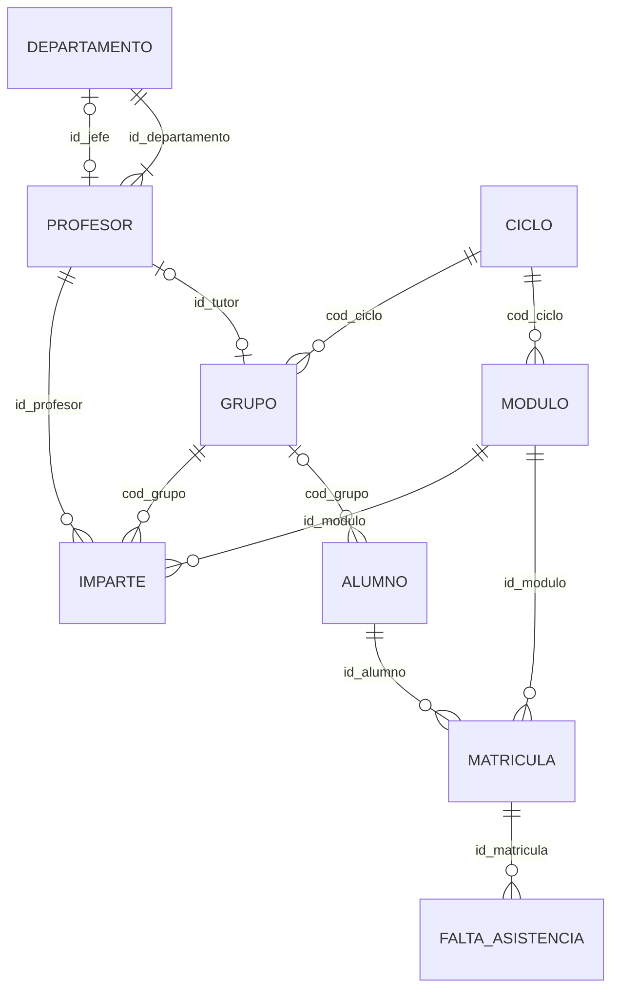

# UD03 · El modelo relacional


## Resumen del Tema

**Visión General:**
El **Modelo Relacional**, ideado por Edgar F. Codd en IBM en 1970, es el modelo de datos lógico más extendido y utilizado comercialmente en el mundo de las bases de datos. A diferencia del Modelo Entidad-Relación (EER), que es una herramienta de abstracción conceptual para representar la información del mundo real de forma independiente del software, el Modelo Relacional representa la estructura lógica de los datos mediante **relaciones (tablas)** compuestas por **tuplas (filas)** y **atributos (columnas)**.

En esta unidad se estudian minuciosamente los conceptos matemáticos y pragmáticos que sustentan el modelo relacional: la estructura formal de una tabla, el dominio y tipado de atributos, el grado y la cardinalidad, las claves (candidatas, primarias, alternativas y foráneas), la semántica de los valores nulos (`NULL`) y las reglas de integridad (inherentes y semánticas). Además, se detalla un catálogo completo de **reglas de transformación para convertir esquemas conceptuales EER en esquemas relacionales lógicos**, ilustrado con ejemplos reales, esquemas formales y tablas con datos reales.



### Temporalización

La unidad ocupa **20 horas de aula** (9 de teoría y 11 de práctica).


items:
  - {h: 2, tipo: T, t: "Relación, atributo, dominio, tupla, grado y cardinalidad. Claves", ref: "§1 y §2 · laboratorio de claves"}
  - {h: 2, tipo: T, t: "Restricciones e integridad referencial", ref: "§3 · simulador de integridad"}
  - {h: 1, tipo: P, t: "Simulador de integridad referencial", ref: "Práctica 3.2"}
  - {h: 2, tipo: T, t: "Reglas de transformación (I): entidades, débiles y atributos", ref: "§4.1 a §4.3 · transformador"}
  - {h: 2, tipo: T, t: "Reglas de transformación (II): relaciones y jerarquías. Ejemplos", ref: "§4.4 a §4.9 y §5"}
  - {h: 2, tipo: P, t: "Biblioteca: del E/R a las tablas", ref: "Práctica 3.1"}
  - {h: 1, tipo: T, t: "Restricciones no representables y herramientas", ref: "§6 y §7"}
  - {h: 1, tipo: P, t: "Tres formas de transformar una jerarquía", ref: "Práctica 3.3"}
  - {h: 2, tipo: P, t: "Modelo lógico de EduGest", ref: "§8 y proyecto EduGest-3"}
  - {h: 2, tipo: P, t: "Tareas de transformación 1 y 2 (naviera e instituto)", ref: "Tareas 1 y 2"}
  - {h: 1, tipo: P, t: "Ingeniería inversa de un esquema", ref: "Práctica 3.4"}
  - {h: 1, tipo: P, t: "Catálogo de restricciones de un hotel", ref: "Práctica 3.5"}
  - {h: 1, tipo: P, t: "Banco de ejercicios de transformación (bloque 1)", ref: "Ejercicios 1 a 5"}
autonomo:
  - "Tareas de transformación 3 a 7 (E/R → relacional)"
  - "Práctica 3.6"
  - "Banco de 20 ejercicios (bloques 2 y 3)"


> [!IMPORTANT]
> Esta unidad es el **puente** entre el diseño y la implementación: lo que decidas aquí (claves, nulos, políticas de borrado) determina la creación de las tablas en la UD05. Un error de diseño que no detectes ahora se paga después con datos incorrectos.

### Objetivos de aprendizaje

Al terminar esta unidad serás capaz de:

- Describir los elementos del modelo relacional: relación, atributo, dominio, tupla, grado y cardinalidad.
- Identificar claves candidatas, primarias, alternativas y ajenas, y la semántica del valor `NULL`.
- Aplicar las reglas de integridad de entidad, referencial y de dominio, y elegir la política de borrado adecuada.
- Transformar un diagrama E/R extendido en un esquema relacional aplicando reglas sistemáticas.
- Documentar las restricciones que el modelo lógico no puede expresar.



---


Elementos del modelo y claves

## 1. Conceptos Fundamentales del Modelo Relacional

### 1.1 Definición de Relación (Tabla)

En el Modelo Relacional, la unidad básica de almacenamiento es la **relación**, término matemático que en la práctica informática se denomina **tabla**.

Una relación se define como un subconjunto del producto cartesiano de una familia de dominios $D_1 \times D_2 \times \dots \times D_n$. Gráficamente, una relación es una estructura bidimensional formada por filas y columnas:

- **Diferencia Crucial de Términos:** En el Modelo Entidad-Relación (EER), la palabra *"Relación"* se refiere a una asociación o vínculo entre dos entidades (ej. el cliente `COMPRA` productos). En cambio, en el Modelo Relacional, la palabra *"Relación"* designa a una **tabla completa de datos**.

---

### 1.2 Atributos, Dominios, Grado y Cardinalidad

Para caracterizar matemáticamente una tabla se utilizan los siguientes conceptos:

1. **Atributo (Campo o Columna):** Representa una propiedad o característica de la entidad o relación que describe la tabla. Cada columna tiene un nombre único en la tabla y un tipo de dato especificado.
2. **Dominio:** Es el conjunto de valores atómicos que puede tomar un atributo. Lo define el tipo de dato y, si se quiere, una restricción adicional (por ejemplo, «edad entre 0 y 120»). Varios atributos distintos pueden compartir el mismo dominio (por ejemplo, `fecha_contrato` y `fecha_nacimiento` comparten el dominio `DATE`).
3. **Grado:** Es el número total de atributos (columnas) que componen la tabla. Una tabla con 5 columnas tiene un **grado de 5**.
4. **Cardinalidad:** Es el número total de tuplas (filas o registros) almacenadas en un momento determinado en la tabla. A diferencia del grado (que es fijo una vez diseñado el esquema), la cardinalidad es dinámica y varía constantemente a medida que se insertan o borran filas.

---

{}
El propio Codd propuso más tarde distinguir entre un valor **ausente pero aplicable** y otro **no aplicable**. Los gestores reales se quedaron con un único valor nulo (`NULL`), y de ahí vienen muchas sorpresas: comparar dos nulos con `=` no da «verdadero» sino «desconocido», porque no se sabe si son iguales.
{}

### 1.3 Tuplas (Filas) y Semántica de Valores Nulos (NULL)

- **Tupla (Fila, Registro u Ocurrencia):** Cada fila individual de la tabla representa una instancia concreta de la entidad o relación del mundo real. Cada tupla tiene un valor para cada atributo de la tabla; el orden de las columnas no es significativo (véase el apartado 3.1).
- **Valores Nulos (`NULL`):** Representan la **ausencia de valor**, valor desconocido o no aplicable.
  - *Diferencia Semántica Importante:* El valor `NULL` no equivale al número cero (`0`) ni a una cadena de texto vacía (`""`). Un cero en `saldo` significa que el saldo es de 0 euros; un `NULL` en `saldo` significa que se desconoce el saldo.
  - *Nota sobre Oracle:* en Oracle, el gestor que usaremos, la cadena vacía `''` se almacena como `NULL`. Es una peculiaridad de Oracle, no del modelo relacional.

---

{}
En 1985 Codd publicó una lista de 12 reglas (numeradas de la 1 a la 12, más una «regla 0») que un sistema debía cumplir para llamarse realmente relacional. Casi ningún SGBD comercial las cumple todas, pero siguen siendo el listón de referencia.
{}

## 2. Estudio Exhaustivo de Claves

Las claves constituyen el pilar fundamental para garantizar la unicidad de las filas y establecer vínculos de integridad entre tablas.



### 2.1 Clave Candidata y Clave Primaria (Primary Key - PK)

- **Clave Candidata:** Es un atributo o conjunto mínimo de atributos cuyos valores identifican de forma única e unívoca cada tupla de una relación, sin que ningún subconjunto propio de dichos atributos pueda identificarla.
- **Clave Primaria (Primary Key - PK):** Es la clave candidata elegida explícitamente por el diseñador de la base de datos como el identificador principal de las tuplas de la tabla. Por regla absoluta del modelo relacional, **ningún atributo de la clave primaria puede ser nulo (`NOT NULL`) y no puede haber dos filas con el mismo valor de clave primaria**. En una clave compuesta se compara la combinación completa: cada atributo por separado sí puede repetirse (véase el apartado 2.4).

---

### 2.2 Claves Alternativas

Cualquier clave candidata que no haya sido elegida como clave primaria pasa a ser una **clave alternativa**. En el esquema relacional, las claves alternativas se señalan con la restricción de unicidad (UK, *unique key*): impiden que dos filas repitan el mismo valor.

> [!NOTE]
> **Ejemplo:** En la tabla `CLIENTE`, si disponemos del campo `id_cliente` (autoincremental interno) y del campo `dni`, ambos son claves candidatas. Elegimos `id_cliente` como **Clave Primaria (PK)** e indicamos que `dni` es una **Clave Alternativa (UK)**.

---

### 2.3 Clave Foránea / Ajena (Foreign Key - FK)

Una **Clave Foránea (Foreign Key - FK)** es un atributo (o conjunto de atributos) en una tabla cuyos valores deben coincidir obligatoriamente con los valores de la clave primaria (o de una clave alternativa) de otra tabla (o de la misma tabla en relaciones reflexivas), o bien ser nulos si la participación es opcional.

Las claves foráneas representan las relaciones del modelo EER en el esquema relacional lógico.

---

### 2.4 Claves Primarias Compuestas

Cuando una única columna no basta para identificar de forma unívoca a una fila, la clave primaria se compone de dos o más atributos combinados.

> [!NOTE]
> **Ejemplo de Clave Compuesta:**
> En una tabla de matrícula universitaria `MATRICULA`, la clave primaria se compone de `(id_alumno, id_asignatura)`. Un alumno puede matricularse en varias asignaturas y en una asignatura hay varios alumnos, pero la combinación de un alumno concreto en una asignatura concreta es única.

> [!CAUTION]
> **Una clave no se descubre mirando los datos de hoy.** Que ningún valor se repita en la muestra no demuestra que no pueda repetirse mañana. La clave se decide por el **significado** del problema: ¿puede dos alumnos tener el mismo nombre? ¿Puede cambiar el valor con el tiempo? ¿Puede faltar?

#### Laboratorio: ¿es una clave?

Con datos reales de la tabla `ALUMNO` de EduGest, prueba qué conjuntos de columnas identifican a cada fila. Fíjate en el `NULL` de `dni` y en los apellidos repetidos.




- q: "En la muestra de arriba, `(nombre, apellidos)` no se repite. ¿Es una buena clave primaria para `ALUMNO`?"
  options: ["Sí, identifica a todas las filas", "No: dos alumnos distintos pueden llamarse igual y los nombres cambian", "Sí, siempre que se declare obligatorio", "Solo si se añade también `localidad`"]
  answer: 1
  explain: "Que no se repita **hoy** no la convierte en clave. Una clave primaria debe ser estable, no nula y única por significado. Por eso se usa `id_alumno` (artificial) y se protege el NIA con una restricción de unicidad (UK)."
- q: "`dni` contiene algún `NULL` en la muestra. ¿Qué papel puede tener esa columna?"
  options: ["Clave primaria", "Clave alternativa (UK), pero no clave primaria", "Ninguno: no puede ser clave de ningún tipo", "Clave ajena"]
  answer: 1
  explain: "Una clave primaria no admite nulos (integridad de entidad). Una clave alternativa (UK) sí admite nulos, aunque en la práctica conviene que el DNI sea obligatorio si es un dato del negocio."


---

Restricciones e integridad referencial

## 3. Restricciones del Modelo Relacional

### 3.1 Restricciones Inherentes al Modelo

Son reglas estructurales impuestas automáticamente por la propia definición matemática del modelo relacional:

1. **Unicidad de Tuplas:** No pueden existir dos tuplas idénticas en una misma relación (deben diferenciarse al menos en la clave primaria).
2. **Desorden de Tuplas:** El orden en que se almacenan las filas no es significativo. La consulta devuelve los mismos datos independientemente de cómo se dispongan en el disco.
3. **Desorden de Atributos:** El orden de las columnas no altera el significado semántico de la relación.
4. **Atomicidad de Atributos (Atributos Escalares):** Cada celda de la tabla en la intersección de una fila y una columna solo puede albergar un **único valor atómico** perteneciente al dominio (no se permiten listas ni matrices dentro de una celda).

---

### 3.2 Restricciones Semánticas o de Usuario (PK, UK, obligatoriedad, reglas de fila)

Son reglas de negocio definidas explícitamente por el diseñador de la base de datos (más adelante, en la UD05, aprenderás a declararlas en un gestor):

- **Clave primaria (PK):** identifica cada fila (garantiza unicidad y no nulidad).
- **Clave alternativa (UK):** garantiza que no haya valores duplicados (admite nulos salvo que se indique lo contrario).
- **Atributo obligatorio:** el atributo debe tener siempre un valor.
- **Regla de fila:** una condición lógica que debe cumplir cada fila por sí sola (por ejemplo, «el precio es mayor que 0» o «la edad es como mínimo 18»).

---

### 3.3 Integridad Referencial y Políticas de Borrado/Modificación

La **Integridad Referencial** exige que los valores almacenados en una clave foránea (`FK`) existan previamente en la clave primaria (`PK`) de la tabla referenciada.

Cuando se intenta eliminar o actualizar una fila en la tabla padre (la tabla que contiene la `PK`), el SGBD puede aplicar una de las siguientes 4 **políticas de integridad referencial**:

1. **En Cascada:**
   Al borrar o modificar una tupla en la tabla padre, el SGBD borra o actualiza automáticamente todas las tuplas de la tabla hija que contenían esa clave foránea.

2. **Restringido:**
   El SGBD impide y rechaza el borrado o modificación de la tupla padre mientras existan tuplas hijas que la estén referenciando.

3. **Puesta a Nulos:**
   Al borrar o actualizar la tupla padre, el SGBD establece automáticamente a `NULL` el valor de la clave foránea en todas las tuplas hijas afectadas.

4. **Puesta a Valor por Defecto:**
   Al borrar o actualizar la tupla padre, el SGBD asigna un valor por defecto previamente configurado a la clave foránea en las tuplas hijas.

---

> [!WARNING]
> **No todos los gestores ofrecen todas las políticas.** Casi todos permiten el borrado en cascada y la puesta a nulos, pero muchos no permiten propagar el cambio de una clave primaria. Por eso conviene diseñar claves primarias **estables**. Oracle, por ejemplo, solo ofrece `ON DELETE CASCADE` y `ON DELETE SET NULL` (o rechazar): no tiene `ON UPDATE` ni puesta a valor por defecto. En la UD05 comprobarás qué ofrece el gestor que usaremos.

> [!TIP]
> **¿Qué política elijo?** Hazte esta pregunta sobre la fila hija: *¿tiene sentido que siga existiendo sin la fila padre?*
> - **No** (una matrícula sin alumno) → `CASCADE`.
> - **Sí, pero hay que revisarla** (un alumno cuyo grupo desaparece) → `SET NULL`, con la columna opcional.
> - **No debe pasar nunca por accidente** (un departamento con empleados) → rechazar (la opción más prudente).

#### Laboratorio: simulador de integridad referencial

Cambia la política de la clave ajena, intenta borrar, cambiar y insertar filas, y lee los mensajes que explican por qué se rechaza cada operación. Después, repite el experimento haciendo el atributo obligatorio.




- q: "La FK `matricula.id_alumno` debe eliminar la matrícula cuando se borra el alumno. ¿Qué política declaras?"
  options: ["Restringido", "Borrado en cascada", "Puesta a nulos", "Puesta a valor por defecto"]
  answer: 1
  explain: "La matrícula carece de sentido sin su alumno: se borra en cascada. La puesta a nulos dejaría matrículas sin alumno y el borrado restringido impediría eliminar al alumno."
- q: "En el simulador, ¿por qué la puesta a nulos falla si `cod_grupo` es obligatorio?"
  options: ["Porque ningún gestor admite la puesta a nulos", "Porque la política exige poner NULL en una columna que no lo admite", "Porque el grupo no existe", "Porque falta confirmar los cambios"]
  answer: 1
  explain: "Puesta a nulos y obligatoriedad se contradicen: el SGBD no puede cumplir las dos reglas a la vez. Hay que elegir entre una política o la otra."


---

Simulador de integridad referencial

La práctica 3.2 se hace en la [página de prácticas](/ud03-modelo-relacional/ud03-practicas), con lápiz y papel, y se implementará en la UD05.

---

Reglas de transformación (I)

## 4. Reglas de Transformación del Modelo EER al Modelo Relacional

Para transformar de forma metódica un diagrama EER conceptual a un esquema relacional lógico, se aplican las reglas de este apartado. Cada regla se acompaña de **un ejemplo completo**, con la misma estructura que verás en todas:

1. el **diagrama de Chen** de partida;
2. el **esquema relacional** resultante, escrito con la notación de las prácticas (PK, FK, UK, VNN);
3. el **patrón general** con entidades abstractas `A`, `B`, `C` y atributos `a0`, `a1`, `b0`… (`a0` es siempre el identificador de `A`);
4. unas **filas de ejemplo** para comprobar que las restricciones hacen lo que deben.

> [!NOTE]
> **Notación del esquema.** Cada tabla se escribe con sus columnas y, debajo, sus restricciones:
> **PK** = clave primaria · **FK** = clave ajena (`columna → TABLA`) · **UK** = clave alternativa (*unique*) · **VNN** = valor no nulo (obligatorio).
> Es la misma notación de las [tareas de transformación](/ud03-modelo-relacional/ud03-practicas#tareas-de-transformación-del-er-al-modelo-relacional).

---

### 4.1 Transformación de Entidades Fuertes

- **Regla:** Cada entidad fuerte del diagrama EER se convierte en una **tabla (relación)** independiente.
  - Los atributos simples de la entidad pasan a ser **columnas** de la tabla.
  - El atributo identificador principal de la entidad pasa a ser la **Clave Primaria (PK)** de la tabla.
  - Los identificadores candidatos (claves alternativas) pasan a ser **UK**. Como identifican, además llevan **VNN**.

#### Ejemplo 4.1 · La entidad ALUMNO

En el centro, cada alumno tiene un NIA (número de identificación del alumnado) que asigna la Conselleria. También tiene DNI, que no se repite, pero se elige el NIA como identificador principal.




{}
```text
ALUMNO (nia, dni, nombre, fecha_nac)
   PK:  nia
   UK:  dni
   VNN: dni
```
- `nia` es la **PK**: no se repite y no puede ser nula.
- `dni` es **UK** porque también identifica, y **VNN** porque una clave candidata sin valor no identificaría a nadie.
- `nombre` y `fecha_nac` son columnas normales. Si el enunciado dijera que son obligatorias, llevarían también VNN.
{}
{}
```text
Diagrama:   A (a0 identificador, a1, a2, a3 clave alternativa)

A (a0, a1, a2, a3)
   PK:  a0
   UK:  a3
   VNN: a3
```
{}
{}
| nia (PK) | dni (UK) | nombre | fecha_nac |
|---|---|---|---|
| 10234567 | 48123456P | Paula Ortiz | 2006-03-14 |
| 10234568 | 21456789K | Izan Pastor | 2005-11-02 |
| 10234569 | 74222333B | Lucía Sempere | 2006-07-29 |

Una cuarta fila con el DNI `48123456P` sería rechazada por la **UK**, aunque su NIA fuese distinto.
{}


---

### 4.2 Transformación de Entidades Débiles (por Identificación y Existencia)

- **Regla:** Una entidad débil se convierte en una **tabla independiente**.
  - **Débil por Identificación (ID):** La clave primaria de la tabla resultante es una **clave compuesta** formada por la clave primaria de la entidad fuerte propietaria (que se propaga como `FK`) combinada con el discriminador parcial de la entidad débil.
  - **Débil por Existencia (E):** Si la entidad débil posee su propio identificador único, este es su PK. La clave primaria de la entidad fuerte se propaga como **FK obligatoria (VNN)**. Es el caso habitual de una relación 1:N con participación obligatoria, que se ve con más detalle en el apartado 4.4.

#### Ejemplo 4.2-a · Débil por identificación: EDIFICIO y AULA

Las aulas se numeran **dentro de cada edificio**: el edificio A tiene un aula 1 y el edificio B también. El número de aula, por sí solo, no identifica: es un **discriminador** (subrayado discontinuo).




{}
```text
EDIFICIO (cod_edificio, nombre)
   PK:  cod_edificio

AULA (cod_edificio, num_aula, capacidad)
   PK:  (cod_edificio, num_aula)
   FK:  cod_edificio → EDIFICIO
```
- La relación `tiene` **no genera tabla**: queda absorbida en `AULA`.
- `cod_edificio` es a la vez **parte de la PK** y **FK**. Como forma parte de la PK, ya es obligatoria: no hace falta escribir VNN.
{}
{}
```text
Diagrama:   A (débil, discriminador a0) ──ID── B (b0)
            Restricción de identidad

A (a0, a1, aB)
   PK:  (a0, aB)
   FK:  aB → B

B (b0, b1)
   PK:  b0
```
{}
{}
**EDIFICIO**

| cod_edificio (PK) | nombre |
|---|---|
| A | Edificio principal |
| B | Talleres |

**AULA**

| cod_edificio (PK, FK) | num_aula (PK) | capacidad |
|---|---|---|
| A | 1 | 30 |
| A | 2 | 24 |
| B | 1 | 20 |

El valor `1` de `num_aula` se repite, pero la pareja `(A, 1)` no. Insertar `(C, 3)` fallaría: el edificio `C` no existe (**FK**).
{}


#### Ejemplo 4.2-b · Débil por existencia: CLIENTE y PEDIDO

Un pedido tiene su propio número, que no se repite nunca, pero **no puede existir sin el cliente** que lo realiza (marca **E**).




{}
```text
CLIENTE (cod_cliente, nombre)
   PK:  cod_cliente

PEDIDO (num_pedido, fecha, cod_cliente)
   PK:  num_pedido
   FK:  cod_cliente → CLIENTE
   VNN: cod_cliente
```
- La PK de `PEDIDO` es solo `num_pedido`: no necesita al cliente para identificarse.
- La dependencia en existencia se traduce en **VNN** sobre la FK: no hay pedidos «huérfanos».
- Al borrar un cliente, la política habitual es **en cascada** (se borran sus pedidos) o **restringida** (no se deja borrar). Se decide en la UD05.
{}
{}
```text
Diagrama:   A (a0, a1) ──E── R ── B (b0, b1)     (A depende de B)

A (a0, a1, aB)
   PK:  a0
   FK:  aB → B
   VNN: aB
```
{}
{}
| num_pedido (PK) | fecha | cod_cliente (FK, VNN) |
|---|---|---|
| 5001 | 2026-10-04 | C01 |
| 5002 | 2026-10-04 | C02 |
| 5003 | 2026-10-05 | C01 |

Insertar `(5004, 2026-10-06, NULL)` fallaría por el **VNN**.
{}


> [!TIP]
> **¿ID o E?** Pregúntate: *¿el identificador de la entidad débil se repite entre propietarios distintos?* Si se repite (aula 1 del edificio A, aula 1 del edificio B), es por **identificación** y la PK es compuesta. Si no se repite (el pedido 5001 es único en toda la empresa), es por **existencia** y basta con una FK obligatoria.

---

### 4.3 Transformación de Atributos Compuestos y Multivaluados

Estas son las **reglas preparatorias**: se aplican antes que las demás y se basan en la primera forma normal (UD04), que exige que cada columna guarde **un único valor atómico**.

1. **Atributos Compuestos:** Se eliminan desplegando cada uno de sus sub-atributos simples como columnas individuales de la propia tabla. El atributo compuesto «padre» desaparece.
2. **Atributos Multivaluados ($N$):** Se crea una **nueva tabla independiente** para albergar el atributo multivaluado. La clave primaria de esta nueva tabla será la combinación de la clave primaria de la entidad originaria y el propio atributo multivaluado.

#### Ejemplo 4.3 · PERSONA con dirección y varios teléfonos




{}
```text
PERSONA (dni, nombre, calle, numero, ciudad)
   PK:  dni

TELEFONO (dni, telefono)
   PK:  (dni, telefono)
   FK:  dni → PERSONA
```
- `direccion` no aparece como columna: se sustituye por `calle`, `numero` y `ciudad`.
- `telefono` sale de `PERSONA`. Si se dejara dentro, habría que guardar «600111222, 965000000» en una sola celda, o crear columnas `telefono1`, `telefono2`… sin saber cuántas hacen falta.
{}
{}
```text
Diagrama:   A (a0, a1, a2 multivaluado (n), a3)

A (a0, a1, a3)
   PK:  a0

A2 (a0, a2)
   PK:  (a0, a2)
   FK:  a0 → A
```
{}
{}
**PERSONA**

| dni (PK) | nombre | calle | numero | ciudad |
|---|---|---|---|---|
| 48123456P | Paula Ortiz | Lillo Juan | 128 | Sant Vicent del Raspeig |
| 21456789K | Izan Pastor | Alfonso X | 12 | Alicante |

**TELEFONO**

| dni (PK, FK) | telefono (PK) |
|---|---|
| 48123456P | 600111222 |
| 48123456P | 965000000 |
| 21456789K | 611222333 |

Paula tiene dos teléfonos: dos filas. Repetir `(48123456P, 600111222)` violaría la **PK**.
{}


> [!NOTE]
> **Excepción:** si el valor multivaluado no puede repetirse entre entidades distintas (por ejemplo, un correo corporativo que solo pertenece a una persona), el propio valor basta como PK: `CORREO (email, dni)` con PK: `email`, FK: `dni → PERSONA`, VNN: `dni`.

> [!WARNING]
> **Pérdida semántica.** Si el diagrama exige un mínimo de 1 («toda persona tiene al menos un teléfono»), las tablas no pueden garantizarlo: se puede insertar una persona sin ninguna fila en `TELEFONO`. Hay que anotarlo (apartado 6).

#### Laboratorio: del E/R a las tablas

Este transformador aplica las reglas del apartado 4 y produce el esquema relacional formal. Empieza por los casos de esta sesión (débil, multivaluado) y vuelve a él en la siguiente.



---

Reglas de transformación (II): relaciones y jerarquías

### 4.4 Transformación de Relaciones Binarias 1:N

- **Regla (Propagación de Clave):** No se crea una nueva tabla. Se toma la clave primaria de la entidad del lado "1" y se **propaga como clave foránea (`FK`)** a la tabla resultante de la entidad del lado "N".
- Si la relación contenía atributos descriptores propios, estos se trasladan también como columnas a la tabla del lado "N".
- Si la participación del lado "N" es obligatoria (cardinalidad mínima 1), la FK debe ser obligatoria (**VNN**).
- Si la clave del lado "1" es **compuesta**, la FK también es compuesta: viajan **todas** sus columnas juntas.

> [!TIP]
> **Truco para no equivocarse:** la clave viaja **hacia el lado N**. Piensa en una fila del lado N: un empleado tiene **un** departamento, así que cabe en una columna. Un departamento tiene **muchos** empleados, que no caben en una columna.

#### Ejemplo 4.4-a · Participación opcional: EMPLEADO y DEPARTAMENTO (0,1)

Cada empleado trabaja en **como mucho** un departamento (puede haber empleados recién contratados sin asignar). Un departamento tiene muchos empleados. La relación guarda la fecha de alta.




{}
```text
DEPARTAMENTO (cod_dep, nombre)
   PK:  cod_dep

EMPLEADO (dni, nombre, cod_dep, fecha_alta)
   PK:  dni
   FK:  cod_dep → DEPARTAMENTO
```
- `cod_dep` viaja a `EMPLEADO` (lado N) como **FK**.
- `fecha_alta`, atributo de la relación, viaja con ella.
- Sin VNN: el mínimo junto a DEPARTAMENTO es 0, así que `cod_dep` admite nulos.
{}
{}
```text
Diagrama:   A (a0, a1) ──N── R ──1── B (b0, b1)

A (a0, a1, aB)
   PK:  a0
   FK:  aB → B

B (b0, b1)
   PK:  b0
```
{}
{}
**DEPARTAMENTO**

| cod_dep (PK) | nombre |
|---|---|
| INF | Informática |
| ADM | Administración |

**EMPLEADO**

| dni (PK) | nombre | cod_dep (FK) | fecha_alta |
|---|---|---|---|
| 11111111H | Marta Lloret | INF | 2020-09-01 |
| 22222222J | Andrés Gil | INF | 2023-09-01 |
| 33333333P | Sara Vidal | `NULL` | `NULL` |

Sara aún no tiene departamento: la FK es nula y es válido.
{}


#### Ejemplo 4.4-b · Participación obligatoria: (1,1)

Si el enunciado dice que **todo empleado pertenece obligatoriamente a un departamento**, el mínimo junto a DEPARTAMENTO pasa a ser 1.




{}
```text
DEPARTAMENTO (cod_dep, nombre)
   PK:  cod_dep

EMPLEADO (dni, nombre, cod_dep, fecha_alta)
   PK:  dni
   FK:  cod_dep → DEPARTAMENTO
   VNN: cod_dep
```
La única diferencia con 4.4-a es el **VNN**: ahora la fila de Sara con `cod_dep` nulo sería rechazada.
{}
{}
```text
Diagrama:   A (a0, a1) ──E── R ── B (b0, b1)     (mínimo 1 junto a B)

A (a0, a1, aB)
   PK:  a0
   FK:  aB → B
   VNN: aB
```
{}


> [!WARNING]
> **Pérdida semántica.** Junto a EMPLEADO pone **(1,N)**: todo departamento tiene **al menos un** empleado. Eso **no se puede** garantizar con claves: nada impide insertar un departamento sin empleados. Es el caso de la figura del PDF en el que la marca **E** está en el lado 1. Se anota como restricción no representable y se controla en la implementación (UD08).

#### Ejemplo 4.4-c · Clave ajena compuesta: SESION y AULA

Ahora el lado 1 es `AULA`, cuya clave es **compuesta** `(cod_edificio, num_aula)` (ejemplo 4.2-a). Cada sesión de clase se imparte en un aula.




{}
```text
SESION (id_sesion, dia, hora, cod_edificio, num_aula)
   PK:  id_sesion
   FK:  (cod_edificio, num_aula) → AULA
   VNN: cod_edificio, num_aula
```
{}
{}
```text
Diagrama:   A (a0, a1) ──N── R ──1── B (b0, b1)      con PK de B = (b0, b1)

A (a0, a1, aB0, aB1)
   PK:  a0
   FK:  (aB0, aB1) → B
```
{}
{}
| id_sesion (PK) | dia | hora | cod_edificio (FK) | num_aula (FK) |
|---|---|---|---|---|
| 1 | L | 08:00 | A | 1 |
| 2 | L | 09:00 | B | 1 |
| 3 | M | 08:00 | A | 2 |

`(B, 2)` no existe en `AULA` (ver 4.2-a): una sesión en esa aula sería rechazada.
{}


> [!CAUTION]
> **Error frecuente:** escribir dos FK separadas, `cod_edificio → EDIFICIO` y `num_aula → AULA`. Con dos FK separadas se aceptaría la pareja `(B, 2)`, porque el edificio B existe y existe *algún* aula 2. Una clave ajena apunta **siempre a la PK completa** de la tabla referenciada: si la PK es simple, la FK es simple; si es compuesta, la FK es compuesta.

---

### 4.5 Transformación de Relaciones Binarias N:M

- **Regla (Tabla Intermedia):** Se crea obligatoriamente una **nueva tabla de relación**.
  - La clave primaria de esta nueva tabla es una **clave compuesta** formada por la unión de las claves primarias de ambas entidades participantes (doble propagación de clave).
  - Cada una de estas claves funciona por separado como clave foránea (`FK`) hacia su tabla correspondiente.
  - Los atributos propios de la relación $N:M$ se incorporan como columnas de esta nueva tabla.

#### Ejemplo 4.5 · ALUMNO cursa MODULO



{}
{}
Un alumno cursa muchos módulos y un módulo tiene muchos alumnos: relación **N:M** con el atributo `nota`.
{}
{}
`ALUMNO(nia PK, nombre)` y `MODULO(cod_modulo PK, nombre)`. Cada entidad fuerte se convierte en una tabla con su clave.
{}
{}
No se puede poner una FK en ninguna de las dos tablas sin repetir filas (un alumno tendría que guardar varios módulos en una celda), así que se crea una **tabla intermedia** `CURSA`.
{}
{}
Las dos claves ajenas forman juntas la PK compuesta `(nia, cod_modulo)`. Así un alumno no cursa dos veces el mismo módulo.
{}
{}
`nota` va en `CURSA`: depende de la pareja alumno-módulo, no de uno solo.
{}
{}
`CURSA(nia PK,FK → ALUMNO · cod_modulo PK,FK → MODULO · nota)`
{}
{}


{}
```text
ALUMNO (nia, nombre)
   PK:  nia

MODULO (cod_modulo, nombre)
   PK:  cod_modulo

CURSA (nia, cod_modulo, nota)
   PK:  (nia, cod_modulo)
   FK:  nia        → ALUMNO
   FK:  cod_modulo → MODULO
```
{}
{}
```text
Diagrama:   A (a0, a1) ──N── R (r1) ──M── B (b0, b1)

A (a0, a1)          B (b0, b1)
   PK:  a0             PK:  b0

R (rA, rB, r1)
   PK:  (rA, rB)
   FK:  rA → A
   FK:  rB → B
```
{}
{}
**ALUMNO**

| nia (PK) | nombre |
|---|---|
| 10234567 | Paula Ortiz |
| 10234568 | Izan Pastor |

**MODULO**

| cod_modulo (PK) | nombre |
|---|---|
| 0484 | Bases de datos |
| 0485 | Programación |

**CURSA**

| nia (PK, FK) | cod_modulo (PK, FK) | nota |
|---|---|---|
| 10234567 | 0484 | 8,5 |
| 10234567 | 0485 | 7 |
| 10234568 | 0484 | 6,25 |

Cada valor de `nia` y de `cod_modulo` se repite, pero ninguna **pareja** se repite.
{}


> [!NOTE]
> **¿Y si la pareja puede repetirse?** Si un alumno puede cursar el mismo módulo en varias convocatorias y se quiere guardar cada nota, la pareja `(nia, cod_modulo)` ya no basta: se añade a la PK el atributo que distingue las repeticiones, `CURSA (nia, cod_modulo, convocatoria, nota)` con PK: `(nia, cod_modulo, convocatoria)`.

> [!WARNING]
> **Pérdida semántica.** El (1,N) junto a MODULO dice que **todo alumno cursa al menos un módulo**. La tabla `CURSA` no puede obligar a que cada alumno tenga una fila: se anota.

---

### 4.6 Transformación de Relaciones Binarias 1:1

Existen 3 alternativas según las cardinalidades mínimas de participación:

1. **Participación opcional en ambos lados (0,1)-(0,1):** hay dos soluciones válidas. La más simple propaga la clave de una entidad a la tabla de la otra como FK con restricción de unicidad (UK) que **admite nulos** (es la que usa EduGest para la tutoría). Si se quieren evitar los nulos, se crea una tabla intermedia con la clave de una entidad como PK y la de la otra como UK obligatoria.
2. **Participación obligatoria en un lado y opcional en el otro (0,1)-(1,1):** la clave ajena se coloca en la tabla de la entidad cuya participación es **obligatoria**, referenciando a la otra, como FK obligatoria y única (UK + VNN). Así no necesita admitir nulos.
3. **Participación obligatoria en ambos lados (1,1)-(1,1):** ambas entidades pueden unificarse en una **única tabla** que agrupa todos los atributos, siempre que describan de verdad el mismo objeto.

> [!NOTE]
> En el transformador interactivo, la regla 2 se refleja así: si «cada A debe tener un B» (mínimo 1) y no al revés, la clave ajena está en A.

#### Ejemplo 4.6-a · (0,1)-(0,1): EMPLEADO usa TAQUILLA

Un empleado puede tener una taquilla o ninguna, y una taquilla puede estar libre.




{}
```text
EMPLEADO (dni, nombre)            TAQUILLA (num_taquilla, planta)
   PK:  dni                          PK:  num_taquilla

USA (num_taquilla, dni, fecha_entrega)
   PK:  num_taquilla
   UK:  dni
   FK:  num_taquilla → TAQUILLA
   FK:  dni          → EMPLEADO
   VNN: dni
```
- **PK** en `num_taquilla`: una taquilla aparece una vez como mucho.
- **UK** en `dni`: un empleado aparece una vez como mucho. Así se garantiza el «1» de los dos lados.
- No hay nulos: si una taquilla está libre, simplemente no tiene fila en `USA`.
{}
{}
```text
EMPLEADO (dni, nombre)
   PK:  dni

TAQUILLA (num_taquilla, planta, dni, fecha_entrega)
   PK:  num_taquilla
   UK:  dni
   FK:  dni → EMPLEADO
```
Menos tablas, pero `dni` y `fecha_entrega` quedan a `NULL` en las taquillas libres.

> **Nota:** en Oracle, una UK de una sola columna admite varias filas con `NULL`, porque `NULL` no se considera igual a `NULL`.
{}
{}
```text
Diagrama:   A (a0, a1) ─(0,1)─ R ─(0,1)─ B (b0, b1)

A (a0, a1)          B (b0, b1)
   PK:  a0             PK:  b0

R (rA, rB)
   PK:  rA
   UK:  rB
   FK:  rA → A
   FK:  rB → B
   VNN: rB
```
{}


#### Ejemplo 4.6-b · (0,1)-(1,1): PERSONA posee PASAPORTE

Todo pasaporte pertenece a una persona; no toda persona tiene pasaporte.




{}
```text
PERSONA (dni, nombre)
   PK:  dni

PASAPORTE (num_pasaporte, caducidad, dni)
   PK:  num_pasaporte
   UK:  dni
   FK:  dni → PERSONA
   VNN: dni
```
- La FK va en `PASAPORTE`, la entidad que participa **obligatoriamente**: así nunca es nula.
- La **UK** convierte la FK en «1:1»: sin ella, una persona podría tener varios pasaportes (sería una 1:N).
{}
{}
```text
Diagrama:   A (a0, a1) ──E── R ── B (b0, b1)     (A obligatoria, B opcional)

A (a0, a1, aB)
   PK:  a0
   UK:  aB
   FK:  aB → B
   VNN: aB

B (b0, b1)
   PK:  b0
```
{}
{}
| num_pasaporte (PK) | caducidad | dni (UK, FK, VNN) |
|---|---|---|
| PAA123456 | 2031-05-10 | 48123456P |
| PAB654321 | 2029-01-22 | 21456789K |

Un segundo pasaporte para `48123456P` sería rechazado por la **UK**. Si la FK se hubiera puesto en `PERSONA`, las personas sin pasaporte tendrían esa columna a `NULL`.
{}


#### Ejemplo 4.6-c · (1,1)-(1,1): PAIS tiene CAPITAL

Todo país tiene exactamente una capital y toda capital lo es de exactamente un país.




{}
```text
PAIS (cod_pais, nombre, cod_ciudad, habitantes)
   PK:  cod_pais
   UK:  cod_ciudad
   VNN: cod_ciudad
```
Las dos entidades se fusionan en una única tabla. La clave de la otra entidad pasa a ser **UK**.
{}
{}
```text
Diagrama:   A (a0, a1) ──E── R ──E── B (b0, b1)

R (a0, a1, b0, b1)
   PK:  a0
   UK:  b0
   VNN: b0
```
{}


> [!IMPORTANT]
> Fusionar solo tiene sentido si las dos entidades **no participan en otras relaciones** que obliguen a tenerlas separadas. Si `CAPITAL` se relacionara además con `MUSEO`, conviene mantener dos tablas y aplicar la regla 2 (FK con UK y VNN).

---

### 4.7 Transformación de Relaciones Reflexivas / Recursivas

Las relaciones reflexivas se transforman **con los mismos patrones** que las binarias, pero la entidad aparece en los dos extremos. Como la clave tiene que aparecer **dos veces**, se renombra cada copia según su **rol** (`jefe`, `subordinado`…). Las dos copias son FK hacia la **misma** tabla.

1. **Reflexiva 1:N:** Se añade una columna de clave foránea (`FK`) en la propia tabla que **apunta a la clave primaria de la misma tabla** (autorreferencia).
2. **Reflexiva 1:1:** Igual que una 1:1 binaria: una FK con **UK** en la propia tabla, o una tabla nueva con PK en un rol y UK en el otro.
3. **Reflexiva N:M:** Se crea una **tabla intermedia** cuya clave primaria se compone de dos columnas que hacen clave foránea hacia la clave primaria de la propia tabla (representando el rol origen y el rol destino).

#### Ejemplo 4.7-a · Reflexiva 1:N: EMPLEADO dirige EMPLEADO




{}
```text
EMPLEADO (dni, nombre, dni_jefe)
   PK:  dni
   FK:  dni_jefe → EMPLEADO
```
`dni_jefe` contiene un DNI que tiene que existir **en la misma tabla**. Admite nulos: el director general no tiene jefe.
{}
{}
```text
A (a0, a1, rA)
   PK:  a0
   FK:  rA → A
```
{}
{}
| dni (PK) | nombre | dni_jefe (FK → EMPLEADO) |
|---|---|---|
| 11111111H | Marta Lloret | `NULL` |
| 22222222J | Andrés Gil | 11111111H |
| 33333333P | Sara Vidal | 11111111H |
| 44444444A | Nerea Soler | 22222222J |

Marta dirige a Andrés y a Sara; Andrés dirige a Nerea. Es un **árbol** guardado en una sola tabla.
{}


#### Ejemplo 4.7-b · Reflexiva 1:1: ALUMNO mentoriza ALUMNO

En el programa de mentoría, un alumno de segundo mentoriza como mucho a uno de primero, y cada alumno de primero tiene como mucho un mentor.




{}
```text
ALUMNO (nia, nombre)
   PK:  nia

MENTORIA (nia_mentorizado, nia_mentor)
   PK:  nia_mentorizado
   UK:  nia_mentor
   FK:  nia_mentorizado → ALUMNO
   FK:  nia_mentor      → ALUMNO
   VNN: nia_mentor
```
También sería válido poner `nia_mentor` en `ALUMNO` como FK con **UK** (admitiendo nulos), como en la opción 2 del ejemplo 4.6-a.
{}
{}
```text
A (a0)
   PK:  a0

R (rA1, rA2)
   PK:  rA1
   UK:  rA2
   FK:  rA1 → A
   FK:  rA2 → A
```
`rA2` representa el mismo tipo de valor que `rA1`: hay que duplicarlo para poder relacionar la entidad consigo misma.
{}


#### Ejemplo 4.7-c · Reflexiva N:M: MODULO requiere MODULO

Un módulo puede tener varios módulos previos recomendados, y un módulo puede ser previo de varios.




{}
```text
MODULO (cod_modulo, nombre)
   PK:  cod_modulo

REQUIERE (cod_modulo, cod_modulo_previo)
   PK:  (cod_modulo, cod_modulo_previo)
   FK:  cod_modulo        → MODULO
   FK:  cod_modulo_previo → MODULO
```
{}
{}
```text
A (a0)
   PK:  a0

R (rA1, rA2)
   PK:  (rA1, rA2)
   FK:  rA1 → A
   FK:  rA2 → A
```
{}
{}
| cod_modulo (PK, FK) | cod_modulo_previo (PK, FK) |
|---|---|
| 0486 Acceso a datos | 0484 Bases de datos |
| 0486 Acceso a datos | 0485 Programación |
| 0489 Prog. multimedia y disp. móviles | 0485 Programación |

`0486` tiene dos previos y `0485` es previo de dos módulos.
{}


> [!WARNING]
> Las claves no impiden la fila `(0484, 0484)` (un módulo previo de sí mismo). Se evita con una **regla de fila** (`cod_modulo <> cod_modulo_previo`, UD05). Los **ciclos** (A requiere B y B requiere A) no se pueden evitar con restricciones de una fila: es una pérdida semántica.

---

### 4.8 Transformación de Relaciones Ternarias

Una ternaria **siempre** genera una tabla nueva con las tres claves propagadas (cada una es FK). Lo que cambia según las cardinalidades es **cuál es la PK**:

- **Ternaria N:N:N:** la `PK` es la combinación de las **tres** claves.
- **Ternaria 1:N:N:** la `PK` son las claves de los **dos lados N**. La del lado 1 lleva VNN.
- **Ternaria 1:1:N:** la `PK` es la clave del lado N más **una** de las de lado 1. La otra combinación (lado N + el otro lado 1) es **UK**.
- **Ternaria 1:1:1:** la `PK` son dos claves cualesquiera; las otras dos combinaciones son **UK**.

> [!TIP]
> Recuerda el convenio de la UD02: en una ternaria, el par junto a una entidad cuenta **cuántas instancias de ella corresponden a cada pareja de las otras dos**. Si junto a PROFESOR pone (1,1), cada pareja (módulo, grupo) tiene **un solo** profesor: por eso la pareja (módulo, grupo) es la que identifica la fila.

#### Ejemplo 4.8-a · N:N:N: PROFESOR imparte MODULO a GRUPO

Un mismo módulo en un mismo grupo puede repartirse entre varios profesores (por ejemplo, con desdobles), y se guardan las horas de cada uno.




{}
```text
IMPARTE (dni, cod_modulo, cod_grupo, horas)
   PK:  (dni, cod_modulo, cod_grupo)
   FK:  dni        → PROFESOR
   FK:  cod_modulo → MODULO
   FK:  cod_grupo  → GRUPO
```
(Más las tablas `PROFESOR`, `MODULO` y `GRUPO`, que salen de las entidades.)
{}
{}
```text
A (a0, a1)   PK: a0
B (b0, b1)   PK: b0
C (c0, c1)   PK: c0

R (a0, b0, c0)
   PK:  (a0, b0, c0)
   FK:  a0 → A
   FK:  b0 → B
   FK:  c0 → C
```
{}
{}
| dni (PK, FK) | cod_modulo (PK, FK) | cod_grupo (PK, FK) | horas |
|---|---|---|---|
| 11111111H | 0484 | 1DAW | 3 |
| 22222222J | 0484 | 1DAW | 2 |
| 11111111H | 0484 | 1DAM | 5 |

Dos profesores comparten 0484 en 1DAW: es válido porque la PK incluye al profesor.
{}


#### Ejemplo 4.8-b · 1:N:N: un solo profesor por módulo y grupo

Si el centro decide que cada módulo de cada grupo lo imparte **un único** profesor, junto a PROFESOR pone (1,1).




{}
```text
IMPARTE (cod_modulo, cod_grupo, dni, horas)
   PK:  (cod_modulo, cod_grupo)
   FK:  dni        → PROFESOR
   FK:  cod_modulo → MODULO
   FK:  cod_grupo  → GRUPO
   VNN: dni
```
`dni` ya no forma parte de la PK: con la pareja (módulo, grupo) basta para saber quién lo imparte.
{}
{}
```text
Diagrama:   A con cardinalidad 1; B y C con cardinalidad N

R (a0, b0, c0)
   PK:  (b0, c0)
   FK:  a0 → A
   FK:  b0 → B
   FK:  c0 → C
   VNN: a0
```
{}
{}
| cod_modulo (PK, FK) | cod_grupo (PK, FK) | dni (FK, VNN) | horas |
|---|---|---|---|
| 0484 | 1DAW | 11111111H | 5 |
| 0484 | 1DAM | 11111111H | 5 |
| 0485 | 1DAW | 22222222J | 8 |

La fila `(0484, 1DAW, 22222222J, 2)` sería rechazada: ya hay un profesor para esa pareja.
{}


#### Ejemplo 4.8-c · 1:1:N: FRANJA, AULA y GRUPO

En el horario, en una franja horaria, un grupo está en **un** aula y un aula alberga **un** grupo. Una misma pareja aula-grupo se repite en muchas franjas.




{}
```text
OCUPA (cod_franja, cod_aula, cod_grupo)
   PK:  (cod_franja, cod_aula)
   UK:  (cod_franja, cod_grupo)
   FK:  cod_franja → FRANJA
   FK:  cod_aula   → AULA
   FK:  cod_grupo  → GRUPO
   VNN: cod_grupo
```
- La **PK** `(cod_franja, cod_aula)` impide meter dos grupos en la misma aula a la vez.
- La **UK** `(cod_franja, cod_grupo)` impide que un grupo esté en dos aulas a la vez.
- Se podría haber elegido al revés (PK con el grupo y UK con el aula): las dos combinaciones son claves candidatas.
{}
{}
```text
Diagrama:   A y B con cardinalidad 1; C con cardinalidad N

R (a0, b0, c0)
   PK:  (a0, c0)
   UK:  (b0, c0)
   FK:  a0 → A
   FK:  b0 → B
   FK:  c0 → C
   VNN: b0
```
{}
{}
| cod_franja (PK, FK) | cod_aula (PK, FK) | cod_grupo (UK, FK) |
|---|---|---|
| L1 | A-1 | 1DAW |
| L1 | A-2 | 1DAM |
| L2 | A-1 | 1DAW |

- `(L1, A-1, 2ASIR)` → rechazada por la **PK**: el aula A-1 ya está ocupada en L1.
- `(L1, B-1, 1DAW)` → rechazada por la **UK**: 1DAW ya está en otra aula en L1.
{}


#### Ternaria 1:1:1 (patrón general)

Es poco frecuente. Cada pareja de entidades determina la tercera, así que **cualquier pareja** sirve de clave:

```text
R (a0, b0, c0)
   PK:  (a0, b0)
   UK:  (a0, c0)
   UK:  (b0, c0)
   FK:  a0 → A
   FK:  b0 → B
   FK:  c0 → C
```

---

### 4.9 Transformación de Jerarquías de Generalización / Especialización

Existen 3 estrategias relacionales para transformar jerarquías EER:

1. **Opción A (Tabla Única para toda la Jerarquía):** Se crea una sola tabla con todos los atributos del supertipo y de los subtipos, añadiendo una columna discriminadora de tipo (`tipo_subtipo`). Válida para especializaciones disjuntas; en una solapada hace falta un indicador por subtipo.
2. **Opción B (Tablas para el Supertipo y cada Subtipo):** Se crea una tabla para el supertipo (con la `PK` principal) y una tabla por cada subtipo (cuya `PK` y `FK` es la clave del supertipo). Es la solución más limpia y flexible, y la que se usa por defecto.
3. **Opción C (Tablas únicamente para los Subtipos):** Solo se crean tablas para las entidades especializadas, duplicando los atributos del supertipo en cada una. Solo válida si la jerarquía es Total y Disjunta $(T,D)$.

#### Ejemplo 4.9 · Especialización de EMPLEADO (parcial y solapada)

En el centro hay profesores y personal administrativo. Hay empleados que no son ni lo uno ni lo otro (conserjes: **parcial**) y algún profesor que también hace tareas administrativas (**solapada**, marca `o`).




{}
```text
EMPLEADO (dni, nombre, sueldo)
   PK:  dni

PROFESOR (dni, especialidad)
   PK:  dni
   FK:  dni → EMPLEADO

ADMINISTRATIVO (dni, puesto)
   PK:  dni
   FK:  dni → EMPLEADO
```
La misma columna `dni` es **PK y FK** en cada subtipo: cada fila de `PROFESOR` «es» un empleado.
{}
{}
```text
EMPLEADO (dni, nombre, sueldo, es_profesor, especialidad,
          es_administrativo, puesto)
   PK:  dni
   VNN: es_profesor, es_administrativo
```
Al ser **solapada**, no basta con una columna `tipo`: hacen falta dos indicadores (S/N). `especialidad` y `puesto` quedan a `NULL` en muchas filas.
{}
{}
```text
Diagrama:   A (a0, a1) ── especialización (P,S) ──> B (b0), C (c0)

A (a0, a1)
   PK:  a0

B (b0, bA)
   PK:  bA
   FK:  bA → A

C (c0, cA)
   PK:  cA
   FK:  cA → A
```
{}
{}
**EMPLEADO**

| dni (PK) | nombre | sueldo |
|---|---|---|
| 11111111H | Marta Lloret | 2.700 |
| 22222222J | Andrés Gil | 2.650 |
| 55555555K | Pepe Ruiz | 1.600 |

**PROFESOR**

| dni (PK, FK) | especialidad |
|---|---|
| 11111111H | Informática |
| 22222222J | Informática |

**ADMINISTRATIVO**

| dni (PK, FK) | puesto |
|---|---|
| 22222222J | Secretaría |

Andrés está en las dos subtablas (**solapada**). Pepe, el conserje, solo está en `EMPLEADO` (**parcial**).
{}


> [!WARNING]
> **Pérdida semántica.** Con la opción B, el modelo relacional representa de forma natural la especialización **parcial y solapada**. Si fuera **total** («todo empleado es profesor o administrativo») o **disjunta** («nadie es las dos cosas»), las claves no lo pueden impedir: se anota y se controla con disparadores (UD08).


- q: "Todo `PASAPORTE` pertenece a una persona, pero no toda `PERSONA` tiene pasaporte. ¿Dónde va la clave ajena?"
  options: ["En `PERSONA`, obligatoria y única", "En `PASAPORTE`, obligatoria y única", "En ambas tablas", "En una tabla nueva obligatoriamente"]
  answer: 1
  explain: "La clave ajena va en la tabla de la entidad con participación obligatoria (`PASAPORTE`): nunca es nula y la unicidad garantiza el «1» del otro lado."
- q: "`AULA` es débil por identificación respecto a `EDIFICIO`. ¿Cuál es su clave primaria?"
  options: ["`num_aula`", "`id_edificio`", "`(id_edificio, num_aula)`", "No tiene clave primaria"]
  answer: 2
  explain: "El número de aula solo es único dentro de cada edificio: la clave primaria incluye la clave del propietario (que además es clave ajena)."
- q: "`SESION` se relaciona 1:N con `AULA`, cuya PK es `(cod_edificio, num_aula)`. ¿Cómo es la clave ajena en `SESION`?"
  options: ["Dos FK: `cod_edificio → EDIFICIO` y `num_aula → AULA`", "Una FK compuesta: `(cod_edificio, num_aula) → AULA`", "Solo `num_aula → AULA`", "No hace falta FK"]
  answer: 1
  explain: "Una FK apunta siempre a la PK completa. Con dos FK separadas se aceptaría un aula que no existe en ese edificio."
- q: "En una ternaria `IMPARTE` con PROFESOR (1,1), MODULO (0,N) y GRUPO (0,N), ¿cuál es la PK?"
  options: ["`(dni, cod_modulo, cod_grupo)`", "`(cod_modulo, cod_grupo)`", "`(dni, cod_grupo)`", "`dni`"]
  answer: 1
  explain: "Es una 1:N:N: las claves de los lados N forman la PK; la del lado 1 (`dni`) lleva VNN."
- q: "En la ternaria 1:1:N de `OCUPA(cod_franja, cod_aula, cod_grupo)`, ¿qué evita la UK `(cod_franja, cod_grupo)`?"
  options: ["Que un aula tenga dos grupos a la vez", "Que un grupo esté en dos aulas a la vez", "Que una franja no tenga aula", "Nada: sobra"]
  answer: 1
  explain: "La PK (franja, aula) controla el aula; la UK (franja, grupo) controla el grupo. Las dos son necesarias."
- q: "Una relación reflexiva 1:N `EMPLEADO dirige EMPLEADO`, ¿cuántas tablas genera?"
  options: ["Ninguna nueva: una FK `dni_jefe → EMPLEADO` en la propia tabla", "Una tabla nueva `DIRIGE`", "Dos tablas `JEFE` y `SUBORDINADO`", "Una tabla nueva con PK compuesta"]
  answer: 0
  explain: "Es como una 1:N cualquiera, pero los dos extremos son la misma tabla: la clave se duplica con otro nombre."


---

### 4.10 Transformación de Agregaciones

- **Regla:** La relación agregada se transforma primero según su tipo (normalmente N:M, con su tabla intermedia). Después, esa tabla **actúa como una entidad más**: su PK es la que se propaga a la relación con la tercera entidad.

#### Ejemplo 4.10 · La matrícula, evaluada por un profesor

Un alumno cursa módulos (N:M, con la fecha de matrícula). Cada **matrícula** concreta (alumno-módulo) puede tener asignado un profesor evaluador. No se evalúa al alumno ni al módulo por separado, sino a la pareja: por eso se agrega `cursa` como `MATRICULA`.




{}
```text
ALUMNO (nia, nombre)          PK: nia
MODULO (cod_modulo, nombre)   PK: cod_modulo
PROFESOR (dni, nombre)        PK: dni

CURSA (nia, cod_modulo, fecha_mat, dni_evaluador)
   PK:  (nia, cod_modulo)
   FK:  nia           → ALUMNO
   FK:  cod_modulo    → MODULO
   FK:  dni_evaluador → PROFESOR
```
`evalua` es 1:N desde la agregación: la clave del profesor viaja a la tabla de la agregación (`CURSA`), como en cualquier 1:N.
{}
{}
```text
CURSA (nia, cod_modulo, fecha_mat)
   PK:  (nia, cod_modulo)
   FK:  nia        → ALUMNO
   FK:  cod_modulo → MODULO

EVALUA (nia, cod_modulo, dni)
   PK:  (nia, cod_modulo, dni)
   FK:  (nia, cod_modulo) → CURSA
   FK:  dni               → PROFESOR
```
La FK apunta a `CURSA` y es **compuesta**: así solo se puede evaluar una matrícula que exista. Si se pusiera `nia → ALUMNO` y `cod_modulo → MODULO` por separado, se podría evaluar a un alumno en un módulo que no cursa.
{}
{}
```text
Diagrama:   [ A (a0) ──N── R (r1) ──M── B (b0) ]  ──N── S ──1── C (c0)
            La agregación contiene A, R y B; S la une con C.

A (a0, a1)   PK: a0
B (b0, b1)   PK: b0
C (c0, c1)   PK: c0

Si S es 1:N (la agregación en el lado N):
R (rA, rB, r1, rC)
   PK:  (rA, rB)
   FK:  rA → A
   FK:  rB → B
   FK:  rC → C

Si S es N:M:
R (rA, rB, r1)
   PK:  (rA, rB)
   FK:  rA → A
   FK:  rB → B

S (sA, sB, sC)
   PK:  (sA, sB, sC)
   FK:  (sA, sB) → R
   FK:  sC → C
```
{}
{}
**CURSA** (la tabla de la agregación, caso 1:N)

| nia (PK, FK) | cod_modulo (PK, FK) | fecha_mat | dni_evaluador (FK) |
|---|---|---|---|
| 10234567 | 0484 | 2026-09-10 | 11111111H |
| 10234567 | 0485 | 2026-09-10 | 22222222J |
| 10234568 | 0484 | 2026-09-12 | `NULL` |

- La matrícula de Izan en 0484 aún no tiene evaluador: la FK admite nulos porque junto a PROFESOR pone (0,1).
- Si pusiera (1,1), `dni_evaluador` llevaría **VNN**.
- No se puede asignar evaluador a `(10234568, 0485)`: esa matrícula no existe, así que no hay fila donde ponerlo.
{}


> [!WARNING]
> **Pérdidas semánticas en agregaciones.** Igual que en las binarias, los mínimos de 1 **en el lado de la agregación** no se pueden garantizar: «todo profesor evalúa al menos una matrícula» exige que cada profesor aparezca en `CURSA`, y nada lo obliga. Si `evalua` fuera N:M, tampoco se podría obligar a que toda matrícula tenga al menos una fila en `EVALUA`.

> [!TIP]
> **¿Agregación o ternaria?** Si la pareja alumno-módulo **existe por sí misma** (hay matrículas sin evaluador), es una agregación. Si las tres entidades solo tienen sentido juntas (no hay «profesor imparte módulo» sin grupo), es una ternaria (4.8).

---

### 4.11 Pérdidas semánticas en la transformación

Hay información del diagrama E/R que **no se puede representar** con PK, FK, UK y VNN. A esto se le llama **pérdida semántica**. No se resuelve en el diseño lógico: se anota y se implementa después con reglas de fila, disparadores (*triggers*) o procedimientos almacenados (UD08). El apartado 6 explica cómo documentarlas.

| Situación del diagrama | Ejemplo | ¿Por qué se pierde? |
|---|---|---|
| Mínimo 1 en el lado 1 de una 1:N | Todo departamento tiene al menos un empleado (4.4-b) | La FK está en `EMPLEADO`; nada obliga a que cada departamento aparezca en ella |
| Mínimo 1 en una N:M | Todo alumno cursa al menos un módulo (4.5) | Nada obliga a que cada alumno tenga filas en `CURSA` |
| Existencia de una entidad respecto a una relación que está en **otra** tabla | Toda persona tiene pasaporte, si la FK está en `PASAPORTE` | Solo se puede obligar con VNN en la tabla donde está la FK |
| Atributo multivaluado con mínimo 1 | Toda persona tiene al menos un teléfono (4.3) | La tabla `TELEFONO` puede no tener filas de esa persona |
| Generalización total o disjunta | Nadie es a la vez profesor y administrativo (4.9) | Las claves de dos tablas distintas no se comparan entre sí |
| Mínimo 1 en el lado de la agregación | Todo profesor evalúa al menos una matrícula (4.10) | Igual que en las binarias: nada obliga a que cada profesor aparezca en `CURSA` |
| Mínimos en ternarias | Todo profesor imparte al menos un módulo a algún grupo (4.8-a) | Nada obliga a que cada profesor tenga filas en `IMPARTE` |
| Ciclos en reflexivas | Un módulo no puede ser previo de sí mismo a través de otros (4.7-c) | Implica recorrer varias filas |

---

### 4.12 Tabla resumen: patrones de transformación

Esta tabla reúne los **patrones generales** de los ejemplos anteriores. Es la chuleta para resolver las tareas de transformación.

| Caso del E/R | Tablas | Esquema resultante |
|---|---|---|
| Entidad fuerte | 1 | `A (a0, a1)` · PK: a0 |
| Débil por identificación | 1 por entidad | `A (a0, a1, aB)` · PK: (a0, aB) · FK: aB → B |
| Débil por existencia / 1:N obligatoria | 1 por entidad | `A (a0, a1, aB)` · PK: a0 · FK: aB → B · VNN: aB |
| 1:N opcional | 1 por entidad | `A (a0, a1, aB)` · PK: a0 · FK: aB → B |
| 1:N con PK compuesta en el lado 1 | 1 por entidad | `A (a0, aB0, aB1)` · PK: a0 · FK: (aB0, aB1) → B |
| N:M | 3 | `R (rA, rB, r1)` · PK: (rA, rB) · FK: rA → A · FK: rB → B |
| 1:1 (0,1)-(0,1) | 3 | `R (rA, rB)` · PK: rA · UK: rB · FK: rA → A · FK: rB → B · VNN: rB |
| 1:1 (1,1)-(0,1) | 2 | `A (a0, a1, aB)` · PK: a0 · UK: aB · FK: aB → B · VNN: aB |
| 1:1 (1,1)-(1,1) | 1 | `R (a0, a1, b0, b1)` · PK: a0 · UK: b0 · VNN: b0 |
| Reflexiva 1:N | 1 | `A (a0, rA)` · PK: a0 · FK: rA → A |
| Reflexiva 1:1 | 2 | `R (rA1, rA2)` · PK: rA1 · UK: rA2 · FK: rA1 → A · FK: rA2 → A |
| Reflexiva N:M | 2 | `R (rA1, rA2)` · PK: (rA1, rA2) · FK: rA1 → A · FK: rA2 → A |
| Ternaria N:N:N | 4 | `R (a0, b0, c0)` · PK: (a0, b0, c0) · 3 FK |
| Ternaria 1:N:N (A es el lado 1) | 4 | `R (a0, b0, c0)` · PK: (b0, c0) · VNN: a0 · 3 FK |
| Ternaria 1:1:N (C es el lado N) | 4 | `R (a0, b0, c0)` · PK: (a0, c0) · UK: (b0, c0) · VNN: b0 · 3 FK |
| Ternaria 1:1:1 | 4 | `R (a0, b0, c0)` · PK: (a0, b0) · UK: (a0, c0) · UK: (b0, c0) · 3 FK |
| Generalización (opción B) | 1 + 1 por subtipo | `B (b0, bA)` · PK: bA · FK: bA → A |
| Agregación unida a C por 1:N | 1 por entidad + la de la agregación | `R (rA, rB, r1, rC)` · PK: (rA, rB) · FK: rA → A · FK: rB → B · FK: rC → C |
| Agregación unida a C por N:M | 1 por entidad + 2 | `S (sA, sB, sC)` · PK: (sA, sB, sC) · FK: (sA, sB) → R · FK: sC → C |
| Atributo multivaluado | 2 | `A2 (a0, a2)` · PK: (a0, a2) · FK: a0 → A |

> [!TIP]
> **Comprobación rápida de cualquier transformación:** coge cada FK y pregúntate *¿puede repetirse?* (si no, le falta UK o forma parte de la PK) y *¿puede faltar?* (si no, le falta VNN). Es el mismo razonamiento, al revés, de la [práctica 3.6](/ud03-modelo-relacional/ud03-practicas#práctica-36--entender-un-esquema-relacional).

---

## 5. Colección de Ejemplos de Transformación Completa

A continuación se presentan 5 ejemplos prácticos completos que ilustran minuciosamente cada una de las reglas de transformación vistas.

---

### 5.1 Ejemplo Completo 1: Gestión de Departamento y Empleados

#### Enunciado Semántico (5.1)

Un `DEPARTAMENTO` (identificado por `id_dep`, con `nombre_dep`) emplea a múltiples `EMPLEADO` (identificado por `id_emp`, con `nombre`, `salario` y `fecha_alta`). Un empleado trabaja en un único departamento (Relación $1:N$).

#### Esquema Relacional Formal (5.1)

- $\text{DEPARTAMENTO}(\underline{\text{id\_dep}}, \text{nombre\_dep})$
- $\text{EMPLEADO}(\underline{\text{id\_emp}}, \text{nombre}, \text{salario}, \text{fecha\_alta}, \text{id\_dep*})$
  - $\text{FK: id\_dep } \rightarrow \text{DEPARTAMENTO}(\text{id\_dep}) \text{ (borrado restringido)}$

#### Contenido de Datos Reales en Tablas (5.1)

**Tabla: `departamento`**

| `id_dep` (PK) | `nombre_dep` |
| :--- | :--- |
| `10` | `'Tecnología e Innovación'` |
| `20` | `'Recursos Humanos'` |
| `30` | `'Finanzas y Contabilidad'` |

**Tabla: `empleado`**

| `id_emp` (PK) | `nombre` | `salario` | `fecha_alta` | `id_dep` (FK) |
| :--- | :--- | :--- | :--- | :--- |
| `101` | `'Ana Torres'` | `2400.00` | `'2024-01-15'` | `10` |
| `102` | `'Carlos Ruiz'` | `1950.00` | `'2024-03-01'` | `20` |
| `103` | `'Lucía Vega'` | `3100.00` | `'2022-06-10'` | `10` |

---

### 5.2 Ejemplo Completo 2: Sistema Académico (Alumnos, Asignaturas y Matriculación)

#### Enunciado Semántico (5.2)

Un `ALUMNO` (`id_alumno`, `nombre`, `email`) se matricula en múltiples `ASIGNATURA` (`id_asig`, `nombre_asig`, `creditos`). Una asignatura acoge a múltiples alumnos (Relación $N:M$). De cada matriculación se guarda la `nota_final` alcanzada.

#### Esquema Relacional Formal (5.2)

- $\text{ALUMNO}(\underline{\text{id\_alumno}}, \text{nombre}, \text{email})$
- $\text{ASIGNATURA}(\underline{\text{id\_asig}}, \text{nombre\_asig}, \text{creditos})$
- $\text{MATRICULA}(\underline{\text{id\_alumno*}}, \underline{\text{id\_asig*}}, \text{nota\_final})$
  - $\text{FK1: id\_alumno } \rightarrow \text{ALUMNO}(\text{id\_alumno}) \text{ (borrado en cascada)}$
  - $\text{FK2: id\_asig } \rightarrow \text{ASIGNATURA}(\text{id\_asig}) \text{ (borrado en cascada)}$

#### Contenido de Datos Reales en Tablas (5.2)

**Tabla: `alumno`**

| `id_alumno` (PK) | `nombre` | `email` |
| :--- | :--- | :--- |
| `1` | `'Juan Pérez'` | `'juan@universidad.edu'` |
| `2` | `'María López'` | `'maria@universidad.edu'` |

**Tabla: `asignatura`**

| `id_asig` (PK) | `nombre_asig` | `creditos` |
| :--- | :--- | :--- |
| `501` | `'Bases de Datos'` | `6` |
| `502` | `'Sistemas Operativos'` | `6` |

**Tabla: `matricula` (Tabla Intermedia N:M)**

| `id_alumno` (PK,FK) | `id_asig` (PK,FK) | `nota_final` |
| :--- | :--- | :--- |
| `1` | `501` | `8.50` |
| `1` | `502` | `7.00` |
| `2` | `501` | `9.25` |

---

### 5.3 Ejemplo Completo 3: Edificios y Aulas (Entidad Débil por Identificación)

#### Enunciado Semántico (5.3)

Un `EDIFICIO` (`id_edificio`, `nombre_edificio`, `direccion`) contiene múltiples `AULA` (`num_aula`, `capacidad`). El aula es una **entidad débil por identificación** respecto al edificio: el número de aula `num_aula` (101, 102...) se repite en distintos edificios, por lo que su clave primaria relacional se compone conjuntamente con el código del edificio.

#### Esquema Relacional Formal (5.3)

- $\text{EDIFICIO}(\underline{\text{id\_edificio}}, \text{nombre\_edificio}, \text{direccion})$
- $\text{AULA}(\underline{\text{id\_edificio*}}, \underline{\text{num\_aula}}, \text{capacidad})$
  - $\text{FK: id\_edificio } \rightarrow \text{EDIFICIO}(\text{id\_edificio}) \text{ (borrado en cascada)}$

#### Contenido de Datos Reales en Tablas (5.3)

**Tabla: `edificio`**

| `id_edificio` (PK) | `nombre_edificio` | `direccion` |
| :--- | :--- | :--- |
| `1` | `'Edificio Polivalente A'` | `'Campus Sur, Av. Universidad 1'` |
| `2` | `'Edificio de Laboratorios'` | `'Campus Norte, C/ Ciencia 4'` |

**Tabla: `aula` (Entidad Débil)**

| `id_edificio` (PK,FK) | `num_aula` (PK) | `capacidad` |
| :--- | :--- | :--- |
| `1` | `101` | `45` |
| `1` | `102` | `30` |
| `2` | `101` | `60` |

---

### 5.4 Ejemplo Completo 4: Jerarquía de Empleados y Jefes (Relación Reflexiva)

#### Enunciado Semántico (5.4)

En una empresa, de cada `EMPLEADO` (`id_emp`, `nombre`, `cargo`) se conoce su jefe directo. Un empleado tiene como máximo un único jefe directo (que es a su vez otro empleado de la propia empresa) y un jefe puede supervisar a varios empleados (**Relación Reflexiva $1:N$**).

#### Esquema Relacional Formal (5.4)

- $\text{EMPLEADO}(\underline{\text{id\_emp}}, \text{nombre}, \text{cargo}, \text{id\_jefe*})$
  - $\text{FK: id\_jefe } \rightarrow \text{EMPLEADO}(\text{id\_emp}) \text{ (puesta a nulos)}$

#### Contenido de Datos Reales en Tablas (5.4)

**Tabla: `empleado` (Con autorreferencia reflexiva)**

| `id_emp` (PK) | `nombre` | `cargo` | `id_jefe` (FK -> `empleado.id_emp`) |
| :--- | :--- | :--- | :--- |
| `1` | `'Elena Blanco'` | `'Directora General'` | `NULL` |
| `2` | `'Roberto Gómez'` | `'Jefe de Desarrollo'` | `1` |
| `3` | `'Marta Vidal'` | `'Programadora Senior'` | `2` |
| `4` | `'Santi Castro'` | `'Programador Junior'` | `2` |

---

### 5.5 Ejemplo Completo 5: Venta de Automóviles y Revisiones en Taller

#### Enunciado Semántico (5.5)

Un concesionario vende `COCHE` (`matricula`, `modelo`, `precio`) a `CLIENTE` (`id_cliente`, `nombre`, `telefono`). Un cliente puede comprar varios coches ($1:N$). Cada coche pasa `REVISION` periódicas en el taller. La revisión se identifica de forma débil por un `num_revision` relativo a la matrícula del coche (`matricula`, `num_revision`), registrando `fecha_revision` y `coste`.

#### Esquema Relacional Formal (5.5)

- $\text{CLIENTE}(\underline{\text{id\_cliente}}, \text{nombre}, \text{telefono})$
- $\text{COCHE}(\underline{\text{matricula}}, \text{modelo}, \text{precio}, \text{id\_cliente*})$
  - $\text{FK: id\_cliente } \rightarrow \text{CLIENTE}(\text{id\_cliente}) \text{ (borrado restringido)}$
- $\text{REVISION}(\underline{\text{matricula*}}, \underline{\text{num\_revision}}, \text{fecha\_revision}, \text{coste})$
  - $\text{FK: matricula } \rightarrow \text{COCHE}(\text{matricula}) \text{ (borrado en cascada)}$

#### Contenido de Datos Reales en Tablas (5.5)

**Tabla: `cliente`**

| `id_cliente` (PK) | `nombre` | `telefono` |
| :--- | :--- | :--- |
| `10` | `'Gonzalo Navarro'` | `'600112233'` |

**Tabla: `coche`**

| `matricula` (PK) | `modelo` | `precio` | `id_cliente` (FK) |
| :--- | :--- | :--- | :--- |
| `'1234-BBB'` | `'Sedán Familiar'` | `22500.00` | `10` |

**Tabla: `revision` (Entidad Débil por Identificación)**

| `matricula` (PK,FK) | `num_revision` (PK) | `fecha_revision` | `coste` |
| :--- | :--- | :--- | :--- |
| `'1234-BBB'` | `1` | `'2025-02-10'` | `120.00` |
| `'1234-BBB'` | `2` | `'2026-02-15'` | `250.00` |

---

Biblioteca: del E/R a las tablas

Restricciones no representables y herramientas

## 6. Restricciones que el Modelo Lógico no Puede Expresar

El modelo relacional expresa muy bien las restricciones **de una fila** (atributo obligatorio, regla de fila) y **de clave** (clave primaria, clave alternativa, clave ajena). Pero muchas reglas de negocio afectan a **varias filas o varias tablas** y no se pueden declarar así. El criterio RA6.h exige **analizarlas y documentarlas** para que no se pierdan entre el diseño y la implementación.

| Regla de negocio (EduGest) | ¿Por qué no basta con una restricción declarativa? | Dónde se implementará |
|---|---|---|
| El jefe de un departamento debe pertenecer a ese departamento | Compara una fila de `DEPARTAMENTO` con una fila de `PROFESOR` | Trigger (UD08) |
| Un alumno solo se matricula en módulos del ciclo de su grupo | Implica `ALUMNO`, `GRUPO` y `MODULO` | Trigger o procedimiento de matrícula (UD08) |
| Un profesor no supera 20 horas lectivas semanales | Es una **suma** sobre varias filas de `IMPARTE` | Trigger compuesto o procedimiento (UD08) |
| No hay faltas anteriores a la fecha de matrícula | Compara dos tablas | Trigger (UD08) |
| La nota final se pone en múltiplos de 0,25 | Es una regla de **una fila** | Regla de fila: `nota_final` múltiplo de 0,25 (se declara en la UD05) |
| Un grupo no supera 30 alumnos | Es un **recuento** sobre varias filas | Procedimiento de matrícula o trigger (UD08) |

Cada restricción se documenta con un formato fijo:

```text
R1. Jefe de departamento
    Descripción: el profesor jefe de un departamento debe pertenecer a él.
    Tablas: DEPARTAMENTO(id_jefe), PROFESOR(id_profesor, id_departamento)
    Momento de comprobación: al asignar o cambiar el jefe y al cambiar de
                             departamento a un profesor.
    Implementación prevista: trigger (UD08).
```

> [!IMPORTANT]
> Una regla que solo se comprueba en la aplicación (en el código Java, Kotlin o PHP) puede saltarse insertando datos directamente en la base de datos o desde otra aplicación. Siempre que sea posible, las reglas de integridad deben vivir **en la base de datos**.

---

## 7. Herramientas Gráficas para el Diseño Lógico

El diseño lógico se representa con un **diagrama relacional**: un rectángulo por tabla con sus columnas, la clave primaria marcada y flechas desde cada clave ajena a la clave primaria que referencia (RA6.a).

| Herramienta | Qué aporta |
|---|---|
| **Oracle SQL Developer Data Modeler** | Diseña el modelo lógico (Barker) y el relacional. Más adelante permitirá también la ingeniería inversa de un esquema existente |
| **draw.io** | Plantillas de tablas (*Entity Relation* → *Table*) |
| **dbdiagram.io / DBML** | Diagrama a partir de una descripción en texto |
| **Mermaid** | Diagramas `erDiagram` en Markdown, ideales para documentar en el repositorio |

> [!TIP]
> Cuando termines el proyecto en la UD05, dibuja el diagrama de las tablas que hayas creado y compáralo con tu diseño lógico. Si no coinciden, hay un error en uno de los dos.

{}
Hazte tres preguntas, en este orden: ¿se decide mirando **una sola fila**? → regla de fila (se declara en el propio esquema). ¿Compara una columna con la **clave de otra tabla**? → clave ajena. ¿Necesita **sumar, contar o comparar varias filas** o tablas? → trigger o procedimiento en el servidor (UD08). Solo si ninguna de las tres sirve debe vivir en la aplicación.
{}

---

Tres formas de transformar una jerarquía

Catálogo de restricciones de un hotel

## 8. Caso Guiado: EduGest del Modelo E/R al Relacional

Aplicamos las reglas del apartado 4 al diagrama de la UD02. Cada paso cita la regla aplicada.

| Elemento del modelo E/R | Regla | Resultado en el modelo relacional |
|---|---|---|
| Entidad `CICLO` | 4.1 Entidad fuerte | CICLO(<u>cod_ciclo</u>, nombre, grado, horas_totales) |
| Entidad `MODULO` con (codigo, ciclo) único | 4.1 + clave alternativa | MODULO(<u>id_modulo</u>, codigo, nombre, curso, horas, *cod_ciclo*) · UK(codigo, cod_ciclo) |
| CICLO 1:N MODULO | 4.4 La FK va al lado N | `cod_ciclo` en MODULO, obligatoria porque la participación es (1, 1) |
| CICLO 1:N GRUPO | 4.4 | GRUPO(<u>cod_grupo</u>, *cod_ciclo*, curso, turno, ...) |
| GRUPO 1:N ALUMNO, participación (0, 1) | 4.4 con FK opcional | ALUMNO(..., *cod_grupo*) **admite NULL** |
| PROFESOR 1:1 GRUPO (tutoría), opcional en los dos lados | 4.6 | `id_tutor` en GRUPO, admite nulos y es **UK** |
| ALUMNO N:M MODULO con atributos y curso académico | 4.5 | MATRICULA(<u>id_matricula</u>, *id_alumno*, *id_modulo*, curso_academico, ...) · UK(id_alumno, id_modulo, curso_academico) |
| PROFESOR–MODULO–GRUPO (imparte) | 4.8 Ternaria | IMPARTE(<u>*id_modulo*, *cod_grupo*, curso_academico</u>, *id_profesor*, horas_semanales) |

> [!NOTE]
> En `MATRICULA` se ha usado una **clave artificial** (`id_matricula`) en lugar de la clave compuesta (id_alumno, id_modulo, curso_academico). Las dos opciones son correctas. La clave artificial simplifica las claves ajenas que apuntan a la matrícula (como las faltas de asistencia), pero **obliga** a declarar la clave natural como clave alternativa (UK); si no, se podrían duplicar matrículas.

{}

{}

---

Modelo lógico de EduGest


- t: "Relación"
  d: "Tabla del modelo relacional: conjunto de tuplas con los mismos atributos."
- t: "Tupla"
  d: "Fila de una relación."
- t: "Grado"
  d: "Número de atributos (columnas) de una relación."
- t: "Cardinalidad"
  d: "Número de tuplas (filas) de una relación."
- t: "Clave candidata"
  d: "Conjunto mínimo de atributos que identifica cada tupla."
- t: "Clave ajena"
  d: "Atributo(s) que referencian la clave primaria de otra relación."


## 9. Resumen y Conclusiones

- El **Modelo Relacional** estructura lógicamente la información mediante relaciones (tablas), tuplas (filas) y atributos (columnas), basándose en la teoría matemática de conjuntos.
- Las **claves primarias (PK)** y **claves alternativas (UK)** garantizan la unicidad de las tuplas, mientras que las **claves foráneas (FK)** representan los vínculos e imponen integridad referencial.
- Las políticas de integridad referencial (`CASCADE`, `RESTRICT`, `SET NULL`) determinan la respuesta del SGBD ante borrados o modificaciones de claves primarias.
- El paso de EER a Relacional se rige por un catálogo estricto de reglas de transformación que mapea entidades a tablas, relaciones $1:N$ a propagaciones de clave, relaciones $N:M$ a tablas intermedias de enlace y entidades débiles a claves compuestas.

---

## 10. Ejercicios Resueltos

### 1. Pregunta Teórica: Claves en el Modelo Relacional

**Pregunta:** ¿Cuál es la diferencia entre una clave candidata, una clave primaria y una clave foránea?
{}
- *Clave Candidata:* Cualquier conjunto mínimo de atributos que identifica de forma única a cada tupla de una tabla.
- *Clave Primaria (PK):* La clave candidata elegida por el diseñador como identificador principal. No admite valores nulos ni repetidos.
- *Clave Foránea (FK):* Atributo en una tabla cuyos valores hacen referencia a la clave primaria de otra tabla para representar un vínculo.
{}

---

### 2. Análisis de Políticas de Integridad Referencial

**Pregunta:** Si eliminamos la fila de un `DEPARTAMENTO` con `id_dep = 10` y la clave foránea en la tabla `EMPLEADO` tiene configurada la política de borrado en cascada, ¿qué ocurre con los empleados pertenecientes a dicho departamento?
{}
El SGBD eliminará automáticamente de la tabla `EMPLEADO` todas las tuplas que tengan `id_dep = 10`.
{}

---

### 3. Ejercicio Práctico de Transformación Relacional

**Enunciado:** Un `AUTOR` (`id_autor`, `nombre`) escribe múltiples `LIBRO` (`isbn`, `titulo`, `precio`). Un libro puede ser escrito por varios autores. Exprese el esquema relacional formal resultante y justifique dónde van las claves ajenas y qué política de borrado conviene en esta relación $N:M$.

**Solución Paso a Paso:**

1. **Esquema Relacional Formal:**
   - $\text{AUTOR}(\underline{\text{id\_autor}}, \text{nombre})$
   - $\text{LIBRO}(\underline{\text{isbn}}, \text{titulo}, \text{precio})$
   - $\text{ESCRIBE}(\underline{\text{id\_autor*}}, \underline{\text{isbn*}})$

2. **Claves ajenas y políticas de borrado:** `id_autor` e `isbn` son claves ajenas en `ESCRIBE` y forman su clave primaria compuesta. Si se borra un autor o un libro, tiene sentido borrar también sus filas de `ESCRIBE` (borrado en cascada). Además, `precio` debe cumplir una regla de fila: ser mayor que 0.

---

## 11. Autoevaluación

Responde a las preguntas y pulsa **Corregir**. Cada respuesta incluye una explicación.


- q: "Una tabla tiene 6 columnas y 250 filas. ¿Cuáles son su grado y su cardinalidad?"
  options: ["Grado 250 y cardinalidad 6", "Grado 6 y cardinalidad 250", "Grado 6 y cardinalidad 6", "Depende de la clave primaria"]
  answer: 1
  explain: "El **grado** es el número de atributos (columnas) y la **cardinalidad** el número de tuplas (filas)."
- q: "En la tabla CLIENTE, tanto `id_cliente` como `dni` identifican a cada cliente. Se elige `id_cliente` como clave primaria. ¿Qué es `dni`?"
  options: ["Una clave ajena", "Una clave alternativa", "Una superclave no mínima", "Un atributo derivado"]
  answer: 1
  explain: "Es una clave **candidata** que no se ha elegido como primaria: una clave alternativa. Se marca como UK."
- q: "¿Qué regla de integridad impide que una clave primaria tome el valor NULL?"
  options: ["Integridad referencial", "Integridad de entidad", "Integridad de dominio", "Regla de negocio"]
  answer: 1
  explain: "La **integridad de entidad** exige que la clave primaria sea única y no nula, porque identifica cada fila."
- q: "Al transformar una relación 1:N entre DEPARTAMENTO (1) y EMPLEADO (N), ¿dónde va la clave ajena?"
  options: ["En DEPARTAMENTO", "En EMPLEADO", "En una tabla nueva", "En las dos tablas"]
  answer: 1
  explain: "La clave ajena se coloca en el lado **N**: cada empleado guarda el identificador de su único departamento."
- q: "Una relación N:M entre ALUMNO y ASIGNATURA con el atributo nota se transforma en..."
  options: ["Una clave ajena en ALUMNO", "Una clave ajena en ASIGNATURA", "Una tabla nueva con las dos claves ajenas y la nota", "Un atributo multivaluado"]
  answer: 2
  explain: "Toda relación N:M genera una **tabla propia** con las claves de ambas entidades (normalmente como clave primaria compuesta) y los atributos de la relación."
- q: "Se borra un departamento que tiene empleados. La FK de EMPLEADO tiene política de puesta a nulos. ¿Qué ocurre?"
  options: ["Se rechaza el borrado", "Se borran también los empleados", "Los empleados quedan con id_dep a NULL", "Los empleados pasan a otro departamento"]
  answer: 2
  explain: "La puesta a nulos conserva las filas hijas y deja su clave ajena vacía. Solo es posible si la columna admite nulos."
- q: "¿Por qué conviene que las claves primarias sean **estables** (que no cambien)?"
  options: ["Porque no se pueden escribir dos veces", "Porque cambiar una clave referenciada obliga a actualizar todas las claves ajenas que la apuntan, y muchos gestores no lo propagan", "Porque las claves primarias no admiten texto", "Porque así se evitan los nulos"]
  answer: 2
  explain: "Cambiar una clave primaria referenciada rompe la integridad referencial si el gestor no propaga el cambio. Por eso se prefieren claves **estables**, que no cambien nunca."
- q: "La regla «un profesor no puede impartir más de 20 horas semanales» se debe..."
  options: ["Expresar con una regla de fila en la tabla IMPARTE", "Documentar como restricción no representable e implementar con programación en el servidor (UD08)", "Ignorar, ya que no forma parte del modelo", "Resolver con una clave ajena"]
  answer: 1
  explain: "Afecta a la **suma** de varias filas. Una regla de fila solo ve la fila actual. Se documenta (RA6.h) y se implementa con un trigger o un procedimiento (UD08)."


### Autoevaluación ampliada

Dos tests más para afianzar el tema. Corrige al terminar: cada pregunta explica por qué la respuesta es la correcta, y puedes reiniciar y repetirlos las veces que quieras.

#### Test A · Conceptos del modelo relacional


- q: "En el modelo relacional, una **tupla** es…"
  options: ["Una columna de la tabla", "Una fila de la relación", "El nombre de la tabla", "Una clave foránea"]
  answer: 1
  explain: "Relación = tabla, tupla = fila, atributo = columna, dominio = conjunto de valores permitidos."
- q: "Una **clave candidata** es…"
  options: ["Cualquier columna que no admite nulos", "Un conjunto mínimo de atributos que identifica de forma única cada tupla", "La clave que se elige para la clave foránea", "Una clave que todavía no se ha creado"]
  answer: 1
  explain: "De entre las candidatas se elige una como clave primaria; las demás son claves alternativas (UNIQUE)."
- q: "¿Qué garantiza la **integridad de entidad**?"
  options: ["Que la clave primaria no sea nula ni se repita", "Que las claves foráneas apunten a filas existentes", "Que los datos estén cifrados", "Que no haya duplicados en ninguna columna"]
  answer: 0
  explain: "La integridad referencial es la que exige que las claves foráneas apunten a filas existentes."
- q: "La **integridad referencial** impide…"
  options: ["Que una clave foránea contenga un valor que no existe como clave en la tabla referenciada", "Que una tabla tenga más de 10 columnas", "Que haya valores nulos en cualquier columna", "Que se borre la base de datos"]
  answer: 0
  explain: "Una clave foránea puede ser nula (si la participación es opcional), pero si tiene valor debe existir en la tabla padre."
- q: "Si se borra una fila de la tabla padre que tiene filas hijas y la política es **CASCADE**…"
  options: ["Se rechaza el borrado", "Se borran también las filas hijas", "Las hijas pasan a NULL", "No ocurre nada"]
  answer: 1
  explain: "RESTRICT rechaza; CASCADE propaga el borrado; SET NULL pone la clave foránea a nulo."
- q: "Una clave primaria **compuesta** es la que…"
  options: ["Se forma con varias columnas", "Contiene letras y números", "Es autonumérica", "Se calcula con una función"]
  answer: 0
  explain: "Es habitual en las tablas intermedias de relaciones N:M: la clave es la pareja de claves foráneas."


#### Test B · Transformación E/R → relacional


- q: "En una relación **1:N** entre `GRUPO` (1) y `ALUMNO` (N), ¿dónde va la clave foránea?"
  options: ["En `GRUPO`", "En `ALUMNO`", "En una tabla nueva", "En ninguna parte"]
  answer: 1
  explain: "La clave foránea se coloca en el lado N, apuntando a la clave primaria del lado 1."
- q: "Una relación **N:M** con atributo propio (`nota` en la matrícula) se transforma en…"
  options: ["Un atributo de ALUMNO", "Una tabla con las dos claves foráneas como clave primaria y la columna `nota`", "Dos tablas independientes sin relación", "Una vista"]
  answer: 1
  explain: "La nota depende de la pareja alumno-módulo, de modo que solo puede vivir en la tabla de la relación."
- q: "En una **relación 1:1 con participación opcional en un lado**, lo más habitual es poner la clave foránea…"
  options: ["En el lado de participación obligatoria, evitando nulos", "Siempre en el lado opcional", "En ambas tablas", "En una tercera tabla siempre"]
  answer: 0
  explain: "Así la clave foránea nunca es nula. La alternativa de fundir las dos tablas es válida si ambas participan siempre."
- q: "Una **entidad débil** por identificación genera una tabla cuya clave primaria es…"
  options: ["Solo su atributo discriminador", "La clave de la entidad fuerte más su discriminador", "Un número aleatorio", "No tiene clave"]
  answer: 1
  explain: "Por ejemplo, la línea de pedido tiene clave (num_pedido, num_linea)."
- q: "Para una jerarquía con pocos atributos específicos y que apenas se consulta por subtipo, ¿qué estrategia es razonable?"
  options: ["Tabla única con un atributo discriminador", "Una tabla por cada subtipo sin supertipo, siempre", "No transformarla", "Una tabla por atributo"]
  answer: 0
  explain: "La tabla única es simple y rápida, a costa de admitir nulos en los atributos específicos; hay que controlar con CHECK que sean coherentes con el tipo."
- q: "Una restricción como «un empleado no puede ser jefe de sí mismo» en el modelo lógico…"
  options: ["Se expresa a veces con CHECK; si no, queda como regla documentada para controlar en la aplicación o con un trigger", "No importa", "Siempre se expresa con una clave primaria", "Se elimina del diseño"]
  answer: 0
  explain: "Las restricciones que el modelo no puede expresar deben documentarse y decidir dónde se controlan."


## Referencias

- Codd, E. F. (1970). «A Relational Model of Data for Large Shared Data Banks». *Communications of the ACM*, 13(6).
