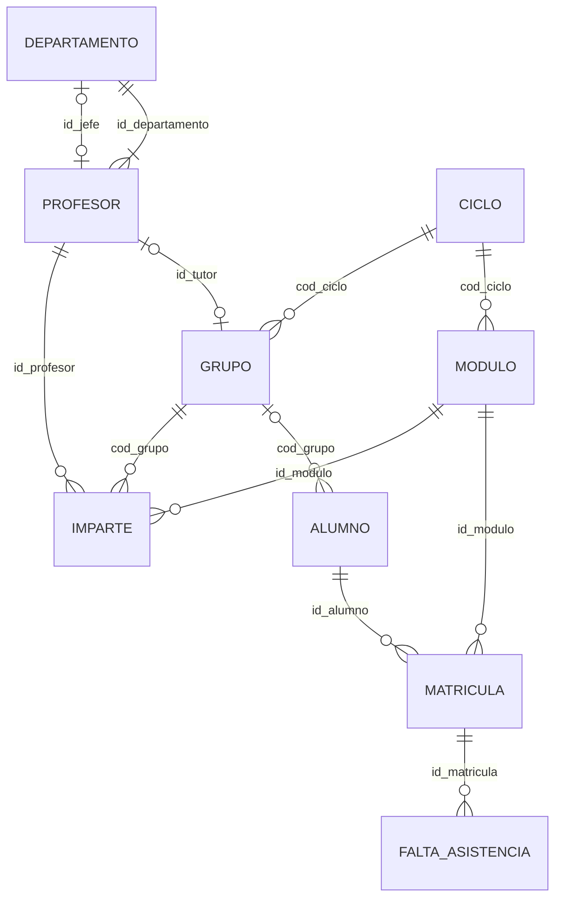

# UD03 · El modelo relacional


## Resumen del Tema

**Visión General:**
El **Modelo Relacional**, ideado por Edgar F. Codd en IBM en 1970, es el modelo de datos lógico más extendido y utilizado comercialmente en el mundo de las bases de datos. A diferencia del Modelo Entidad-Relación (EER), que es una herramienta de abstracción conceptual para representar la información del mundo real de forma independiente del software, el Modelo Relacional representa la estructura lógica de los datos mediante **relaciones (tablas)** compuestas por **tuplas (filas)** y **atributos (columnas)**.

En esta unidad se estudian minuciosamente los conceptos matemáticos y pragmáticos que sustentan el modelo relacional: la estructura formal de una tabla, el dominio y tipado de atributos, el grado y la cardinalidad, las claves (candidatas, primarias, alternativas y foráneas), la semántica de los valores nulos (`NULL`) y las reglas de integridad (inherentes y semánticas). Además, se detalla un catálogo completo de **reglas de transformación para convertir esquemas conceptuales EER en esquemas relacionales lógicos**, ilustrado con abundantes ejemplos reales, esquemas formales y tablas con datos reales.



### Temporalización

La unidad ocupa **17 horas de aula** (9 de teoría y 8 de práctica).


items:
  - {h: 2, tipo: T, t: "Relación, atributo, dominio, tupla, grado y cardinalidad. Claves", ref: "§1 y §2 · laboratorio de claves"}
  - {h: 2, tipo: T, t: "Restricciones e integridad referencial", ref: "§3 · simulador de integridad"}
  - {h: 1, tipo: P, t: "Simulador de integridad referencial", ref: "Práctica 3.2"}
  - {h: 2, tipo: T, t: "Reglas de transformación (I): entidades, débiles y atributos", ref: "§4.1 a §4.3 · transformador"}
  - {h: 2, tipo: T, t: "Reglas de transformación (II): relaciones y jerarquías. Ejemplos", ref: "§4.4 a §4.9 y §5"}
  - {h: 2, tipo: P, t: "Biblioteca: del E/R a las tablas", ref: "Práctica 3.1"}
  - {h: 1, tipo: T, t: "Restricciones no representables y herramientas", ref: "§6 y §7"}
  - {h: 2, tipo: P, t: "Tres formas de transformar una jerarquía", ref: "Práctica 3.3"}
  - {h: 1, tipo: P, t: "Catálogo de restricciones de un hotel", ref: "Práctica 3.5"}
  - {h: 2, tipo: P, t: "Modelo lógico de EduGest", ref: "§8 y proyecto EduGest-3"}
autonomo:
  - "Tareas de transformación 1 a 7 (E/R → relacional)"
  - "Práctica 3.4 (ingeniería inversa) y práctica 3.6"
  - "Banco de 20 ejercicios"


> [!IMPORTANT]
> Esta unidad es el **puente** entre el diseño y la implementación: lo que decidas aquí (claves, nulos, políticas de borrado) determina la creación de las tablas en la UD05. Un error de diseño que no detectes ahora se paga después con datos incorrectos.

### Objetivos de aprendizaje

Al terminar esta unidad serás capaz de:

- Describir los elementos del modelo relacional: relación, atributo, dominio, tupla, grado y cardinalidad.
- Identificar claves candidatas, primarias, alternativas y ajenas, y la semántica del valor `NULL`.
- Aplicar las reglas de integridad de entidad, referencial y de dominio, y elegir la política de borrado adecuada.
- Transformar un diagrama E/R extendido en un esquema relacional aplicando reglas sistemáticas.
- Documentar las restricciones que el modelo lógico no puede expresar.



---


Elementos del modelo y claves

## 1. Conceptos Fundamentales del Modelo Relacional

### 1.1 Definición de Relación (Tabla)

En el Modelo Relacional, la unidad básica de almacenamiento es la **relación**, término matemático que en la práctica informática se denomina **tabla**.

Una relación se define como un subconjunto del producto cartesiano de una familia de dominios $D_1 \times D_2 \times \dots \times D_n$. Gráficamente, una relación es una estructura bidimensional formada por filas y columnas:

- **Diferencia Crucial de Términos:** En el Modelo Entidad-Relación (EER), la palabra *"Relación"* se refiere a una asociación o vínculo entre dos entidades (ej. el cliente `COMPRA` productos). En cambio, en el Modelo Relacional, la palabra *"Relación"* designa a una **tabla completa de datos**.

---

### 1.2 Atributos, Dominios, Grado y Cardinalidad

Para caracterizar matemáticamente una tabla se utilizan los siguientes conceptos:

1. **Atributo (Campo o Columna):** Representa una propiedad o característica de la entidad o relación que describe la tabla. Cada columna tiene un nombre único en la tabla y un tipo de dato especificado.
2. **Dominio:** Es el conjunto finito de todos los valores atómicos válidos del mismo tipo que un atributo puede albergar. Varios atributos distintos pueden compartir el mismo dominio (por ejemplo, `fecha_contrato` y `fecha_nacimiento` comparten el dominio `DATE`).
3. **Grado:** Es el número total de atributos (columnas) que componen la tabla. Una tabla con 5 columnas tiene un **grado de 5**.
4. **Cardinalidad:** Es el número total de tuplas (filas o registros) almacenadas en un momento determinado en la tabla. A diferencia del grado (que es fijo una vez diseñado el esquema), la cardinalidad es dinámica y varía constantemente a medida que se insertan o borran filas.

---

{}
El propio Codd propuso más tarde distinguir entre un valor **ausente pero aplicable** y otro **no aplicable**. Los gestores reales se quedaron con un único valor nulo (`NULL`), y de ahí vienen muchas sorpresas: dos nulos no pueden considerarse iguales entre sí.
{}

### 1.3 Tuplas (Filas) y Semántica de Valores Nulos (NULL)

- **Tupla (Fila, Registro u Ocurrencia):** Cada fila individual de la tabla representa una instancia concreta de la entidad o relación del mundo real. Cada tupla está formada por una lista ordenada de valores, donde cada valor corresponde a un atributo específico.
- **Valores Nulos (`NULL`):** Representan la **ausencia de valor**, valor desconocido o no aplicable.
  - *Diferencia Semántica Importante:* El valor `NULL` no equivale al número cero (`0`) ni a una cadena de texto vacía (`""`). Un cero en `saldo` significa que el saldo es de 0 euros; un `NULL` en `saldo` significa que se desconoce el saldo.

---

{}
En 1985 Codd publicó una lista de 12 reglas (numeradas de la 1 a la 12, más una «regla 0») que un sistema debía cumplir para llamarse realmente relacional. Casi ningún SGBD comercial las cumple todas, pero siguen siendo el listón de referencia.
{}

## 2. Estudio Exhaustivo de Claves

Las claves constituyen el pilar fundamental para garantizar la unicidad de las filas y establecer vínculos de integridad entre tablas.



### 2.1 Clave Candidata y Clave Primaria (Primary Key - PK)

- **Clave Candidata:** Es un atributo o conjunto mínimo de atributos cuyos valores identifican de forma única e unívoca cada tupla de una relación, sin que ningún subconjunto propio de dichos atributos pueda identificarla.
- **Clave Primaria (Primary Key - PK):** Es la clave candidata elegida explícitamente por el diseñador de la base de datos como el identificador principal de las tuplas de la tabla. Por regla absoluta del modelo relacional, **ningún atributo de la clave primaria puede contener valores nulos (`NOT NULL`) ni duplicados**.

---

### 2.2 Claves Alternativas

Cualquier clave candidata que no haya sido elegida como clave primaria pasa a ser una **clave alternativa**. En el esquema relacional, las claves alternativas se señalan con la restricción de unicidad (UK, *unique key*): impiden que dos filas repitan el mismo valor.

> [!NOTE]
> **Ejemplo:** En la tabla `CLIENTE`, si disponemos del campo `id_cliente` (autoincremental interno) y del campo `dni`, ambos son claves candidatas. Elegimos `id_cliente` como **Clave Primaria (PK)** e indicamos que `dni` es una **Clave Alternativa (UK)**.

---

### 2.3 Clave Foránea / Ajena (Foreign Key - FK)

Una **Clave Foránea (Foreign Key - FK)** es un atributo (o conjunto de atributos) en una tabla cuyos valores deben coincidir obligatoriamente con los valores de la clave primaria de otra tabla (o de la misma tabla en relaciones reflexivas), o bien ser nulos si la participación es opcional.

Las claves foráneas representan las relaciones del modelo EER en el esquema relacional lógico.

---

### 2.4 Claves Primarias Compuestas

Cuando una única columna no basta para identificar de forma unívoca a una fila, la clave primaria se compone de dos o más atributos combinados.

> [!NOTE]
> **Ejemplo de Clave Compuesta:**
> En una tabla de matrícula universitaria `MATRICULA`, la clave primaria se compone de `(id_alumno, id_asignatura)`. Un alumno puede matricularse en varias asignaturas y en una asignatura hay varios alumnos, pero la combinación de un alumno concreto en una asignatura concreta es única.

> [!CAUTION]
> **Una clave no se descubre mirando los datos de hoy.** Que ningún valor se repita en la muestra no demuestra que no pueda repetirse mañana. La clave se decide por el **significado** del problema: ¿puede dos alumnos tener el mismo nombre? ¿Puede cambiar el valor con el tiempo? ¿Puede faltar?

#### Laboratorio: ¿es una clave?

Con datos reales de la tabla `ALUMNO` de EduGest, prueba qué conjuntos de columnas identifican a cada fila. Fíjate en el `NULL` de `dni` y en los apellidos repetidos.




- q: "En la muestra de arriba, `(nombre, apellidos)` no se repite. ¿Es una buena clave primaria para `ALUMNO`?"
  options: ["Sí, identifica a todas las filas", "No: dos alumnos distintos pueden llamarse igual y los nombres cambian", "Sí, siempre que se declare obligatorio", "Solo si se añade también `localidad`"]
  answer: 1
  explain: "Que no se repita **hoy** no la convierte en clave. Una clave primaria debe ser estable, no nula y única por significado. Por eso se usa `id_alumno` (artificial) y se protege el NIA con una restricción de unicidad (UK)."
- q: "`dni` contiene algún `NULL` en la muestra. ¿Qué papel puede tener esa columna?"
  options: ["Clave primaria", "Clave alternativa (UK), pero no clave primaria", "Ninguno: no puede ser clave de ningún tipo", "Clave ajena"]
  answer: 1
  explain: "Una clave primaria no admite nulos (integridad de entidad). Una clave alternativa (UK) sí admite nulos, aunque en la práctica conviene que el DNI sea obligatorio si es un dato del negocio."


---

Restricciones e integridad referencial

## 3. Restricciones del Modelo Relacional

### 3.1 Restricciones Inherentes al Modelo

Son reglas estructurales impuestas automáticamente por la propia definición matemática del modelo relacional:

1. **Unicidad de Tuplas:** No pueden existir dos tuplas idénticas en una misma relación (deben diferenciarse al menos en la clave primaria).
2. **Desorden de Tuplas:** El orden en que se almacenan las filas no es significativo. La consulta devuelve los mismos datos independientemente de cómo se dispongan en el disco.
3. **Desorden de Atributos:** El orden de las columnas no altera el significado semántico de la relación.
4. **Atomicidad de Atributos (Atributos Escalares):** Cada celda de la tabla en la intersección de una fila y una columna solo puede albergar un **único valor atómico** perteneciente al dominio (no se permiten listas ni matrices dentro de una celda).

---

### 3.2 Restricciones Semánticas o de Usuario (PK, UK, obligatoriedad, reglas de fila)

Son reglas de negocio definidas explícitamente por el diseñador de la base de datos (más adelante, en la UD05, aprenderás a declararlas en un gestor):

- **Clave primaria (PK):** identifica cada fila (garantiza unicidad y no nulidad).
- **Clave alternativa (UK):** garantiza que no haya valores duplicados (admite nulos salvo que se indique lo contrario).
- **Atributo obligatorio:** el atributo debe tener siempre un valor.
- **Regla de fila:** una condición lógica que debe cumplir cada fila por sí sola (por ejemplo, «el precio es mayor que 0» o «la edad es como mínimo 18»).

---

### 3.3 Integridad Referencial y Políticas de Borrado/Modificación

La **Integridad Referencial** exige que los valores almacenados en una clave foránea (`FK`) existan previamente en la clave primaria (`PK`) de la tabla referenciada.

Cuando se intenta eliminar o actualizar una fila en la tabla padre (la tabla que contiene la `PK`), el SGBD puede aplicar una de las siguientes 4 **políticas de integridad referencial**:

1. **En Cascada:**
   Al borrar o modificar una tupla en la tabla padre, el SGBD borra o actualiza automáticamente todas las tuplas de la tabla hija que contenían esa clave foránea.

2. **Restringido:**
   El SGBD impide y rechaza el borrado o modificación de la tupla padre mientras existan tuplas hijas que la estén referenciando.

3. **Puesta a Nulos:**
   Al borrar o actualizar la tupla padre, el SGBD establece automáticamente a `NULL` el valor de la clave foránea en todas las tuplas hijas afectadas.

4. **Puesta a Valor por Defecto:**
   Al borrar o actualizar la tupla padre, el SGBD asigna un valor por defecto previamente configurado a la clave foránea en las tuplas hijas.

---

> [!WARNING]
> **No todos los gestores ofrecen todas las políticas.** Casi todos permiten el borrado en cascada y la puesta a nulos, pero muchos no permiten propagar el cambio de una clave primaria. Por eso conviene diseñar claves primarias **estables**. En la UD05 comprobarás qué ofrece el gestor que usaremos.

> [!TIP]
> **¿Qué política elijo?** Hazte esta pregunta sobre la fila hija: *¿tiene sentido que siga existiendo sin la fila padre?*
> - **No** (una matrícula sin alumno) → `CASCADE`.
> - **Sí, pero hay que revisarla** (un alumno cuyo grupo desaparece) → `SET NULL`, con la columna opcional.
> - **No debe pasar nunca por accidente** (un departamento con empleados) → rechazar (la opción más prudente).

#### Laboratorio: simulador de integridad referencial

Cambia la política de la clave ajena, intenta borrar, cambiar y insertar filas, y lee los mensajes que explican por qué se rechaza cada operación. Después, repite el experimento haciendo el atributo obligatorio.




- q: "La FK `matricula.id_alumno` debe eliminar la matrícula cuando se borra el alumno. ¿Qué política declaras?"
  options: ["Restringido", "Borrado en cascada", "Puesta a nulos", "Puesta a valor por defecto"]
  answer: 1
  explain: "La matrícula carece de sentido sin su alumno: se borra en cascada. La puesta a nulos dejaría matrículas sin alumno y el borrado restringido impediría eliminar al alumno."
- q: "En el simulador, ¿por qué la puesta a nulos falla si `cod_grupo` es obligatorio?"
  options: ["Porque ningún gestor admite la puesta a nulos", "Porque la política exige poner NULL en una columna que no lo admite", "Porque el grupo no existe", "Porque falta confirmar los cambios"]
  answer: 1
  explain: "Puesta a nulos y obligatoriedad se contradicen: el SGBD no puede cumplir las dos reglas a la vez. Hay que elegir entre una política o la otra."


---

Simulador de integridad referencial

La práctica 3.2 se hace en la [página de prácticas](/ud03-modelo-relacional/ud03-practicas), con lápiz y papel, y se implementará en la UD05.

---

Reglas de transformación (I)

## 4. Reglas de Transformación del Modelo EER al Modelo Relacional

Para transformar de forma metódica un diagrama EER conceptual a un esquema relacional lógico, se aplican las siguientes reglas estandarizadas:

---

### 4.1 Transformación de Entidades Fuertes

- **Regla:** Cada entidad fuerte del diagrama EER se convierte en una **tabla (relación)** independiente.
  - Los atributos simples de la entidad pasan a ser **columnas** de la tabla.
  - El atributo identificador principal de la entidad pasa a ser la **Clave Primaria (PK)** de la tabla.
  - Las claves alternativas pasan a protegerse con una restricción de unicidad (UK).

#### Esquema Notacional Formal

$$\text{ENTIDAD}(\underline{\text{id\_entidad}}, \text{atributo1}, \text{atributo2})$$

---

### 4.2 Transformación de Entidades Débiles (por Identificación y Existencia)

- **Regla:** Una entidad débil se convierte en una **tabla independiente**.
  - **Débil por Identificación:** La clave primaria de la tabla resultante es una **clave compuesta** formada por la clave primaria de la entidad fuerte propietaria (que se propaga como `FK`) combinada con el discriminador parcial de la entidad débil.
  - **Débil por Existencia:** Si la entidad débil posee su propio identificador único, la clave primaria de la entidad fuerte se propaga como FK obligatoria (no admite nulos) con política de borrado en cascada.

#### Esquema Notacional Formal (Débil por Identificación)

$$\text{ENTIDAD\_DÉBIL}(\underline{\text{id\_padre}}, \underline{\text{id\_parcial\_débil}}, \text{atributo1})$$
$$\text{FK: id\_padre } \rightarrow \text{ENTIDAD\_PADRE}(\text{id\_padre}) \text{ (borrado en cascada)}$$

---

### 4.3 Transformación de Atributos Compuestos y Multivaluados

1. **Atributos Compuestos:** Se eliminan desplegando cada uno de sus sub-atributos simples como columnas individuales de la propia tabla.
2. **Atributos Multivaluados ($N$):** Se crea una **nueva tabla independiente** para albergar el atributo multivaluado. La clave primaria de esta nueva tabla será la combinación de la clave primaria de la entidad originaria y el propio atributo multivaluado.

#### Esquema Notacional Formal (Atributo Multivaluado)

$$\text{ENTIDAD\_TELÉFONO}(\underline{\text{id\_persona}}, \underline{\text{numero\_telefono}}, \text{tipo\_linea})$$
$$\text{FK: id\_persona } \rightarrow \text{PERSONA}(\text{id\_persona}) \text{ (borrado en cascada)}$$

#### Laboratorio: del E/R a las tablas

Este transformador aplica las reglas del apartado 4 y produce el esquema relacional formal. Empieza por los casos de esta sesión (débil, multivaluado) y vuelve a él en la siguiente.



---

Reglas de transformación (II): relaciones y jerarquías

### 4.4 Transformación de Relaciones Binarias 1:N

- **Regla (Propagación de Clave):** No se crea una nueva tabla. Se toma la clave primaria de la entidad del lado "1" y se **propaga como clave foránea (`FK`)** a la tabla resultante de la entidad del lado "N".
- Si la relación contenía atributos descriptores propios, estos se trasladan también como columnas a la tabla del lado "N".
- Si la participación del lado "N" es obligatoria (cardinalidad mínima 1), la FK debe ser obligatoria (no admite nulos).

---

{}
{}
Un alumno se matricula en muchas asignaturas y una asignatura tiene muchos alumnos: relación **N:M** con el atributo `nota`.
{}
{}
`ALUMNO(id_alumno PK, nombre)` y `ASIGNATURA(id_asig PK, titulo)`. Cada entidad fuerte se convierte en una tabla con su clave.
{}
{}
No se puede poner una FK en ninguna de las dos tablas sin repetir filas, así que se crea una **tabla intermedia** `MATRICULA`.
{}
{}
Las dos claves ajenas forman juntas la PK compuesta `(id_alumno, id_asig)`. Así un alumno no se matricula dos veces en la misma asignatura.
{}
{}
`nota` y `fecha` van en `MATRICULA`: dependen de la pareja alumno-asignatura, no de uno solo.
{}
{}
`MATRICULA(id_alumno PK,FK → ALUMNO · id_asig PK,FK → ASIGNATURA · nota)`
{}
{}

### 4.5 Transformación de Relaciones Binarias N:M

- **Regla (Tabla Intermedia / Junta):** Se crea obligatoriamente una **nueva tabla de relación**.
  - La clave primaria de esta nueva tabla es una **clave compuesta** formada por la unión de las claves primarias de ambas entidades participantes.
  - Cada una de estas claves funciona por separado como clave foránea (`FK`) hacia su tabla correspondiente.
  - Los atributos propios de la relación $N:M$ se incorporan como columnas de esta nueva tabla.

---

### 4.6 Transformación de Relaciones Binarias 1:1

Existen 3 alternativas según las cardinalidades mínimas de participación:

1. **Participación opcional en ambos lados:** hay dos soluciones válidas. La más simple propaga la clave de una entidad a la tabla de la otra como FK con restricción de unicidad (UK) que **admite nulos** (es la que usa EduGest para la tutoría). Si se quieren evitar los nulos, se crea una tabla intermedia con la clave de una entidad como PK y la de la otra como UK obligatoria.
2. **Participación obligatoria en un lado y opcional en el otro:** la clave ajena se coloca en la tabla de la entidad cuya participación es **obligatoria**, referenciando a la otra, como FK obligatoria y única (UK). Así no necesita admitir nulos.
3. **Participación obligatoria en ambos lados:** ambas entidades pueden unificarse en una **única tabla** que agrupa todos los atributos, siempre que describan de verdad el mismo objeto.

> [!NOTE]
> En el transformador interactivo, la regla 2 se refleja así: si «cada A debe tener un B» (mínimo 1) y no al revés, la clave ajena está en A.

---

### 4.7 Transformación de Relaciones Reflexivas / Recursivas

1. **Reflexiva 1:N:** Se añade una columna de clave foránea (`FK`) en la propia tabla que **apunta a la clave primaria de la misma tabla** (autorreferencia).
2. **Reflexiva N:M:** Se crea una **tabla intermedia** cuya clave primaria se compone de dos columnas que hacen clave foránea hacia la clave primaria de la propia tabla (representando el rol origen y el rol destino).

---

### 4.8 Transformación de Relaciones Ternarias

- **Ternaria N:N:N:** Se crea una tabla intermedia cuya `PK` es la combinación de las claves primarias de las tres entidades participantes.
- **Ternaria 1:1:1 o 1:1:N:** Se crea una tabla intermedia de relación propagando las tres claves primarias, determinando la `PK` compuesta según los lados de cardinalidad máxima $N$.

---

### 4.9 Transformación de Jerarquías de Generalización / Especialización

Existen 3 estrategias relacionales para transformar jerarquías EER:

1. **Opción A (Tabla Única para toda la Jerarquía):** Se crea una sola tabla con todos los atributos del supertipo y de los subtipos, añadiendo una columna discriminadora de tipo (`tipo_subtipo`). Válida para especializaciones disjuntas.
2. **Opción B (Tablas para el Supertipo y cada Subtipo):** Se crea una tabla para el supertipo (con la `PK` principal) y una tabla por cada subtipo (cuya `PK` y `FK` es la clave del supertipo). Es la solución más limpia y flexible.
3. **Opción C (Tablas únicamente para los Subtipos):** Solo se crean tablas para las entidades especializadas, duplicando los atributos del supertipo en cada una. Solo válida si la jerarquía es Total y Disjunta $(T,D)$.


- q: "Todo `PASAPORTE` pertenece a una persona, pero no toda `PERSONA` tiene pasaporte. ¿Dónde va la clave ajena?"
  options: ["En `PERSONA`, obligatoria y única", "En `PASAPORTE`, obligatoria y única", "En ambas tablas", "En una tabla nueva obligatoriamente"]
  answer: 1
  explain: "La clave ajena va en la tabla de la entidad con participación obligatoria (`PASAPORTE`): nunca es nula y la unicidad garantiza el «1» del otro lado."
- q: "`AULA` es débil por identificación respecto a `EDIFICIO`. ¿Cuál es su clave primaria?"
  options: ["`num_aula`", "`id_edificio`", "`(id_edificio, num_aula)`", "No tiene clave primaria"]
  answer: 2
  explain: "El número de aula solo es único dentro de cada edificio: la clave primaria incluye la clave del propietario (que además es clave ajena)."


---

## 5. Colección Abundante de Ejemplos de Transformación Completa

A continuación se presentan 5 ejemplos prácticos completos que ilustran minuciosamente cada una de las reglas de transformación vistas.

---

### 5.1 Ejemplo Completo 1: Gestión de Departamento y Empleados

#### Enunciado Semántico (5.1)

Un `DEPARTAMENTO` (identificado por `id_dep`, con `nombre_dep`) emplea a múltiples `EMPLEADO` (identificado por `id_emp`, con `nombre`, `salario` y `fecha_alta`). Un empleado trabaja en un único departamento (Relación $1:N$).

#### Esquema Relacional Formal (5.1)

- $\text{DEPARTAMENTO}(\underline{\text{id\_dep}}, \text{nombre\_dep})$
- $\text{EMPLEADO}(\underline{\text{id\_emp}}, \text{nombre}, \text{salario}, \text{fecha\_alta}, \text{id\_dep*})$
  - $\text{FK: id\_dep } \rightarrow \text{DEPARTAMENTO}(\text{id\_dep}) \text{ (borrado restringido)}$

#### Contenido de Datos Reales en Tablas (5.1)

**Tabla: `departamento`**

| `id_dep` (PK) | `nombre_dep` |
| :--- | :--- |
| `10` | `'Tecnología e Innovación'` |
| `20` | `'Recursos Humanos'` |
| `30` | `'Finanzas y Contabilidad'` |

**Tabla: `empleado`**

| `id_emp` (PK) | `nombre` | `salario` | `fecha_alta` | `id_dep` (FK) |
| :--- | :--- | :--- | :--- | :--- |
| `101` | `'Ana Torres'` | `2400.00` | `'2024-01-15'` | `10` |
| `102` | `'Carlos Ruiz'` | `1950.00` | `'2024-03-01'` | `20` |
| `103` | `'Lucía Vega'` | `3100.00` | `'2022-06-10'` | `10` |

---

### 5.2 Ejemplo Completo 2: Sistema Académico (Alumnos, Asignaturas y Matriculación)

#### Enunciado Semántico (5.2)

Un `ALUMNO` (`id_alumno`, `nombre`, `email`) se matricula en múltiples `ASIGNATURA` (`id_asig`, `nombre_asig`, `creditos`). Una asignatura acoge a múltiples alumnos (Relación $N:M$). De cada matriculación se guarda la `nota_final` alcanzada.

#### Esquema Relacional Formal (5.2)

- $\text{ALUMNO}(\underline{\text{id\_alumno}}, \text{nombre}, \text{email})$
- $\text{ASIGNATURA}(\underline{\text{id\_asig}}, \text{nombre\_asig}, \text{creditos})$
- $\text{MATRICULA}(\underline{\text{id\_alumno*}}, \underline{\text{id\_asig*}}, \text{nota\_final})$
  - $\text{FK1: id\_alumno } \rightarrow \text{ALUMNO}(\text{id\_alumno}) \text{ (borrado en cascada)}$
  - $\text{FK2: id\_asig } \rightarrow \text{ASIGNATURA}(\text{id\_asig}) \text{ (borrado en cascada)}$

#### Contenido de Datos Reales en Tablas (5.2)

**Tabla: `alumno`**

| `id_alumno` (PK) | `nombre` | `email` |
| :--- | :--- | :--- |
| `1` | `'Juan Pérez'` | `'juan@universidad.edu'` |
| `2` | `'María López'` | `'maria@universidad.edu'` |

**Tabla: `asignatura`**

| `id_asig` (PK) | `nombre_asig` | `creditos` |
| :--- | :--- | :--- |
| `501` | `'Bases de Datos'` | `6` |
| `502` | `'Sistemas Operativos'` | `6` |

**Tabla: `matricula` (Tabla Intermedia N:M)**

| `id_alumno` (PK,FK) | `id_asig` (PK,FK) | `nota_final` |
| :--- | :--- | :--- |
| `1` | `501` | `8.50` |
| `1` | `502` | `7.00` |
| `2` | `501` | `9.25` |

---

### 5.3 Ejemplo Completo 3: Edificios y Aulas (Entidad Débil por Identificación)

#### Enunciado Semántico (5.3)

Un `EDIFICIO` (`id_edificio`, `nombre_edificio`, `direccion`) contiene múltiples `AULA` (`num_aula`, `capacidad`). El aula es una **entidad débil por identificación** respecto al edificio: el número de aula `num_aula` (101, 102...) se repite en distintos edificios, por lo que su clave primaria relacional se compone conjuntamente con el código del edificio.

#### Esquema Relacional Formal (5.3)

- $\text{EDIFICIO}(\underline{\text{id\_edificio}}, \text{nombre\_edificio}, \text{direccion})$
- $\text{AULA}(\underline{\text{id\_edificio*}}, \underline{\text{num\_aula}}, \text{capacidad})$
  - $\text{FK: id\_edificio } \rightarrow \text{EDIFICIO}(\text{id\_edificio}) \text{ (borrado en cascada)}$

#### Contenido de Datos Reales en Tablas (5.3)

**Tabla: `edificio`**

| `id_edificio` (PK) | `nombre_edificio` | `direccion` |
| :--- | :--- | :--- |
| `1` | `'Edificio Polivalente A'` | `'Campus Sur, Av. Universidad 1'` |
| `2` | `'Edificio de Laboratorios'` | `'Campus Norte, C/ Ciencia 4'` |

**Tabla: `aula` (Entidad Débil)**

| `id_edificio` (PK,FK) | `num_aula` (PK) | `capacidad` |
| :--- | :--- | :--- |
| `1` | `101` | `45` |
| `1` | `102` | `30` |
| `2` | `101` | `60` |

---

### 5.4 Ejemplo Completo 4: Jerarquía de Empleados y Jefes (Relación Reflexiva)

#### Enunciado Semántico (5.4)

En una empresa, de cada `EMPLEADO` (`id_emp`, `nombre`, `cargo`) se conoce su jefe directo. Un empleado tiene como máximo un único jefe directo (que es a su vez otro empleado de la propia empresa) y un jefe puede supervisar a varios empleados (**Relación Reflexiva $1:N$**).

#### Esquema Relacional Formal (5.4)

- $\text{EMPLEADO}(\underline{\text{id\_emp}}, \text{nombre}, \text{cargo}, \text{id\_jefe*})$
  - $\text{FK: id\_jefe } \rightarrow \text{EMPLEADO}(\text{id\_emp}) \text{ (puesta a nulos)}$

#### Contenido de Datos Reales en Tablas (5.4)

**Tabla: `empleado` (Con autorreferencia reflexiva)**

| `id_emp` (PK) | `nombre` | `cargo` | `id_jefe` (FK -> `empleado.id_emp`) |
| :--- | :--- | :--- | :--- |
| `1` | `'Elena Blanco'` | `'Directora General'` | `NULL` |
| `2` | `'Roberto Gómez'` | `'Jefe de Desarrollo'` | `1` |
| `3` | `'Marta Vidal'` | `'Programadora Senior'` | `2` |
| `4` | `'Santi Castro'` | `'Programador Junior'` | `2` |

---

### 5.5 Ejemplo Completo 5: Venta de Automóviles y Revisiones en Taller

#### Enunciado Semántico (5.5)

Un concesionario vende `COCHE` (`matricula`, `modelo`, `precio`) a `CLIENTE` (`id_cliente`, `nombre`, `telefono`). Un cliente puede comprar varios coches ($1:N$). Cada coche pasa `REVISION` periódicas en el taller. La revisión se identifica de forma débil por un `num_revision` relativo a la matrícula del coche (`matricula`, `num_revision`), registrando `fecha_revision` y `coste`.

#### Esquema Relacional Formal (5.5)

- $\text{CLIENTE}(\underline{\text{id\_cliente}}, \text{nombre}, \text{telefono})$
- $\text{COCHE}(\underline{\text{matricula}}, \text{modelo}, \text{precio}, \text{id\_cliente*})$
  - $\text{FK: id\_cliente } \rightarrow \text{CLIENTE}(\text{id\_cliente}) \text{ (borrado restringido)}$
- $\text{REVISION}(\underline{\text{matricula*}}, \underline{\text{num\_revision}}, \text{fecha\_revision}, \text{coste})$
  - $\text{FK: matricula } \rightarrow \text{COCHE}(\text{matricula}) \text{ (borrado en cascada)}$

#### Contenido de Datos Reales en Tablas (5.5)

**Tabla: `cliente`**

| `id_cliente` (PK) | `nombre` | `telefono` |
| :--- | :--- | :--- |
| `10` | `'Gonzalo Navarro'` | `'600112233'` |

**Tabla: `coche`**

| `matricula` (PK) | `modelo` | `precio` | `id_cliente` (FK) |
| :--- | :--- | :--- | :--- |
| `'1234-BBB'` | `'Sedán Familiar'` | `22500.00` | `10` |

**Tabla: `revision` (Entidad Débil por Identificación)**

| `matricula` (PK,FK) | `num_revision` (PK) | `fecha_revision` | `coste` |
| :--- | :--- | :--- | :--- |
| `'1234-BBB'` | `1` | `'2025-02-10'` | `120.00` |
| `'1234-BBB'` | `2` | `'2026-02-15'` | `250.00` |

---

Biblioteca: del E/R a las tablas

Restricciones no representables y herramientas

## 6. Restricciones que el Modelo Lógico no Puede Expresar

El modelo relacional expresa muy bien las restricciones **de una fila** (atributo obligatorio, regla de fila) y **de clave** (clave primaria, clave alternativa, clave ajena). Pero muchas reglas de negocio afectan a **varias filas o varias tablas** y no se pueden declarar así. El criterio RA6.h exige **analizarlas y documentarlas** para que no se pierdan entre el diseño y la implementación.

| Regla de negocio (EduGest) | ¿Por qué no basta con una restricción declarativa? | Dónde se implementará |
|---|---|---|
| El jefe de un departamento debe pertenecer a ese departamento | Compara una fila de `DEPARTAMENTO` con una fila de `PROFESOR` | Trigger (UD09) |
| Un alumno solo se matricula en módulos del ciclo de su grupo | Implica `ALUMNO`, `GRUPO` y `MODULO` | Trigger o procedimiento de matrícula (UD09) |
| Un profesor no supera 20 horas lectivas semanales | Es una **suma** sobre varias filas de `IMPARTE` | Trigger compuesto o procedimiento (UD09) |
| No hay faltas anteriores a la fecha de matrícula | Compara dos tablas | Trigger (UD09) |
| La nota final se pone en múltiplos de 0,25 | Es una regla de **una fila** | Regla de fila: `nota_final` múltiplo de 0,25 (se declara en la UD05) |
| Un grupo no supera 30 alumnos | Es un **recuento** sobre varias filas | Procedimiento de matrícula o trigger (UD09) |

Cada restricción se documenta con un formato fijo:

```text
R1. Jefe de departamento
    Descripción: el profesor jefe de un departamento debe pertenecer a él.
    Tablas: DEPARTAMENTO(id_jefe), PROFESOR(id_profesor, id_departamento)
    Momento de comprobación: al asignar o cambiar el jefe y al cambiar de
                             departamento a un profesor.
    Implementación prevista: trigger (UD09).
```

> [!IMPORTANT]
> Una regla que solo se comprueba en la aplicación (en el código Java, Kotlin o PHP) puede saltarse insertando datos directamente en la base de datos o desde otra aplicación. Siempre que sea posible, las reglas de integridad deben vivir **en la base de datos**.

---

## 7. Herramientas Gráficas para el Diseño Lógico

El diseño lógico se representa con un **diagrama relacional**: un rectángulo por tabla con sus columnas, la clave primaria marcada y flechas desde cada clave ajena a la clave primaria que referencia (RA6.a).

| Herramienta | Qué aporta |
|---|---|
| **Oracle SQL Developer Data Modeler** | Diseña el modelo lógico (Barker) y el relacional. Más adelante permitirá también la ingeniería inversa de un esquema existente |
| **draw.io** | Plantillas de tablas (*Entity Relation* → *Table*) |
| **dbdiagram.io / DBML** | Diagrama a partir de una descripción en texto |
| **Mermaid** | Diagramas `erDiagram` en Markdown, ideales para documentar en el repositorio |

> [!TIP]
> Cuando termines el proyecto en la UD05, dibuja el diagrama de las tablas que hayas creado y compáralo con tu diseño lógico. Si no coinciden, hay un error en uno de los dos.

{}
Hazte tres preguntas, en este orden: ¿se decide mirando **una sola fila**? → regla de fila (se declara en el propio esquema). ¿Compara una columna con la **clave de otra tabla**? → clave ajena. ¿Necesita **sumar, contar o comparar varias filas** o tablas? → trigger o procedimiento en el servidor (UD09). Solo si ninguna de las tres sirve debe vivir en la aplicación.
{}

---

Tres formas de transformar una jerarquía

Catálogo de restricciones de un hotel

## 8. Caso Guiado: EduGest del Modelo E/R al Relacional

Aplicamos las reglas del apartado 4 al diagrama de la UD02. Cada paso cita la regla aplicada.

| Elemento del modelo E/R | Regla | Resultado en el modelo relacional |
|---|---|---|
| Entidad `CICLO` | 4.1 Entidad fuerte | CICLO(<u>cod_ciclo</u>, nombre, grado, horas_totales) |
| Entidad `MODULO` con (codigo, ciclo) único | 4.1 + clave alternativa | MODULO(<u>id_modulo</u>, codigo, nombre, curso, horas, *cod_ciclo*) · UK(codigo, cod_ciclo) |
| CICLO 1:N MODULO | 4.4 La FK va al lado N | `cod_ciclo` en MODULO, obligatoria porque la participación es (1, 1) |
| CICLO 1:N GRUPO | 4.4 | GRUPO(<u>cod_grupo</u>, *cod_ciclo*, curso, turno, ...) |
| GRUPO 1:N ALUMNO, participación (0, 1) | 4.4 con FK opcional | ALUMNO(..., *cod_grupo*) **admite NULL** |
| PROFESOR 1:1 GRUPO (tutoría), opcional en los dos lados | 4.6 | `id_tutor` en GRUPO, admite nulos y es **UK** |
| ALUMNO N:M MODULO con atributos y curso académico | 4.5 | MATRICULA(<u>id_matricula</u>, *id_alumno*, *id_modulo*, curso_academico, ...) · UK(id_alumno, id_modulo, curso_academico) |
| PROFESOR–MODULO–GRUPO (imparte) | 4.8 Ternaria | IMPARTE(<u>*id_modulo*, *cod_grupo*, curso_academico</u>, *id_profesor*, horas_semanales) |

> [!NOTE]
> En `MATRICULA` se ha usado una **clave artificial** (`id_matricula`) en lugar de la clave compuesta (id_alumno, id_modulo, curso_academico). Las dos opciones son correctas. La clave artificial simplifica las claves ajenas que apuntan a la matrícula (como las faltas de asistencia), pero **obliga** a declarar la clave natural como clave alternativa (UK); si no, se podrían duplicar matrículas.

{}

{}

---

Modelo lógico de EduGest


- t: "Relación"
  d: "Tabla del modelo relacional: conjunto de tuplas con los mismos atributos."
- t: "Tupla"
  d: "Fila de una relación."
- t: "Grado"
  d: "Número de atributos (columnas) de una relación."
- t: "Cardinalidad"
  d: "Número de tuplas (filas) de una relación."
- t: "Clave candidata"
  d: "Conjunto mínimo de atributos que identifica cada tupla."
- t: "Clave ajena"
  d: "Atributo(s) que referencian la clave primaria de otra relación."


## 9. Resumen y Conclusiones

- El **Modelo Relacional** estructura lógicamente la información mediante relaciones (tablas), tuplas (filas) y atributos (columnas), basándose en la teoría matemática de conjuntos.
- Las **claves primarias (PK)** y **claves alternativas (UK)** garantizan la unicidad de las tuplas, mientras que las **claves foráneas (FK)** representan los vínculos e imponen integridad referencial.
- Las políticas de integridad referencial (`CASCADE`, `RESTRICT`, `SET NULL`) determinan la respuesta del SGBD ante borrados o modificaciones de claves primarias.
- El paso de EER a Relacional se rige por un catálogo estricto de reglas de transformación que mapea entidades a tablas, relaciones $1:N$ a propagaciones de clave, relaciones $N:M$ a tablas intermedias de enlace y entidades débiles a claves compuestas.

---

## 10. Ejercicios Resueltos

### 1. Pregunta Teórica: Claves en el Modelo Relacional

**Pregunta:** ¿Cuál es la diferencia entre una clave candidata, una clave primaria y una clave foránea?
{}
- *Clave Candidata:* Cualquier conjunto mínimo de atributos que identifica de forma única a cada tupla de una tabla.
- *Clave Primaria (PK):* La clave candidata elegida por el diseñador como identificador principal. No admite valores nulos ni repetidos.
- *Clave Foránea (FK):* Atributo en una tabla cuyos valores hacen referencia a la clave primaria de otra tabla para representar un vínculo.
{}

---

### 2. Análisis de Políticas de Integridad Referencial

**Pregunta:** Si eliminamos la fila de un `DEPARTAMENTO` con `id_dep = 10` y la clave foránea en la tabla `EMPLEADO` tiene configurada la política de borrado en cascada, ¿qué ocurre con los empleados pertenecientes a dicho departamento?
{}
El SGBD eliminará automáticamente de la tabla `EMPLEADO` todas las tuplas que tengan `id_dep = 10`.
{}

---

### 3. Ejercicio Práctico de Transformación Relacional

**Enunciado:** Un `AUTOR` (`id_autor`, `nombre`) escribe múltiples `LIBRO` (`isbn`, `titulo`, `precio`). Un libro puede ser escrito por varios autores. Exprese el esquema relacional formal resultante y justifique dónde van las claves ajenas y qué política de borrado conviene en esta relación $N:M$.

**Solución Paso a Paso:**

1. **Esquema Relacional Formal:**
   - $\text{AUTOR}(\underline{\text{id\_autor}}, \text{nombre})$
   - $\text{LIBRO}(\underline{\text{isbn}}, \text{titulo}, \text{precio})$
   - $\text{ESCRIBE}(\underline{\text{id\_autor*}}, \underline{\text{isbn*}})$

2. **Claves ajenas y políticas de borrado:** `id_autor` e `isbn` son claves ajenas en `ESCRIBE` y forman su clave primaria compuesta. Si se borra un autor o un libro, tiene sentido borrar también sus filas de `ESCRIBE` (borrado en cascada). Además, `precio` debe cumplir una regla de fila: ser mayor que 0.

---

## 11. Autoevaluación

Responde a las preguntas y pulsa **Corregir**. Cada respuesta incluye una explicación.


- q: "Una tabla tiene 6 columnas y 250 filas. ¿Cuáles son su grado y su cardinalidad?"
  options: ["Grado 250 y cardinalidad 6", "Grado 6 y cardinalidad 250", "Grado 6 y cardinalidad 6", "Depende de la clave primaria"]
  answer: 1
  explain: "El **grado** es el número de atributos (columnas) y la **cardinalidad** el número de tuplas (filas)."
- q: "En la tabla CLIENTE, tanto `id_cliente` como `dni` identifican a cada cliente. Se elige `id_cliente` como clave primaria. ¿Qué es `dni`?"
  options: ["Una clave ajena", "Una clave alternativa", "Una superclave no mínima", "Un atributo derivado"]
  answer: 1
  explain: "Es una clave **candidata** que no se ha elegido como primaria: una clave alternativa. Se marca como UK."
- q: "¿Qué regla de integridad impide que una clave primaria tome el valor NULL?"
  options: ["Integridad referencial", "Integridad de entidad", "Integridad de dominio", "Regla de negocio"]
  answer: 1
  explain: "La **integridad de entidad** exige que la clave primaria sea única y no nula, porque identifica cada fila."
- q: "Al transformar una relación 1:N entre DEPARTAMENTO (1) y EMPLEADO (N), ¿dónde va la clave ajena?"
  options: ["En DEPARTAMENTO", "En EMPLEADO", "En una tabla nueva", "En las dos tablas"]
  answer: 1
  explain: "La clave ajena se coloca en el lado **N**: cada empleado guarda el identificador de su único departamento."
- q: "Una relación N:M entre ALUMNO y ASIGNATURA con el atributo nota se transforma en..."
  options: ["Una clave ajena en ALUMNO", "Una clave ajena en ASIGNATURA", "Una tabla nueva con las dos claves ajenas y la nota", "Un atributo multivaluado"]
  answer: 2
  explain: "Toda relación N:M genera una **tabla propia** con las claves de ambas entidades (normalmente como clave primaria compuesta) y los atributos de la relación."
- q: "Se borra un departamento que tiene empleados. La FK de EMPLEADO tiene política de puesta a nulos. ¿Qué ocurre?"
  options: ["Se rechaza el borrado", "Se borran también los empleados", "Los empleados quedan con id_dep a NULL", "Los empleados pasan a otro departamento"]
  answer: 2
  explain: "La puesta a nulos conserva las filas hijas y deja su clave ajena vacía. Solo es posible si la columna admite nulos."
- q: "¿Por qué conviene que las claves primarias sean **estables** (que no cambien)?"
  options: ["Porque no se pueden escribir dos veces", "Porque cambiar una clave referenciada obliga a actualizar todas las claves ajenas que la apuntan, y muchos gestores no lo propagan", "Porque las claves primarias no admiten texto", "Porque así se evitan los nulos"]
  answer: 2
  explain: "Cambiar una clave primaria referenciada rompe la integridad referencial si el gestor no propaga el cambio. Por eso se prefieren claves **estables**, que no cambien nunca."
- q: "La regla «un profesor no puede impartir más de 20 horas semanales» se debe..."
  options: ["Expresar con una regla de fila en la tabla IMPARTE", "Documentar como restricción no representable e implementar con programación en el servidor (UD09)", "Ignorar, ya que no forma parte del modelo", "Resolver con una clave ajena"]
  answer: 1
  explain: "Afecta a la **suma** de varias filas. Una regla de fila solo ve la fila actual. Se documenta (RA6.h) y se implementa con un trigger o un procedimiento (UD09)."


## Referencias

- Codd, E. F. (1970). «A Relational Model of Data for Large Shared Data Banks». *Communications of the ACM*, 13(6).
