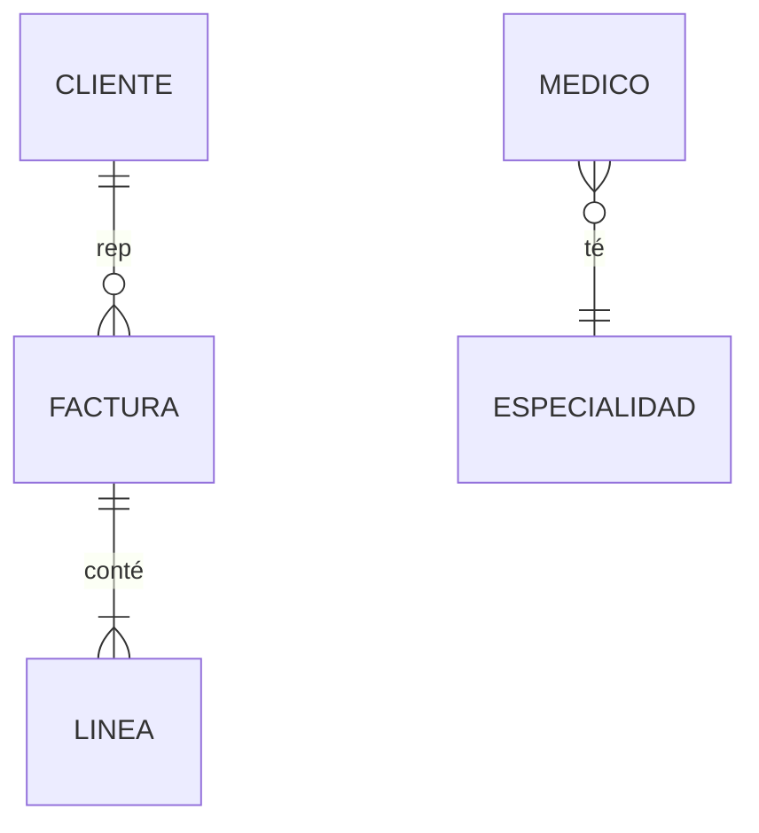

# UD02 · Pràctiques



| Pràctica | Tipus | Nivell | CE principals |
|---|---|---|---|
| [2.1 Biblioteca municipal: de l'enunciat al diagrama](#pràctica-21--biblioteca-municipal-de-lenunciat-al-diagrama) | Guiada | ●○○ | RA6.a, RA6.d, RA6.e |
| [2.2 Llegir i escriure cardinalitats](#pràctica-22--llegir-i-escriure-cardinalitats) | Guiada | ●○○ | RA6.d |
| [2.3 Plataforma de streaming](#pràctica-23--plataforma-de-streaming) | Autònoma | ●●○ | RA6.a, RA6.d, RA6.e |
| [2.4 Clínica veterinària amb jerarquies](#pràctica-24--clínica-veterinària-amb-jerarquies) | Autònoma | ●●○ | RA6.d, RA6.e, RA6.h |
| [2.5 Revisió d'un disseny defectuós](#pràctica-25--revisió-dun-disseny-defectuós) | Repte | ●●● | RA6.d, RA6.h |
| [2.6 Autoescola: ternària o agregació](#pràctica-26--autoescola-ternària-o-agregació) | Repte | ●●● | RA6.d |
| [2.7 Almàssera: l'entrevista que no ho diu tot](#pràctica-27--almàssera-lentrevista-que-no-ho-diu-tot) | Repte | ●●● | RA6.a, RA6.d, RA6.e, RA6.h |
| [2.8 Lloguer de cotxes: el model que recorda](#pràctica-28--lloguer-de-cotxes-el-model-que-recorda) | Repte | ●●● | RA6.d, RA6.e, RA6.h |
| [2.9 Enginyeria inversa: de l'albarà a les entitats](#pràctica-29--enginyeria-inversa-de-lalbarà-a-les-entitats) | Repte | ●●● | RA6.a, RA6.d, RA6.h |
| [2.10 Dos dissenys, un guanyador](#pràctica-210--dos-dissenys-un-guanyador) | Repte | ●●● | RA6.d, RA6.h |
| [2.11 Festival de música: edicions, escenaris i actuacions](#pràctica-211--festival-de-música-edicions-escenaris-i-actuacions) | Repte | ●●● | RA6.a, RA6.d, RA6.e, RA6.h |
| [2.12 Editorial: obres, traduccions i drets d'autor](#pràctica-212--editorial-obres-traduccions-i-drets-dautor) | Repte | ●●● | RA6.a, RA6.d, RA6.e, RA6.h |
| [2.13 Taller aeronàutic: aeronaus, ordres de treball i habilitacions](#pràctica-213--taller-aeronàutic-aeronaus-ordres-de-treball-i-habilitacions) | Repte | ●●● | RA6.a, RA6.d, RA6.e, RA6.h |
| [2.14 Comunitat de propietaris: immobles, juntes i votacions](#pràctica-214--comunitat-de-propietaris-immobles-juntes-i-votacions) | Repte | ●●● | RA6.a, RA6.d, RA6.e, RA6.h |
| [Projecte EduGest · UD02](#projecte-edugest--ud02-model-conceptual) | Projecte | ●●○ | RA6.a, RA6.d, RA6.e, RA6.h |
| [Banc · Fonaments (exercicis 1-5)](#bloc-1--fonaments) | Autònoma | ●○○ | RA6.a, RA6.d, RA6.e, RA6.h |
| [Banc · Intermedi (exercicis 6-15)](#bloc-2--intermedi) | Autònoma | ●●○ | RA6.a, RA6.d, RA6.e, RA6.h |
| [Banc · Intermedi: integració (exercicis 16-23)](#bloc-3--intermedi-integració) | Autònoma | ●●○ | RA6.a, RA6.d, RA6.e, RA6.h |
| [Banc · Intermedi: EER (exercicis 24-30)](#bloc-4--intermedi-eer) | Autònoma | ●●○ |
| [Banc · Consolidació (exercicis 31-35)](#bloc-5--consolidació) | Autònoma | ●●● | RA6.a, RA6.d, RA6.e, RA6.h |

> [!NOTE]
> **Com estan organitzades estes pàgines.** L'enunciat es presenta com el contaria una persona del negoci, no com una llista d'entitats: **decidir què és una entitat, un atribut o una relació forma part del treball**. Les tasques, la comprovació i els errors habituals estan plegats: desplega'ls quan els necessites, no abans de pensar.

> [!IMPORTANT]
> **Reptes de requisits (2.11 a 2.14).** Els enunciats d'estes quatre pràctiques estan escrits com un **document de requisits**: diversos paràgrafs, regles disperses, dades que no pertanyen al sistema i frases que admeten més d'una lectura. Ningú et diu quines són les entitats ni què és una relació ternària. Dedica la primera sessió a llegir, subratllar i **escriure les teues preguntes i supòsits** abans de dibuixar res.

> [!TIP]
> **Mètode per a tots els exercicis.** (1) Subratlla substantius i verbs; (2) decidix entitats i identificadors; (3) relacions i cardinalitats en **els dos sentits**; (4) atributs, inclosos els de les relacions; (5) revisa redundàncies i escriu els **supòsits** que hages hagut de fer.

---

## Pràctica 2.1 · Biblioteca municipal: de l'enunciat al diagrama



#### Objectiu

Aplicar la metodologia de cinc passos per a construir un diagrama E/R complet a partir d'un relat d'una persona del negoci.

#### Context

Montepinar, el barri de *La que se avecina*, estrena biblioteca i el president de la comunitat vol que tot conste en una base de dades. La biblioteca d'un barri vol deixar el quadern i passar a una base de dades. El seu responsable et conta com treballa.

#### Enunciat

> «Quan arriba un llibre nou l'apunte amb el seu ISBN, el títol, l'editorial i l'any. Hi ha llibres escrits per diverses persones i autors amb molts llibres en el nostre catàleg; de cada autor anote com es diu i d'on és, i als que es repetixen els pose un codi per a no confondre'ls.
>
> De cada llibre sol comprar diverses còpies. Les distinguisc amb un número que els apegue al llom (la 1, la 2, la 3...), i eixe número comença una altra vegada en cada llibre. Apunte també si la còpia està nova, usada o deteriorada.
>
> Els veïns es fan socis amb el seu DNI, el seu nom i un telèfon, i els done un número de carnet. Quan algú s'emporta una còpia a casa, anote el dia que se l'emporta, fins quan pot tindre-la i el dia en què la torna de veritat. Hi ha llibres que porten mesos prestats i altres que mai no han eixit. A alguns socis els he de cridar moltes vegades.»

#### Desenvolupament

Seguix els cinc passos i respon a les preguntes abans d'obrir les respostes.

{}

1. **Entitats.** Subratlla substantius i verbs. Quines tenen propietats pròpies? Hi ha algun «fet» que semble una entitat però en realitat relacione dos altres coses?

2. **Identificadors.** Per a cada entitat, quina dada la distingix de les altres? Alguna s'identifica amb un número que es repetix d'unes a altres? Quina dada candidata queda com a alternativa?

3. **Relacions i cardinalitats.** Per a cada parella, formula les dos preguntes, una en cada sentit, i decidix el mínim i el màxim. Què diu el relat sobre llibres que «mai no han eixit»?

4. **Atributs de les relacions.** A què pertanyen les dates? Pot el mateix soci emportar-se la mateixa còpia en dos ocasions? Què implica això per a identificar cada préstec?

5. **Dibuixa** el diagrama en draw.io amb la notació de Chen (*Més formes* → *Entity Relation*) i compara'l amb la solució.

{}





{}

{}
- [ ] Hi ha 4 entitats i `EJEMPLAR` està marcada com a feble (doble rectangle en Chen).
- [ ] Les dues relacions N:M tenen la cardinalitat màxima N en els dos costats.
- [ ] Les dates del préstec estan en la relació, no en `SOCIO` ni en `EJEMPLAR`.
- [ ] Has descartat la informació que no genera dades.
- [ ] Has escrit almenys tres supòsits semàntics.
{}

{}

{}

> [!WARNING]
> - Relacionar `SOCIO` amb `LIBRO` en lloc d'amb `EJEMPLAR`. El que es presta és una còpia física, no l'obra.
> - Posar `fecha_prestamo` com a atribut de `SOCIO`. Un soci té molts préstecs, així que eixe atribut només podria guardar-ne un.

{}

#### Ampliació

La biblioteca vol gestionar **reserves**: un soci pot reservar un **llibre** (no un exemplar concret) i es guarda la data de reserva. Afig esta relació i justifica per què es relaciona amb `LIBRO` i no amb `EJEMPLAR`.

---

## Pràctica 2.2 · Llegir i escriure cardinalitats



#### Objectiu

Determinar les cardinalitats mínima i màxima d'una relació a partir de frases del llenguatge natural, i a l'inrevés.

#### Desenvolupament

Per a cada frase, escriu la relació en notació (mín, màx) en els **dos sentits** i el tipus de correspondència (1:1, 1:N o N:M). Desplega la solució per a comprovar-la.

| # | Frase |
|---|---|
| a | Tot empleat treballa en un únic departament; un departament pot no tindre empleats encara. |
| b | Cada país té una capital; cada capital ho és d'un únic país. |
| c | Una comanda conté almenys un producte; un producte pot no haver-se demanat mai o aparéixer en moltes comandes. |
| d | Un empleat pot supervisar diversos empleats; tot empleat llevat del director té un supervisor. |
| e | Un vehicle d'empresa pot estar assignat a un empleat com a màxim; un empleat pot no tindre vehicle i mai no en té més d'un. |



#### Segona part: del diagrama a la frase

Escriu en llenguatge natural el que expressa cada diagrama:



---

## Pràctica 2.3 · Plataforma de streaming



#### Context

Després de l'èxit d'*Élite* i *La casa de papel*, tothom vol la seua pròpia plataforma de streaming. Tres amics preparen el llançament d'un servei de vídeo sota demanda i et demanen el model conceptual. Este és el correu que t'envien.

#### Enunciat

> «Hola. Us contem com volem que funcione *Cinefilia*.
>
> La gent es registra amb el seu NIF, el seu nom i cognoms, un correu (no volem dos comptes amb el mateix) i una adreça de facturació: carrer, codi postal i ciutat. Hi haurà tres tarifes —bàsica, estàndard i premium— que es diferencien en el que costen al mes i en quantes pantalles es poden usar alhora. Cada client en té contractada una.
>
> En el catàleg, cada pel·lícula té el seu títol, any i durada. La classifiquem per gèneres perquè la gent busca «comèdia romàntica» o «ciència-ficció», i també volem que es puga buscar per actor i que en la fitxa es veja qui fa de qui.
>
> Necessitem saber què veu cada client i quan —a quina hora va començar i fins a quin minut va arribar— per a oferir «continuar veient». Sí, hi ha qui veu tres vegades la mateixa pel·li. I els clients podran puntuar-les d'1 a 5 estreles, però una sola vegada per pel·lícula, que si no es manipulen les mitjanes.»

{}

1. Diagrama E/R complet en la notació que preferisques (indica quina).
2. **Diccionari de dades**: taula amb entitat o relació, atribut, descripció, tipus de dada conceptual (text, número, data...) i si és obligatori.
3. Llista de **supòsits semàntics**.
4. Dos **restriccions** que el diagrama no puga expressar.

{}

{}

{}
- [ ] `género` està modelat com a **entitat** o com a **atribut multivaluat**, i justifiques l'elecció.
- [ ] `personaje` és un atribut de la relació actor–pel·lícula.
- [ ] *Visualització* i *valoració* són relacions **distintes**: una es repetix i l'altra no.
- [ ] L'adreça apareix com a atribut **compost**.
- [ ] La tarifa és una entitat amb les seues pròpies dades, no un text en el client.
- [ ] Entre les restriccions textuals està «la puntuació està entre 1 i 5» o una altra semblant.
{}

{}

{}

Les dos relacionen `CLIENTE` i `PELICULA`, però la visualització pot repetir-se (s'identifica també per la data i hora), mentre que la valoració és única per parella client-pel·lícula. Són dos fets distints: dues relacions distintes.

{}

#### Ampliació

Afig **sèries**, compostes per temporades (1, 2, 3...) i episodis numerats dins de cada temporada. Quantes entitats febles apareixen? De qui depén cadascuna?

---

## Pràctica 2.4 · Clínica veterinària amb jerarquies



#### Context

Fins i tot el gos d'*Los Serrano* té fitxa en aquesta clínica. Una clínica veterinària de grandària mitjana estrena sistema de gestió. La gerent descriu el seu dia a dia.

#### Enunciat

> «Ací treballem onze persones, i de totes guarde el DNI, el nom, el telèfon i el dia que van començar. Els que passen consulta són veterinaris, amb el seu número de col·legiat i la seua especialitat; els auxiliars tenen una titulació; i en el taulell estan els administratius, dels quals apunte els idiomes que parlen perquè els estrangers ho agraïxen. Ningú no fa dos coses: o és una o és l'altra.
>
> Als clients els coneixem per les seues mascotes: xip, nom, data de naixement i espècie. Cada mascota és d'un client, encara que un client pot portar-ne diverses. Dels gossos anote la raça i si la llei els considera potencialment perillosos; dels gats, si estan esterilitzats. Amb la resta (conills, tortugues...) no cal res especial.
>
> Cada consulta la passa un veterinari a una mascota un dia concret. Anote el motiu, el diagnòstic i el que recepta, amb la dosi de cada medicament (nom comercial i un codi intern). De vegades un auxiliar fa una mà.»

{}

1. Diagrama EER amb totes les jerarquies.
2. Classifica cada jerarquia com a total/parcial i disjunta/solapada i **justifica-ho amb una frase del text**.
3. Decidix si `CONSULTA` és una entitat o una relació. Raona les dues opcions.
4. Escriu les restriccions que no pot arreplegar el diagrama (per exemple, sobre la dosi o sobre qui pot receptar).
5. Identifica quina informació del text **no** dona lloc a cap dada que calga guardar.

{}

{}

{}
- [ ] La jerarquia d'empleats és **total i disjunta**.
- [ ] La jerarquia de mascotes és **parcial i disjunta**.
- [ ] Els atributs comuns estan en la superclasse i només els específics en les subclasses.
- [ ] El client apareix com a entitat encara que el text «el coneix per les seues mascotes».
- [ ] La dosi és un atribut de la relació consulta–medicament.
{}

{}



#### Ampliació

Com canviaria el model si un empleat poguera ser alhora auxiliar i administratiu? I si es volguera guardar l'**historial de llocs** de cada empleat amb les seues dates?

---

## Pràctica 2.5 · Revisió d'un disseny defectuós



#### Context

Un company ha dissenyat el model d'un **gimnàs** i et demana que el revises abans de passar a taules. L'enunciat és: *«Els socis s'apunten a activitats (spinning, ioga...) que s'imparteixen en sales. Cada sessió d'una activitat té dia, hora, sala i monitor. Un soci reserva plaça en sessions concretes. Cada soci té una quota mensual»*.



#### Enunciat

Fes la revisió com la faria un company sènior: no saps quants problemes hi ha. Per a cadascun que troves indica l'element afectat, el tipus d'error, la seua conseqüència i la correcció. Després dibuixa el diagrama corregit i decidix si hi ha alguna cosa que **no** pots corregir sense preguntar al client.

{}
Identificadors inestables, atributs derivats, atributs multivaluats amagats en un text, atributs col·locats en l'entitat equivocada, entitats que no tenen identificador, conceptes que haurien de ser entitats (monitor, sessió), relacions redundants.
{}



---

## Pràctica 2.6 · Autoescola: ternària o agregació



#### Enunciat

> «En la nostra autoescola cada alumne fa les pràctiques amb el professor que li assignem, sempre en un dels nostres cotxes (cadascun amb la seua matrícula, marca i model). Apuntem el dia i l'hora de cada classe i els quilòmetres que fan. Al llarg del curs un alumne pot fer classe amb diversos professors, i un professor pot fer classe en diversos cotxes.
>
> Quan un alumne ha acabat amb un professor i este el considera preparat, demanem examen davant de la DGT: s'anota la data i si aprova o suspén. Hi ha alumnes que mai no arriben a presentar-se, i els que es presenten poden fer-ho més d'una vegada.»

{}

1. Modela les classes pràctiques com una relació **ternària** alumne–professor–vehicle. Calcula la cardinalitat de cada entitat fixant les altres dos.
2. Modela l'examen. Explica per què una **agregació** de la relació alumne–professor és millor que una ternària amb `EXAMEN`, i què canvia perquè puga repetir-se.
3. Explica quina informació es perdria si substituïxes la ternària del punt 1 per tres relacions binàries.

{}

{}

{}
- [ ] La ternària inclou la data i l'hora com a atributs i justifiques la seua cardinalitat (amb diversos alumnes, professors i vehicles sol ser N:M:P).
- [ ] L'agregació permet que hi haja parelles alumne–professor **sense** examen.
- [ ] Has identificat cada examen amb alguna cosa més que la parella alumne–professor (la data).
- [ ] S'explica amb un exemple concret la pèrdua d'informació de les binàries.
{}

{}



---

## Pràctica 2.7 · Almàssera: l'entrevista que no ho diu tot



#### Context

A *El pueblo* també es fa oli, i la cooperativa del poble vol saber quina botella ix de quina olivera. Una cooperativa d'oli vol registrar la traçabilitat de la seua producció. Esta és la transcripció de la reunió amb el gerent. Com ocorre en la realitat, **el client no t'ho conta tot, es contradiu i barreja coses que no són del teu sistema**.

#### Enunciat

> **Gerent:** Som uns cent vint socis. Cadascun té les seues finques, encara que hi ha finques que són de dos germans i llavors cadascun té la seua part. Una finca s'identifica pel seu polígon i la seua parcel·la, i està en un terme municipal.
>
> **Tu:** Què lliuren els socis?
>
> **Gerent:** En campanya, que va d'octubre a gener, porten l'oliva en remolc. Es pesa a l'entrada i se'ls dona un albarà amb el seu número. Normalment és d'una sola finca, però de vegades un soci barreja dos finques en el mateix viatge. El que no volem és que es barreje oliva de varietats distintes, això es rebutja.
>
> **Tu:** I després?
>
> **Gerent:** Es mol per lots. En cada lot entra el de diversos socis, de vegades de diversos dies. Del lot volem saber quant oli ha eixit, que se'ns pregunta molt pel rendiment. L'oli va a un dipòsit, i d'allí s'envasa en ampolles de diferent grandària. Cada tanda d'envasament l'anote amb la seua data i el nombre d'ampolles.
>
> **Tu:** La venda també va en el sistema?
>
> **Gerent:** No, això ho portem amb el programa de facturació. Però sí que m'importa que, si un client es queixa d'una ampolla, jo puga dir de quines finques ve l'oli que porta. Això ens ho exigix la inspecció.
>
> **Tu:** I l'oli d'un lot pot acabar en diversos dipòsits?
>
> **Gerent:** Doncs… depén. Quasi sempre en un, però si el dipòsit s'ompli, es passa al següent.

{}

1. Redacta una llista d'**almenys cinc preguntes** que faries al gerent perquè l'entrevista deixa caps solts. Per a cadascuna, indica quina decisió de disseny depén de la resposta.
2. Delimita l'**abast**: quina part de la conversa **no** pertany al teu model i per què.
3. Elabora el diagrama E/R triant l'opció més raonable en cada ambigüitat i arreplegant-la com a **supòsit**.
4. Demostra la **traçabilitat**: escriu, com una seqüència de relacions, el camí que recorres en el teu diagrama des d'una ampolla fins a les finques d'origen. Quina part del camí perd precisió?
5. Escriu tres restriccions que el teu diagrama no pot expressar (per exemple, sobre la varietat o sobre qui lliura de quina finca).

{}

{}

{}
- [ ] Hi ha una relació entre `SOCIO` i `FINCA` que admet el repartiment del percentatge de propietat.
- [ ] El lliurament i la molturació són **relacions N:M amb atributs**: un lliurament pot alimentar diversos lots i un lot arreplega diversos lliuraments.
- [ ] La relació entre lot i dipòsit s'ha justificat amb una pregunta al client.
- [ ] La venda i la facturació no apareixen en el diagrama.
- [ ] Has identificat el tram del camí ampolla → finca que perd precisió i per què.
{}

{}





---

## Pràctica 2.8 · Lloguer de cotxes: el model que recorda



#### Context

Quan els Alcántara de *Cuéntame cómo pasó* lloguen un cotxe per a anar al poble, mai no saben qui el tenia abans. Un disseny que només guarda «el que és veritat ara» oblida el que ja ha passat. Una empresa de lloguer de cotxes necessita poder explicar una factura de fa tres anys.

#### Enunciat

> «Tenim diverses sucursals i una flota de cotxes. Cada cotxe està assignat a una sucursal, encara que el movem entre elles segons la temporada; per a les auditories necessitem saber on va estar cada cotxe en cada moment.
>
> Els cotxes s'agrupen per categoria (econòmic, familiar, de luxe) i cada categoria té una tarifa diària que revisem cada any. Quan un client signa un contracte, es queda amb el preu que hi havia eixe dia, encara que després pugi. Si algú reclama, hem de demostrar quina tarifa estava vigent.
>
> Dels clients guardem nom, document i l'adreça on se'ls envien les factures. Les factures han de mostrar l'adreça que tenia el client quan es van emetre, no l'actual.
>
> Els empleats tenen una categoria professional (agent, supervisor, director) que pot canviar amb els anys; el sou depén d'ella. Ens demanen informes del tipus «quants supervisors hi havia al març de 2024».
>
> Un contracte és d'un client, per a un cotxe, entre dos dates, i el gestiona un empleat de la sucursal des de la qual es lliura el cotxe.»

{}

1. Localitza **totes les frases** de l'enunciat que exigixen conservar el passat i classifica-les: relació que canvia, atribut que canvia, o valor que ha de «congelar-se» en un document.
2. Per a cadascuna, decidix com es modela (atributs de data en la relació, entitat històrica, còpia del valor en el document) i com canvia la **cardinalitat** en incorporar el temps (per exemple, una relació 1:N ara, què és al llarg del temps?).
3. Escriu la restricció que **no pots expressar** amb el diagrama i que garantix que els períodes d'una mateixa entitat no se solapen.
4. Elabora el diagrama E/R final.
5. Raona en quin cas s'accepta **repetir** una dada (el preu en el contracte) i per què això no es considera redundància nociva.

{}

{}

{}
- [ ] L'assignació cotxe–sucursal és una relació **N:M amb data d'inici i de fi** (o una entitat històrica), no un atribut del cotxe.
- [ ] La tarifa és una entitat vinculada a la categoria amb una data de vigència, i el contracte guarda la seua pròpia còpia del preu.
- [ ] L'adreça de facturació està versionada, o copiada en la factura.
- [ ] La categoria professional de l'empleat té historial.
- [ ] Has escrit la restricció de no solapament de períodes.
{}

{}



---

## Pràctica 2.9 · Enginyeria inversa: de l'albarà a les entitats



#### Context

Distribuciones Marina subministra gènere al bar d'*Los Serrano* i tot s'apunta en un albarà. En moltes empreses no hi ha requisits escrits: hi ha **documents** (albarans, factures, fulls de càlcul) i la gent que els usa. Un bon analista sap llegir un document i deduir el model que hi ha darrere.

#### Enunciat

Una distribuïdora de begudes per a hostaleria et lliura dos documents reals amb les dades sensibles substituïdes.

**Document A: albarà de lliurament**

| | |
|---|---|
| **Distribuciones Marina S. L.** · CIF B-12345678 | **Albarà núm. 2026/004871** |
| Data: 14/09/2026 | Ruta: R-03 (Costa Nord) · Repartidor: M. Soler · Furgoneta 4512-KLM |
| **Client:** 00418 · Bar La Gamba · CIF B-98765432 | **Lliurar a:** C/ del Puerto, 12 · 03700 Dénia |

| Ref. | Descripció | Format | Uds. | Preu | Dte. | Import |
|---|---|---|---:|---:|---:|---:|
| 1021 | Cervesa rossa 33 cl | Caixa 24 | 10 | 17,40 | 0 % | 174,00 |
| 1045 | Aigua mineral 50 cl | Pack 12 | 6 | 3,90 | 0 % | 23,40 |
| 2310 | Ginebra premium 70 cl | Ampolla | 4 | 19,50 | 10 % | 70,20 |
| 2310 | Ginebra premium 70 cl (promoció 3×2) | Ampolla | 2 | 0,00 | 0 % | 0,00 |

Base imposable: 267,60 € · IVA 10 % sobre 23,40 €: 2,34 € · IVA 21 % sobre 244,20 €: 51,28 € · **Total: 321,22 €** · Pagament: transferència a 30 dies · Rebut del client: signatura i DNI

**Document B: full de ruta del repartidor (fragment de full de càlcul)**

| Data | Repartidor | Furgoneta | Client | Hora d'arribada | Hora d'eixida | Incidències |
|---|---|---|---|---|---|---|
| 14/09 | M. Soler | 4512-KLM | 00418 | 09:42 | 09:58 | – |
| 14/09 | M. Soler | 4512-KLM | 00533 | 10:15 | 10:31 | Client tancat, es deixa en un veí |
| 15/09 | M. Soler | 7781-HTB | 00418 | 09:30 | 09:41 | Falten 2 caixes |

{}

1. Dedueix les **entitats** que hi ha darrere dels dos documents i els seus identificadors. Quines entitats apareixen en els dos?
2. Distingeix en l'albarà els **atributs bàsics** dels **derivats** (que es calculen a partir d'altres) i dels que són **còpia** d'una dada que podria canviar (per exemple, el preu).
3. Identifica el **grup repetit** de l'albarà i decidix si és un atribut multivaluat o una entitat/relació.
4. Descobrix almenys **dos inconsistències o preguntes** que el document deixa obertes (per exemple, l'IVA).
5. Dibuixa el diagrama E/R i escriu el diccionari de dades amb una columna «derivat / còpia / bàsic».

{}

{}

{}
- [ ] L'albarà és una entitat i les seues línies formen una relació N:M amb atributs entre albarà i producte (o una entitat feble de línia).
- [ ] `importe`, `base imponible`, `IVA` i `total` estan marcats com a derivats.
- [ ] El preu de la línia es tracta com a còpia del preu de catàleg en el moment del lliurament.
- [ ] Repartidor, furgoneta i ruta formen un conjunt que es repetix en els dos documents i no es repetix com a text.
- [ ] Has assenyalat què fa que els dos documents descriguen dos fets distints (lliurament i visita).
{}

{}



---

## Pràctica 2.10 · Dos dissenys, un guanyador



#### Context

El club de pàdel on queden els dijous els de *Machos Alfa* té dues propostes de disseny. Un bon disseny no es valora per com es veu, sinó per si **suporta les situacions reals** del negoci. Una tècnica útil és escriure casos de prova i comprovar si el disseny pot representar-los.

#### Enunciat

Un club de pàdel ha rebut dos propostes de model i no sap quina triar. El club descriu així la seua operativa:

> «Els socis reserven una pista per a una hora concreta. En cada reserva juguen quatre persones, però de vegades només dos. Els que no són socis són convidats, i d'ells només apuntem el nom. Cada jugador paga la seua part, encara que de vegades un paga per tots. Amb el temps, alguns convidats acaben fent-se socis. Volem poder contestar a: quantes vegades ha jugat cada persona?, qui juga habitualment amb qui? i què deu cadascú?»

**Proposta A**



**Proposta B**



{}

1. Escriu una taula amb **almenys huit casos de prova** extrets de l'enunciat (per exemple: partit de dos jugadors, convidat que es fa soci, pagaments creuats…) i marca, per a cada proposta, si pot representar-lo, si el representa amb dificultat o si no pot.
2. Respon, per a cada pregunta del club, quin disseny la resol sense esforç i quin no.
3. Redacta les **tres correccions** que caldria incorporar a la proposta guanyadora per a suportar tots els casos.
4. Dibuixa el disseny final.

{}

{}

{}
- [ ] Has detectat que A conté un grup repetit (`jugador1..4`) i que no admet partits de dos ni de cinc.
- [ ] Has vist que B resol «quantes vegades ha jugat cada persona?», però no distingix qui va pagar per qui.
- [ ] El teu disseny final tracta socis i convidats com a **especialització** de persona (o amb un atribut de condició).
- [ ] Has proposat com registrar que un convidat es fa soci sense perdre el seu historial.
{}

{}



---

## Pràctica 2.11 · Festival de música: edicions, escenaris i actuacions



#### Context

Si a *Élite* una festa ja acaba en drama, imagina un festival sencer. Una associació cultural organitza diversos festivals a l'any i du la programació en fulls de càlcul que ja ningú entén. T'han enviat l'apartat de **requisits** de la licitació. Com en un document real, **hi ha dades repetides, frases ambigües i parts que no pertanyen al sistema**. El teu treball és separar el que cal modelar del que no, i deixar per escrit cada decisió que prengues.

#### Enunciat

> **1. Festivals i edicions.** L'associació organitza actualment tres festivals (*Sonora Rock*, *Sonora Jazz* i *Sonora Folk*), però preveu obrir-ne més. Cada festival té un nom i una descripció curta. Cada any se celebra una **edició** de cada festival, amb les dates d'inici i de fi, la ciutat seu i el pressupost aprovat. Les edicions s'identifiquen sempre pel festival i per l'any: l'associació parla de «el Sonora Jazz de 2026», mai de «l'edició 17». No es guarden edicions futures que no tinguen pressupost aprovat.
>
> **2. Recintes i escenaris.** Cada edició se celebra en un recinte, que pot canviar d'un any a un altre. De cada escenari es guarda el nom, l'aforament màxim i el **punt d'accés**, que el personal de seguretat necessita descrit en tres parts: la zona del recinte (nord, sud, central…), la porta i les indicacions d'arribada. Els escenaris es numeren dins de cada edició (escenari 1, escenari 2…); l'«escenari 1» de 2025 no té res a veure amb el de 2026, encara que estiga al mateix lloc. Tota edició té almenys un escenari.
>
> **3. Artistes.** Un artista pot ser un **solista** o una **agrupació**; no s'admeten altres tipus i ningú és les dues coses alhora (si un solista munta una banda, es dona d'alta com a agrupació a part). De tots es guarda el nom artístic, el país d'origen, els **gèneres** que toca (pot ser més d'un) i les dades del **representant**: nom, telèfon i correu, que es gestionen sempre junts. Dels solistes interessa el seu nom real i la data de naixement; de les agrupacions, l'any de formació i el nombre de components. Els components d'una agrupació són músics dels quals es guarda el nom, l'instrument principal i, per a cada agrupació a què pertanyen, la data en què hi van entrar i l'instrument amb què hi toquen. Un mateix músic pot estar en diverses agrupacions.
>
> **4. Programació.** El dia es divideix en **franges** de trenta minuts que comencen en punt o i mitja. Cada actuació consisteix que un artista toca en un escenari durant una o diverses franges consecutives; s'anota la franja d'inici, la durada en minuts i el caixet pactat. Un artista pot actuar diverses vegades en una mateixa edició, fins i tot en escenaris diferents i dies diferents, però **no pot estar en dos escenaris alhora** i un escenari **no pot acollir dues actuacions simultànies**. L'associació vol consultar la programació d'un escenari o la d'un artista d'una ullada.
>
> **5. Personal.** Tot el personal d'una edició s'identifica pel seu DNI i té nom, telèfon i talla de camiseta. Es distingeixen tècnics (amb la seua especialitat: so, il·luminació o escenari), personal de seguretat (amb el seu número d'habilitació) i voluntaris (amb els dies de la setmana en què estan disponibles). Hi ha personal de producció que no encaixa en cap de les tres categories, i és habitual que un voluntari amb formació tècnica treballe també com a tècnic, de manera que la mateixa persona pot figurar en dues categories. Cada persona s'assigna a un escenari en un torn concret (matí, vesprada o nit) d'una edició; pot cobrir diversos torns i diversos escenaris, però només d'edicions en què estiga contractada.
>
> **6. Fora d'abast.** La venda d'entrades la gestiona una plataforma externa i no forma part d'aquest sistema; només es rebrà al final de cada dia el total d'assistents per escenari. Tampoc no es gestionen els pagaments a proveïdors ni la comptabilitat de l'associació.

{}

1. Extrau del text les **entitats candidates** i descarta les que no pertanyen al sistema, justificant-ho amb una frase de l'apartat 6. Indica quines són febles i quin és l'**identificador complet** de cadascuna.
2. Classifica les dues jerarquies (artistes i personal) com a totals o parcials i disjuntes o solapades, citant la frase del text que ho justifica. Decideix quins atributs van a la superclasse.
3. Modela l'actuació com a relació **ternària** (artista, escenari, franja). Calcula la cardinalitat de cada entitat fixant les altres dues i explica com les dues prohibicions de l'apartat 4 en redueixen una.
4. Marca tots els atributs **compostos**, **multivalor** i **derivats** i explica com els representaries. La `duración` és un atribut de la relació o es dedueix d'una altra cosa?
5. Escriu **almenys sis restriccions** que el diagrama no pot expressar (solapaments, coherència entre edicions, aforament…).
6. Redacta cinc **preguntes al client** sobre les parts ambigües del text i com canviaria el teu model segons la resposta.

{}

{}

{}
- [ ] `EDICIÓN` és feble de `FESTIVAL` (festival + any) i `ESCENARIO` és feble de `EDICIÓN` (festival + any + número).
- [ ] La franja pertany a l'edició o és una dada general; has justificat quina de les dues opcions tries.
- [ ] La jerarquia d'artistes és **total i disjunta**; la del personal és **parcial i solapada**.
- [ ] `punto de acceso` i `representante` són atributs compostos; `géneros` i `días disponibles` són multivalor.
- [ ] La relació entre agrupació i músic és N:M i duu `fecha_entrada` i `instrumento`.
- [ ] L'assignació de personal té el torn com a part de la seua identificació.
- [ ] La venda d'entrades no apareix al diagrama.
{}

{}

{}

> [!WARNING]
> - Identificar l'edició amb un número correlatiu global: el text diu que s'identifica per festival i any.
> - Posar `escenario` com a text dins de l'actuació: té aforament, punt d'accés i personal assignat, de manera que és una entitat.
> - Convertir la ternària en tres binàries i perdre quin artista toca en quin escenari en quina franja.
> - Posar `edad` en lloc de `fecha_nacimiento`, o `número_componentes` com a dada introduïda en lloc de derivada de la relació amb els músics.
> - Oblidar que el personal pot estar en dues categories alhora i declarar la jerarquia disjunta.

{}

#### Ampliació

L'associació vol una **llista d'espera de voluntaris** per edició i que un voluntari puga recomanar-ne un altre. És una relació reflexiva? Quina cardinalitat té i quina restricció necessites per a evitar que algú es recomane a si mateix?



---

## Pràctica 2.12 · Editorial: obres, traduccions i drets d'autor



#### Context

Valeria, l'escriptora de la sèrie *Valeria*, ha fundat la seua pròpia editorial independent. Una editorial independent publica novel·la, poesia i còmic, tradueix obres d'altres idiomes i compila antologies. Hui du el catàleg i els contractes en documents de text solts i ha tingut problemes perquè **ningú no sabia quin percentatge de drets corresponia a cada persona d'una obra**. Et lliuren este resum de requisits.

#### Enunciat

> **1. Obres.** Una **obra** és el text en si, independentment de com es publique. Cada obra té un codi intern, el títol, l'any de primera publicació i l'idioma original. Hi ha tres classes d'obres amb dades pròpies: les **novel·les** (nombre de capítols i si pertanyen a una saga, cas en què s'anota el nom de la saga i el volum), els **poemaris** (nombre de poemes i mètrica predominant) i els **còmics** (nombre de pàgines i si són en color o en blanc i negre). Hi ha obres de divulgació i d'assaig que no encaixen en cap de les tres classes i només guarden les dades comunes. Una obra no pot ser alhora novel·la i còmic, encara que tinga adaptació: l'adaptació és una altra obra distinta.
>
> **2. Relacions entre obres.** Una obra pot ser una **traducció** d'una altra obra de l'editorial (l'original). De la traducció interessa el seu idioma, que no coincideix amb el de l'original, i qui la va traduir. Una obra original pot tindre moltes traduccions, però una traducció ho és d'una sola original. A més, l'editorial publica **antologies**: obres que reuneixen fragments o peces completes d'altres obres. En una antologia importa l'ordre en què apareix cada peça i les pàgines que ocupa. Una obra pot aparéixer en diverses antologies, i una antologia no pot incloure's a si mateixa.
>
> **3. Persones i funcions.** Els qui participen en una obra són persones: autors, traductors, il·lustradors i prologuistes. De cada persona es guarda el nom civil, la nacionalitat, la data de naixement i, si ha mort, la data de defunció; també un o diversos **pseudònims** sota els quals ha publicat. L'**adreça fiscal** es conserva desglossada en carrer, número, codi postal, localitat i país, perquè s'utilitza per a emetre les retencions. Una persona pot tindre diferents funcions en diferents obres (autor d'una, traductor d'una altra) i fins i tot més d'una en la mateixa. Per a cada funció s'anota el **percentatge de drets** que li correspon sobre l'obra.
>
> **4. Contractes i representació.** Abans de publicar una obra se signa un **contracte** de cessió de drets per cada persona que hi participa amb una funció concreta: es guarda la data de signatura, l'avançament i la durada en anys. Algunes persones tenen un **agent literari** que negocia en nom seu; l'agent té nom, agència i telèfon, i pot representar moltes persones. El contracte reflecteix si l'ha negociat un agent i qui va ser; els contractes de persones sense agent se signen directament.
>
> **5. Edicions i impressions.** Una obra es publica en una o diverses **edicions**: cadascuna amb el seu ISBN (que la identifica a tot el món), format (tapa dura, rústica o llibre electrònic), nombre de pàgines i preu. Cada edició s'imprimeix en **tirades** numerades dins de l'edició (primera, segona…), amb data d'impressió, nombre d'exemplars i impremta. Una tirada no té sentit sense la seua edició i si es retira una edició es retiren les seues tirades. Els llibres electrònics no tenen tirades.
>
> **6. Llibreries.** L'editorial envia exemplars de cada tirada a llibreries (CIF, nom, adreça i telèfon), indicant la data d'enviament i la quantitat. Una llibreria pot rebre diverses vegades exemplars de la mateixa tirada. Les **vendes** al públic les gestiona el distribuïdor i queden fora de l'abast.

{}

1. Dibuixa el diagrama EER en notació de Chen. Justifica per què l'**obra** i l'**edició** són entitats distintes.
2. Classifica la jerarquia d'obres. Què canvia si el text digués que «tota obra és novel·la, poemari o còmic»?
3. Representa les relacions *traduce* i *incluye* com a **reflexives** sobre obra: escriu-ne els rols, cardinalitats i atributs, i les restriccions d'integritat que necessiten.
4. Modela la participació de les persones en les obres com a relació **ternària** (persona, obra, funció) o com a binària amb la funció com a entitat. Compara les dues opcions i tria'n una.
5. Representa el contracte mitjançant una **agregació** de la participació i explica per què una simple relació entre persona i obra no basta.
6. Identifica les entitats febles i els seus identificadors. Per què l'ISBN no converteix l'edició en entitat feble i la tirada sí que ho és?
7. Escriu almenys cinc restriccions textuals i assenyala dues dades que siguen **derivades**.

{}

{}

{}
- [ ] La jerarquia d'obres és **parcial i disjunta**, amb atributs propis en cada subclasse.
- [ ] *Traduce* és una reflexiva 1:N amb els rols *original* i *traducción*; *incluye* és una reflexiva N:M amb `orden` i `páginas`.
- [ ] La participació de persones duu el percentatge de drets i admet diverses funcions de la mateixa persona en la mateixa obra.
- [ ] El contracte es modela com a agregació de la participació, amb l'agent com a relació opcional.
- [ ] `TIRADA` és una entitat feble d'`EDICIÓN`; `EDICIÓN` té identificador propi (ISBN).
- [ ] `seudónimos` és multivalor, `dirección fiscal` és compost i «domini públic» o «en vida» és derivat de les dates.
{}

{}

{}

> [!WARNING]
> - Fondre obra i edició en una sola entitat: es repeteix el títol, l'autor i els drets en cada edició.
> - Posar `traductor` com a atribut de text en l'obra: és una persona amb dades i amb un percentatge de drets.
> - Modelar l'antologia com una entitat apart amb una relació a obra: és una obra més, i la seua relació amb altres obres és reflexiva.
> - Posar el percentatge de drets en la persona o en l'obra: pertany a la **participació** (persona, obra, funció).
> - Fer de l'agent un atribut del contracte: l'agent és una entitat amb dades pròpies i moltes representacions.

{}

#### Ampliació

Algunes obres tenen **coautoria**. Canvia alguna cosa en el model? Afig ara que els drets d'una persona sobre una obra passen als seus hereus quan mor: quina relació necessites i quin problema apareix amb les dates?



---

## Pràctica 2.13 · Taller aeronàutic: aeronaus, ordres de treball i habilitacions



#### Context

El taller manté els avions de l'aerolínia de *Berlín* (vegeu l'exercici 31). Un taller de manteniment aeronàutic treballa sota una normativa estricta: **cada tasca ha de poder demostrar qui la va fer, amb quina habilitació i sobre quina peça concreta**. El responsable de qualitat et lliura la descripció del que el sistema ha de registrar. Part de les regles estan escrites com a «ha de» i unes altres apareixen de passada: **ambdues són requisits**.

#### Enunciat

> **1. Aeronaus i models.** El taller revisa aeronaus de moltes companyies. Cada aeronau s'identifica per la seua matrícula i és d'un **model** (per exemple, ATR 72-600), del qual es coneix el fabricant, la denominació, la categoria de manteniment i les hores de vol entre revisions majors. De l'aeronau es guarda la data de fabricació i les hores de vol acumulades, que s'actualitzen en cada entrada al taller. Hi ha tres tipus: **avions** (nombre de motors i envergadura), **helicòpters** (nombre de pales del rotor principal i si tenen rotor de cua) i altres aeronaus lleugeres que no necessiten dades específiques. Una aeronau és sempre d'un únic tipus.
>
> **2. Propietaris.** Cada aeronau pertany en cada moment a una persona física o jurídica, de la qual es guarda un nom o raó social, un NIF i una **adreça de contacte** desglossada en carrer, número, codi postal, localitat i país. Amb la compravenda i l'arrendament una aeronau canvia de propietari al llarg de la seua vida, i la normativa exigeix conservar **tot l'historial**: qui va ser el propietari i des de quina data fins a quina data. Un propietari pot tindre moltes aeronaus i una aeronau no pot tindre dos propietaris al mateix temps.
>
> **3. Ordres de treball.** Cada vegada que una aeronau entra al taller s'obri una **ordre de treball**, que es numera de forma correlativa dins de cada any (l'ordre 17 de 2026). Es guarden la data d'entrada, la data prevista i la real d'eixida, el tipus de revisió (A, B, C o D) i les observacions del client. Una ordre es descompon en **tasques** numerades dins de l'ordre: cada tasca té una descripció, les hores estimades i el seu estat (pendent, en curs o acabada). Algunes tasques no poden començar fins que s'han acabat unes altres de la mateixa ordre, i eixes dependències han de quedar registrades. Una tasca no es reutilitza en una altra ordre: si es repeteix el treball, es crea una tasca nova.
>
> **4. Personal tècnic i habilitacions.** Els tècnics tenen un codi d'empleat, un nom i una data de contractació. Per a treballar sobre un model concret necessiten una **habilitació**, que es concedeix per **categoria de llicència** (B1 mecànica, B2 aviònica o C certificació) i té una data de caducitat. Un tècnic pot tindre diverses habilitacions: pot ser B1 en l'ATR 72 i B2 en l'Airbus A320, o B1 i B2 alhora en el mateix model. Per al mateix model i la mateixa categoria hi ha una única habilitació per tècnic. Cada tasca la realitzen un o diversos tècnics; s'anoten les hores reals que dedica cadascú i la data en què signa la seua part. Només els tècnics amb categoria C poden **certificar** la conformitat d'una ordre completa.
>
> **5. Magatzem i peces.** El magatzem gestiona peces identificades pel seu número de part, amb la descripció, la unitat de mesura i l'estoc mínim. Hi ha dues classes de peces: els **consumibles** (cargols, juntes, olis) dels quals només es controla la quantitat en magatzem, i els **rotables** (motors, trens d'aterratge) que tenen número de sèrie propi, les hores acumulades i una vida útil màxima. Les peces són d'una de les dues classes, mai d'ambdues. Cada peça es compra a un o diversos proveïdors, amb un preu per proveïdor i un termini de lliurament; un proveïdor pot subministrar moltes peces.
>
> **6. Ús de peces.** Una tasca consumeix peces (quantitat per als consumibles) o instal·la i desmunta rotables concrets en una aeronau. De cada instal·lació es guarda la data de muntatge i, quan es retira, la de desmuntatge; un rotable no pot estar instal·lat en dues aeronaus al mateix temps, però al llarg de la seua vida passa per diverses. El taller necessita poder respondre a «quins rotables duia l'aeronau EC-XYZ el 3 de març» i «en quines aeronaus ha estat instal·lat este motor».
>
> **7. Fora d'abast.** La facturació al client i la nòmina dels tècnics es porten en altres programes.

{}

1. Identifica les entitats, indica les **febles** amb el seu identificador complet i dibuixa la cadena ordre → tasca. Per què la matrícula identifica l'aeronau però el número d'ordre no identifica l'ordre?
2. Classifica les dues jerarquies (aeronaus i peces) i justifica cada classificació amb una frase del text.
3. Modela l'habilitació com a relació **ternària** tècnic–model–categoria i calcula les cardinalitats. Per què no basta una binària tècnic–model?
4. Modela l'historial de propietaris, el d'instal·lació de rotables i la dependència entre tasques. Indica en cada cas quin atribut fa que la mateixa parella d'entitats puga repetir-se.
5. Decideix com representar la **certificació** d'una ordre i quina restricció exigeix que el tècnic siga de categoria C.
6. Escriu almenys set restriccions d'integritat que el diagrama no pot arreplegar.
7. Enumera tres consultes del taller que el teu diagrama ha de poder contestar i recorre el camí de relacions que usaria cadascuna.

{}

{}

{}
- [ ] `ORDEN` s'identifica per (any, número) i `TAREA` per (any, número d'ordre, número de tasca).
- [ ] La jerarquia d'aeronaus és **parcial i disjunta**; la de peces, **total i disjunta**.
- [ ] L'habilitació és una ternària amb la data de caducitat com a atribut.
- [ ] L'historial de propietat i el d'instal·lació duen la data d'inici com a part de la seua identificació.
- [ ] La dependència entre tasques és una N:M reflexiva sense atributs.
- [ ] La relació tasca–tècnic és N:M amb `horas_reales` i `fecha_firma`.
- [ ] `dirección de contacto` apareix com a atribut compost.
{}

{}

{}

> [!WARNING]
> - Guardar el propietari com a atribut de l'aeronau: es perd l'historial que exigeix la normativa.
> - Identificar la tasca només pel seu número dins de l'ordre, sense heretar la identificació de l'ordre.
> - Confondre `rotable` (amb número de sèrie i historial) amb `consumible` (només quantitat) i posar les hores acumulades en totes les peces.
> - Resoldre l'habilitació amb dues binàries (tècnic–model i tècnic–categoria): no se sap quina categoria té sobre quin model.
> - Donar a les tasques dependents una relació 1:N: una tasca pot esperar-ne diverses i ser requisit de diverses.

{}

#### Ampliació

L'autoritat aeronàutica exigeix que cada **certificació d'ordre** quede signada per un tècnic de categoria C, amb la data i un número de certificat únic. Modela la certificació i decideix si és una entitat, una relació amb atributs o una agregació. Després afig la possibilitat que una certificació siga **anul·lada** i substituïda per una altra.



---

## Pràctica 2.14 · Comunitat de propietaris: immobles, juntes i votacions



#### Context

Juntes de veïns? Pregunta-li a *La que se avecina*: la comunitat de Montepinar viu de votacions. Un administrador de finques gestiona desenes de comunitats de propietaris amb fulls de càlcul i paper. Vol un sistema que li permeta saber **qui és amo de què en cada moment, què es va votar en cada junta i qui deu diners**. Esta és la descripció del client. Com sol ocórrer, barreja regles legals amb costums de la casa, i no totes tenen el mateix pes.

#### Enunciat

> **1. Comunitats i immobles.** L'administrador du diverses comunitats. Cada comunitat té un CIF, un nom, una adreça (carrer, número, codi postal i localitat) i un compte bancari en què s'ingressen les quotes. Una comunitat es compon d'un o diversos **portals**, numerats dins de la comunitat (portal 1, portal 2…), i cada portal conté **immobles** que s'identifiquen per la seua planta i la seua lletra dins del portal (3r B). El «3r B del portal 1» d'una comunitat no té res a veure amb el «3r B del portal 1» d'una altra.
>
> **2. Tipus d'immobles.** Tot immoble té la seua superfície en metres quadrats i un **coeficient de participació** (el tant per cent que li correspon en les despeses i en els vots); la suma de coeficients d'una comunitat és sempre el 100 %. Els immobles són habitatges (nombre de dormitoris i si tenen terrassa), locals comercials (activitat que s'hi desenvolupa i número de llicència) o places de garatge (número de plaça i planta del soterrani). Un immoble és sempre d'un únic tipus. Alguns garatges estan **vinculats** a un habitatge concret i es transmeten amb ell; un garatge només pot estar vinculat a un habitatge de la seua mateixa comunitat, i un habitatge pot tindre diversos garatges vinculats.
>
> **3. Propietaris.** Els propietaris poden ser persones físiques (DNI, nom i cognoms) o jurídiques (CIF, raó social i persona de contacte, amb el seu nom i telèfon). Els dos tipus comparteixen un telèfon i un correu de notificació. Un immoble pot pertànyer a diverses persones alhora, cadascuna amb el seu **percentatge de propietat** (el 50 % cadascun si el compren dos germans). La propietat canvia amb vendes i herències, i s'ha de conservar l'**historial**: qui va ser propietari de quin immoble, amb quin percentatge i entre quines dates. Si no es coneix la data de fi, el propietari continua sent-ho.
>
> **4. Juntes.** Cada comunitat celebra juntes, ordinàries o extraordinàries, numerades per any dins de la comunitat (la junta 2 de 2026). De cadascuna es guarden la data, el lloc, si es va celebrar en primera o en segona convocatòria i l'acta (un text llarg). Cada junta té un **ordre del dia** compost per punts numerats dins de la junta; cada punt té un títol, una descripció i el resultat de la votació (aprovat, rebutjat o sense votació). Els punts no existeixen fora de la seua junta.
>
> **5. Assistència, delegació i vot.** A cada junta assisteixen propietaris, bé en persona, bé **representats** per un altre propietari de la mateixa comunitat a qui han delegat el seu vot; de cada assistent s'anota si va estar present o representat. Un propietari pot delegar el seu vot en una junta concreta en un altre, que al seu torn pot acumular diverses delegacions, però ningú no pot delegar en si mateix ni delegar un vot que ja ha rebut per delegació. Quan un punt se sotmet a votació, cada propietari present o representat vota **a favor, en contra o s'absté**, i el vot compta amb el coeficient de l'immoble. Es vol saber com va votar cada propietari en cada punt.
>
> **6. Quotes, derrames i rebuts.** Cada immoble paga una quota mensual de despeses proporcional al seu coeficient. A més, la junta pot aprovar **derrames extraordinàries** (una obra, per exemple) en un punt de l'ordre del dia; la derrama es reparteix entre els immobles segons el coeficient i té un import total, un concepte i unes dates de pagament. Tots els cobraments s'emeten com a **rebuts** a nom del propietari actual de l'immoble, numerats dins de cada immoble; en un rebut s'anoten el concepte, l'import, la data d'emissió i, quan es paga, la data de pagament. Un rebut és morós si passen trenta dies des de l'emissió sense haver-se pagat.
>
> **7. Fora d'abast.** La comptabilitat general de la comunitat, les incidències de manteniment i els contractes amb proveïdors es tractaran en una fase posterior.

{}

1. Dibuixa la **cadena d'entitats febles** comunitat → portal → immoble i escriu l'identificador complet de cadascuna. Explica per què no es pot usar un codi global d'immoble sense perdre informació.
2. Classifica la jerarquia d'immobles i la de propietaris. Justifica cada classificació amb una frase del text i decideix quins atributs van en cada nivell.
3. Modela el vincle entre garatges i habitatges. És una reflexiva? Quina cardinalitat té des de cada costat?
4. Modela la **propietat amb historial** (immoble, propietari, percentatge, dates) i justifica quin atribut forma part de l'identificador.
5. Modela la **delegació de vot** com a relació **ternària** (propietari que delega, propietari representant, junta). Calcula les seues cardinalitats i escriu les tres restriccions de l'apartat 5.
6. Modela el vot en cada punt i explica per què el coeficient **no** és un atribut del vot.
7. Identifica els atributs compostos, derivats i multivalor (si n'hi ha) i explica què caldria preguntar al client per a decidir.
8. Escriu almenys huit restriccions, distingint les **legals** de les **de negoci**.

{}

{}

{}
- [ ] `PORTAL` és feble de `COMUNIDAD`; `INMUEBLE` és feble de `PORTAL`; `JUNTA` és feble de `COMUNIDAD`; `PUNTO` és feble de `JUNTA`; `RECIBO` és feble d'`INMUEBLE`.
- [ ] La jerarquia d'immobles és **total i disjunta**; la de propietaris, **total i disjunta**, amb atributs diferents en cada subclasse.
- [ ] El vincle garatge–habitatge és una relació 1:N des de l'habitatge i opcional del costat del garatge.
- [ ] La propietat és una N:M entre immoble i propietari amb `porcentaje` i `fecha_inicio` com a part de l'identificador.
- [ ] La delegació és una ternària amb dos papers distints per a la mateixa entitat `PROPIETARIO`.
- [ ] El vot és una N:M entre propietari i punt, amb el sentit del vot com a atribut.
- [ ] «Morós» s'ha declarat com a atribut derivat.
{}

{}

{}

> [!WARNING]
> - Usar un codi d'immoble global i perdre l'estructura portal–planta–lletra que usa l'administrador.
> - Posar `propietario` com a atribut de l'immoble: es perden el repartiment de percentatges i l'historial.
> - Modelar la delegació com una relació binària entre propietaris, sense la junta: el mateix propietari pot delegar en un o en un altre segons la junta.
> - Guardar el coeficient en el vot: és una dada de l'immoble, i el propietari en pot tindre diversos.
> - Guardar el resultat de la votació com a text lliure, o comptar-lo a mà, en lloc de derivar-lo dels vots (aprovat si els vots a favor superen els contraris).

{}

#### Ampliació

Una comunitat pot tindre **subcomunitats** (per exemple, un garatge comú a diversos portals amb les seues pròpies quotes). Decideix si es modela com una reflexiva de `COMUNIDAD` o com una entitat nova, i explica què ocorre amb els coeficients.



---

## Projecte EduGest · UD02: model conceptual



#### Objectiu

Construir el model conceptual complet del projecte transversal.

#### Enunciat

Llig l'[entrevista amb la direcció d'estudis](/guia/proyecto-edugest#1-enunciat-entrevista-amb-la-direcció-destudis) com ho faria un analista: ací no s'enumeren les entitats i hi ha detalls que es mencionen de passada. El [cas guiat de la teoria](/ud02-modelo-er/ud02-teoria#8-cas-guiat-el-model-er-dedugest) en resol una part.

{}

1. El **diagrama E/R** amb totes les entitats, relacions, cardinalitats, atributs i identificadors. Completa'l fins a cobrir tot el que conta l'entrevista.
2. El **diccionari de dades** (entitat, atribut, descripció, domini, obligatori, identificador).
3. Els **supòsits semàntics**.
4. Les **restriccions textuals**: almenys cinc regles que el diagrama no pot representar.
5. Una llista de **preguntes que faries a la direcció d'estudis** perquè l'entrevista no les resol.

{}

{}

{}
- [ ] La relació *és cap de* entre `PROFESOR` i `DEPARTAMENTO` és distinta de *pertany a*.
- [ ] *Imparteix* relaciona professor, mòdul i grup, i inclou el curs acadèmic. Justifiques si és ternària.
- [ ] Les faltes d'assistència depenen de la matrícula, no només de l'alumne.
- [ ] Totes les decisions dubtoses estan en la llista de supòsits.
{}

{}

> [!IMPORTANT]
> No consultes encara la solució de referència del projecte. El teu disseny es revisarà a classe i l'usaràs en la UD03. Les diferències amb la referència es discutiran en la UD04.

---

## Banc d'exercicis

35 exercicis per a practicar el disseny conceptual, **ordenats de menor a major dificultat** en cinc blocs. Cada exercici té el mateix format que les pràctiques: context i enunciat a la vista, i **objectiu, tasques, comprovació, errors habituals i solució plegats** (dibuixada amb la notació EER que usem a classe). Els enunciats estan escrits sense ressaltar les entitats: reconéixer-les és part de l'exercici.

| Bloc | Exercicis | Què introduïx | A més del diagrama es demana |
|---|---|---|---|
| Fonaments ●○○ | 1-5 | Entitats, atributs, identificadors, relacions 1:N i N:M, atributs de relació i una primera relació reflexiva. | Diagrama i supòsits |
| Intermedi ●●○ | 6-15 | Relacions 1:1, N:M reflexives, entitats febles, atributs compostos, multivaluats i derivats, i diverses relacions entre les mateixes entitats. | Justificar decisions i escriure restriccions textuals |
| Intermedi: integració ●●○ | 16-23 | Relacions ternàries, agregació, dues relacions entre les mateixes entitats, llistes de materials, cardinalitats màximes concretes i primera generalització. | Classificar jerarquies, comparar ternària i agregació, diccionari parcial |
| Intermedi: EER ●●○ | 24-30 | Diverses especialitzacions en un mateix model, cadenes d'entitats febles, ternàries amb atributs i casos d'integració complets. | Diccionari de dades, restriccions i taules previstes |
| Consolidació ●●● | 31-35 | Casos llargs que barregen cadenes de febles, ternàries, agregació, reflexives i especialitzacions. | Diagrama, diccionari de dades, restriccions i taules previstes |



> [!IMPORTANT]
> **Notació de Chen estesa.** Les entitats són rectangles i les relacions, rombes; l'entitat feble porta rectangle doble i la seua relació identificadora, rombe doble. Una **línia doble** uneix una entitat amb una relació quan la participació és total (mínim 1) i una línia senzilla quan és parcial (mínim 0). Junt al rombe es rotula la cardinalitat màxima (1, N, M, P) i junt a l'entitat el parell (mín, màx). Les especialitzacions es dibuixen amb un cercle amb **d** (disjunta) o **o** (solapada); cada subclasse s'uneix amb el símbol de subconjunt ⊂ i la línia fins a la superclasse és doble si l'especialització és total.

> [!IMPORTANT]
> **Conveni de cardinalitats.** El parell (mín, màx) escrit **junt a una entitat** indica amb quantes instàncies d'**eixa** entitat es relaciona una instància de l'altra. És el mateix conveni de la [teoria](/ud02-modelo-er/ud02-teoria#71-equivalència-entre-la-notació-de-chen-i-la-pota-de-gall). En una relació ternària, el parell junt a una entitat compta quantes instàncies d'ella corresponen a cada parella de les altres dos.

> [!TIP]
> **Com treballar un exercici.** Aplica el mètode d'ací dalt, dibuixa en paper o en draw.io, omple la llista de comprovació i només llavors desplega la solució. Si el teu diagrama difereix, no vol dir que estiga malament: compara els **supòsits**. Dos dissenys distints són vàlids si responen igual a les regles de l'enunciat.

> [!NOTE]
> Els atributs s'escriuen en `snake_case` perquè servisquen de noms de columna en la [UD03](/ud03-modelo-relacional/ud03-teoria). El subratllat continu marca l'identificador, el discontinu el discriminador d'una entitat feble (o l'atribut que permet repetir la mateixa combinació d'entitats en una relació, com la data d'una multa) i el de punts una clau alternativa. Els ovals dobles són multivaluats, els discontinus derivats i els que penjen d'un altre oval, compostos. Alguns exercicis afigen una **E** junt a l'entitat que depén en existència (conserva el seu propi identificador).

---

## Bloc 1 · Fonaments

Entitats, atributs, identificadors, relacions 1:N i N:M, atributs de relació i una primera relació reflexiva.

### Exercici 1 · Merchandatge d'Élite: clients, productes i proveïdors



{}

Identificar entitats, atributs i identificadors i distingir una relació 1:N d'una N:M.

{}

#### Context

La distribuïdora oficial del merchandatge d'*Élite* vol informatitzar les seues vendes i les seues compres a proveïdors.

#### Enunciat

> Som la distribuïdora oficial del merchandatge d'*Élite* (dessuadores de Las Encinas, polseres, tasses…) i venem a particulars. Quan algú ens compra apuntem qui és: el seu DNI, com es diu i quins cognoms té, a quina adreça li enviem la comanda i quan va nàixer, perquè el dia del seu aniversari li fem un descompte. Una mateixa persona ens compra coses distintes al llarg de l'any i, com és lògic, cada article acaba a casa de molts clients.
>
> Al catàleg cada article té el seu codi, el seu nom i el que costa la unitat. No fabriquem res: cada article se'l serveix sempre el mateix proveïdor i no el canviem de l'un a l'altre, encara que un proveïdor ens subministra molts articles. Del proveïdor ens fa falta el NIF, el nom amb què s'anuncia i la seua adreça, per a enviar-li les comandes de reposició. La furgoneta de repartiment no entra ací, la portem a banda.

{}

1. Dibuixa el diagrama EER en notació de Chen: entitats, atributs, claus i relacions amb la seua cardinalitat (mín, màx).
2. Explica amb una frase per què *comprar* és N:M i *subministrar* és 1:N.
3. Anota els supòsits sobre les cardinalitats **mínimes**, que l'enunciat no indica.

{}

{}

{}
- [ ] Hi ha tres entitats i dues relacions, cadascuna amb el seu rombe.
- [ ] El màxim és 1 junt a `PROVEEDOR` (cada producte té un únic proveïdor) i N junt a `PRODUCTO`.
- [ ] Cada entitat té el seu identificador subratllat.
- [ ] Has escrit almenys dos supòsits.
{}

{}

{}

> [!WARNING]
> - Dibuixar *compra* com 1:N perquè «un client compra productes». Formula sempre la pregunta en **els dos sentits**.
> - Posar el NIF del proveïdor com a atribut de `PRODUCTO`. Repetiries les dades del proveïdor en cada producte.

{}

#### Ampliació

L'empresa vol guardar la **data** i la **quantitat** de cada compra. On col·loques eixos atributs? Quin problema apareix si un client compra el mateix producte en dos dies distints?



---

### Exercici 2 · Pel·lícules en streaming: del plató al cinema



{}

Convertir en entitats les dades per les quals es busca (actor, gènere) i descobrir que un fet («haver vist») és una relació, no un atribut booleà.

{}

#### Context

Una plataforma de cinema sota demanda vol recomanar pel·lícules i avisar el client del que ja ha vist.

#### Enunciat

> Els actors d'*Élite* i *La casa de papel* fan el salt al cinema i una plataforma de streaming vol ordenar les seues pel·lícules per a recomanar-les al seu públic.
>
> Uns amics munten una plataforma de pel·lícules per internet i volen la base de dades abans d'escriure l'aplicació. Per a donar-se d'alta el client ens dona el seu NIF, el seu nom i cognoms, un correu i la seua adreça; a més, cada client té al compte un saldo amb el qual va pagant els lloguers.
>
> Allò important és el catàleg. Cada pel·lícula té el seu títol, l'any en què es va estrenar i quant dura, i la identifiquem internament amb un codi. La gent la troba pel títol, però també pel gènere (cada pel·lícula és d'un, comèdia, drama, terror…) i pels actors que hi apareixen; d'ells guardem un codi, el nom complet i d'on són.
>
> Volem que, en obrir una pel·lícula, l'aplicació avise que ja l'has vista. Per a això cal recordar què ha vist cada persona, quin dia ho va veure i quina nota li va posar, de l'1 al 5.

{}

1. Dibuixa el diagrama EER en notació de Chen.
2. Explica per què `ACTOR` i `GÉNERO` són entitats i no atributs de `PELÍCULA`.
3. Cal un atribut `vista (sí/no)`? Raona la resposta.
4. Anota els supòsits.

{}

{}

{}
- [ ] Hi ha quatre entitats: `CLIENTE`, `PELÍCULA`, `ACTOR` i `GÉNERO`.
- [ ] *Veu* és N:M i porta `fecha` i `valoración`.
- [ ] *Actua en* és N:M i *pertany a* és 1:N.
- [ ] No existix cap atribut booleà «vista».
{}

{}

{}

> [!WARNING]
> - Afegir `vista (sí/no)` a la relació: si existix la parella client–pel·lícula, ja l'ha vista; si no existix, no. El booleà és redundant.
> - Guardar `actor` i `género` com a atributs de `PELÍCULA`: una pel·lícula té diversos actors i buscar per ells obligaria a recórrer text lliure.
> - Posar el `saldo` en una entitat apart: és una dada de cada client.

{}

#### Ampliació

Una pel·lícula pot pertànyer a **diversos gèneres** (comèdia romàntica, terror psicològic…). Què canvia en la relació *pertany a*? I en el color del rombe?



---

### Exercici 3 · Multes de trànsit a Montepinar



{}

Decidir si un fet repetible (la multa) es modela com a relació amb atributs o com a entitat.

{}

#### Context

L'ajuntament de Montepinar (el de *La que se avecina*) vol gestionar les infraccions de trànsit i les multes associades.

#### Enunciat

> L'ajuntament de Montepinar, el de *La que se avecina*, vol controlar les multes de trànsit del barri, començant per les del garatge de Coque. El primer és saber de quins cotxes parlem: de cadascun s'anota la matrícula, si és turisme, moto o furgoneta, la marca i el model. Cada vehicle té un amo censat al municipi, al qual cal poder escriure a casa i que s'identifica amb el DNI i el seu nom complet; un veí pot tindre diversos cotxes.
>
> La policia local no s'inventa les infraccions: hi ha una llista oficial en què cadascuna té el seu codi, un text que la descriu i el que cal pagar per ella. Cada vegada que un cotxe en comet una es posa una multa en què consta el dia en què es va posar i el dia en què es va pagar (si és que es paga). Un cotxe pot acumular multes durant anys, fins i tot per la mateixa cosa, i una infracció de la llista la comet molta gent.

{}

1. Dibuixa el diagrama EER en notació de Chen.
2. La multa és una **relació** o una **entitat**? Raona les dues opcions i queda't amb una.
3. Un vehicle pot cometre **la mateixa infracció** dues vegades. Quin atribut ha de formar part de la identificació de la multa?
4. Anota els supòsits.

{}

{}

{}
- [ ] Existixen tres entitats: `PROPIETARIO`, `VEHÍCULO` i `INFRACCIÓN`.
- [ ] `cuantía` està en `INFRACCIÓN`, no en la multa (és del catàleg).
- [ ] Has resolt la repetició de la mateixa infracció en el mateix vehicle.
- [ ] `fecha_pago` pot estar buida i ho has anotat.
{}

{}

{}

> [!WARNING]
> - Guardar la quantia en la multa **i** en la infracció: si canvia el catàleg, quina quantia és la correcta?
> - Modelar la multa com a atribut de `VEHÍCULO`. Un vehicle té moltes multes.

{}

#### Ampliació

La multa pot **recórrer-se** diverses vegades (data del recurs i resolució). Continua sent adequada una relació amb atributs? Raona per què la multa passaria a ser entitat.



---

### Exercici 4 · Alta mar: capitans, contenidors, ports i vaixells



{}

Encadenar diverses relacions 1:N i modelar un històric mitjançant una relació N:M amb atributs propis.

{}

#### Context

La naviliera d'*Alta mar* necessita gestionar la seua flota i les mercaderies que transporta.

#### Enunciat

> La naviliera del transatlàntic Bonanza, el d'*Alta mar*, ens demana ordenar el seu paperam, perquè en l'últim viatge es van perdre dos contenidors i ningú sap de qui eren. Treballen amb capitans, dels quals necessiten saber el DNI, com es diuen, un telèfon, on viuen (adreça i població) i quant cobren. Cada capità s'encarrega de portar molts contenidors, però cada contenidor el porta sempre un únic capità.
>
> Els contenidors porten un codi pintat al costat i una descripció del que viatja dins; a més s'apunten les senyes de qui els envia i de qui els rep. Tot contenidor té un únic port de destinació i a un port (amb el seu codi i el seu nom) poden arribar contenidors de tota mena.
>
> Els vaixells tenen una matrícula, un nom, la potència del seu motor i la drassana on es van construir. No és estrany que un mateix capità governe vaixells distints en èpoques distintes ni que un vaixell passe per les mans de diversos capitans: allò que volen és poder saber des de quin dia fins a quin dia va manar cadascun cada vaixell.

{}

1. Dibuixa el diagrama EER en notació de Chen.
2. Indica quines relacions són 1:N i quina és N:M, i justifica-ho amb les preguntes en els dos sentits.
3. Decidix on van `fecha_inicio` i `fecha_fin` i explica per què no poden ser atributs de `CAPITÁN` ni de `BARCO`.
4. Anota els supòsits.

{}

{}

{}
- [ ] Hi ha quatre entitats i tres relacions.
- [ ] Les dates estan en la relació *governa*, no en les entitats.
- [ ] Has pensat què ocorre si el **mateix** capità governa el **mateix** vaixell en dos períodes distints.
- [ ] `dirección_remitente` i `dirección_destinatario` estan en `CONTENEDOR`.
{}

{}

{}

> [!WARNING]
> - Posar `fecha_inicio` en `BARCO`: un vaixell té molts capitans i només podria guardar una data.
> - Relacionar directament `CAPITÁN` amb `PUERTO`. El port es deduïx del contenidor.

{}

{}
Si el mateix capità pot tornar a governar el mateix vaixell, la parella (capità, vaixell) **no basta** per a distingir cada període. La `fecha_inicio` ha de formar part de la identificació. En el diagrama es marca amb subratllat discontinu.
{}

#### Ampliació

La naviliera vol saber en quin **vaixell** viatja cada contenidor. Com es modifica el model? Continua sent necessària la relació entre capità i contenidor?



---

### Exercici 5 · Parentesc i filiació: la família Alcántara



{}

Modelar una relació **reflexiva** amb rols, detectar una cardinalitat mínima impossible i fixar un màxim concret (2).

{}

#### Context

Els fans de *Cuéntame cómo pasó* volen guardar qui és progenitor de qui en la família Alcántara i el seu entorn.

#### Enunciat

> Volem registrar el parentesc entre els personatges de *Cuéntame cómo pasó*, des de l'avi Herminio fins als nets Alcántara. De cada persona guardem el DNI, el nom, el domicili i un telèfon de contacte. Allò que de debò importa és de qui és fill cadascú: hi ha persones que han tingut diversos fills i altres cap, però al registre no pot aparéixer ningú de qui no sapiguem qui és el seu pare o la seua mare.

{}

1. Dibuixa el diagrama EER amb una **relació reflexiva** i els **rols** (progenitor, fill).
2. Escriu les cardinalitats (mín, màx) de cada rol. Quants progenitors pot tindre una persona com a màxim?
3. Raona si el mínim que demana l'enunciat («obligatòriament») es pot mantindre en una base de dades real i proposa'n un de viable.
4. Indica el màxim de cada costat de la relació en el vèrtex del rombe i explica què significa que ambdós siguen majors que 1.

{}

{}

{}
- [ ] Només hi ha una entitat i la relació ix i torna a ella.
- [ ] Els dos extrems de la relació tenen **rol**.
- [ ] El màxim del rol *progenitor* és **2** (pare i mare), no 1 ni N.
- [ ] Has detectat el problema de les persones sense ascendents registrats i el mínim del rol *progenitor* és 0.
{}

{}

{}

> [!WARNING]
> - Crear dues entitats `PADRE` i `HIJO`. Ambdós són `PERSONA` i una persona pot ser alhora pare i fill.
> - Posar (1,1) en el rol de progenitor: només permetria registrar un dels dos progenitors i, a més, obligaria que totes les persones en tingueren un de registrat.
> - Escriure un 1 en un extrem del rombe: els dos màxims (2 i N) són majors que 1, així que no hi ha costat «1» (és una relació N:M).

{}

{}
Si totes les persones han de tindre progenitor registrat i la base de dades és finita, la cadena d'ascendents hauria de tancar-se en un cicle. Això és impossible. El mínim del rol *progenitor* ha de ser 0.
{}

#### Ampliació

Es vol distingir la filiació **biològica** de l'**adoptiva** i registrar la data d'adopció. On col·loques eixos atributs? Continua sent 2 el màxim del rol *progenitor*?



---

---

## Bloc 2 · Intermedi

Relacions 1:1, N:M reflexives, entitats febles, atributs compostos, multivaluats i derivats, i diverses relacions entre les mateixes entitats.

### Exercici 6 · Institut Zurbarán: mòduls, matrícules, delegats i casellers



{}

Distingir una relació 1:1 opcional, una N:M reflexiva i una 1:N reflexiva en un mateix model.

{}

#### Context

L'institut Zurbarán (el de *Física o Química*) dissenya la seua base de dades de docència.

#### Enunciat

> L'institut Zurbarán, el de *Física o Química*, necessita ordenar la seua estructura acadèmica abans que arribe la inspecció. El professorat està donat d'alta amb el seu DNI, el seu nom, la seua adreça i el seu telèfon. Cadascú pot donar diversos mòduls, però cada mòdul (que té un codi i un nom) el dona una sola persona.
>
> Entre mòduls hi ha dependències: per a cursar-ne alguns cal haver passat abans per altres, i hi ha mòduls que es demanen per a diversos més. De l'alumnat s'anota el número d'expedient, el nom i cognoms, quan va nàixer i el curs en què està. Un alumne es pot matricular d'un sol mòdul o de diversos i sempre en queda constància del dia que es va matricular.
>
> Els alumnes d'un mateix curs formen un grup i, dins del grup, els companys trien un que parla en nom seu. A més, qui ho demana rep un armariet (amb el seu número i la seua grandària en metres); un armariet és només d'una persona i ningú no en pot tindre més d'un.

{}

1. Dibuixa el diagrama EER en notació de Chen.
2. Modela el delegat **sense crear una entitat nova**. Quin tipus de relació necessites? Escriu els seus rols.
3. Calcula les cardinalitats de la relació amb l'armariet i raona per què el mínim és 0 en els dos costats.
4. Escriu almenys **dues restriccions** que el diagrama no pot expressar.

{}

{}

{}
- [ ] *És requisit de* és una N:M **reflexiva** sobre `MÓDULO` amb dos rols.
- [ ] *És delegat de* és una 1:N **reflexiva** sobre `ALUMNO`.
- [ ] La relació alumne–armariet és 1:1 amb (0,1) en els dos costats: els dos màxims són 1 (relació 1:1).
- [ ] `fecha_matrícula` està en la relació *es matricula*, no en `ALUMNO`.
{}

{}

{}

> [!WARNING]
> - Usar un atribut `es_delegado` en `ALUMNO`: no diu a qui representa ni garantix un únic delegat per grup.
> - Dibuixar *és requisit de* com 1:N. Un mòdul pot tindre diversos previs i ser previ de diversos.
> - Posar la data de matrícula en `ALUMNO`: un alumne es matricula de diversos mòduls, potser en dates distintes.

{}

{}
Quan una entitat es relaciona amb si mateixa s'usa una **relació reflexiva**. Un alumne (rol *delegat*) representa molts alumnes (rol *representat*) i cada alumne té, com a molt, un delegat.
{}

#### Ampliació

El centre decidix guardar els **grups** com a entitat (codi, curs, aula). Redissenya la part del delegat: quines relacions apareixen entre `ALUMNO` i `GRUPO`? Per què no poden fusionar-se en una sola?



---

### Exercici 7 · Urgències per a Los hombres de Paco: pacients, ingressos i metges



{}

Reconéixer una **entitat feble** i la seua identificació per dependència amb un atribut compost.

{}

#### Context

L'hospital que atén els guàrdies de *Los hombres de Paco* vol controlar els ingressos dels seus pacients i els metges que els atenen.

#### Enunciat

> Els guàrdies de *Los hombres de Paco* acaben tantes voltes a urgències que l'hospital vol informatitzar la gestió dels ingressos. Als pacients els identifica un codi i s'anoten el seu nom, cognoms, telèfon, quan van nàixer i on viuen, amb el carrer, la població, la província i el codi postal per separat perquè després es fan cartes per districtes. Dels metges s'arrepleguen el codi, el nom, els cognoms, un telèfon i l'especialitat.
>
> Cada vegada que un pacient ingressa se li assigna habitació i llit, i s'anota el dia d'entrada. Cada pacient té la seua pròpia història, de manera que els seus ingressos es numeren 1, 2, 3… i, naturalment, un ingrés no té sentit si no se sap de qui és. Tot ingrés està a càrrec d'un únic metge, que en pot portar molts a la vegada.

{}

1. Dibuixa el diagrama EER amb l'entitat feble, la relació identificadora i l'atribut compost.
2. Escriu l'**identificador complet** d'`INGRESO` i explica per què el número d'ingrés no basta.
3. Anota els supòsits.
4. Escriu una restricció que el diagrama no puga expressar.

{}

{}

{}
- [ ] `INGRESO` és una entitat feble (doble rectangle) i depén de `PACIENTE` en identificació (doble rectangle i relació identificadora amb rombe doble).
- [ ] El número d'ingrés és un discriminador (subratllat discontinu).
- [ ] `dirección` és un atribut compost.
- [ ] *Atén* és 1:N entre `MÉDICO` i `INGRESO`.
{}

{}

{}

> [!WARNING]
> - Usar el número d'ingrés com a clau: l'ingrés 1 el tenen tots els pacients.
> - Relacionar `MÉDICO` amb `PACIENTE`. Qui atén cada ingrés pot canviar d'un a un altre.

{}

#### Ampliació

Un ingrés pot ser atés per **diversos metges** que fan torns. Com canvia *atén*? Quin atribut caldria guardar en la relació?



---

### Exercici 8 · Veterinari de Desengaño 21: calendari de vacunació



{}

Separar les dades que es **calculen** (edat, pròxima vacuna) de les que es guarden i evitar relacions redundants.

{}

#### Context

La clínica veterinària d'*Aquí no hay quien viva* vol avisar els veïns de les vacunes pendents dels seus animals.

#### Enunciat

> La clínica veterinària dels veïns d'*Aquí no hay quien viva* (la del número 21 del carrer Desengaño) està cansada que a la gent se li passe la data de les vacunes i vol avisar els amos per compte seu. Els amos són clients dels quals es guarda el DNI, el nom complet, l'adreça, el telèfon i el correu; un client sol portar més d'un animal.
>
> De cada animal hi ha una fitxa amb un codi, el seu nom, si és gos o gat o una altra cosa, la raça i quan va nàixer. En pantalla ha d'aparéixer també l'edat. Es vacunen amb productes del catàleg de la clínica, que tenen un codi, un nom i cada quants dies cal repetir-los. Quan se'n posa una, s'apunta el dia; a partir d'ací, i de l'última vegada, se sap quan toca la següent.
>
> Els avisos que s'envien als clients es numeren i indiquen la data en què es van enviar, quina vacuna està pendent i quan s'esperava l'animal. Finalment, el veterinari anota cada visita de l'animal amb la seua data, de quin tipus va ser (vacunació, consulta…) i alguna observació.

{}

1. Dibuixa el diagrama EER en notació de Chen.
2. Marca els atributs **derivats** i explica de quines dades s'obtenen.
3. Ha de relacionar-se `NOTIFICACIÓN` directament amb `CLIENTE`? Raona la resposta.
4. Decidix si `VISITA` és una entitat feble i escriu el seu identificador complet.

{}

{}

{}
- [ ] `edad` i `próxima_fecha` són derivats (oval discontinu).
- [ ] *Es vacuna* és N:M entre `ANIMAL` i `VACUNA` i la data permet repetir la mateixa vacuna.
- [ ] `NOTIFICACIÓN` es relaciona amb `ANIMAL` i amb `VACUNA`, no amb `CLIENTE`.
- [ ] `VISITA` és feble d'`ANIMAL` (doble rectangle i rombe doble identificador).
{}

{}

{}

> [!WARNING]
> - Guardar l'edat: canvia cada dia. Es calcula a partir de la data de naixement.
> - Guardar «tipus de vacuna pendent» com a text en la notificació: ha de ser una relació amb `VACUNA`.
> - Relacionar la notificació amb el client **i** amb l'animal: l'amo s'obté a partir de l'animal, i les dues relacions podrien contradir-se.

{}

#### Ampliació

Algunes vacunes es posen **durant una visita**. Com relacionaries l'administració de la vacuna amb la visita? Quin problema apareix si una visita inclou dos vacunes?



---

### Exercici 9 · Velvet en línia: comandes, línies i categories



{}

Combinar entitat feble, relació reflexiva, atributs multivaluats, compostos i derivats en un cas de comerç electrònic.

{}

#### Context

Les Galeries Velvet (les de *Velvet*) volen substituir el seu full de càlcul de roba en línia per una base de dades.

#### Enunciat

> Les Galeries Velvet, les de la sèrie *Velvet*, obrin per fi la seua botiga a internet. Quan algú es registra ens dona un correu (no s'admeten dos comptes amb el mateix), el seu nom i cognoms, l'adreça de facturació (carrer, codi postal i ciutat) i tots els telèfons que vulga deixar-nos.
>
> El catàleg té un codi per article, un nom, una descripció, el preu i quantes unitats queden. Cada article es mostra en una categoria, i les categories s'aniuen: dins de «Roba» hi ha «Samarretes», i dins de «Samarretes» podria haver-hi unes altres.
>
> Un client fa comandes, i cada comanda té el seu número, la data, un estat i un import total que ix de sumar les seues parts. Una comanda es compon de diverses línies que es numeren dins d'ella (la 1, la 2…); en cada línia va un article, quants se'n demanen i a quin preu es venien aquell dia, encara que el preu del catàleg canvie demà.

{}

1. Dibuixa el diagrama EER en notació de Chen.
2. Classifica cada atribut: simple, compost, multivaluat o derivat.
3. Explica per què `precio_unitario` està en la línia i no només en `PRODUCTO`.
4. Escriu dues restriccions que el diagrama no arreplega (per exemple, sobre l'estoc).

{}

{}

{}
- [ ] `LÍNEA_PEDIDO` és una entitat feble de `PEDIDO`.
- [ ] `teléfono` és multivaluat i `dirección` és compost.
- [ ] `importe_total` és un atribut derivat.
- [ ] La relació entre categories és reflexiva amb els rols *categoria* i *subcategoria*.
{}

{}

{}

> [!WARNING]
> - Guardar `importe_total` com a atribut normal: es desincronitza si canvia una línia.
> - Obtindre el preu de la línia sempre des de `PRODUCTO`: les comandes antigues canviarien d'import quan pugi el preu.

{}

#### Ampliació

Un producte pot pertànyer a **diverses categories** alhora. Canvia la cardinalitat? Quina taula apareixerà en passar al model relacional?



---

### Exercici 10 · Recio Motors: vendes, revisions i mecànics



{}

Combinar una entitat feble amb una relació reflexiva de supervisió i decidir com guardar els treballs d'una revisió.

{}

#### Context

Recio Motors (el concessionari de *La que se avecina*) gestiona la venda de cotxes i les revisions del seu taller.

#### Enunciat

> Antonio Recio, el de *La que se avecina*, ha obert un concessionari («Recio Motors, el cotxe de qualitat!») i vol portar les seues vendes i el seu taller. De cada cotxe s'anoten la matrícula, la marca, el model, el color i el preu al qual es ven. Els compradors són persones que s'identifiquen internament amb un codi, a les quals es demana el NIF i de les quals es guarda el nom, l'adreça, la ciutat i el telèfon. Una persona pot comprar diversos cotxes, però cada cotxe es ven a una sola.
>
> Després de la venda, els cotxes passen pel taller. Les revisions d'un cotxe es numeren en l'ordre en què es van fer (la primera, la segona…) i en cadascuna es deixa constància de si es va canviar el filtre, l'oli o els frens, i de qualsevol altre treball. La fa sempre un sol mecànic, del qual tenim el codi d'empleat, el DNI, el nom, el telèfon i l'adreça; un mecànic fa moltíssimes revisions. Al taller hi ha un supervisor entre els mecànics que reparteix el treball als altres.

{}

1. Dibuixa el diagrama EER amb l'entitat feble i la relació reflexiva.
2. Decidix com guardar els treballs de la revisió (booleans o atribut multivaluat) i justifica l'elecció.
3. El client té un **codi intern** i un **NIF**. Quin tries com a identificador? Quin paper té l'altre i com es marca en el diagrama?
4. Anota els supòsits i una restricció textual.

{}

{}

{}
- [ ] `REVISIÓN` és feble de `COCHE` i el seu discriminador és el número de revisió.
- [ ] El supervisor es modela amb una relació **reflexiva** sobre `MECÁNICO`.
- [ ] Has indicat quina clau és candidata i quina és alternativa en `CLIENTE`.
- [ ] Un cotxe acabat de fabricar, no venut encara, és possible en el teu model.
{}

{}

{}

> [!WARNING]
> - Crear una entitat `SUPERVISOR` apart. Un supervisor és un mecànic.
> - Donar al cotxe un identificador artificial i oblidar que la matrícula ja identifica.

{}

#### Ampliació

El taller vol guardar **quines peces** es van canviar en cada revisió i quantes. Quina entitat i quina relació afigs? Quin atribut porta la relació?



---

### Exercici 11 · El pueblo: províncies, ciutats i habitacions



{}

Encadenar dues entitats febles per identificació i modelar una estada repetible amb dates.

{}

#### Context

Una central de reserves de turisme rural, inspirada en la sèrie *El pueblo*, vol gestionar la seua oferta d'allotjaments.

#### Enunciat

> Després de l'èxit de la sèrie *El pueblo*, una associació de turisme rural vol publicar un portal per als fans que somien a passar el cap de setmana en un poble de sèrie. Per a ordenar la informació comencen pel territori: de cada província tenen el nom, la superfície i la població total; dins d'elles estan les ciutats, amb el seu nom i els seus habitants. Ull, que a Espanya hi ha moltes ciutats anomenades «Villanueva», així que el nom d'una ciutat només serveix per a distingir-la dins de la seua província.
>
> A cada ciutat hi ha cases rurals, i cada casa pertany a una sola ciutat. Una casa s'anuncia amb un nom que mai no es repeteix, diu on està i avisa de si serveix esmorzar. Per dins, cada casa té habitacions que es numeren a la pròpia casa (la 1, la 2…), amb una descripció i el que costa passar una nit.
>
> Els hostes deixen el seu DNI, el seu nom, la seua adreça i un telèfon. Cada estada queda registrada amb el dia en què entra i el dia en què se'n va, i un mateix hoste pot tornar a dormir en la mateixa habitació un altre any.

{}

1. Dibuixa el diagrama EER en notació de Chen.
2. Escriu l'**identificador complet** de `CIUDAD` i d'`HABITACIÓN`.
3. Quin atribut permet que un client repetisca la mateixa habitació? Marca'l en el diagrama.
4. Anota els supòsits.

{}

{}

{}
- [ ] `CIUDAD` és feble de `PROVINCIA` i `HABITACIÓN` és feble de `CASA_RURAL` (doble rectangle i rombe doble identificador).
- [ ] *Està en* (casa–ciutat) és 1:N i **no** és identificadora: el nom de la casa ja és únic.
- [ ] *S'allotja* és N:M i `fecha_entrada` forma part de la identificació.
- [ ] `desayuno` és un atribut de `CASA_RURAL`.
{}

{}

{}

> [!WARNING]
> - Donar a `CIUDAD` el nom com a clau: dos províncies poden tindre una ciutat amb el mateix nom.
> - Relacionar el client amb la casa en lloc d'amb l'habitació: es perd quina habitació va ocupar.
> - Identificar l'estada només amb (client, habitació): impedix allotjar-se dues vegades en la mateixa habitació.

{}

#### Ampliació

Variant: a més de llogar, es vol saber quines **persones viuen** en cada casa (cada persona viu en una sola) i quines persones **són propietàries** (una casa pot tindre diversos propietaris i es guarda la data de compra). Les cases tenen ara un identificador propi i **no poden existir sense la seua ciutat** (dependència en existència, etiqueta E). Dibuixa el diagrama d'esta variant.



---

### Exercici 12 · Ministerio del Tiempo: projectes, tasques i desenvolupadors



{}

Modelar una jerarquia de dependència (client → projecte → tasca) amb una N:M amb atributs i una relació reflexiva.

{}

#### Context

La consultora tecnològica del *Ministerio del Tiempo* vol controlar els seus projectes i les hores del seu equip.

#### Enunciat

> La consultora de programari que desenvolupa les aplicacions del *Ministerio del Tiempo* gestiona els seus projectes des d'un full de càlcul que ja no dona més de si (i que, per descomptat, mai no coincideix amb el seu propi calendari). Els seus clients són empreses: s'anoten el CIF, la raó social, el web i un telèfon. Un client encarrega diversos projectes, però cada projecte és d'un únic client.
>
> Cada projecte té un codi, un nom, el dia en què arranca i un pressupost. Es trosseja en tasques que es numeren dins del projecte (la 1, la 2…) i de cadascuna s'anoten què cal fer, quantes hores es calcula que durà i en quin punt està: pendent, en procés o acabada.
>
> Qui programa són els desenvolupadors, dels quals es guarda el número d'empleat, el DNI, el nom, l'especialitat i el nivell. Una tasca mai no la trau una sola persona: s'hi assignen diversos desenvolupadors i, quan acaba, es comptabilitzen les hores reals que va dedicar cadascun. I és costum que algun dels més veterans faça de mentor dels que acaben d'incorporar-se.

{}

1. Dibuixa el diagrama EER en notació de Chen.
2. Per què `TAREA` és una entitat feble i `PROYECTO` no? Escriu l'identificador de cadascuna.
3. Explica per què `horas_reales` està en la relació i `horas_estimadas` en l'entitat.
4. Escriu dues restriccions: una sobre l'estat de la tasca i una altra sobre els mentors.

{}

{}

{}
- [ ] `TAREA` depén de `PROYECTO`; `PROYECTO` depén (només per relació) de `CLIENTE`.
- [ ] *Treballa en* té l'atribut `horas_reales`.
- [ ] *Tutela* és reflexiva sobre `DESARROLLADOR`.
- [ ] L'estat de la tasca té un domini tancat de tres valors i ho has anotat.
{}

{}

{}

> [!WARNING]
> - Fer `PROYECTO` feble de `CLIENTE`. El codi del projecte ja l'identifica.
> - Posar `horas_reales` en `TAREA`: de quin desenvolupador serien?

{}

#### Ampliació

Es vol que cada desenvolupador tinga **un únic rol** per projecte (cap de projecte, analista, programador…). On es guarda esta dada? És un atribut de la relació o cal afegir una entitat?



---

### Exercici 13 · Gran Hotel: hotels, habitacions i reserves



{}

Modelar un cas de reserves amb entitat feble, N:M repetible entre les mateixes entitats i supervisió reflexiva.

{}

#### Context

La cadena hotelera de *Gran Hotel* estructura el sistema central de reserves dels seus establiments.

#### Enunciat

> La família Alarcón, la de *Gran Hotel*, ha convertit el seu hotel en una cadena i vol unificar el seu sistema de reserves. Cada hotel té un codi intern, un nom, les estrelles que ostenta, la seua adreça i la ciutat on està.
>
> Dins de l'hotel, les habitacions es numeren com a qualsevol hotel (101, 102, 201…) i per això el 101 d'un hotel no és el 101 d'un altre; cadascuna és individual, doble o suite i té un preu per nit. Qui reserva és un client del qual ens quedem amb el DNI, el nom, el correu i un telèfon; reserva habitacions concretes per a unes dates (s'apunta quan entra i quan ix) i s'anota el que va costar l'estada en total. És habitual que torne i demane la mateixa habitació.
>
> La plantilla és una altra història: de cada empleat es guarden el codi, el nom i el seu lloc, i tots treballen en un hotel concret. Les governantes de planta vigilen el personal de neteja del seu mateix hotel.

{}

1. Dibuixa el diagrama EER en notació de Chen.
2. Identifica per complet l'entitat feble `HABITACIÓN` i raona per què el número d'habitació no basta.
3. Un client reserva la mateixa habitació dues vegades. Quin atribut permet distingir les reserves?
4. Escriu tres restriccions que el diagrama no arreplega (solapaments de dates, eixida posterior a entrada, supervisió dins del mateix hotel…).

{}

{}

{}
- [ ] `HABITACIÓN` és feble d'`HOTEL`.
- [ ] *Reserva* és una N:M entre `CLIENTE` i `HABITACIÓN` amb `fecha_entrada` com a discriminador.
- [ ] La supervisió és una relació reflexiva amb rols.
- [ ] Has anotat la restricció sobre solapaments de dates.
{}

{}

{}

> [!WARNING]
> - Relacionar `CLIENTE` amb `HOTEL` i no amb `HABITACIÓN`: no sabries quina habitació s'ha reservat.
> - Usar el número d'habitació com a clau global: la 101 existix en tots els hotels.

{}

#### Ampliació

Una reserva pot incloure **diverses habitacions** (una família en reserva dos). Quina entitat intermèdia s'introduïx i què canvia en la relació amb les habitacions?



---

### Exercici 14 · Merlí. Sapere Aude: facultats, departaments i càtedres



{}

Combinar una cadena de dependències jeràrquiques, una relació 1:1 amb condicions i una reflexiva.

{}

#### Context

La universitat de *Merlí. Sapere Aude* organitza la seua estructura acadèmica i investigadora.

#### Enunciat

> La universitat de *Merlí. Sapere Aude* vol reflectir com s'organitza, perquè l'alumnat deixe de perdre's entre despatxos. Hi ha facultats, amb un codi i un nom, i cadascuna agrupa diversos departaments, que tenen un codi i es dediquen a una àrea de coneixement.
>
> Als departaments es posen en marxa càtedres d'investigació. Una càtedra es numera dins del seu departament (la primera, la segona…) i es coneix pel seu nom i pel pressupost que rep. Les persones del professorat tenen un número de registre, un DNI, un nom, una categoria i el dia en què es van incorporar; cadascuna està adscrita a un sol departament. Al capdavant d'una càtedra es pot posar un professor, però només si és catedràtic. D'altra banda, la universitat té el costum que els professors veterans tutoritzen els novells.

{}

1. Dibuixa el diagrama EER en notació de Chen.
2. Identifica l'entitat feble, la seua propietària i l'identificador complet.
3. Calcula les cardinalitats de *dirigix* i raona per què una càtedra sempre té director però un professor pot no dirigir-ne cap.
4. Escriu les restriccions textuals: qui pot dirigir una càtedra i de quin departament.

{}

{}

{}
- [ ] `CATEDRA` és feble de `DEPARTAMENTO`.
- [ ] *Dirigix* és 1:1: la càtedra té (1,1) director i el professor (0,1) càtedra.
- [ ] *Tutoritza* és reflexiva amb rols *veterà* i *novell*.
- [ ] Has indicat que el director ha de ser catedràtic i del mateix departament.
{}

{}

{}

> [!WARNING]
> - Convertir `CATEDRÁTICO` en una entitat sense plantejar-te que és un professor amb una categoria concreta.
> - No exigir que el director pertanga al departament de la càtedra.

{}

#### Ampliació

Els **catedràtics** tenen dades pròpies (any d'oposició, sexennis). Converteix esta situació en una **especialització** de `PROFESOR` i raona quina restricció desapareix del text.



---

### Exercici 15 · El Internado: residents, educadors i informes



{}

Modelar una entitat feble amb esborrat en cascada i valorar la protecció de dades de menors.

{}

#### Context

L'antic internat d'*El Internado: Las Cumbres*, reconvertit en centre d'acollida de menors, necessita un registre informatitzat de residents i dels seus expedients.

#### Enunciat

> L'antic internat d'*El Internado: Las Cumbres*, ara reconvertit en centre d'acollida de menors, vol per fi portar un seguiment ordenat de cada xic i xica. De cada menor resident tenen un número d'expedient, nom i cognoms, data de naixement i com localitzar els seus tutors legals: el nom del pare, el de la mare i un telèfon.
>
> L'equip tècnic el formen educadors, amb el seu número de col·legiat, DNI, nom i cognoms i una especialitat (psicologia, treball social o educació social). Cada educador tutela diversos menors, però cada menor té un sol educador de referència. Per damunt hi ha una figura de coordinació, també educador, que supervisa la resta de l'equip.
>
> Cada menor genera informes de seguiment al llarg de la seua estada: el primer, el segon… (els números comencen de nou amb cada xiquet). S'hi arrepleguen la data, com evoluciona i les incidències. Quan es tanca un expedient perquè el menor ha complit la mesura, els seus informes es destrueixen amb ell.

{}

1. Dibuixa el diagrama EER en notació de Chen.
2. Explica què significa «s'eliminen tots els seus informes» en el model i on es documenta.
3. Classifica `datos_tutores`: atribut compost o entitat? Raona la decisió.
4. Redacta una nota sobre quines dades serien **especialment sensibles** i quines mesures demanaries (RGPD i LOPDGDD).

{}

{}

{}
- [ ] `INFORME` és feble de `MENOR`.
- [ ] *Coordina* és reflexiva: un educador supervisa diversos.
- [ ] L'educador tutor principal és obligatori: (1,1) junt a `EDUCADOR`.
- [ ] La nota de protecció de dades cita almenys el principi de minimització.
{}

{}

{}

> [!WARNING]
> - Guardar la llista d'informes com a atribut multivaluat de `MENOR`: cada informe té atributs propis.
> - Perdre de vista que esborrar un menor esborra els seus informes. És una regla d'integritat, no un detall d'implementació.

{}

#### Ampliació

Un menor pot ser **traslladat** a un altre centre i tornar anys després. Com canviaria l'identificador del menor i quina entitat nova faries aparéixer per a conservar l'historial?



---

---

## Bloc 3 · Intermedi: integració

Relacions ternàries, agregació, dues relacions entre les mateixes entitats, llistes de materials, cardinalitats màximes concretes i primera generalització.

### Exercici 16 · Autobusos de Skam España: línies, parades i torns



{}

Introduir una relació **ternària** junt amb una entitat feble i una N:M reflexiva amb atributs.

{}

#### Context

L'empresa d'autobusos de *Skam España* gestiona la seua xarxa, la seua flota i els torns de conducció.

#### Enunciat

> L'empresa d'autobusos amb què els xics de *Skam España* arriben tard a classe necessita organitzar la seua xarxa. Les línies tenen un codi (L1, L5…), el nom del recorregut i cada quants minuts passen.
>
> Cada línia va parant en un ordre fix: la primera parada, la segona, etc.; de la parada s'anota el nom del carrer o de la marquesina i si hi ha pantalla amb la informació d'arribades. Hi ha llocs on es pot canviar d'una línia a una altra, i llavors es guarda quant es tarda a peu entre totes dues.
>
> La flota són autobusos amb la seua matrícula, el seu model i quants viatgers hi caben de peu. Els conductors tenen DNI, nom i tipus de carnet. En un torn concret, un conductor porta un autobús que està assignat a una línia; cal saber qui va portar què i per a quina línia en cada torn.

{}

1. Dibuixa el diagrama EER en notació de Chen.
2. Modela *condueix* com a relació **ternària** (conductor, autobús, línia) amb l'atribut `turno`. Indica la seua cardinalitat (N:M:P) i explica què passaria amb tres relacions binàries.
3. Raona per què `PARADA` és feble i per què *transbordament* és reflexiva amb atribut.
4. Escriu dues restriccions: una sobre el nombre mínim de parades i una altra sobre els torns.

{}

{}

{}
- [ ] *Condueix* és un únic rombe connectat a tres entitats.
- [ ] `PARADA` és feble de `LÍNEA`; el seu discriminador és el número d'ordre.
- [ ] *Transbordament* té l'atribut `tiempo_a_pie`.
- [ ] Has explicat quina informació es perd amb tres binàries.
{}

{}

{}

> [!WARNING]
> - Dibuixar tres relacions binàries (conductor–autobús, autobús–línia, conductor–línia): no sabries qui conduïa quin autobús en quina línia.
> - Col·locar `turno` en `CONDUCTOR`. El torn depén de la combinació dels tres.

{}

{}
Si el fet «el conductor C condueix l'autobús A en la línia L en el torn T» no es pot reconstruir a partir de tres fets parcials, necessites la ternària. Prova amb dos conductors, dos autobusos i dos línies.
{}

#### Ampliació

El transbordament es produïx realment **entre parades**, no entre línies. Redibuixa la relació entre `PARADA` i `PARADA` i raona com s'identifica ara.



---

### Exercici 17 · Lliga de Machos Alfa: equips, partits i incidències



{}

Modelar **dues relacions entre les mateixes entitats** (local i visitant), una relació circular (capità) i una entitat feble amb discriminador compost.

{}

#### Context

La lliga de futbol sala de *Machos Alfa* informatitza el control de les seues competicions oficials.

#### Enunciat

> Pedro, Santi, Luis i Raúl, els de *Machos Alfa*, han muntat la federació de futbol sala de la seua província i volen portar les competicions (i que ningú discutisca els resultats). Cada club es registra amb un codi, el seu nom i la ciutat. Els seus jugadors tenen una fitxa federativa, un DNI, un nom i porten un dorsal; només poden jugar en un equip i cada equip tria un dels seus com a capità.
>
> Un partit té el seu codi, es juga en una data i hora i pertany a una jornada de la lliga; s'enfronten dos equips distints, un actua com a local i l'altre com a visitant. L'àrbitre alça una acta en què es va anotant el que succeeix: gols, targetes grogues, expulsions i substitucions. Cada anotació queda fixada pel minut en què ocorre i un ordre dins del partit (pot haver-hi dues coses en el mateix minut), i sempre es diu quin jugador la protagonitza. Si un partit s'anul·la, la seua acta desapareix amb tot el que conté.

{}

1. Dibuixa el diagrama EER en notació de Chen.
2. Explica per què entre `EQUIPO` i `PARTIDO` hi ha **dos** relacions i no una amb un atribut `rol`.
3. Escriu l'identificador d'`INCIDENCIA` i raona per què el discriminador té dos atributs.
4. Escriu almenys tres restriccions que el diagrama no arreplega (capità del propi equip, local distint de visitant, jugador d'un dels dos equips).

{}

{}

{}
- [ ] Hi ha dues relacions amb rols distints entre `EQUIPO` i `PARTIDO`.
- [ ] *Capità* és 1:1 i distinta de *pertany*.
- [ ] `INCIDENCIA` és feble de `PARTIDO` amb discriminador (minut, número de seqüència).
- [ ] Has escrit la restricció «el jugador pertany a un dels equips del partit».
{}

{}

{}

> [!WARNING]
> - Relacionar `PARTIDO` amb `EQUIPO` mitjançant una sola N:M: no distingixes qui juga a casa.
> - Usar només el minut com a discriminador: pot haver-hi dos incidències en el mateix minut.

{}

#### Ampliació

La federació vol guardar els **jugadors convocats** en cada partit i els minuts que juga cadascun. Quina relació afigs i amb quins atributs? Com es relaciona amb la incidència?



---

### Exercici 18 · Cuerpo de Élite Gym: sales, reserves i entrenadors



{}

Gestionar diverses relacions N:M amb atributs repetibles junt amb una entitat feble i una supervisió reflexiva.

{}

#### Context

La cadena de gimnasos dels agents de *Cuerpo de Élite* gestiona els seus centres, els seus socis i els entrenaments personalitzats.

#### Enunciat

> Després d'acabar l'acadèmia, els agents de *Cuerpo de Élite* obrin una cadena de gimnasos i volen un sistema únic. Cada gimnàs té un codi, el nom comercial amb què s'anuncia, una adreça, la ciutat i els metres quadrats que ocupa.
>
> En cada centre hi ha sales, que es reconeixen per un número o una lletra propis d'aqueix centre (la 101 d'un no és la 101 d'un altre, o la «Sala A»), amb una activitat (musculació, cardio, pilates o spinning) i un aforament màxim. Les persones que s'apunten són socis: se'ls assigna un número, i es guarden el DNI, el nom i cognoms, un telèfon i el dia que es van donar d'alta. Cada soci pertany a un gimnàs principal, però pot usar qualsevol centre de la cadena, i per això reserva plaça en una sala indicant la data, l'hora i la plaça.
>
> Els entrenadors tenen codi d'empleat, nom, especialitat i titulació, i treballen en un únic gimnàs. S'encarreguen de preparar rutines per als socis, amb el dia en què s'assignen i l'objectiu que es persegueix. En cada gimnàs un dels entrenadors actua com a director tècnic de la resta.

{}

1. Dibuixa el diagrama EER en notació de Chen.
2. Distingix les dues relacions entre `SOCIO` i `GIMNASIO`/`SALA`: la inscripció i la reserva. Justifica les seues cardinalitats.
3. Identifica quins atributs de les dues relacions N:M permeten que es repetisquen entre les mateixes entitats.
4. Escriu tres restriccions textuals (aforament, un únic director per gimnàs, reserves solapades).

{}

{}

{}
- [ ] `SALA` és feble de `GIMNASIO`.
- [ ] *Reserva* connecta `SOCIO` amb `SALA` i la data i l'hora formen part de la seua identificació.
- [ ] *Dissenya* és N:M amb `fecha_asignación` i `objetivo`.
- [ ] *Dirigix* és una relació reflexiva sobre `ENTRENADOR`.
{}

{}

{}

> [!WARNING]
> - Relacionar `SOCIO` amb `GIMNASIO` per a les reserves. La reserva es fa sobre una sala concreta.
> - Oblidar que un soci pot reservar la mateixa sala moltes vegades.

{}

#### Ampliació

Les reserves de classe **tenen un entrenador** responsable. La reserva passa a ser una ternària o pot resoldre's amb una binària addicional? Raona amb l'aforament i la sessió.



---

### Exercici 19 · Paquita Sweet (PAVA S.A.): receptes, formats, comandes i competència



{}

Resoldre un cas amb set entitats, una composició amb percentatges i un format dependent del producte.

{}

#### Context

Una gran empresa de dolços necessita una base de dades centralitzada per a la seua producció, vendes i promocions.

#### Enunciat

> Paquita Salas, la mítica representant de la sèrie *Paquita Salas*, deixa els càstings i munta una fàbrica de dolços: PAVA S.A.
>
> PAVA S.A. és una empresa de rebosteria industrial. Compra ingredients dels quals coneix el nom, que no es repeteix, quantes vitamines A, B i C porten per cada 100 g, les seues calories i el que costa el quilo.
>
> Amb ells elabora productes com els «Filipondios» o els «Barridulces», que es coneixen pel seu nom comercial i dels quals interessa saber quins ingredients porten i en quina proporció dins de la recepta. Cada producte ix al mercat en formats de pes distint (40 g, 150 g, 250 g…) i cada format es ven a un preu.
>
> Els clients són comerços: es guarda el seu CIF, el nom, l'adreça, la població, la província i el telèfon. Fan comandes del tipus «200 unitats de Barridulces en format de 250 g».
>
> Una vegada a l'any l'empresa llança cada tipus de promoció («2x1», «Val de descompte»…), que dura entre dues dates i limita quantes unitats de cada format s'hi poden acollir. Finalment, el departament comercial vigila la competència: de cada producte rival interessa el seu nom comercial (únic), la marca i l'any de llançament, i amb quin dels productes de l'empresa se'l compara pel seu paregut.

{}

1. Dibuixa el diagrama EER en notació de Chen.
2. Decidix si el format és una entitat feble de `PRODUCTO` o una entitat independent. Justifica-ho amb un exemple (40 g de Barridulces enfront de 40 g de Filipondios).
3. Elabora el **diccionari de dades** d'`INGREDIENTE` i de la relació de composició.
4. Escriu tres restriccions: suma de percentatges, quantitat màxima de promoció i dates.

{}

{}

{}
- [ ] La composició és una N:M amb atribut `porcentaje`.
- [ ] El format depén del producte: `FORMATO` és una entitat feble.
- [ ] La comanda es relaciona amb el **format**, no només amb el producte.
- [ ] *S'assembla a* és 1:N des del producte cap als competidors.
{}

{}

{}

> [!WARNING]
> - Relacionar `PEDIDO` amb `PRODUCTO` sense indicar el format. No sabries què s'ha demanat.
> - Posar el preu en `PRODUCTO`: cada format té el seu.

{}

#### Ampliació

El **preu** de cada format canvia amb el temps i es vol conservar l'històric. Quina entitat o atribut afegiries? On es guardaria el preu amb què es va vendre cada comanda?



---

### Exercici 20 · Perfumerías de la Reina: llista de materials i inspeccions



{}

Modelar una estructura de **llista de materials (BOM)** amb una N:M reflexiva i detectar restriccions d'integritat que el diagrama no arreplega (cicles i esborrat).

{}

#### Context

L'empresa de *Sueños de libertad* gestiona el seu procés de producció i els seus controls de qualitat.

#### Enunciat

> Perfumerías de la Reina, l'empresa de *Sueños de libertad*, vol organitzar la seua producció. Té fàbriques, de les quals es coneix un codi, on estan i un telèfon. A cada fàbrica hi ha línies de muntatge la numeració de les quals arranca en 1 dins de cadascuna (la línia 1 de València i la línia 1 de Sevilla no són la mateixa) i que tenen un nom propi.
>
> Les peces tenen un codi, un nom, el que pesen en grams i un cost estàndard. Moltes es munten a partir d'altres peces, de les quals cal saber quantes unitats hi entren, i al seu torn una peça pot servir per a fabricar moltes altres de nivell superior. Cada peça ix sempre d'una línia de muntatge.
>
> Qualitat inspecciona totes les peces. Les inspeccions d'una peça es van numerant (la 1, la 2…) i de cadascuna es guarda quan es va fer, si va resultar aprovada o rebutjada i les observacions. Quan una peça es retira del catàleg, desapareixen automàticament també les seues inspeccions.

{}

1. Dibuixa el diagrama EER en notació de Chen.
2. Explica la relació reflexiva *compon* amb els seus dos rols i el seu atribut.
3. Identifica les **dos** entitats febles i escriu els seus identificadors complets.
4. Escriu les restriccions: absència de cicles en la llista de materials, esborrat en cascada i domini del resultat.

{}

{}

{}
- [ ] *Compon* és una N:M reflexiva amb l'atribut `cantidad`.
- [ ] `LÍNEA` i `INSPECCIÓN` són entitats febles.
- [ ] La peça es relaciona amb la línia de muntatge (que al seu torn depén de la fàbrica).
- [ ] Entre les restriccions apareix «una peça no pot contindre's a si mateixa, directa o indirectament».
{}

{}

{}

> [!WARNING]
> - Donar a `LÍNEA` un codi global: l'enunciat diu que és correlatiu per fàbrica.
> - Modelar la llista de materials amb una relació 1:N: una peça component participa en molts assemblatges.

{}

#### Ampliació

Algunes peces es **compren a proveïdors** en lloc de fabricar-se. Com modelaries esta distinció? Planteja una especialització de `PIEZA` i decidix si és total o parcial, disjunta o solapada.



---

### Exercici 21 · Comandància de Starship Troopers



{}

Combinar set relacions amb cardinalitats màximes concretes, atributs de N:M i una jerarquia reflexiva.

{}

#### Context

La comandància de la força de defensa vol registrar la seua operativa interna.

#### Enunciat

> La comandància de la força de defensa vol ordenar el seu dia a dia. Els soldats —troopers— tenen un número de placa, un DNI, un nom, una categoria i una funció (pilot, agent…). Tots reben ordes d'un únic cap directe, i un cap pot tindre diversos subordinats.
>
> A l'arsenal cada arma té un codi irrepetible, una classe i un nom. Un trooper en pot manejar diverses i de cada combinació s'anota quant sap usar-la, en una escala d'1 a 10.
>
> Els bitxos que es capturen tenen un identificador, una raça, el lloc d'on vénen i un pes. Un o diversos troopers participen en la detenció d'un mateix bitxo i s'apunta el dia. Si el mateix soldat torna a atrapar el mateix bitxo un altre dia, això també queda registrat. Mentre estiguen a la comandància, els bitxos es tanquen en masmorres, que tenen un codi i una ubicació i no n'admeten més de quatre alhora.
>
> A més, els bitxos intervenen en delictes, que tenen un número d'assalt i un jutjat instructor; de cada bitxo en cada delicte s'anota el càrrec principal. Un o diversos troopers investiguen el mateix delicte.

{}

1. Dibuixa el diagrama EER en notació de Chen.
2. Escriu les cardinalitats (mín, màx) de les set relacions i justifica la de la masmorra.
3. Indica quins atributs pertanyen a relacions N:M i per què (habilitat, data de detenció, càrrec principal).
4. Escriu les restriccions: l'habilitat entre 1 i 10, i el màxim de quatre bitxos per masmorra.

{}

{}

{}
- [ ] La jerarquia de caps és una reflexiva 1:N.
- [ ] `cargo_principal` està en la relació *implicat en*.
- [ ] La masmorra té màxim 4 bitxos en la cardinalitat.
- [ ] `fecha_detención` forma part de la identificació de *detén*.
{}

{}

{}

> [!WARNING]
> - Posar `cargo_principal` en `BICHO`: un bitxo pot estar implicat en diversos delictes amb càrrecs distints.
> - Expressar «màxim quatre» només en el text i no en la cardinalitat.

{}

#### Ampliació

Cada trooper té una **especialitat** (pilot, agent, metge…) amb dades pròpies. Planteja una **especialització** de `TROOPER`, decidix si és total o parcial, disjunta o solapada, i redibuixa la part afectada.



---

### Exercici 22 · Cases de Joc de Trons: castells, arquitectes i mecenatges



{}

Usar una **agregació** per a relacionar una entitat amb una relació N:M, junt amb una entitat feble i una reflexiva.

{}

#### Context

George R. R. Martin vol documentar els castells de les grans cases de Poniente.

#### Enunciat

> George RR Martin vol guardar una base de dades amb els castells que pertanyen a cada casa. Les cases són la Casa Stark, Tully, etc.
>
> Cada Casa té assignat un número d'ordre sobre la base de l'any de la seua fundació; a més, de cadascuna d'elles es vol saber el nom (que és únic), l'any en què es va fundar, la localització, l'adreça (vall, muntanya i barranc) i els metres quadrats que té.
>
> Cada Casa té una sèrie de Castells dels quals es vol guardar el seu codi (establit per cada Casa), nom, mesures, data i estil (gòtic, romànic, etc.) en què va ser construït i una descripció de la tècnica utilitzada per a construir-lo.
>
> Cada castell és creat per un determinat arquitecte (del qual volem conéixer el seu nom, nacionalitat, data de naixement i data de defunció). A més, un arquitecte pot tindre un altre dels arquitectes que es troben en la BD com a mestre; al seu torn, un mestre pot ser-ho de diversos o de cap.
>
> Els arquitectes poden pertànyer o no a una escola, de la qual es vol saber el seu nom, en quin país i data va aparéixer, i a quin estil pertany.
>
> Els arquitectes poden tindre també un o diversos mecenes que els protegixen, dels quals volem conéixer el seu nom (pot repetir-se), país i ciutat de naixement, data de naixement i data de defunció. Al seu torn, un mateix mecenes pot ser-ho de diversos arquitectes. Es vol arreplegar la relació que hi ha entre un arquitecte i el seu mecenes. A més, es vol saber de cada mecenatge la data en què comença, la data en què acaba, en quina població va tindre lloc i volem saber quins castells van resultar de cada mecenatge.

{}

1. Dibuixa el diagrama EER en notació de Chen.
2. Escriu l'identificador complet de `CASTILLO`.
3. Els castells es relacionen amb el **mecenatge**, que és una relació. Compara dues solucions: una ternària (arquitecte, mecenes, castell) i una **agregació**. Quina representa millor l'enunciat?
4. Quin identificador dones a `MECENAS` si el seu nom pot repetir-se?

{}

{}

{}
- [ ] `CASTILLO` és feble de `CASA` (doble rectangle i rombe doble identificador).
- [ ] *És mestre de* és una reflexiva 1:N sobre `ARQUITECTO`.
- [ ] *Mecenatge* és N:M i queda dins d'un requadre d'**agregació**.
- [ ] La relació *resulta de* uneix `CASTILLO` amb l'agregació, no amb `ARQUITECTO` ni amb `MECENAS` per separat.
- [ ] `MECENAS` té un codi artificial com a identificador.
{}

{}

{}

> [!WARNING]
> - Usar una ternària: obligaria que tot mecenatge tinguera un castell, i l'enunciat admet mecenatges sense castells.
> - Relacionar `CASTILLO` només amb `MECENAS`: es perd quin arquitecte va treballar per a ell en eixe mecenatge.
> - Usar el nom del mecenes com a clau: es repetix.

{}

{}
En el model E/R una relació només uneix entitats. Quan necessites relacionar una entitat amb el **fet** que dues entitats estiguen relacionades (el mecenatge), tanca eixa relació en una **agregació** i tracta-la com si fora una entitat.
{}

#### Ampliació

Un castell pot ser fruit de **diversos mecenatges** (per exemple, començat amb un mecenes i acabat amb un altre). Com canvia la cardinalitat de *resulta de*? I el color del rombe?



---

### Exercici 23 · Campionat de Quidditch



{}

Integrar una **generalització** amb atributs propis, dues entitats febles, una reflexiva, un atribut multivaluat i una cardinalitat màxima concreta (2).

{}

#### Context

Se celebrarà un campionat de *quidditch* entre seleccions de distints països.

#### Enunciat

> Es va a celebrar un torneig de *quidditch*.
>
> Al campionat participen jugadors i àrbitres; d'ambdós es vol conéixer el número de mag, nom, adreça, lloc i campionats en què han participat (com a jugador o com a àrbitre). Dels jugadors es precisa a més el nivell de joc en numèric i en els àrbitres la categoria (nacional, internacional). Recorda que la final de 1994 es va jugar entre els equips d'Irlanda i Bulgària.
>
> Cap àrbitre no pot participar com a jugador.
>
> Els països envien al campionat un conjunt de jugadors i àrbitres, encara que no tots els països envien seleccions (equip i àrbitres). Tot equip i àrbitre és enviat per un únic país. Un país pot ser representat per un altre país.
>
> Cada país s'identifica per un número correlatiu segons el seu ordre alfabètic i interessa conéixer, a més del seu nom, el nombre de clubs de quidditch existents en ell.
>
> Cada joc s'identifica per un número correlatiu (Cod-Q), el juguen dos equips i l'arbitra un àrbitre. Interessa registrar les partides que juga cada equip. Cal tindre en compte que un àrbitre no pot arbitrar equips enviats pel mateix país que l'ha enviat a ell.
>
> Tot equip participa en almenys un joc.
>
> Tant equips com àrbitres s'allotgen en un dels castells on es desenvolupen les partides; es vol conéixer en quin castell i en quines dates s'ha allotjat cadascun dels participants. Els equips poden no romandre a Hogwarts durant tot el campionat, sinó acudir quan han de jugar alguna partida, allotjant-se en el mateix o en un altre castell. De cada castell es vol conéixer el nom, l'adreça i el número de telèfon.
>
> El campionat es desenvolupa al llarg d'una sèrie de jornades (any, mes, dia) i cada partida té lloc en una de les jornades, encara que no tinguen lloc partides en totes les jornades (pot haver-hi dies de descans).
>
> Cada partida se celebra en un estadi dels que poden disposar els castells; es vol conéixer el nombre d'entrades venudes per a cada partida. De cada estadi es vol conéixer la capacitat i els mitjans de què disposa (ràdio, televisió, vídeo…) per a facilitar la retransmissió de les trobades. Un estadi pot disposar de diversos mitjans distints.
>
> De cada partida es pretén registrar tots els moviments que la componen; la identificació de moviment s'establix sobre la base d'un número d'ordre dins de cada partida: per a cada moviment es guarden la jugada i un breu comentari realitzat per un expert.

{}

1. Dibuixa el diagrama EER en notació de Chen.
2. Classifica la generalització de `PARTICIPANTE` (total/parcial, disjunta/solapada) i justifica-ho amb frases de l'enunciat.
3. Quina cardinalitat té `EQUIPO` en la relació *juga*? Quin màxim s'escriu en eixe vèrtex del rombe?
4. Escriu les restriccions que el diagrama no pot expressar.

{}

{}

{}
- [ ] `PARTICIPANTE` es generalitza en `JUGADOR` i `ÁRBITRO` amb **cercle «d» amb línia doble: total i disjunta**.
- [ ] *Juga* té (2,2) junt a `EQUIPO`.
- [ ] `ESTADIO` és feble de `CASTILLO` i `MOVIMIENTO` és feble de `JUEGO` (doble rectangle i rombe doble identificador).
- [ ] `campeonato` (dels participants) i `medios` (dels estadis) són multivaluats.
- [ ] *S'allotja* és N:M i la data d'entrada forma part de la identificació.
{}

{}

{}

> [!WARNING]
> - Repetir número de mag, nom i adreça en `JUGADOR` i en `ÁRBITRO`: van en la superclasse.
> - Guardar les entrades venudes en `ESTADIO`: depenen de cada joc.
> - Fer de la data un atribut de `JUEGO` i oblidar que l'enunciat demana jornades sense jocs (de descans).
> - Relacionar `JUGADOR` directament amb `PAÍS`: el país s'obté a través de l'equip.

{}

{}
Quan el nombre de participants és fix s'escriu el nombre en la cardinalitat: (2,2) junt a `EQUIPO`. El vèrtex del rombe que mira a `EQUIPO` porta el màxim 2, perquè participen exactament dos equips.
{}

#### Ampliació

Es vol distingir l'equip **local** del **visitant**. Proposa dues alternatives (dues relacions 1:N o una relació amb un atribut `papel`) i explica quina restricció textual necessita cadascuna.



---

---

## Bloc 4 · Intermedi: EER

Diverses especialitzacions en un mateix model, cadenes d'entitats febles, ternàries amb atributs i casos d'integració complets.

### Exercici 24 · La casa de papel: vigilants, bandes i atracaments



{}

Integrar una especialització amb atributs propis, una ternària amb atributs, una reflexiva i un atribut derivat.

{}

#### Context

La Policia i l'associació d'entitats bancàries, escarmentades per *La casa de papel*, volen una base de dades sobre seguretat i delictes.

#### Enunciat

> Després d'allò de la Fàbrica de Moneda i Timbre, els bancs han contractat una empresa de seguretat —la nostra—, que ens demana el model de dades del seu treball amb els bancs. Cada entitat bancària té un codi i una seu; de cadascuna de les seues sucursals sabem l'adreça i quanta gent hi treballa. Les sucursals no tenen un número propi al món: el banc les numera, i dos bancs distints poden tindre cadascun la seua sucursal 1.
>
> Els vigilants els contracten les sucursals. De cada vigilant guardem un codi, el seu DNI, el seu nom i quan va nàixer (l'edat ens interessa, però no volem haver d'actualitzar-la). Un vigilant sempre és d'un de dos tipus: els que van armats, dels quals anotem la puntuació a la prova de tir i el calibre de la seua arma, i els que no, dels quals basta saber si tenen titulació en arts marcials. Amb el temps, un mateix vigilant passa per diverses sucursals; cada contracte té la seua data i queda anotat si es va fer amb arma o sense.
>
> D'altra banda, la policia ens passa dades dels detinguts per atracaments: codi, nom i cognoms. Alguns actuaven en banda (número de banda i grandària), i hi ha bandes que depenen d'una altra de major. Cada atracament que se'ls imputa implica un detingut, la sucursal que va patir el cop i el jutge que du el cas (clau del jutjat, nom i anys de servei); de l'atracament guardem quan va ocórrer, els anys de condemna i la indemnització.

> [!TIP]
> **Què és un atribut derivat?** És un atribut el valor del qual es **calcula a partir d'altres dades** que ja guardes, així que no cal emmagatzemar-lo. Ací l'`edad` ix de la data de naixement (hui menys `fecha_nacimiento`) i canvia sola cada any: si la guardares, caldria actualitzar-la a mà i es quedaria desfasada. El mateix passa amb la grandària de la banda, que s'obté comptant quants detinguts hi pertanyen. En la notació de Chen es dibuixa amb una el·lipse de **línia discontínua**.

{}

1. Dibuixa el diagrama EER en notació de Chen.
2. Classifica la jerarquia de vigilants i explica on es col·loca cada atribut.
3. Modela l'atracament com a **ternària** i raona les seues cardinalitats. Quin atribut permet repetir la mateixa terna?
4. Escriu el diccionari de dades de `VIGILANTE` i tres restriccions: contracte amb arma només per a armats, `num_miembros` coherent i condemna no negativa.

{}

{}

{}
- [ ] L'especialització és **total i disjunta**.
- [ ] `edad` i `num_miembros` són atributs derivats.
- [ ] *Atracament* és una ternària amb `fecha`, `condena` i `indemnización`.
- [ ] `SUCURSAL` és feble d'`ENTIDAD_BANCARIA`.
{}

{}

{}

> [!WARNING]
> - Guardar `edad` com a atribut normal: canvia cada any.
> - No relacionar el contracte amb l'especialització: un contracte «amb arma» només pot signar-lo un vigilant armat.

{}

#### Ampliació

Un detingut pot pertànyer a **diverses bandes** al llarg del temps. Quin atribut necessita ara la relació i com canvia la reflexiva de subordinació?



---

### Exercici 25 · Club hípic de La Promesa: cavalls, boxes i lliçons



{}

Modelar dues especialitzacions, una genealogia reflexiva, una cadena d'entitat feble i una ternària de lliçons.

{}

#### Context

El palau de *La Promesa* gestiona la seua quadra, els seus socis, els seus instructors i les classes d'equitació.

#### Enunciat

> El palau de *La Promesa* ha obert un club hípic i vol deixar el quadern dels marquesos per a portar les seues dades en una base de dades. De cada cavall coneixem el microxip, el nom, la raça i quan va nàixer. Uns són del club, i d'ells apuntem quan es van comprar i el que costa mantindre'ls al mes; uns altres són d'un soci que paga per tindre'ls al club, i llavors importa quant paga de pupil·latge i qui és l'amo. També volem saber de qui descendeixen: el pare i la mare d'un poltre, quan va nàixer ací, han de poder consultar-se, i un mateix cavall pot ser pare de molts poltres.
>
> Les instal·lacions estan organitzades en pavellons amb codi i nom. En cada pavelló hi ha boxes que es numeren des de l'1 dins del seu, així que hi ha un box 1 en cada pavelló. Cada cavall viu en un únic box i mai no el compartirà amb un altre.
>
> Els socis aporten el seu DNI i el seu nom. Qui dona classe són instructors, que tenen número de col·legiat, DNI, nom i titulació; uns ja són titulars i altres estan en pràctiques, i aquests últims sempre treballen sota la tutela d'un titular. Finalment, les classes: en cadascuna participen un soci, un instructor i un cavall, i s'anota el dia, l'hora, la pista i el nivell, que només pot ser iniciació, doma o salt.

{}

1. Dibuixa el diagrama EER en notació de Chen.
2. Classifica les dues jerarquies i justifica per què la relació amb el soci propietari ix d'una subclasse i no de `CABALLO`.
3. Modela la lliçó com a ternària i calcula les seues cardinalitats.
4. Escriu el diccionari de dades de `CABALLO` i tres restriccions (dos progenitors com a màxim, instructor en pràctiques supervisat, box lliure).

{}

{}

{}
- [ ] Hi ha dues jerarquies **totals i disjuntes**.
- [ ] La genealogia és una reflexiva amb màxim 2 progenitors per poltre.
- [ ] `BOX` és feble de `PABELLÓN`.
- [ ] *Supervisa* ix de la subclasse *en pràctiques* cap a *titular*.
{}

{}

{}

> [!WARNING]
> - Relacionar `SOCIO` amb tots els cavalls: només amb els que són de soci.
> - Dibuixar la genealogia com a 1:N: un poltre té dos progenitors.

{}

#### Ampliació

Un cavall canvia de box amb el temps i es vol conservar l'**historial d'ubicacions**. Quina relació passa a ser N:M i amb quins atributs?



---

### Exercici 26 · Balneari de Los Serrano: allotjats, habitacions i tractaments



{}

Combinar dues especialitzacions, una especialització parcial amb reflexiva, una entitat feble i una ternària amb atributs.

{}

#### Context

Un hotel-balneari termal, on se'n van de vacances *Los Serrano*, automatitza la gestió d'hostes, instal·lacions i tractaments.

#### Enunciat

> Els Serrano se'n van de vacances a un hotel amb balneari, que vol controlar qui s'allotja i quins tractaments rep, perquè l'última volta algú es va colar a l'spa sense reserva. De cada client es guarda DNI, nom, cognoms i data de naixement. Els que dormen a l'hotel deixen una targeta de crèdit i la data en què pensen anar-se'n; els que només vénen a passar el dia deixen un telèfon per si hi ha una urgència. Ningú no és les dues coses a la vegada.
>
> L'hotel té plantes, cadascuna amb el seu número, un nom i la quantitat d'habitacions que alberga. Les habitacions es numeren dins de la seua planta, de manera que l'habitació 1 de la tercera i l'habitació 1 de la huitena són habitacions distintes, i de cadascuna coneixem quantes persones hi caben. N'hi ha de luxe, amb els seus jacuzzis i els seus metres quadrats, i les normals, on interessa si admeten un llit extra i quin tipus de bany tenen. Cada vegada que un client s'allotja s'anota l'habitació i la data.
>
> El personal té codi, nom i lloc. Alguns són terapeutes, i entre ells hi ha qui coordina altres: un terapeuta de categoria sènior s'encarrega de diversos júnior. Els tractaments (codi i nom) es reben sempre d'un terapeuta, per part d'un client, i del servei en queda constància de la data, l'hora, el que dura i qualsevol observació mèdica.

{}

1. Dibuixa el diagrama EER en notació de Chen.
2. Classifica les tres jerarquies (client, habitació, empleat) i justifica cada classificació amb una frase de l'enunciat.
3. Raona per què el nombre d'habitacions de la planta és un atribut derivat i per què l'habitació és feble.
4. Escriu el diccionari de dades de `CLIENTE` i tres restriccions (només els allotjats s'assignen a habitació, capacitat, data d'eixida).

{}

{}

{}
- [ ] La jerarquia d'empleats és **parcial** i les altres dues són **totals i disjuntes**.
- [ ] *Assignació* ix de la subclasse `ALOJADO`.
- [ ] `HABITACIÓN` és feble de `PLANTA`.
- [ ] *Presta* és una ternària amb quatre atributs.
{}

{}

{}

> [!WARNING]
> - Relacionar l'habitació amb `CLIENTE` en lloc de amb `ALOJADO`: un ambulant no té habitació.
> - Fer que tots els empleats siguen terapeutes: la jerarquia és parcial.

{}

#### Ampliació

Una suite pot **reformar-se** i passar a estàndard. És compatible amb una especialització disjunta? Quina decisió de disseny caldria prendre?



---

### Exercici 27 · Apagón: centrals, nodes i subministrament



{}

Resoldre una especialització amb tres subclasses, una entitat feble, una reflexiva N:M amb atributs i una ternària.

{}

#### Context

Després de l'*Apagón*, el Ministeri vol un sistema per a controlar la producció, el transport i el subministrament d'electricitat.

#### Enunciat

> Després de l'*Apagón* de la sèrie, l'empresa que gestiona la xarxa elèctrica vol un model de la seua xarxa perquè no es repetisca. Les centrals porten un codi, un nom que no es repeteix, la seua producció mitjana i quan van començar a funcionar. Cadascuna és exactament d'un d'aquests tipus: hidroelèctrica (riu, embassament i volum útil), tèrmica (combustible que crema i emissions) o renovable (quants generadors té i la superfície que capta).
>
> De cada central es du un historial de revisions. No hi ha un número de revisió global: cada central compta les seues des d'1. De cadascuna importa quan es va fer, quina empresa la va fer i quant va costar.
>
> L'electricitat circula per nodes de la xarxa, amb codi i nom, connectats entre ells per línies; cal saber la capacitat en kV i la longitud en km de cadascuna. Finalment, la venda a l'engròs: cada contracte se signa entre una central, una comercialitzadora (CIF i nom) i una zona de distribució (codi i nom), i arreplega els MWh pactats, la tarifa i el dia en què es va signar.

{}

1. Dibuixa el diagrama EER en notació de Chen.
2. Classifica la jerarquia de centrals i explica per què l'atribut comú `producción_media` va en la superclasse.
3. Modela el subministrament com a ternària. Quin atribut permet repetir l'acord entre les mateixes tres entitats?
4. Escriu tres restriccions: el nom únic, la capacitat positiva i el part amb data posterior a la posada en marxa.

{}

{}

{}
- [ ] La jerarquia és **total i disjunta** amb tres subclasses.
- [ ] *Línia* és una reflexiva N:M amb dos atributs.
- [ ] `PARTE` és feble de `CENTRAL`.
- [ ] *Subministrament* és una ternària.
{}

{}

{}

> [!WARNING]
> - Crear una entitat `LÍNEA` a part sense necessitat: és una relació entre nodes amb atributs.
> - Posar riu i embassament en `CENTRAL`: només tenen sentit en les hidroelèctriques.

{}

#### Ampliació

Les centrals renovables es divideixen al seu torn en **solars** i **eòliques** amb atributs propis. Afegeix una segona jerarquia davall `RENOVABLE` i raona com es classificaria.



---

### Exercici 28 · Festival de Las Encinas: edicions, escenaris i actuacions



{}

Modelar una **cadena d'entitats febles** (festival → edició → escenari), una especialització i una actuació repetible.

{}

#### Context

Las Encinas (la d'*Élite*) organitza un festival que es repeteix cada any i vol guardar tot el seu històric.

#### Enunciat

> Las Encinas, l'institut d'*Élite*, organitza cada any un festival de música (amb la festa posterior que ja t'imagines) i vol conservar la seua història. Cada festival té codi, nom i ciutat, i es repeteix cada any; anomenem edició cada celebració, que es reconeix per l'any dins del seu festival (pot haver-hi una edició 2024 de diversos festivals distints) i de la qual guardem quan comença, quan acaba i l'aforament.
>
> Cada edició alça els seus propis escenaris, reconeixibles pel nom dins de l'edició (el Principal, el d'Electrònica…), i dels quals es coneix la capacitat. En ells toquen artistes, amb codi, nom artístic i país. N'hi ha que actuen sols, i llavors volem l'instrument, i n'hi ha que són grup, i llavors interessa quants són. De cada actuació s'anota el dia, l'hora a la qual comença, quant dura i el caixet; un artista pot tornar a pisar el mateix escenari més d'una vegada.
>
> El públic són assistents (DNI, nom i correu). Les entrades es numeren dins de cada edició, són d'un tipus (general, vip o abonament) i tenen preu. Una entrada la compra un únic assistent, però pot ser que algunes es queden sense vendre.

{}

1. Dibuixa el diagrama EER en notació de Chen.
2. Escriu l'identificador complet d'`ESCENARIO` i explica per què necessita tres components.
3. Raona per què l'*actuació* és una relació amb atributs i quins atributs formen part de la seua identificació.
4. Escriu tres restriccions: solapaments d'actuacions al mateix escenari, dates dins de l'edició i entrades venudes enfront de l'aforament.

{}

{}

{}
- [ ] `EDICIÓN` és feble de `FESTIVAL` i `ESCENARIO` és feble d'`EDICIÓN`.
- [ ] `ENTRADA` és feble d'`EDICIÓN`.
- [ ] L'especialització d'artistes és **total i disjunta**.
- [ ] *Actua* té la data i l'hora d'inici com a discriminador.
{}

{}

{}

> [!WARNING]
> - Identificar l'escenari només pel seu nom: «Principal» existeix en totes les edicions.
> - Relacionar l'artista amb l'edició i no amb l'escenari: perds on i quan actua.

{}

#### Ampliació

Els festivals tenen **patrocinadors** que aporten un import per edició. Afig aquesta relació i decideix amb quina entitat s'estableix. Quins atributs porta?



---

### Exercici 29 · Grups de supervivents de l'apocalipsi zombi



{}

Combinar una especialització amb atributs propis, un atribut derivat, una entitat feble i una reflexiva sobre l'entitat feble.

{}

#### Context

Any 2050: després d'una invasió zombi, els supervivents s'organitzen en grups i l'informàtic supervivent vol una base de dades amb ells.

#### Enunciat

> Després del col·lapse, diversos grups de supervivents volen organitzar les seues dades per a repartir-se el treball. De cada grup hi ha un identificador, un nom, l'adreça del seu refugi, la província i el tipus d'activitat a la qual es dedica (recol·lecció, fabricar munició, atac…).
>
> Els grups se sostenen amb les aportacions dels seus integrants: DNI, nom, adreça i província, el dia en què es van incorporar i la quota mensual que donen. Interessa també saber el que aporten a l'any, però aqueixa xifra es dedueix de la quota i no s'ha de guardar.
>
> A més dels integrants hi ha qui treballa per al grup. Cada treballador té un número, un nom i una data d'ingrés, i és d'un de dos tipus: els mantinguts, que cobren en espècie, ocupen un càrrec i dels quals es du el compte de tot el que se'ls ha lliurat; i els voluntaris, dels quals es guarda l'edat, la professió i les hores que dediquen. Qui contribueix amb quota no pot ser alhora treballador del mateix grup.
>
> El grup emprén tasques. Es numeren dins del grup i de cadascuna s'anota en quina zona lliure de zombis es fa i en quina part d'ella, l'objectiu i a quanta gent beneficia. Una tasca gran es pot descompondre en altres de més xicotetes, que són també tasques.

{}

1. Dibuixa el diagrama EER en notació de Chen.
2. Classifica l'especialització de `TRABAJADOR` i justifica-la.
3. Indica quin atribut és derivat i com es calcula.
4. Modela les subtasques i escriu l'identificador complet de `TAREA`.
5. Escriu les restriccions que el diagrama no pot expressar.

{}

{}

{}
- [ ] `TRABAJADOR` s'especialitza en `MANTENIDO` i `VOLUNTARIO` amb **cercle «d» amb línia doble: total i disjunta**.
- [ ] `aportación_anual` és derivat (òval discontinu).
- [ ] `TAREA` és feble de `GRUPO` (doble rectangle i rombe doble identificador).
- [ ] *Es compon de* és una reflexiva 1:N sobre `TAREA`.
{}

{}

{}

> [!WARNING]
> - Crear una entitat `SUBTAREA`: una subtasca és una tasca, es modela amb una relació reflexiva.
> - Guardar l'aportació anual: es calcula com `cuota_mensual × 12`.
> - Posar `edad` i `profesión` en `TRABAJADOR`: només els tenen els voluntaris.

{}

#### Ampliació

Un integrant pot pertànyer a **diversos grups** amb una quota diferent en cadascun. Què canvia en la relació *forma part de*? On van ara `fecha_alta`, `cuota_mensual` i `aportación_anual`?



---

### Exercici 30 · Mostra d'Acacias 38: províncies, plats, restaurants i vins



{}

Resoldre un cas d'integració amb tres entitats febles dependents de la mateixa propietària, una especialització i tres relacions N:M, i justificar cada decisió.

{}

#### Context

El barri d'*Acacias 38* organitza una mostra de plats típics d'Espanya amb informació de les localitats, els restaurants, les visites i els vins que els acompanyen.

#### Enunciat

> El barri d'*Acacias 38* organitza una mostra gastronòmica de plats típics de tota Espanya i necessita unificar les dades dels participants. Les províncies tenen nom, extensió i capital. Les localitats tenen nom, grandària i habitants, i el nom no basta per a reconéixer-les: hi ha localitats del mateix nom en províncies distintes.
>
> Cada plat típic porta el seu nom, diversos ingredients bàsics i la forma de preparar-lo. Un mateix plat es menja en moltes localitats i en una localitat es conserven molts plats; cada vegada que coincideixen s'anoten les variacions locals de la recepta.
>
> Els restaurants són d'una localitat i tenen nom, adreça, telèfon, preu del menú del dia i aforament. Dues localitats poden tindre restaurants amb el mateix nom, però no pot haver-hi dos així en la mateixa. Cap restaurant no és genèric: tots s'han d'especialitzar en almenys un dels plats típics.
>
> Cada localitat ofereix visites guiades, i el nom del lloc visitat no es repeteix dins de la localitat. Unes són culturals i tenen un horari; altres són industrials (fàbriques d'embotit, bodegues de sidra) i es concreten amb una persona de contacte i el seu telèfon.
>
> Els patrocinadors són bodegues: CIF, nom del director, adreça de la seu i telèfon. Ofereixen vins, amb el seu codi, anyada, grau, color i textura. Un comité d'experts recomana quins vins acompanyen cada plat.

{}

1. Dibuixa el diagrama EER en notació de Chen.
2. Identifica les tres entitats febles i escriu els seus identificadors complets. Explica per què `LOCALIDAD` és feble de `PROVINCIA`.
3. Classifica la jerarquia de visites i justifica la classificació amb una frase de l'enunciat.
4. Elabora el **diccionari de dades** de `LOCALIDAD`, `RESTAURANTE` i de la relació plat-localitat.
5. Escriu quatre restriccions i proposa quina llista de taules eixiria en passar al model relacional (avanç de la UD03).

{}

{}

{}
- [ ] `LOCALIDAD`, `RESTAURANTE` i `VISITA` són entitats febles.
- [ ] *És típic de* és una N:M amb l'atribut `variación_local`.
- [ ] La jerarquia de visites és **total i disjunta**.
- [ ] `ingredientes_básicos` és multivaluat.
{}

{}

{}

> [!WARNING]
> - Identificar la localitat només pel seu nom: Villanueva existeix en moltes províncies.
> - Relacionar el restaurant amb el plat sense exigir el mínim 1: «ha d'estar especialitzat en almenys un».

{}

#### Ampliació

Els experts aconsellen un vi **distint segons la temporada** (hivern o estiu). Com canvia la relació entre `PLATO` i `VINO`? Es converteix en ternària?



---

## Bloc 5 · Consolidació

Cinc exercicis molt difícils que combinen **tot l'explicat en la unitat**: entitats febles encadenades, relacions reflexives, ternàries, agregació, especialitzacions, atributs compostos, multivaluats i derivats, i restriccions que el diagrama no arreplega. Estan pensats per a tancar la unitat: sense guies ni indicacions, amb el diccionari de dades, les restriccions i les taules previstes.

### Exercici 31 · Aerolínia de Berlín: rutes, vols i tripulació



{}

Modelar un cas amb entitats febles encadenades amb dos discriminadors, dues relacions entre les mateixes entitats, una reflexiva amb rols, dues ternàries amb cardinalitats distintes i una especialització parcial i solapada.

{}

#### Context

L'aerolínia de *Berlín* vol substituir els seus fulls de càlcul d'operacions per una base de dades única.

#### Enunciat

> Berlín, el de la sèrie *Berlín*, ha muntat la seua pròpia aerolínia per als seus colps per Europa i necessita una base de dades que no siga un tovalló.
>
> Una companyia aèria té un codi intern, un nom i un país. Disposa d'una flota d'aeronaus, cadascuna amb la seua matrícula i la data en què va entrar en servei, i cada aeronau és d'un model concret (fabricant, capacitat de passatgers i autonomia en quilòmetres) que pot estar representat per moltes aeronaus. Els aeroports es coneixen pel seu codi IATA i tenen nom, ciutat, país i unes coordenades (latitud i longitud) que sempre es manegen juntes. La companyia publica rutes entre parells d'aeroports, de les quals es guarda la distància; una ruta no és el mateix que un vol i només interessa que existisca.
>
> Els vols no tenen un codi propi al món: «IB6250» l'opera cada dia la mateixa companyia, de manera que un vol s'identifica per la companyia, el número de vol i la data. De cada vol es calcula la durada real una vegada completat. Un vol es compon d'un o diversos trams numerats dins del vol (amb escales, el tram 1 pot ser València-Madrid i el 2, Madrid-Lima); cada tram ix d'un aeroport i arriba a un altre, té hora d'eixida i d'arribada i el fa una única aeronau, que al llarg del dia fa molts trams.
>
> El personal té DNI, nom i data d'alta, i se'n calcula l'antiguitat. Hi ha pilots (llicència i hores de vol), tripulants de cabina (diversos idiomes) i instructors (especialitat). Hi ha empleats que no són res de l'anterior, com el personal de terra, i un pilot veterà pot ser també instructor. En cada tram treballen diversos empleats exercint un rol (comandant, copilot, cap de cabina…); de cada assignació s'anota l'hora de presentació. Un empleat pot tindre rols distints en trams distints, i en un mateix tram només un empleat pot ser comandant, però el diagrama no pot garantir-ho.
>
> Els passatgers s'identifiquen pel seu passaport i tenen nom i diversos telèfons. Un passatger reserva plaça en un vol amb una tarifa (codi, nom i quilos d'equipatge inclosos); de la reserva es guarden el seient i el preu pagat. En un mateix vol un passatger només viatja amb una tarifa, però pot volar moltes vegades i amb tarifes distintes en vols distints.

{}

1. Dibuixa el diagrama EER en notació de Chen.
2. Escriu l'identificador complet de `VUELO` i de `TRAMO` i explica què canviaria si el número de vol bastara per a identificar un vol.
3. Calcula les cardinalitats de les dues ternàries fixant, per torns, dues de les seues entitats.
4. Classifica l'especialització del personal i justifica cadascuna de les dues propietats amb una frase del text.
5. Escriu cinc restriccions que el diagrama no arreplega (comandant únic per tram, coherència d'aeroports, solapaments de l'aeronau…) i proposa com comprovar cadascuna.
6. Elabora el diccionari de dades de `TRAMO` i de la relació `tripulación`.

{}

{}

{}
- [ ] `VUELO` és feble de `COMPAÑÍA` amb **dos** discriminadors (número i data) i `TRAMO` és feble de `VUELO`.
- [ ] *Ruta* és una relació reflexiva N:M entre `AEROPUERTO` amb rols origen i destinació, i *ix de* i *arriba a* són dues relacions distintes.
- [ ] *Reserva* té `TARIFA` amb màxim 1 i *tripulació* té les tres entitats amb màxim N.
- [ ] La jerarquia del personal és **parcial i solapada**.
- [ ] `coordenadas` és compost, `idiomas` i `teléfonos` multivaluats i `antigüedad` i `duración_real` derivats.
{}

{}

{}

> [!WARNING]
> - Donar a `VUELO` el codi «IB6250» com a identificador: el mateix número es repeteix tots els dies.
> - Convertir *ruta* en *vol*: la ruta és una dada permanent i el vol és un fet d'un dia concret.
> - Posar l'aeronau en `VUELO` en compte de en `TRAMO`: en un vol amb escales pot canviar d'avió.

{}

{}
Pensa en la pregunta «quants X hi ha per a cada parella de Y i Z?» per a cada pota de les ternàries, i recorda que l'enunciat diu que en un mateix vol un passatger només viatja amb **una** tarifa.
{}

#### Ampliació

L'aerolínia ofereix vols en codi compartit: el mateix vol es ven amb el número d'una altra companyia. Com canvia l'identificador de `VUELO` i quina relació nova necessites?



---

### Exercici 32 · Hospital Central: ingressos, llits i atencions



{}

Resoldre un cas amb tres nivells d'entitats febles, una reflexiva 1:N amb rols, una especialització solapada i una agregació que es relaciona amb una altra entitat.

{}

#### Context

L'hospital d'*Hospital Central* vol informatitzar els ingressos, l'ocupació de llits i les prescripcions.

#### Enunciat

> L'hospital d'*Hospital Central* creix: ara té plantes, habitacions, llits i fins i tot prescripcions, i necessita una base de dades a l'altura.
>
> De cada pacient es conserva el número d'història clínica, el nom, la data de naixement (l'edat es calcula), les al·lèrgies (en pot tindre diverses o cap) i l'adreça, que el servei d'admissió necessita per parts: carrer, número, codi postal i localitat. Un pacient pot ingressar moltes vegades; cada ingrés es numera dins de la història del pacient (l'ingrés 1, el 2…) i guarda la data d'ingrés, la data d'alta si ja s'ha produït i el motiu. Un ingrés no té sentit sense el seu pacient.
>
> L'hospital s'organitza en plantes, que s'identifiquen pel seu número i tenen un nom. Dins d'una planta les habitacions es numeren a partir d'1 i tenen un tipus (individual o doble); dins de cada habitació els llits es distingeixen per una lletra (A, B…). Cada planta té almenys una habitació i cada habitació almenys un llit. Un ingrés ocupa llits al llarg de l'estada, amb la data d'inici i la de fi de cada ocupació; el pacient pot canviar de llit o tornar a un llit que ja va ocupar, i un llit l'ocupen molts ingressos amb el temps.
>
> El personal s'identifica per un codi i té nom i DNI. N'hi ha metges (especialitat i número de col·legiat), infermers (titulació) i docents (categoria), que són els que tutoritzen residents. Hi ha personal administratiu que no encaixa en cap dels tres grups, i és habitual que un metge siga també docent. Cada persona del personal té com a màxim un supervisor, que també és personal, i un supervisor pot tindre moltes persones al seu càrrec.
>
> Un metge atén un ingrés concret (s'anota la data de la primera visita), i un ingrés l'atenen un o diversos metges. Sobre cada atenció el metge prescriu medicaments: de cada medicament es guarda el codi, el nom i diversos principis actius; de cada prescripció, la data, la dosi i la freqüència. No es prescriu «a un metge» ni «a un ingrés» per separat, sinó dins d'una atenció concreta.

{}

1. Dibuixa el diagrama EER en notació de Chen.
2. Escriu l'identificador complet de `INGRESO`, `HABITACIÓN` i `CAMA` i indica quines de les tres relacions febles són identificadores.
3. Justifica per què *prescriu* s'ha de modelar amb una agregació i per què una ternària (metge, ingrés, medicament) seria menys precisa.
4. Classifica l'especialització del personal amb una frase del text per a cada propietat.
5. Escriu cinc restriccions que el diagrama no arreplega i una consulta en llenguatge natural que el model permeta respondre («quins llits ha ocupat el pacient X?»).
6. Elabora el diccionari de dades de `INGRESO` i de la relació *ocupa*.

{}

{}

{}
- [ ] `INGRESO`, `HABITACIÓN` i `CAMA` són febles i les tres relacions que les uneixen a la seua propietària són identificadores.
- [ ] *Ocupa* és N:M entre `INGRESO` i `CAMA` amb `fecha_inicio` com a discriminador de la relació.
- [ ] *Prescriu* relaciona l'agregació *atenció* amb `MEDICAMENTO`.
- [ ] *Supervisa* és reflexiva amb rols i màxim 1 al costat del supervisor.
- [ ] L'especialització és **parcial i solapada**; `alergias` i `principios_activos` són multivaluats, `dirección` compost i `edad` derivat.
{}

{}

{}

> [!WARNING]
> - Fer del pacient el propietari de `CAMA`: el llit és de l'habitació i l'ingrés l'ocupa amb una relació pròpia.
> - Substituir l'agregació per una ternària: perdries que la prescripció pertany a **una atenció concreta** d'un metge a un ingrés.
> - Oblidar que *ocupa* admet repetir el mateix llit en dates distintes.

{}

{}
La prescripció necessita dues coses alhora: *qui va atendre qui* i *quin medicament*. Una relació entre una relació i una entitat es resol amb una agregació.
{}

#### Ampliació

Cal registrar quines proves diagnòstiques se sol·liciten en cada atenció i el seu resultat. Reutilitzes l'agregació? Quina cardinalitat té `PRUEBA`?



---

### Exercici 33 · Mobles Serrano: articles, llista de materials i magatzems



{}

Modelar una llista de materials recursiva, dues entitats febles amb identificadors compostos, una especialització total i disjunta i una ternària sense entitats repetides.

{}

#### Context

La fàbrica de mobiliari d'*Los Serrano* vol gestionar el seu catàleg, les seues compres i els seus magatzems en un únic sistema.

#### Enunciat

> El negoci de mobles de *Los Serrano* ha crescut tant que ja no cap en una llibreta.
>
> Tot el que la fàbrica compra, fabrica o ven és un article, amb un codi de referència (SKU), un nom, la unitat de mesura i un cost estàndard; el cost total es calcula a partir dels seus components. Cada article és d'un i només un d'aquests tipus: matèria primera (amb els seus dies de caducitat), component (amb la referència del seu plànol) o producte acabat (amb el preu de venda). Un article pot compondre's d'altres articles, dels quals s'anota quantes unitats hi entren, i al seu torn ser component de molts altres: una cadira porta quatre potes, i la pota porta una quantitat de fusta.
>
> La fàbrica té magatzems amb un codi, un nom i una adreça (carrer, codi postal i localitat). Un magatzem es divideix en ubicacions que es reconeixen pel passadís i el prestatge dins del magatzem (el passadís 3, prestatge 2 existeix en molts magatzems) i tenen una capacitat màxima en quilos. De cada article es produeixen o reben lots, numerats dins de l'article, amb data de fabricació i de caducitat. Un lot pot estar repartit en diverses ubicacions i una ubicació conté lots de diversos articles; s'anota quantes unitats hi ha.
>
> Els proveïdors s'identifiquen pel seu CIF, tenen nom i diversos telèfons. Un proveïdor subministra molts articles i un article el subministren diversos proveïdors, amb un preu i un termini de lliurament que canvien en el temps: es guarda cada tarifa amb la seua data de vigència. Les comandes de compra les emet la fàbrica a un únic proveïdor; tenen un número, una data i un estat, i es componen de línies numerades dins de la comanda, amb l'article demanat, la quantitat i el preu unitari acordat. No tots els articles demanats han de ser dels que el proveïdor subministra habitualment.
>
> Els operaris del magatzem (codi i nom) col·loquen lots en ubicacions; de cada col·locació s'anoten la data i la quantitat. Un mateix operari pot col·locar el mateix lot en la mateixa ubicació en dates distintes.

{}

1. Dibuixa el diagrama EER en notació de Chen.
2. Escriu l'identificador complet de `UBICACIÓN`, `LOTE` i `LÍNEA` i explica per què cap no pot tindre un codi propi global.
3. Modela la llista de materials i escriu les preguntes que permet contestar («de què es compon el producte X?» i «en quins productes intervé la peça Y?»).
4. Compara *emmagatzema* i *col·loca*: per què una és binària amb atribut i l'altra ternària? Què distingeix cadascuna?
5. Escriu cinc restriccions, entre elles la que evita cicles en la llista de materials.
6. Elabora el diccionari de dades de `LOTE` i de la relació *subministra*.

{}

{}

{}
- [ ] *Es compon de* és una reflexiva N:M amb rols *conjunt* i *component* i l'atribut `cantidad`.
- [ ] `UBICACIÓN` té **dos** discriminadors i `LOTE` i `LÍNEA` són febles.
- [ ] L'especialització d'`ARTÍCULO` és **total i disjunta**.
- [ ] *Subministra* té `fecha_tarifa` com a discriminador de la relació.
- [ ] *Col·loca* és una ternària amb `OPERARIO`, `LOTE` i `UBICACIÓN` amb màxim N en les tres potes.
{}

{}

{}

> [!WARNING]
> - Donar a la ubicació un codi propi: en el text s'identifica per passadís i prestatge **dins del magatzem**.
> - Guardar el cost total com a atribut normal en compte de derivat.
> - Oblidar `fecha_tarifa`: sense ella no es pot guardar l'històric de preus.

{}

{}
En una llista de materials, la relació enllaça l'article amb ell mateix; els rols *conjunt* i *component* et diuen quin costat és quin.
{}

#### Ampliació

Algunes peces es fabriquen en diverses versions (v1, v2) i la llista de materials canvia segons la versió. Converteix la versió en entitat feble d'`ARTÍCULO`? Com queda *es compon de*?



---

### Exercici 34 · Torneigs d'escacs de Merlí



{}

Modelar una cadena de quatre nivells d'entitats febles, dues relacions entre les mateixes entitats, una ternària amb una pota de màxim 1 i una especialització total i disjunta.

{}

#### Context

El club de peripatètics de *Merlí* vol portar tots els seus torneigs, rondes i partides d'escacs en una sola base de dades.

#### Enunciat

> Merlí ensenya a pensar i els seus peripatètics juguen als escacs: la federació vol ara ordenar els seus torneigs.
>
> La federació organitza torneigs amb un codi, un nom i una seu formada per la ciutat i el país. Cada torneig és obert (amb una quota d'inscripció) o tancat (amb un Elo mínim per a participar); no hi ha torneigs d'un altre tipus ni dels dos alhora. Cada torneig se celebra diversos anys, i de cada edició es coneix l'any, les dates d'inici i fi i la borsa de premis; l'edició es reconeix sempre pel torneig i l'any.
>
> Una edició es divideix en rondes numerades, i cada ronda té una data i diverses partides, que es numeren per tauler. De cada partida es guarden el resultat i la durada en minuts, que es calcula i no s'emmagatzema. Una partida enfronta un jugador amb blanques i un altre amb negres; les dues relacions són distintes perquè el color importa. La dirigeix un àrbitre principal i l'ajuden diversos àrbitres assistents, que al seu torn poden ser principals d'altres partides.
>
> Els jugadors tenen una llicència, un nom, un país, una data de naixement i diversos títols (mestre, gran mestre…). Un jugador s'inscriu en les edicions en què vol jugar, amb l'Elo que tenia en inscriure's. Cada temporada un jugador està fitxat per un club com a màxim; el club té un codi, un nom i una ciutat, i s'anota el dorsal del jugador en eixa temporada. Un jugador pot canviar de club entre temporades i un club fitxa molts jugadors.
>
> Cada edició reparteix premis numerats per lloc (el 1r, el 2n…) amb un import, que s'enduen jugadors concrets; un premi només pot guanyar-lo un jugador, i un jugador pot guanyar diversos premis en edicions distintes. Totes les edicions reparteixen almenys un premi.

{}

1. Dibuixa el diagrama EER en notació de Chen.
2. Escriu l'identificador complet de `EDICIÓN`, `RONDA`, `PARTIDA` i `PREMIO`.
3. Explica per què *blanques* i *negres* no poden ser una sola relació amb un atribut `color`.
4. Calcula les cardinalitats de *fitxa* i justifica el màxim 1 de `CLUB`.
5. Escriu cinc restriccions (un jugador no juga contra si mateix, un àrbitre no dirigeix una partida que juga, l'Elo mínim en torneigs tancats…).
6. Elabora el diccionari de dades de `PARTIDA`.

{}

{}

{}
- [ ] Hi ha quatre nivells de debilitat: `EDICIÓN`, `RONDA`, `PARTIDA` i `PREMIO` (aquesta última també feble de `EDICIÓN`).
- [ ] `JUGADOR` i `PARTIDA` s'uneixen amb dues relacions, *blanques* i *negres*, totes dues (1,1) per al jugador.
- [ ] *Fitxa* és ternària amb `CLUB` de màxim 1 i l'atribut `dorsal`.
- [ ] L'especialització de `TORNEO` és **total i disjunta**.
- [ ] `sede` és compost, `títulos` multivaluat i `duración_min` derivat.
{}

{}

{}

> [!WARNING]
> - Modelar una única relació jugador–partida amb un atribut `color`: impediria exigir exactament un jugador per color.
> - Posar `club` com a atribut de `JUGADOR`: un jugador canvia de club entre temporades.
> - Identificar la partida només pel seu número de tauler: es repeteix en totes les rondes.

{}

{}
Per a cada nivell feble pregunta't què fa falta per a assenyalar **un sol** element: del torneig, l'any; de l'edició, la ronda; de la ronda, el tauler.
{}

#### Ampliació

La federació vol guardar els moviments de cada partida en ordre. Quina entitat nova necessites i de qui és feble? Quin identificador complet té?



---

### Exercici 35 · Producció d'una sèrie: del guió a l'emissió



{}

Modelar una cadena de tres nivells d'entitats febles, una especialització total i solapada, una ternària amb una pota de màxim 1 i una reflexiva 1:N.

{}

#### Context

La productora de *La casa de papel*, *Élite* i companyia vol portar el seguiment de les seues sèries, des del guió fins a l'emissió.

#### Enunciat

> La productora que hi ha darrere de *La casa de papel*, *Élite* i *Vis a vis* vol portar el seguiment de les seues sèries.
>
> De cada sèrie es guarden un codi, el títol, l'any d'estrena i els gèneres (pot ser més d'un). Una sèrie es divideix en temporades, numerades dins de la sèrie, amb el seu any d'emissió; cada temporada té almenys un episodi, que es numera dins de la temporada i té títol, durada en minuts i data d'estrena. Algunes sèries naixen com a derivades d'una altra (spin-off): una sèrie pot tindre moltes derivades, però cada derivada procedeix, com a màxim, d'una sèrie original.
>
> Les persones que treballen a les sèries tenen un codi, un nom, una nacionalitat i una data de naixement, i se'n calcula l'edat. Cada persona és actor (amb la seua alçada), director (amb el seu estil) o guionista (amb la seua especialitat), o diverses coses alhora: hi ha directors que també escriuen i actors que dirigeixen. No es guarden persones que no encaixen en cap dels tres grups. Cada episodi el dirigeix un únic director, que dirigeix molts episodis; l'escriuen diversos guionistes, a cadascun dels quals s'assigna un percentatge d'autoria, i cada guionista escriu en molts episodis.
>
> Els personatges pertanyen a una sèrie i es reconeixen pel seu nom dins d'ella (hi ha un «Alex» en moltes sèries), amb una descripció. En un episodi concret un personatge l'interpreta un actor, del qual es guarden els minuts en pantalla; el mateix personatge pot ser interpretat per actors distints en episodis distints (de xiquet i d'adult), però en un mateix episodi mai per més d'un.
>
> Els episodis s'emeten en cadenes (CIF i nom), i de cada emissió s'anota la data i l'audiència; un episodi es pot emetre en diverses cadenes i diverses vegades en la mateixa. També es roda en localitzacions, amb un codi, un tipus i una adreça composta de carrer, ciutat i país; de cada episodi i localització s'anota el nombre de jornades de rodatge.

{}

1. Dibuixa el diagrama EER en notació de Chen.
2. Escriu l'identificador complet de `TEMPORADA`, `EPISODIO` i `PERSONAJE`.
3. Justifica les dues propietats de l'especialització de persones amb una frase del text i explica l'efecte de cadascuna en passar al model relacional (UD03).
4. Calcula les cardinalitats d'*interpreta* fixant dues entitats cada vegada.
5. Escriu cinc restriccions i decideix quins atributs de *s'emet en* formen la identificació de cada emissió.
6. Elabora el diccionari de dades de `EPISODIO` i de *interpreta*.

{}

{}

{}
- [ ] `TEMPORADA` i `EPISODIO` són febles en cadena i `PERSONAJE` és feble de `SERIE`.
- [ ] L'especialització de `PERSONA` és **total i solapada**.
- [ ] *Interpreta* és ternària amb `ACTOR` de màxim 1 i l'atribut `minutos_pantalla`.
- [ ] *És spin-off de* és reflexiva amb màxim 1 al costat de la sèrie original.
- [ ] *S'emet en* porta `fecha` com a discriminador, perquè un episodi es repeteix en la mateixa cadena.
{}

{}

{}

> [!WARNING]
> - Modelar el director de cada episodi amb una relació N:M: l'enunciat diu que és únic.
> - Fer `PERSONAJE` fort amb un codi inventat: s'identifica pel seu nom dins de la sèrie.
> - Posar `ACTOR` com a atribut de `PERSONAJE`: l'actor depén de l'episodi.

{}

{}
Fixa el personatge i l'episodi i pregunta't quants actors l'interpreten; la resposta fixa el màxim de la pota `ACTOR`.
{}

#### Ampliació

Els actors poden interpretar diversos personatges en el mateix episodi (doble paper). Què canvia en les cardinalitats d'*interpreta*?


