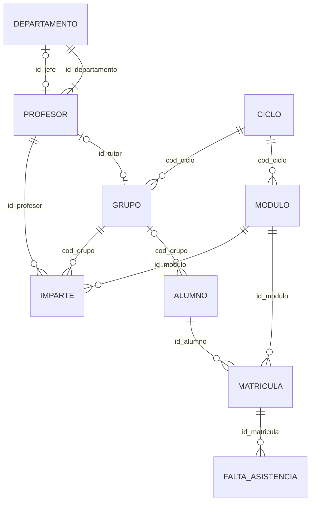

# UD03 · El model relacional


## Resum del Tema

**Visió General:**
El **Model Relacional**, ideat per Edgar F. Codd a IBM el 1970, és el model de dades lògic més estés i utilitzat comercialment al món de les bases de dades. A diferència del Model Entitat-Relació (EER), que és una eina d'abstracció conceptual per a representar la informació del món real de manera independent del programari, el Model Relacional representa l'estructura lògica de les dades mitjançant **relacions (taules)** compostes per **tuples (files)** i **atributs (columnes)**.

En aquesta unitat s'estudien minuciosament els conceptes matemàtics i pragmàtics que sustenten el model relacional: l'estructura formal d'una taula, el domini i el tipat d'atributs, el grau i la cardinalitat, les claus (candidates, primàries, alternatives i foranes), la semàntica dels valors nuls (`NULL`) i les regles d'integritat (inherents i semàntiques). A més, es detalla un catàleg complet de **regles de transformació per a convertir esquemes conceptuals EER en esquemes relacionals lògics**, il·lustrat amb exemples reals, esquemes formals i taules amb dades reals.



### Temporalització

La unitat ocupa **20 hores d'aula** (9 de teoria i 11 de pràctica).


items:
  - {h: 2, tipo: T, t: "Relació, atribut, domini, tupla, grau i cardinalitat. Claus", ref: "§1 i §2 · laboratori de claus"}
  - {h: 2, tipo: T, t: "Restriccions i integritat referencial", ref: "§3 · simulador d'integritat"}
  - {h: 1, tipo: P, t: "Simulador d'integritat referencial", ref: "Pràctica 3.2"}
  - {h: 2, tipo: T, t: "Regles de transformació (I): entitats, febles i atributs", ref: "§4.1 a §4.3 · transformador"}
  - {h: 2, tipo: T, t: "Regles de transformació (II): relacions i jerarquies. Exemples", ref: "§4.4 a §4.9 i §5"}
  - {h: 2, tipo: P, t: "Biblioteca: de l'E/R a les taules", ref: "Pràctica 3.1"}
  - {h: 1, tipo: T, t: "Restriccions no representables i eines", ref: "§6 i §7"}
  - {h: 1, tipo: P, t: "Tres maneres de transformar una jerarquia", ref: "Pràctica 3.3"}
  - {h: 2, tipo: P, t: "Model lògic d'EduGest", ref: "§8 i projecte EduGest-3"}
  - {h: 2, tipo: P, t: "Tasques de transformació 1 i 2 (naviliera i institut)", ref: "Tasques 1 i 2"}
  - {h: 1, tipo: P, t: "Enginyeria inversa d'un esquema", ref: "Pràctica 3.4"}
  - {h: 1, tipo: P, t: "Catàleg de restriccions d'un hotel", ref: "Pràctica 3.5"}
  - {h: 1, tipo: P, t: "Banc d'exercicis de transformació (bloc 1)", ref: "Exercicis 1 a 5"}
autonomo:
  - "Tasques de transformació 3 a 7 (E/R → relacional)"
  - "Pràctica 3.6"
  - "Banc de 20 exercicis (blocs 2 i 3)"


> [!IMPORTANT]
> Aquesta unitat és el **pont** entre el disseny i la implementació: allò que decidisques ací (claus, nuls, polítiques d'esborrat) determina la creació de les taules a la UD05. Un error de disseny que no detectes ara es paga després amb dades incorrectes.

### Objectius d'aprenentatge

En acabar esta unitat seràs capaç de:

- Descriure els elements del model relacional: relació, atribut, domini, tupla, grau i cardinalitat.
- Identificar claus candidates, primàries, alternatives i alienes, i la semàntica del valor `NULL`.
- Aplicar les regles d'integritat d'entitat, referencial i de domini, i triar la política d'esborrat adequada.
- Transformar un diagrama E/R estés en un esquema relacional aplicant regles sistemàtiques.
- Documentar les restriccions que el model lògic no pot expressar.



---


Elements del model i claus

## 1. Conceptes fonamentals del model relacional

### 1.1 Definició de relació (taula)

En el Model Relacional, la unitat bàsica d'emmagatzematge és la **relació**, terme matemàtic que en la pràctica informàtica s'anomena **taula**.

Una relació es defineix com un subconjunt del producte cartesià d'una família de dominis $D_1 \times D_2 \times \dots \times D_n$. Gràficament, una relació és una estructura bidimensional formada per files i columnes:

- **Diferència crucial de termes:** En el Model Entitat-Relació (EER), la paraula *"Relació"* es refereix a una associació o vincle entre dues entitats (p. ex. el client `COMPRA` productes). En canvi, en el Model Relacional, la paraula *"Relació"* designa una **taula completa de dades**.

---

### 1.2 Atributs, dominis, grau i cardinalitat

Per a caracteritzar matemàticament una taula s'utilitzen els conceptes següents:

1. **Atribut (camp o columna):** Representa una propietat o característica de l'entitat o relació que descriu la taula. Cada columna té un nom únic a la taula i un tipus de dada especificat.
2. **Domini:** És el conjunt de valors atòmics que pot prendre un atribut. El defineix el tipus de dada i, si es vol, una restricció addicional (per exemple, «edat entre 0 i 120»). Diversos atributs distints poden compartir el mateix domini (per exemple, `fecha_contrato` i `fecha_nacimiento` comparteixen el domini `DATE`).
3. **Grau:** És el nombre total d'atributs (columnes) que componen la taula. Una taula amb 5 columnes té un **grau de 5**.
4. **Cardinalitat:** És el nombre total de tuples (files o registres) emmagatzemades en un moment determinat a la taula. A diferència del grau (que és fix una vegada dissenyat l'esquema), la cardinalitat és dinàmica i varia constantment a mesura que s'inserixen o s'esborren files.

---

{}
El mateix Codd va proposar més tard distingir entre un valor **absent però aplicable** i un altre **no aplicable**. Els gestors reals es van quedar amb un únic valor nul (`NULL`), i d'ací vénen moltes sorpreses: comparar dos nuls amb `=` no dona «veritat» sinó «desconegut», perquè no se sap si són iguals.
{}

### 1.3 Tuples (files) i semàntica de valors nuls (NULL)

- **Tupla (fila, registre o ocurrència):** Cada fila individual de la taula representa una instància concreta de l'entitat o relació del món real. Cada tupla té un valor per a cada atribut de la taula; l'ordre de les columnes no és significatiu (vegeu l'apartat 3.1).
- **Valors nuls (`NULL`):** Representen l'**absència de valor**, valor desconegut o no aplicable.
  - *Diferència semàntica important:* El valor `NULL` no equival al número zero (`0`) ni a una cadena de text buida (`""`). Un zero en `saldo` significa que el saldo és de 0 euros; un `NULL` en `saldo` significa que es desconeix el saldo.
  - *Nota sobre Oracle:* a Oracle, el gestor que usarem, la cadena buida `''` s'emmagatzema com a `NULL`. És una peculiaritat d'Oracle, no del model relacional.

---

{}
El 1985 Codd va publicar una llista de 12 regles (numerades de l'1 al 12, més una «regla 0») que un sistema havia de complir per a anomenar-se realment relacional. Quasi cap SGBD comercial les complix totes, però continuen sent la referència.
{}

## 2. Estudi exhaustiu de claus

Les claus constituïxen el pilar fonamental per a garantir la unicitat de les files i establir vincles d'integritat entre taules.



### 2.1 Clau candidata i clau primària (Primary Key - PK)

- **Clau candidata:** És un atribut o conjunt mínim d'atributs els valors dels quals identifiquen de manera única i unívoca cada tupla d'una relació, sense que cap subconjunt propi d'eixos atributs puga identificar-la.
- **Clau primària (Primary Key - PK):** És la clau candidata triada explícitament pel dissenyador de la base de dades com a identificador principal de les tuples de la taula. Per regla absoluta del model relacional, **cap atribut de la clau primària pot ser nul (`NOT NULL`) i no pot haver-hi dues files amb el mateix valor de clau primària**. En una clau composta es compara la combinació completa: cada atribut per separat sí que es pot repetir (vegeu l'apartat 2.4).

---

### 2.2 Claus alternatives

Qualsevol clau candidata que no haja sigut triada com a clau primària passa a ser una **clau alternativa**. En l'esquema relacional, les claus alternatives se senyalen amb la restricció d'unicitat (UK, *unique key*): impedixen que dues files repetisquen el mateix valor.

> [!NOTE]
> **Exemple:** A la taula `CLIENTE`, si disposem del camp `id_cliente` (autoincremental intern) i del camp `dni`, tots dos són claus candidates. Triem `id_cliente` com a **Clau Primària (PK)** i indiquem que `dni` és una **Clau Alternativa (UK)**.

---

### 2.3 Clau forana / aliena (Foreign Key - FK)

Una **Clau Aliena (Foreign Key - FK)** és un atribut (o conjunt d'atributs) d'una taula els valors del qual han de coincidir obligatòriament amb els valors de la clau primària (o d'una clau alternativa) d'una altra taula (o de la mateixa taula en relacions reflexives), o bé ser nuls si la participació és opcional.

Les claus alienes representen les relacions del model EER en l'esquema relacional lògic.

---

### 2.4 Claus primàries compostes

Quan una única columna no basta per a identificar de manera unívoca una fila, la clau primària es compon de dos o més atributs combinats.

> [!NOTE]
> **Exemple de clau composta:**
> En una taula de matrícula universitària `MATRICULA`, la clau primària es compon de `(id_alumno, id_asignatura)`. Un alumne pot matricular-se en diverses assignatures i en una assignatura hi ha diversos alumnes, però la combinació d'un alumne concret en una assignatura concreta és única.

> [!CAUTION]
> **Una clau no es descobrix mirant les dades d'hui.** Que cap valor no es repetisca en la mostra no demostra que no puga repetir-se demà. La clau es decidix pel **significat** del problema: poden dos alumnes tindre el mateix nom? Pot canviar el valor amb el temps? Pot faltar?

#### Laboratori: és una clau?

Amb dades reals de la taula `ALUMNO` d'EduGest, prova quins conjunts de columnes identifiquen cada fila. Fixa't en el `NULL` de `dni` i en els cognoms repetits.




- q: "En la mostra de dalt, `(nombre, apellidos)` no es repetix. És una bona clau primària per a `ALUMNO`?"
  options: ["Sí, identifica totes les files", "No: dos alumnes distints poden dir-se igual i els noms canvien", "Sí, sempre que es declare obligatori", "Només si s'afig també `localidad`"]
  answer: 1
  explain: "Que no es repetisca **hui** no la convertix en clau. Una clau primària ha de ser estable, no nul·la i única per significat. Per això s'usa `id_alumno` (artificial) i es protegix el NIA amb una restricció d'unicitat (UK)."
- q: "`dni` conté algun `NULL` en la mostra. Quin paper pot tindre eixa columna?"
  options: ["Clau primària", "Clau alternativa (UK), però no clau primària", "Cap: no pot ser clau de cap tipus", "Clau aliena"]
  answer: 1
  explain: "Una clau primària no admet nuls (integritat d'entitat). Una clau alternativa (UK) sí que admet nuls, encara que a la pràctica convé que el DNI siga obligatori si és una dada del negoci."


---

Restriccions i integritat referencial

## 3. Restriccions del model relacional

### 3.1 Restriccions inherents al model

Són regles estructurals imposades automàticament per la pròpia definició matemàtica del model relacional:

1. **Unicitat de tuples:** No poden existir dues tuples idèntiques en una mateixa relació (s'han de diferenciar almenys en la clau primària).
2. **Desordre de tuples:** L'ordre en què s'emmagatzemen les files no és significatiu. La consulta torna les mateixes dades independentment de com es disposen al disc.
3. **Desordre d'atributs:** L'ordre de les columnes no altera el significat semàntic de la relació.
4. **Atomicitat d'atributs (atributs escalars):** Cada cel·la de la taula en la intersecció d'una fila i una columna només pot albergar un **únic valor atòmic** pertanyent al domini (no es permeten llistes ni matrius dins d'una cel·la).

---

### 3.2 Restriccions semàntiques o d'usuari (PK, UK, obligatorietat, regles de fila)

Són regles de negoci definides explícitament pel dissenyador de la base de dades (més endavant, a la UD05, aprendràs a declarar-les en un gestor):

- **Clau primària (PK):** identifica cada fila (garanteix unicitat i no nul·litat).
- **Clau alternativa (UK):** garanteix que no hi haja valors duplicats (admet nuls tret que s'indique el contrari).
- **Atribut obligatori:** l'atribut ha de tindre sempre un valor.
- **Regla de fila:** una condició lògica que ha de complir cada fila per si sola (per exemple, «el preu és major que 0» o «l'edat és com a mínim 18»).

---

### 3.3 Integritat referencial i polítiques d'esborrat/modificació

La **Integritat Referencial** exigix que els valors emmagatzemats en una clau aliena (`FK`) existisquen prèviament en la clau primària (`PK`) de la taula referenciada.

Quan s'intenta eliminar o actualitzar una fila de la taula pare (la taula que conté la `PK`), el SGBD pot aplicar una de les 4 **polítiques d'integritat referencial** següents:

1. **En cascada:**
   En esborrar o modificar una tupla de la taula pare, el SGBD esborra o actualitza automàticament totes les tuples de la taula filla que contenien eixa clau aliena.

2. **Restringit:**
   El SGBD impedix i rebutja l'esborrat o modificació de la tupla pare mentre existisquen tuples filles que la referencien.

3. **Posada a nuls:**
   En esborrar o actualitzar la tupla pare, el SGBD establix automàticament a `NULL` el valor de la clau aliena en totes les tuples filles afectades.

4. **Posada a valor per defecte:**
   En esborrar o actualitzar la tupla pare, el SGBD assigna un valor per defecte prèviament configurat a la clau aliena en les tuples filles.

---

> [!WARNING]
> **No tots els gestors oferixen totes les polítiques.** Quasi tots permeten l'esborrat en cascada i la posada a nuls, però molts no permeten propagar el canvi d'una clau primària. Per això convé dissenyar claus primàries **estables**. Oracle, per exemple, només oferix `ON DELETE CASCADE` i `ON DELETE SET NULL` (o rebutjar): no té `ON UPDATE` ni posada a valor per defecte. A la UD05 comprovaràs què oferix el gestor que usarem.

> [!TIP]
> **Quina política trie?** Fes-te aquesta pregunta sobre la fila filla: *té sentit que continue existint sense la fila pare?*
> - **No** (una matrícula sense alumne) → `CASCADE`.
> - **Sí, però cal revisar-la** (un alumne el grup del qual desapareix) → `SET NULL`, amb la columna opcional.
> - **No ha de passar mai per accident** (un departament amb empleats) → rebutjar (l'opció més prudent).

#### Laboratori: simulador d'integritat referencial

Canvia la política de la clau aliena, intenta esborrar, canviar i inserir files, i llig els missatges que expliquen per què es rebutja cada operació. Després, repetix l'experiment fent l'atribut obligatori.




- q: "La FK `matricula.id_alumno` ha d'eliminar la matrícula quan s'esborra l'alumne. Quina política declares?"
  options: ["Restringit", "Esborrat en cascada", "Posada a nuls", "Posada a valor per defecte"]
  answer: 1
  explain: "La matrícula no té sentit sense el seu alumne: s'esborra en cascada. La posada a nuls deixaria matrícules sense alumne i l'esborrat restringit impediria eliminar l'alumne."
- q: "Al simulador, per què falla la posada a nuls si `cod_grupo` és obligatori?"
  options: ["Perquè cap gestor admet la posada a nuls", "Perquè la política exigix posar NULL en una columna que no l'admet", "Perquè el grup no existix", "Perquè falta confirmar els canvis"]
  answer: 1
  explain: "Posada a nuls i obligatorietat es contradiuen: el SGBD no pot complir les dues regles alhora. Cal triar entre una política o l'altra."


---

Simulador d'integritat referencial

La pràctica 3.2 es fa a la [pàgina de pràctiques](/ud03-modelo-relacional/ud03-practicas), amb llapis i paper, i s'implementarà a la UD05.

---

Regles de transformació (I)

## 4. Regles de transformació del model EER al model relacional

Per a transformar de manera metòdica un diagrama EER conceptual en un esquema relacional lògic, s'apliquen les regles d'este apartat. Cada regla va acompanyada d'**un exemple complet**, amb la mateixa estructura que veuràs en tots:

1. el **diagrama de Chen** de partida;
2. l'**esquema relacional** resultant, escrit amb la notació de les pràctiques (PK, FK, UK, VNN);
3. el **patró general** amb entitats abstractes `A`, `B`, `C` i atributs `a0`, `a1`, `b0`… (`a0` és sempre l'identificador d'`A`);
4. unes **files d'exemple** per a comprovar que les restriccions fan el que han de fer.

> [!NOTE]
> **Notació de l'esquema.** Cada taula s'escriu amb les seues columnes i, davall, les seues restriccions:
> **PK** = clau primària · **FK** = clau aliena (`columna → TAULA`) · **UK** = clau alternativa (*unique*) · **VNN** = valor no nul (obligatori).
> És la mateixa notació de les [tasques de transformació](/ud03-modelo-relacional/ud03-practicas#ANCLA_TASQUES).

---

### 4.1 Transformació d'entitats fortes

- **Regla:** Cada entitat forta del diagrama EER es convertix en una **taula (relació)** independent.
  - Els atributs simples de l'entitat passen a ser **columnes** de la taula.
  - L'atribut identificador principal de l'entitat passa a ser la **Clau Primària (PK)** de la taula.
  - Els identificadors candidats (claus alternatives) passen a ser **UK**. Com que identifiquen, a més porten **VNN**.

#### Exemple 4.1 · L'entitat ALUMNO

En el centre, cada alumne té un NIA (número d'identificació de l'alumnat) que assigna la Conselleria. També té DNI, que no es repetix, però es tria el NIA com a identificador principal.




{}
```text
ALUMNO (nia, dni, nombre, fecha_nac)
   PK:  nia
   UK:  dni
   VNN: dni
```
- `nia` és la **PK**: no es repetix i no pot ser nul·la.
- `dni` és **UK** perquè també identifica, i **VNN** perquè una clau candidata sense valor no identificaria ningú.
- `nombre` i `fecha_nac` són columnes normals. Si l'enunciat diguera que són obligatòries, portarien també VNN.
{}
{}
```text
Diagrama:   A (a0 identificador, a1, a2, a3 clau alternativa)

A (a0, a1, a2, a3)
   PK:  a0
   UK:  a3
   VNN: a3
```
{}
{}
| nia (PK) | dni (UK) | nombre | fecha_nac |
|---|---|---|---|
| 10234567 | 48123456P | Paula Ortiz | 2006-03-14 |
| 10234568 | 21456789K | Izan Pastor | 2005-11-02 |
| 10234569 | 74222333B | Lucía Sempere | 2006-07-29 |

Una quarta fila amb el DNI `48123456P` seria rebutjada per la **UK**, encara que el seu NIA fora diferent.
{}


---

### 4.2 Transformació d'entitats febles (per identificació i existència)

- **Regla:** Una entitat feble es convertix en una **taula independent**.
  - **Feble per identificació (ID):** La clau primària de la taula resultant és una **clau composta** formada per la clau primària de l'entitat forta propietària (que es propaga com a `FK`) combinada amb el discriminador parcial de l'entitat feble.
  - **Feble per existència (E):** Si l'entitat feble té el seu propi identificador únic, este és la seua PK. La clau primària de l'entitat forta es propaga com a **FK obligatòria (VNN)**. És el cas habitual d'una relació 1:N amb participació obligatòria, que es veu amb més detall en l'apartat 4.4.

#### Exemple 4.2-a · Feble per identificació: EDIFICIO i AULA

Les aules es numeren **dins de cada edifici**: l'edifici A té una aula 1 i l'edifici B també. El número d'aula, per si sol, no identifica: és un **discriminador** (subratllat discontinu).




{}
```text
EDIFICIO (cod_edificio, nombre)
   PK:  cod_edificio

AULA (cod_edificio, num_aula, capacidad)
   PK:  (cod_edificio, num_aula)
   FK:  cod_edificio → EDIFICIO
```
- La relació `tiene` **no genera taula**: queda absorbida en `AULA`.
- `cod_edificio` és alhora **part de la PK** i **FK**. Com que forma part de la PK, ja és obligatòria: no cal escriure VNN.
{}
{}
```text
Diagrama:   A (feble, discriminador a0) ──ID── B (b0)
            Restricció d'identitat

A (a0, a1, aB)
   PK:  (a0, aB)
   FK:  aB → B

B (b0, b1)
   PK:  b0
```
{}
{}
**EDIFICIO**

| cod_edificio (PK) | nombre |
|---|---|
| A | Edifici principal |
| B | Tallers |

**AULA**

| cod_edificio (PK, FK) | num_aula (PK) | capacidad |
|---|---|---|
| A | 1 | 30 |
| A | 2 | 24 |
| B | 1 | 20 |

El valor `1` de `num_aula` es repetix, però la parella `(A, 1)` no. Inserir `(C, 3)` fallaria: l'edifici `C` no existix (**FK**).
{}


#### Exemple 4.2-b · Feble per existència: CLIENTE i PEDIDO

Una comanda té el seu propi número, que no es repetix mai, però **no pot existir sense el client** que la fa (marca **E**).




{}
```text
CLIENTE (cod_cliente, nombre)
   PK:  cod_cliente

PEDIDO (num_pedido, fecha, cod_cliente)
   PK:  num_pedido
   FK:  cod_cliente → CLIENTE
   VNN: cod_cliente
```
- La PK de `PEDIDO` és només `num_pedido`: no necessita el client per a identificar-se.
- La dependència en existència es traduïx en **VNN** sobre la FK: no hi ha comandes «òrfenes».
- En esborrar un client, la política habitual és **en cascada** (s'esborren les seues comandes) o **restringida** (no es deixa esborrar). Es decidix en la UD05.
{}
{}
```text
Diagrama:   A (a0, a1) ──E── R ── B (b0, b1)     (A depén de B)

A (a0, a1, aB)
   PK:  a0
   FK:  aB → B
   VNN: aB
```
{}
{}
| num_pedido (PK) | fecha | cod_cliente (FK, VNN) |
|---|---|---|
| 5001 | 2026-10-04 | C01 |
| 5002 | 2026-10-04 | C02 |
| 5003 | 2026-10-05 | C01 |

Inserir `(5004, 2026-10-06, NULL)` fallaria pel **VNN**.
{}


> [!TIP]
> **ID o E?** Pregunta't: *l'identificador de l'entitat feble es repetix entre propietaris diferents?* Si es repetix (aula 1 de l'edifici A, aula 1 de l'edifici B), és per **identificació** i la PK és composta. Si no es repetix (la comanda 5001 és única en tota l'empresa), és per **existència** i n'hi ha prou amb una FK obligatòria.

---

### 4.3 Transformació d'atributs compostos i multivalorats

Estes són les **regles preparatòries**: s'apliquen abans que les altres i es basen en la primera forma normal (UD04), que exigix que cada columna guarde **un únic valor atòmic**.

1. **Atributs compostos:** S'eliminen desplegant cadascun dels seus subatributs simples com a columnes individuals de la mateixa taula. L'atribut compost «pare» desapareix.
2. **Atributs multivalorats ($N$):** Es crea una **nova taula independent** per a l'atribut multivalorat. La clau primària d'esta nova taula serà la combinació de la clau primària de l'entitat originària i el mateix atribut multivalorat.

#### Exemple 4.3 · PERSONA amb adreça i diversos telèfons




{}
```text
PERSONA (dni, nombre, calle, numero, ciudad)
   PK:  dni

TELEFONO (dni, telefono)
   PK:  (dni, telefono)
   FK:  dni → PERSONA
```
- `direccion` no apareix com a columna: se substituïx per `calle`, `numero` i `ciudad`.
- `telefono` ix de `PERSONA`. Si es deixara dins, caldria guardar «600111222, 965000000» en una sola cel·la, o crear columnes `telefono1`, `telefono2`… sense saber quantes en calen.
{}
{}
```text
Diagrama:   A (a0, a1, a2 multivalorat (n), a3)

A (a0, a1, a3)
   PK:  a0

A2 (a0, a2)
   PK:  (a0, a2)
   FK:  a0 → A
```
{}
{}
**PERSONA**

| dni (PK) | nombre | calle | numero | ciudad |
|---|---|---|---|---|
| 48123456P | Paula Ortiz | Lillo Juan | 128 | Sant Vicent del Raspeig |
| 21456789K | Izan Pastor | Alfonso X | 12 | Alacant |

**TELEFONO**

| dni (PK, FK) | telefono (PK) |
|---|---|
| 48123456P | 600111222 |
| 48123456P | 965000000 |
| 21456789K | 611222333 |

Paula té dos telèfons: dues files. Repetir `(48123456P, 600111222)` violaria la **PK**.
{}


> [!NOTE]
> **Excepció:** si el valor multivalorat no es pot repetir entre entitats diferents (per exemple, un correu corporatiu que només pertany a una persona), el mateix valor és suficient com a PK: `CORREO (email, dni)` amb PK: `email`, FK: `dni → PERSONA`, VNN: `dni`.

> [!WARNING]
> **Pèrdua semàntica.** Si el diagrama exigix un mínim d'1 («tota persona té almenys un telèfon»), les taules no ho poden garantir: es pot inserir una persona sense cap fila en `TELEFONO`. Cal anotar-ho (apartat 6).

#### Laboratori: de l'E/R a les taules

Este transformador aplica les regles de l'apartat 4 i produïx l'esquema relacional formal. Comença pels casos d'esta sessió (feble, multivalorat) i torna a ell en la següent.



---

Regles de transformació (II): relacions i jerarquies

### 4.4 Transformació de relacions binàries 1:N

- **Regla (propagació de clau):** No es crea una taula nova. Es pren la clau primària de l'entitat del costat "1" i es **propaga com a clau forana (`FK`)** a la taula resultant de l'entitat del costat "N".
- Si la relació tenia atributs descriptors propis, estos es traslladen també com a columnes a la taula del costat "N".
- Si la participació del costat "N" és obligatòria (cardinalitat mínima 1), la FK ha de ser obligatòria (**VNN**).
- Si la clau del costat "1" és **composta**, la FK també és composta: viatgen **totes** les seues columnes juntes.

> [!TIP]
> **Truc per a no equivocar-se:** la clau viatja **cap al costat N**. Pensa en una fila del costat N: un empleat té **un** departament, així que cap en una columna. Un departament té **molts** empleats, que no caben en una columna.

#### Exemple 4.4-a · Participació opcional: EMPLEADO i DEPARTAMENTO (0,1)

Cada empleat treballa **com a molt** en un departament (pot haver-hi empleats acabats de contractar sense assignar). Un departament té molts empleats. La relació guarda la data d'alta.




{}
```text
DEPARTAMENTO (cod_dep, nombre)
   PK:  cod_dep

EMPLEADO (dni, nombre, cod_dep, fecha_alta)
   PK:  dni
   FK:  cod_dep → DEPARTAMENTO
```
- `cod_dep` viatja a `EMPLEADO` (costat N) com a **FK**.
- `fecha_alta`, atribut de la relació, viatja amb ella.
- Sense VNN: el mínim al costat de DEPARTAMENTO és 0, així que `cod_dep` admet nuls.
{}
{}
```text
Diagrama:   A (a0, a1) ──N── R ──1── B (b0, b1)

A (a0, a1, aB)
   PK:  a0
   FK:  aB → B

B (b0, b1)
   PK:  b0
```
{}
{}
**DEPARTAMENTO**

| cod_dep (PK) | nombre |
|---|---|
| INF | Informàtica |
| ADM | Administració |

**EMPLEADO**

| dni (PK) | nombre | cod_dep (FK) | fecha_alta |
|---|---|---|---|
| 11111111H | Marta Lloret | INF | 2020-09-01 |
| 22222222J | Andrés Gil | INF | 2023-09-01 |
| 33333333P | Sara Vidal | `NULL` | `NULL` |

Sara encara no té departament: la FK és nul·la i és vàlid.
{}


#### Exemple 4.4-b · Participació obligatòria: (1,1)

Si l'enunciat diu que **tot empleat pertany obligatòriament a un departament**, el mínim al costat de DEPARTAMENTO passa a ser 1.




{}
```text
DEPARTAMENTO (cod_dep, nombre)
   PK:  cod_dep

EMPLEADO (dni, nombre, cod_dep, fecha_alta)
   PK:  dni
   FK:  cod_dep → DEPARTAMENTO
   VNN: cod_dep
```
L'única diferència amb 4.4-a és el **VNN**: ara la fila de Sara amb `cod_dep` nul seria rebutjada.
{}
{}
```text
Diagrama:   A (a0, a1) ──E── R ── B (b0, b1)     (mínim 1 al costat de B)

A (a0, a1, aB)
   PK:  a0
   FK:  aB → B
   VNN: aB
```
{}


> [!WARNING]
> **Pèrdua semàntica.** Al costat d'EMPLEADO posa **(1,N)**: tot departament té **almenys un** empleat. Això **no es pot** garantir amb claus: res impedix inserir un departament sense empleats. És el cas de la figura del PDF en què la marca **E** està en el costat 1. S'anota com a restricció no representable i es controla en la implementació (UD08).

#### Exemple 4.4-c · Clau aliena composta: SESION i AULA

Ara el costat 1 és `AULA`, la clau de la qual és **composta** `(cod_edificio, num_aula)` (exemple 4.2-a). Cada sessió de classe s'impartix en una aula.




{}
```text
SESION (id_sesion, dia, hora, cod_edificio, num_aula)
   PK:  id_sesion
   FK:  (cod_edificio, num_aula) → AULA
   VNN: cod_edificio, num_aula
```
{}
{}
```text
Diagrama:   A (a0, a1) ──N── R ──1── B (b0, b1)      amb PK de B = (b0, b1)

A (a0, a1, aB0, aB1)
   PK:  a0
   FK:  (aB0, aB1) → B
```
{}
{}
| id_sesion (PK) | dia | hora | cod_edificio (FK) | num_aula (FK) |
|---|---|---|---|---|
| 1 | L | 08:00 | A | 1 |
| 2 | L | 09:00 | B | 1 |
| 3 | M | 08:00 | A | 2 |

`(B, 2)` no existix en `AULA` (vegeu 4.2-a): una sessió en eixa aula seria rebutjada.
{}


> [!CAUTION]
> **Error freqüent:** escriure dues FK separades, `cod_edificio → EDIFICIO` i `num_aula → AULA`. Amb dues FK separades s'acceptaria la parella `(B, 2)`, perquè l'edifici B existix i existix *alguna* aula 2. Una clau aliena apunta **sempre a la PK completa** de la taula referenciada: si la PK és simple, la FK és simple; si és composta, la FK és composta.

---

### 4.5 Transformació de relacions binàries N:M

- **Regla (taula intermèdia):** Es crea obligatòriament una **nova taula de relació**.
  - La clau primària d'esta nova taula és una **clau composta** formada per la unió de les claus primàries de les dues entitats participants (doble propagació de clau).
  - Cadascuna d'estes claus funciona per separat com a clau forana (`FK`) cap a la seua taula corresponent.
  - Els atributs propis de la relació $N:M$ s'incorporen com a columnes d'esta nova taula.

#### Exemple 4.5 · ALUMNO cursa MODULO



{}
{}
Un alumne cursa molts mòduls i un mòdul té molts alumnes: relació **N:M** amb l'atribut `nota`.
{}
{}
`ALUMNO(nia PK, nombre)` i `MODULO(cod_modulo PK, nombre)`. Cada entitat forta es convertix en una taula amb la seua clau.
{}
{}
No es pot posar una FK en cap de les dues taules sense repetir files (un alumne hauria de guardar diversos mòduls en una cel·la), així que es crea una **taula intermèdia** `CURSA`.
{}
{}
Les dues claus alienes formen juntes la PK composta `(nia, cod_modulo)`. Així un alumne no cursa dues vegades el mateix mòdul.
{}
{}
`nota` va en `CURSA`: depén de la parella alumne-mòdul, no d'un sol.
{}
{}
`CURSA(nia PK,FK → ALUMNO · cod_modulo PK,FK → MODULO · nota)`
{}
{}


{}
```text
ALUMNO (nia, nombre)
   PK:  nia

MODULO (cod_modulo, nombre)
   PK:  cod_modulo

CURSA (nia, cod_modulo, nota)
   PK:  (nia, cod_modulo)
   FK:  nia        → ALUMNO
   FK:  cod_modulo → MODULO
```
{}
{}
```text
Diagrama:   A (a0, a1) ──N── R (r1) ──M── B (b0, b1)

A (a0, a1)          B (b0, b1)
   PK:  a0             PK:  b0

R (rA, rB, r1)
   PK:  (rA, rB)
   FK:  rA → A
   FK:  rB → B
```
{}
{}
**ALUMNO**

| nia (PK) | nombre |
|---|---|
| 10234567 | Paula Ortiz |
| 10234568 | Izan Pastor |

**MODULO**

| cod_modulo (PK) | nombre |
|---|---|
| 0484 | Bases de dades |
| 0485 | Programació |

**CURSA**

| nia (PK, FK) | cod_modulo (PK, FK) | nota |
|---|---|---|
| 10234567 | 0484 | 8,5 |
| 10234567 | 0485 | 7 |
| 10234568 | 0484 | 6,25 |

Cada valor de `nia` i de `cod_modulo` es repetix, però cap **parella** es repetix.
{}


> [!NOTE]
> **I si la parella es pot repetir?** Si un alumne pot cursar el mateix mòdul en diverses convocatòries i es vol guardar cada nota, la parella `(nia, cod_modulo)` ja no és suficient: s'afig a la PK l'atribut que distingix les repeticions, `CURSA (nia, cod_modulo, convocatoria, nota)` amb PK: `(nia, cod_modulo, convocatoria)`.

> [!WARNING]
> **Pèrdua semàntica.** L'(1,N) al costat de MODULO diu que **tot alumne cursa almenys un mòdul**. La taula `CURSA` no pot obligar que cada alumne tinga una fila: s'anota.

---

### 4.6 Transformació de relacions binàries 1:1

Hi ha 3 alternatives segons les cardinalitats mínimes de participació:

1. **Participació opcional en els dos costats (0,1)-(0,1):** hi ha dues solucions vàlides. La més simple propaga la clau d'una entitat a la taula de l'altra com a FK amb restricció d'unicitat (UK) que **admet nuls** (és la que usa EduGest per a la tutoria). Si es volen evitar els nuls, es crea una taula intermèdia amb la clau d'una entitat com a PK i la de l'altra com a UK obligatòria.
2. **Participació obligatòria en un costat i opcional en l'altre (0,1)-(1,1):** la clau aliena es col·loca en la taula de l'entitat la participació de la qual és **obligatòria**, referenciant l'altra, com a FK obligatòria i única (UK + VNN). Així no necessita admetre nuls.
3. **Participació obligatòria en els dos costats (1,1)-(1,1):** les dues entitats es poden unificar en una **única taula** que agrupa tots els atributs, sempre que descriguen de veritat el mateix objecte.

> [!NOTE]
> En el transformador interactiu, la regla 2 es reflectix així: si «cada A ha de tindre un B» (mínim 1) i no al revés, la clau aliena està en A.

#### Exemple 4.6-a · (0,1)-(0,1): EMPLEADO usa TAQUILLA

Un empleat pot tindre una taquilla o cap, i una taquilla pot estar lliure.




{}
```text
EMPLEADO (dni, nombre)            TAQUILLA (num_taquilla, planta)
   PK:  dni                          PK:  num_taquilla

USA (num_taquilla, dni, fecha_entrega)
   PK:  num_taquilla
   UK:  dni
   FK:  num_taquilla → TAQUILLA
   FK:  dni          → EMPLEADO
   VNN: dni
```
- **PK** en `num_taquilla`: una taquilla apareix una vegada com a molt.
- **UK** en `dni`: un empleat apareix una vegada com a molt. Així es garantix l'«1» dels dos costats.
- No hi ha nuls: si una taquilla està lliure, simplement no té fila en `USA`.
{}
{}
```text
EMPLEADO (dni, nombre)
   PK:  dni

TAQUILLA (num_taquilla, planta, dni, fecha_entrega)
   PK:  num_taquilla
   UK:  dni
   FK:  dni → EMPLEADO
```
Menys taules, però `dni` i `fecha_entrega` queden a `NULL` en les taquilles lliures.

> **Nota:** en Oracle, una UK d'una sola columna admet diverses files amb `NULL`, perquè `NULL` no es considera igual a `NULL`.
{}
{}
```text
Diagrama:   A (a0, a1) ─(0,1)─ R ─(0,1)─ B (b0, b1)

A (a0, a1)          B (b0, b1)
   PK:  a0             PK:  b0

R (rA, rB)
   PK:  rA
   UK:  rB
   FK:  rA → A
   FK:  rB → B
   VNN: rB
```
{}


#### Exemple 4.6-b · (0,1)-(1,1): PERSONA posee PASAPORTE

Tot passaport pertany a una persona; no tota persona té passaport.




{}
```text
PERSONA (dni, nombre)
   PK:  dni

PASAPORTE (num_pasaporte, caducidad, dni)
   PK:  num_pasaporte
   UK:  dni
   FK:  dni → PERSONA
   VNN: dni
```
- La FK va en `PASAPORTE`, l'entitat que participa **obligatòriament**: així mai és nul·la.
- La **UK** convertix la FK en «1:1»: sense ella, una persona podria tindre diversos passaports (seria una 1:N).
{}
{}
```text
Diagrama:   A (a0, a1) ──E── R ── B (b0, b1)     (A obligatòria, B opcional)

A (a0, a1, aB)
   PK:  a0
   UK:  aB
   FK:  aB → B
   VNN: aB

B (b0, b1)
   PK:  b0
```
{}
{}
| num_pasaporte (PK) | caducidad | dni (UK, FK, VNN) |
|---|---|---|
| PAA123456 | 2031-05-10 | 48123456P |
| PAB654321 | 2029-01-22 | 21456789K |

Un segon passaport per a `48123456P` seria rebutjat per la **UK**. Si la FK s'haguera posat en `PERSONA`, les persones sense passaport tindrien eixa columna a `NULL`.
{}


#### Exemple 4.6-c · (1,1)-(1,1): PAIS tiene CAPITAL

Tot país té exactament una capital i tota capital ho és d'exactament un país.




{}
```text
PAIS (cod_pais, nombre, cod_ciudad, habitantes)
   PK:  cod_pais
   UK:  cod_ciudad
   VNN: cod_ciudad
```
Les dues entitats es fusionen en una única taula. La clau de l'altra entitat passa a ser **UK**.
{}
{}
```text
Diagrama:   A (a0, a1) ──E── R ──E── B (b0, b1)

R (a0, a1, b0, b1)
   PK:  a0
   UK:  b0
   VNN: b0
```
{}


> [!IMPORTANT]
> Fusionar només té sentit si les dues entitats **no participen en altres relacions** que obliguen a tindre-les separades. Si `CAPITAL` es relacionara a més amb `MUSEO`, convé mantindre dues taules i aplicar la regla 2 (FK amb UK i VNN).

---

### 4.7 Transformació de relacions reflexives / recursives

Les relacions reflexives es transformen **amb els mateixos patrons** que les binàries, però l'entitat apareix en els dos extrems. Com que la clau ha d'aparéixer **dues vegades**, es reanomena cada còpia segons el seu **rol** (`jefe`, `subordinado`…). Les dues còpies són FK cap a la **mateixa** taula.

1. **Reflexiva 1:N:** S'afig una columna de clau forana (`FK`) en la mateixa taula que **apunta a la clau primària de la mateixa taula** (autoreferència).
2. **Reflexiva 1:1:** Igual que una 1:1 binària: una FK amb **UK** en la mateixa taula, o una taula nova amb PK en un rol i UK en l'altre.
3. **Reflexiva N:M:** Es crea una **taula intermèdia** la clau primària de la qual es compon de dues columnes que fan de clau forana cap a la clau primària de la mateixa taula (representant el rol origen i el rol destinació).

#### Exemple 4.7-a · Reflexiva 1:N: EMPLEADO dirige EMPLEADO




{}
```text
EMPLEADO (dni, nombre, dni_jefe)
   PK:  dni
   FK:  dni_jefe → EMPLEADO
```
`dni_jefe` conté un DNI que ha d'existir **en la mateixa taula**. Admet nuls: el director general no té cap.
{}
{}
```text
A (a0, a1, rA)
   PK:  a0
   FK:  rA → A
```
{}
{}
| dni (PK) | nombre | dni_jefe (FK → EMPLEADO) |
|---|---|---|
| 11111111H | Marta Lloret | `NULL` |
| 22222222J | Andrés Gil | 11111111H |
| 33333333P | Sara Vidal | 11111111H |
| 44444444A | Nerea Soler | 22222222J |

Marta dirigix Andrés i Sara; Andrés dirigix Nerea. És un **arbre** guardat en una sola taula.
{}


#### Exemple 4.7-b · Reflexiva 1:1: ALUMNO mentoriza ALUMNO

En el programa de mentoria, un alumne de segon mentoritza com a molt un de primer, i cada alumne de primer té com a molt un mentor.




{}
```text
ALUMNO (nia, nombre)
   PK:  nia

MENTORIA (nia_mentorizado, nia_mentor)
   PK:  nia_mentorizado
   UK:  nia_mentor
   FK:  nia_mentorizado → ALUMNO
   FK:  nia_mentor      → ALUMNO
   VNN: nia_mentor
```
També seria vàlid posar `nia_mentor` en `ALUMNO` com a FK amb **UK** (admetent nuls), com en l'opció 2 de l'exemple 4.6-a.
{}
{}
```text
A (a0)
   PK:  a0

R (rA1, rA2)
   PK:  rA1
   UK:  rA2
   FK:  rA1 → A
   FK:  rA2 → A
```
`rA2` representa el mateix tipus de valor que `rA1`: cal duplicar-lo per a poder relacionar l'entitat amb si mateixa.
{}


#### Exemple 4.7-c · Reflexiva N:M: MODULO requiere MODULO

Un mòdul pot tindre diversos mòduls previs recomanats, i un mòdul pot ser previ de diversos.




{}
```text
MODULO (cod_modulo, nombre)
   PK:  cod_modulo

REQUIERE (cod_modulo, cod_modulo_previo)
   PK:  (cod_modulo, cod_modulo_previo)
   FK:  cod_modulo        → MODULO
   FK:  cod_modulo_previo → MODULO
```
{}
{}
```text
A (a0)
   PK:  a0

R (rA1, rA2)
   PK:  (rA1, rA2)
   FK:  rA1 → A
   FK:  rA2 → A
```
{}
{}
| cod_modulo (PK, FK) | cod_modulo_previo (PK, FK) |
|---|---|
| 0486 Accés a dades | 0484 Bases de dades |
| 0486 Accés a dades | 0485 Programació |
| 0489 Prog. multimèdia i disp. mòbils | 0485 Programació |

`0486` té dos previs i `0485` és previ de dos mòduls.
{}


> [!WARNING]
> Les claus no impedixen la fila `(0484, 0484)` (un mòdul previ de si mateix). S'evita amb una **regla de fila** (`cod_modulo <> cod_modulo_previo`, UD05). Els **cicles** (A requerix B i B requerix A) no es poden evitar amb restriccions d'una fila: és una pèrdua semàntica.

---

### 4.8 Transformació de relacions ternàries

Una ternària **sempre** genera una taula nova amb les tres claus propagades (cadascuna és FK). El que canvia segons les cardinalitats és **quina és la PK**:

- **Ternària N:N:N:** la `PK` és la combinació de les **tres** claus.
- **Ternària 1:N:N:** la `PK` són les claus dels **dos costats N**. La del costat 1 porta VNN.
- **Ternària 1:1:N:** la `PK` és la clau del costat N més **una** de les del costat 1. L'altra combinació (costat N + l'altre costat 1) és **UK**.
- **Ternària 1:1:1:** la `PK` són dues claus qualssevol; les altres dues combinacions són **UK**.

> [!TIP]
> Recorda el conveni de la UD02: en una ternària, el parell al costat d'una entitat compta **quantes instàncies d'ella corresponen a cada parella de les altres dues**. Si al costat de PROFESOR posa (1,1), cada parella (mòdul, grup) té **un sol** professor: per això la parella (mòdul, grup) és la que identifica la fila.

#### Exemple 4.8-a · N:N:N: PROFESOR imparte MODULO a GRUPO

Un mateix mòdul en un mateix grup es pot repartir entre diversos professors (per exemple, amb desdoblaments), i es guarden les hores de cadascun.




{}
```text
IMPARTE (dni, cod_modulo, cod_grupo, horas)
   PK:  (dni, cod_modulo, cod_grupo)
   FK:  dni        → PROFESOR
   FK:  cod_modulo → MODULO
   FK:  cod_grupo  → GRUPO
```
(I a més les taules `PROFESOR`, `MODULO` i `GRUPO`, que ixen de les entitats.)
{}
{}
```text
A (a0, a1)   PK: a0
B (b0, b1)   PK: b0
C (c0, c1)   PK: c0

R (a0, b0, c0)
   PK:  (a0, b0, c0)
   FK:  a0 → A
   FK:  b0 → B
   FK:  c0 → C
```
{}
{}
| dni (PK, FK) | cod_modulo (PK, FK) | cod_grupo (PK, FK) | horas |
|---|---|---|---|
| 11111111H | 0484 | 1DAW | 3 |
| 22222222J | 0484 | 1DAW | 2 |
| 11111111H | 0484 | 1DAM | 5 |

Dos professors compartixen 0484 en 1DAW: és vàlid perquè la PK inclou el professor.
{}


#### Exemple 4.8-b · 1:N:N: un sol professor per mòdul i grup

Si el centre decidix que cada mòdul de cada grup l'impartix **un únic** professor, al costat de PROFESOR posa (1,1).




{}
```text
IMPARTE (cod_modulo, cod_grupo, dni, horas)
   PK:  (cod_modulo, cod_grupo)
   FK:  dni        → PROFESOR
   FK:  cod_modulo → MODULO
   FK:  cod_grupo  → GRUPO
   VNN: dni
```
`dni` ja no forma part de la PK: amb la parella (mòdul, grup) n'hi ha prou per a saber qui l'impartix.
{}
{}
```text
Diagrama:   A amb cardinalitat 1; B i C amb cardinalitat N

R (a0, b0, c0)
   PK:  (b0, c0)
   FK:  a0 → A
   FK:  b0 → B
   FK:  c0 → C
   VNN: a0
```
{}
{}
| cod_modulo (PK, FK) | cod_grupo (PK, FK) | dni (FK, VNN) | horas |
|---|---|---|---|
| 0484 | 1DAW | 11111111H | 5 |
| 0484 | 1DAM | 11111111H | 5 |
| 0485 | 1DAW | 22222222J | 8 |

La fila `(0484, 1DAW, 22222222J, 2)` seria rebutjada: ja hi ha un professor per a eixa parella.
{}


#### Exemple 4.8-c · 1:1:N: FRANJA, AULA i GRUPO

En l'horari, en una franja horària, un grup està en **una** aula i una aula acull **un** grup. Una mateixa parella aula-grup es repetix en moltes franges.




{}
```text
OCUPA (cod_franja, cod_aula, cod_grupo)
   PK:  (cod_franja, cod_aula)
   UK:  (cod_franja, cod_grupo)
   FK:  cod_franja → FRANJA
   FK:  cod_aula   → AULA
   FK:  cod_grupo  → GRUPO
   VNN: cod_grupo
```
- La **PK** `(cod_franja, cod_aula)` impedix ficar dos grups en la mateixa aula alhora.
- La **UK** `(cod_franja, cod_grupo)` impedix que un grup estiga en dues aules alhora.
- Es podria haver triat al revés (PK amb el grup i UK amb l'aula): les dues combinacions són claus candidates.
{}
{}
```text
Diagrama:   A i B amb cardinalitat 1; C amb cardinalitat N

R (a0, b0, c0)
   PK:  (a0, c0)
   UK:  (b0, c0)
   FK:  a0 → A
   FK:  b0 → B
   FK:  c0 → C
   VNN: b0
```
{}
{}
| cod_franja (PK, FK) | cod_aula (PK, FK) | cod_grupo (UK, FK) |
|---|---|---|
| L1 | A-1 | 1DAW |
| L1 | A-2 | 1DAM |
| L2 | A-1 | 1DAW |

- `(L1, A-1, 2ASIR)` → rebutjada per la **PK**: l'aula A-1 ja està ocupada en L1.
- `(L1, B-1, 1DAW)` → rebutjada per la **UK**: 1DAW ja està en una altra aula en L1.
{}


#### Ternària 1:1:1 (patró general)

És poc freqüent. Cada parella d'entitats determina la tercera, així que **qualsevol parella** servix de clau:

```text
R (a0, b0, c0)
   PK:  (a0, b0)
   UK:  (a0, c0)
   UK:  (b0, c0)
   FK:  a0 → A
   FK:  b0 → B
   FK:  c0 → C
```

---

### 4.9 Transformació de jerarquies de generalització / especialització

Hi ha 3 estratègies relacionals per a transformar jerarquies EER:

1. **Opció A (taula única per a tota la jerarquia):** Es crea una sola taula amb tots els atributs del supertipus i dels subtipus, afegint una columna discriminadora de tipus (`tipo_subtipo`). Vàlida per a especialitzacions disjuntes; en una solapada cal un indicador per subtipus.
2. **Opció B (taules per al supertipus i cada subtipus):** Es crea una taula per al supertipus (amb la `PK` principal) i una taula per cada subtipus (la `PK` i `FK` de la qual és la clau del supertipus). És la solució més neta i flexible, i la que s'usa per defecte.
3. **Opció C (taules únicament per als subtipus):** Només es creen taules per a les entitats especialitzades, duplicant els atributs del supertipus en cadascuna. Només és vàlida si la jerarquia és Total i Disjunta $(T,D)$.

#### Exemple 4.9 · Especialització d'EMPLEADO (parcial i solapada)

En el centre hi ha professors i personal administratiu. Hi ha empleats que no són ni l'una cosa ni l'altra (conserges: **parcial**) i algun professor que també fa tasques administratives (**solapada**, marca `o`).




{}
```text
EMPLEADO (dni, nombre, sueldo)
   PK:  dni

PROFESOR (dni, especialidad)
   PK:  dni
   FK:  dni → EMPLEADO

ADMINISTRATIVO (dni, puesto)
   PK:  dni
   FK:  dni → EMPLEADO
```
La mateixa columna `dni` és **PK i FK** en cada subtipus: cada fila de `PROFESOR` «és» un empleat.
{}
{}
```text
EMPLEADO (dni, nombre, sueldo, es_profesor, especialidad,
          es_administrativo, puesto)
   PK:  dni
   VNN: es_profesor, es_administrativo
```
Com que és **solapada**, no n'hi ha prou amb una columna `tipo`: calen dos indicadors (S/N). `especialidad` i `puesto` queden a `NULL` en moltes files.
{}
{}
```text
Diagrama:   A (a0, a1) ── especialització (P,S) ──> B (b0), C (c0)

A (a0, a1)
   PK:  a0

B (b0, bA)
   PK:  bA
   FK:  bA → A

C (c0, cA)
   PK:  cA
   FK:  cA → A
```
{}
{}
**EMPLEADO**

| dni (PK) | nombre | sueldo |
|---|---|---|
| 11111111H | Marta Lloret | 2.700 |
| 22222222J | Andrés Gil | 2.650 |
| 55555555K | Pepe Ruiz | 1.600 |

**PROFESOR**

| dni (PK, FK) | especialidad |
|---|---|
| 11111111H | Informàtica |
| 22222222J | Informàtica |

**ADMINISTRATIVO**

| dni (PK, FK) | puesto |
|---|---|
| 22222222J | Secretaria |

Andrés està en les dues subtaules (**solapada**). Pepe, el conserge, només està en `EMPLEADO` (**parcial**).
{}


> [!WARNING]
> **Pèrdua semàntica.** Amb l'opció B, el model relacional representa de manera natural l'especialització **parcial i solapada**. Si fora **total** («tot empleat és professor o administratiu») o **disjunta** («ningú és les dues coses»), les claus no ho poden impedir: s'anota i es controla amb disparadors (UD08).


- q: "Tot `PASAPORTE` pertany a una persona, però no tota `PERSONA` té passaport. On va la clau aliena?"
  options: ["En `PERSONA`, obligatòria i única", "En `PASAPORTE`, obligatòria i única", "En les dues taules", "En una taula nova obligatòriament"]
  answer: 1
  explain: "La clau aliena va en la taula de l'entitat amb participació obligatòria (`PASAPORTE`): mai és nul·la i la unicitat garantix l'«1» de l'altre costat."
- q: "`AULA` és feble per identificació respecte a `EDIFICIO`. Quina és la seua clau primària?"
  options: ["`num_aula`", "`id_edificio`", "`(id_edificio, num_aula)`", "No té clau primària"]
  answer: 2
  explain: "El número d'aula només és únic dins de cada edifici: la clau primària inclou la clau del propietari (que a més és clau aliena)."
- q: "`SESION` es relaciona 1:N amb `AULA`, la PK de la qual és `(cod_edificio, num_aula)`. Com és la clau aliena en `SESION`?"
  options: ["Dues FK: `cod_edificio → EDIFICIO` i `num_aula → AULA`", "Una FK composta: `(cod_edificio, num_aula) → AULA`", "Només `num_aula → AULA`", "No cal FK"]
  answer: 1
  explain: "Una FK apunta sempre a la PK completa. Amb dues FK separades s'acceptaria una aula que no existix en eixe edifici."
- q: "En una ternària `IMPARTE` amb PROFESOR (1,1), MODULO (0,N) i GRUPO (0,N), quina és la PK?"
  options: ["`(dni, cod_modulo, cod_grupo)`", "`(cod_modulo, cod_grupo)`", "`(dni, cod_grupo)`", "`dni`"]
  answer: 1
  explain: "És una 1:N:N: les claus dels costats N formen la PK; la del costat 1 (`dni`) porta VNN."
- q: "En la ternària 1:1:N d'`OCUPA(cod_franja, cod_aula, cod_grupo)`, què evita la UK `(cod_franja, cod_grupo)`?"
  options: ["Que una aula tinga dos grups alhora", "Que un grup estiga en dues aules alhora", "Que una franja no tinga aula", "Res: sobra"]
  answer: 1
  explain: "La PK (franja, aula) controla l'aula; la UK (franja, grup) controla el grup. Les dues són necessàries."
- q: "Una relació reflexiva 1:N `EMPLEADO dirige EMPLEADO`, quantes taules genera?"
  options: ["Cap de nova: una FK `dni_jefe → EMPLEADO` en la mateixa taula", "Una taula nova `DIRIGE`", "Dues taules `JEFE` i `SUBORDINADO`", "Una taula nova amb PK composta"]
  answer: 0
  explain: "És com una 1:N qualsevol, però els dos extrems són la mateixa taula: la clau es duplica amb un altre nom."


---

### 4.10 Transformació d'agregacions

- **Regla:** La relació agregada es transforma primer segons el seu tipus (normalment N:M, amb la seua taula intermèdia). Després, eixa taula **actua com una entitat més**: la seua PK és la que es propaga a la relació amb la tercera entitat.

#### Exemple 4.10 · La matrícula, avaluada per un professor

Un alumne cursa mòduls (N:M, amb la data de matrícula). Cada **matrícula** concreta (alumne-mòdul) pot tindre assignat un professor avaluador. No s'avalua l'alumne ni el mòdul per separat, sinó la parella: per això s'agrega `cursa` com a `MATRICULA`.




{}
```text
ALUMNO (nia, nombre)          PK: nia
MODULO (cod_modulo, nombre)   PK: cod_modulo
PROFESOR (dni, nombre)        PK: dni

CURSA (nia, cod_modulo, fecha_mat, dni_evaluador)
   PK:  (nia, cod_modulo)
   FK:  nia           → ALUMNO
   FK:  cod_modulo    → MODULO
   FK:  dni_evaluador → PROFESOR
```
`evalua` és 1:N des de l'agregació: la clau del professor viatja a la taula de l'agregació (`CURSA`), com en qualsevol 1:N.
{}
{}
```text
CURSA (nia, cod_modulo, fecha_mat)
   PK:  (nia, cod_modulo)
   FK:  nia        → ALUMNO
   FK:  cod_modulo → MODULO

EVALUA (nia, cod_modulo, dni)
   PK:  (nia, cod_modulo, dni)
   FK:  (nia, cod_modulo) → CURSA
   FK:  dni               → PROFESOR
```
La FK apunta a `CURSA` i és **composta**: així només es pot avaluar una matrícula que existisca. Si es posara `nia → ALUMNO` i `cod_modulo → MODULO` per separat, es podria avaluar un alumne en un mòdul que no cursa.
{}


---

### 4.11 Pèrdues semàntiques en la transformació

Hi ha informació del diagrama E/R que **no es pot representar** amb PK, FK, UK i VNN. A això se li diu **pèrdua semàntica**. No es resol en el disseny lògic: s'anota i s'implementa després amb regles de fila, disparadors (*triggers*) o procediments emmagatzemats (UD08). L'apartat 6 explica com documentar-les.

| Situació del diagrama | Exemple | Per què es perd? |
|---|---|---|
| Mínim 1 en el costat 1 d'una 1:N | Tot departament té almenys un empleat (4.4-b) | La FK està en `EMPLEADO`; res obliga que cada departament hi aparega |
| Mínim 1 en una N:M | Tot alumne cursa almenys un mòdul (4.5) | Res obliga que cada alumne tinga files en `CURSA` |
| Existència d'una entitat respecte a una relació que està en **una altra** taula | Tota persona té passaport, si la FK està en `PASAPORTE` | Només es pot obligar amb VNN en la taula on està la FK |
| Atribut multivalorat amb mínim 1 | Tota persona té almenys un telèfon (4.3) | La taula `TELEFONO` pot no tindre files d'eixa persona |
| Generalització total o disjunta | Ningú és alhora professor i administratiu (4.9) | Les claus de dues taules diferents no es comparen entre si |
| Mínims en agregacions i ternàries | Tota matrícula té avaluador | Igual que en les binàries, depén d'altres taules |
| Cicles en reflexives | Un mòdul no pot ser previ de si mateix a través d'altres (4.7-c) | Implica recórrer diverses files |

---

### 4.12 Taula resum: patrons de transformació

Esta taula reunix els **patrons generals** dels exemples anteriors. És la xuleta per a resoldre les tasques de transformació.

| Cas de l'E/R | Taules | Esquema resultant |
|---|---|---|
| Entitat forta | 1 | `A (a0, a1)` · PK: a0 |
| Feble per identificació | 1 per entitat | `A (a0, a1, aB)` · PK: (a0, aB) · FK: aB → B |
| Feble per existència / 1:N obligatòria | 1 per entitat | `A (a0, a1, aB)` · PK: a0 · FK: aB → B · VNN: aB |
| 1:N opcional | 1 per entitat | `A (a0, a1, aB)` · PK: a0 · FK: aB → B |
| 1:N amb PK composta en el costat 1 | 1 per entitat | `A (a0, aB0, aB1)` · PK: a0 · FK: (aB0, aB1) → B |
| N:M | 3 | `R (rA, rB, r1)` · PK: (rA, rB) · FK: rA → A · FK: rB → B |
| 1:1 (0,1)-(0,1) | 3 | `R (rA, rB)` · PK: rA · UK: rB · FK: rA → A · FK: rB → B · VNN: rB |
| 1:1 (1,1)-(0,1) | 2 | `A (a0, a1, aB)` · PK: a0 · UK: aB · FK: aB → B · VNN: aB |
| 1:1 (1,1)-(1,1) | 1 | `R (a0, a1, b0, b1)` · PK: a0 · UK: b0 · VNN: b0 |
| Reflexiva 1:N | 1 | `A (a0, rA)` · PK: a0 · FK: rA → A |
| Reflexiva 1:1 | 2 | `R (rA1, rA2)` · PK: rA1 · UK: rA2 · FK: rA1 → A · FK: rA2 → A |
| Reflexiva N:M | 2 | `R (rA1, rA2)` · PK: (rA1, rA2) · FK: rA1 → A · FK: rA2 → A |
| Ternària N:N:N | 4 | `R (a0, b0, c0)` · PK: (a0, b0, c0) · 3 FK |
| Ternària 1:N:N (A és el costat 1) | 4 | `R (a0, b0, c0)` · PK: (b0, c0) · VNN: a0 · 3 FK |
| Ternària 1:1:N (C és el costat N) | 4 | `R (a0, b0, c0)` · PK: (a0, c0) · UK: (b0, c0) · VNN: b0 · 3 FK |
| Ternària 1:1:1 | 4 | `R (a0, b0, c0)` · PK: (a0, b0) · UK: (a0, c0) · UK: (b0, c0) · 3 FK |
| Generalització (opció B) | 1 + 1 per subtipus | `B (b0, bA)` · PK: bA · FK: bA → A |
| Atribut multivalorat | 2 | `A2 (a0, a2)` · PK: (a0, a2) · FK: a0 → A |

> [!TIP]
> **Comprovació ràpida de qualsevol transformació:** agafa cada FK i pregunta't *es pot repetir?* (si no, li falta UK o forma part de la PK) i *pot faltar?* (si no, li falta VNN). És el mateix raonament, al revés, de la [pràctica 3.6](/ud03-modelo-relacional/ud03-practicas#ANCLA_36).

---

## 5. Col·lecció d'exemples de transformació completa

A continuació es presenten 5 exemples pràctics complets que il·lustren minuciosament cadascuna de les regles de transformació vistes.

---

### 5.1 Exemple complet 1: Gestió de departament i empleats

#### Enunciat semàntic (5.1)

Un `DEPARTAMENTO` (identificat per `id_dep`, amb `nombre_dep`) empra diversos `EMPLEADO` (identificat per `id_emp`, amb `nombre`, `salario` i `fecha_alta`). Un empleat treballa en un únic departament (relació $1:N$).

#### Esquema relacional formal (5.1)

- $\text{DEPARTAMENTO}(\underline{\text{id\_dep}}, \text{nombre\_dep})$
- $\text{EMPLEADO}(\underline{\text{id\_emp}}, \text{nombre}, \text{salario}, \text{fecha\_alta}, \text{id\_dep*})$
  - $\text{FK: id\_dep } \rightarrow \text{DEPARTAMENTO}(\text{id\_dep}) \text{ (esborrat restringit)}$

#### Contingut de dades reals en taules (5.1)

**Taula: `departamento`**

| `id_dep` (PK) | `nombre_dep` |
| :--- | :--- |
| `10` | `'Tecnología e Innovación'` |
| `20` | `'Recursos Humanos'` |
| `30` | `'Finanzas y Contabilidad'` |

**Taula: `empleado`**

| `id_emp` (PK) | `nombre` | `salario` | `fecha_alta` | `id_dep` (FK) |
| :--- | :--- | :--- | :--- | :--- |
| `101` | `'Ana Torres'` | `2400.00` | `'2024-01-15'` | `10` |
| `102` | `'Carlos Ruiz'` | `1950.00` | `'2024-03-01'` | `20` |
| `103` | `'Lucía Vega'` | `3100.00` | `'2022-06-10'` | `10` |

---

### 5.2 Exemple complet 2: Sistema acadèmic (alumnes, assignatures i matriculació)

#### Enunciat semàntic (5.2)

Un `ALUMNO` (`id_alumno`, `nombre`, `email`) es matricula en diverses `ASIGNATURA` (`id_asig`, `nombre_asig`, `creditos`). Una assignatura acull diversos alumnes (relació $N:M$). De cada matriculació es guarda la `nota_final` aconseguida.

#### Esquema relacional formal (5.2)

- $\text{ALUMNO}(\underline{\text{id\_alumno}}, \text{nombre}, \text{email})$
- $\text{ASIGNATURA}(\underline{\text{id\_asig}}, \text{nombre\_asig}, \text{creditos})$
- $\text{MATRICULA}(\underline{\text{id\_alumno*}}, \underline{\text{id\_asig*}}, \text{nota\_final})$
  - $\text{FK1: id\_alumno } \rightarrow \text{ALUMNO}(\text{id\_alumno}) \text{ (esborrat en cascada)}$
  - $\text{FK2: id\_asig } \rightarrow \text{ASIGNATURA}(\text{id\_asig}) \text{ (esborrat en cascada)}$

#### Contingut de dades reals en taules (5.2)

**Taula: `alumno`**

| `id_alumno` (PK) | `nombre` | `email` |
| :--- | :--- | :--- |
| `1` | `'Juan Pérez'` | `'juan@universidad.edu'` |
| `2` | `'María López'` | `'maria@universidad.edu'` |

**Taula: `asignatura`**

| `id_asig` (PK) | `nombre_asig` | `creditos` |
| :--- | :--- | :--- |
| `501` | `'Bases de Datos'` | `6` |
| `502` | `'Sistemas Operativos'` | `6` |

**Taula: `matricula` (taula intermèdia N:M)**

| `id_alumno` (PK,FK) | `id_asig` (PK,FK) | `nota_final` |
| :--- | :--- | :--- |
| `1` | `501` | `8.50` |
| `1` | `502` | `7.00` |
| `2` | `501` | `9.25` |

---

### 5.3 Exemple complet 3: Edificis i aules (entitat feble per identificació)

#### Enunciat semàntic (5.3)

Un `EDIFICIO` (`id_edificio`, `nombre_edificio`, `direccion`) conté diverses `AULA` (`num_aula`, `capacidad`). L'aula és una **entitat feble per identificació** respecte a l'edifici: el número d'aula `num_aula` (101, 102...) es repetix en edificis distints, per la qual cosa la seua clau primària relacional es compon conjuntament amb el codi de l'edifici.

#### Esquema relacional formal (5.3)

- $\text{EDIFICIO}(\underline{\text{id\_edificio}}, \text{nombre\_edificio}, \text{direccion})$
- $\text{AULA}(\underline{\text{id\_edificio*}}, \underline{\text{num\_aula}}, \text{capacidad})$
  - $\text{FK: id\_edificio } \rightarrow \text{EDIFICIO}(\text{id\_edificio}) \text{ (esborrat en cascada)}$

#### Contingut de dades reals en taules (5.3)

**Taula: `edificio`**

| `id_edificio` (PK) | `nombre_edificio` | `direccion` |
| :--- | :--- | :--- |
| `1` | `'Edificio Polivalente A'` | `'Campus Sur, Av. Universidad 1'` |
| `2` | `'Edificio de Laboratorios'` | `'Campus Norte, C/ Ciencia 4'` |

**Taula: `aula` (entitat feble)**

| `id_edificio` (PK,FK) | `num_aula` (PK) | `capacidad` |
| :--- | :--- | :--- |
| `1` | `101` | `45` |
| `1` | `102` | `30` |
| `2` | `101` | `60` |

---

### 5.4 Exemple complet 4: Jerarquia d'empleats i caps (relació reflexiva)

#### Enunciat semàntic (5.4)

En una empresa, de cada `EMPLEADO` (`id_emp`, `nombre`, `cargo`) es coneix el seu cap directe. Un empleat té com a màxim un únic cap directe (que és al seu torn un altre empleat de la mateixa empresa) i un cap pot supervisar diversos empleats (**relació reflexiva $1:N$**).

#### Esquema relacional formal (5.4)

- $\text{EMPLEADO}(\underline{\text{id\_emp}}, \text{nombre}, \text{cargo}, \text{id\_jefe*})$
  - $\text{FK: id\_jefe } \rightarrow \text{EMPLEADO}(\text{id\_emp}) \text{ (posada a nuls)}$

#### Contingut de dades reals en taules (5.4)

**Taula: `empleado` (amb autoreferència reflexiva)**

| `id_emp` (PK) | `nombre` | `cargo` | `id_jefe` (FK -> `empleado.id_emp`) |
| :--- | :--- | :--- | :--- |
| `1` | `'Elena Blanco'` | `'Directora General'` | `NULL` |
| `2` | `'Roberto Gómez'` | `'Jefe de Desarrollo'` | `1` |
| `3` | `'Marta Vidal'` | `'Programadora Senior'` | `2` |
| `4` | `'Santi Castro'` | `'Programador Junior'` | `2` |

---

### 5.5 Exemple complet 5: Venda d'automòbils i revisions en el taller

#### Enunciat semàntic (5.5)

Un concessionari ven `COCHE` (`matricula`, `modelo`, `precio`) a `CLIENTE` (`id_cliente`, `nombre`, `telefono`). Un client pot comprar diversos cotxes ($1:N$). Cada cotxe passa `REVISION` periòdiques al taller. La revisió s'identifica de manera feble per un `num_revision` relatiu a la matrícula del cotxe (`matricula`, `num_revision`), registrant `fecha_revision` i `coste`.

#### Esquema relacional formal (5.5)

- $\text{CLIENTE}(\underline{\text{id\_cliente}}, \text{nombre}, \text{telefono})$
- $\text{COCHE}(\underline{\text{matricula}}, \text{modelo}, \text{precio}, \text{id\_cliente*})$
  - $\text{FK: id\_cliente } \rightarrow \text{CLIENTE}(\text{id\_cliente}) \text{ (esborrat restringit)}$
- $\text{REVISION}(\underline{\text{matricula*}}, \underline{\text{num\_revision}}, \text{fecha\_revision}, \text{coste})$
  - $\text{FK: matricula } \rightarrow \text{COCHE}(\text{matricula}) \text{ (esborrat en cascada)}$

#### Contingut de dades reals en taules (5.5)

**Taula: `cliente`**

| `id_cliente` (PK) | `nombre` | `telefono` |
| :--- | :--- | :--- |
| `10` | `'Gonzalo Navarro'` | `'600112233'` |

**Taula: `coche`**

| `matricula` (PK) | `modelo` | `precio` | `id_cliente` (FK) |
| :--- | :--- | :--- | :--- |
| `'1234-BBB'` | `'Sedán Familiar'` | `22500.00` | `10` |

**Taula: `revision` (entitat feble per identificació)**

| `matricula` (PK,FK) | `num_revision` (PK) | `fecha_revision` | `coste` |
| :--- | :--- | :--- | :--- |
| `'1234-BBB'` | `1` | `'2025-02-10'` | `120.00` |
| `'1234-BBB'` | `2` | `'2026-02-15'` | `250.00` |

---

Biblioteca: de l'E/R a les taules

Restriccions no representables i eines

## 6. Restriccions que el model lògic no pot expressar

El model relacional expressa molt bé les restriccions **d'una fila** (atribut obligatori, regla de fila) i **de clau** (clau primària, clau alternativa, clau aliena). Però moltes regles de negoci afecten **diverses files o diverses taules** i no es poden declarar així. El criteri RA6.h exigix **analitzar-les i documentar-les** perquè no es perden entre el disseny i la implementació.

| Regla de negoci (EduGest) | Per què no basta amb una restricció declarativa? | On s'implementarà |
|---|---|---|
| El cap d'un departament ha de pertànyer a eixe departament | Compara una fila de `DEPARTAMENTO` amb una fila de `PROFESOR` | Trigger (UD08) |
| Un alumne només es matricula en mòduls del cicle del seu grup | Implica `ALUMNO`, `GRUPO` i `MODULO` | Trigger o procediment de matrícula (UD08) |
| Un professor no supera 20 hores lectives setmanals | És una **suma** sobre diverses files d'`IMPARTE` | Trigger compost o procediment (UD08) |
| No hi ha faltes anteriors a la data de matrícula | Compara dues taules | Trigger (UD08) |
| La nota final es posa en múltiples de 0,25 | És una regla d'**una fila** | Regla de fila: `nota_final` múltiple de 0,25 (es declara a la UD05) |
| Un grup no supera 30 alumnes | És un **recompte** sobre diverses files | Procediment de matrícula o trigger (UD08) |

Cada restricció es documenta amb un format fix:

```text
R1. Cap de departament
    Descripció: el professor cap d'un departament ha de pertànyer-hi.
    Taules: DEPARTAMENTO(id_jefe), PROFESOR(id_profesor, id_departamento)
    Moment de comprovació: en assignar o canviar el cap i en canviar de
                            departament un professor.
    Implementació prevista: trigger (UD08).
```

> [!IMPORTANT]
> Una regla que només es comprova en l'aplicació (en el codi Java, Kotlin o PHP) pot saltar-se inserint dades directament a la base de dades o des d'una altra aplicació. Sempre que siga possible, les regles d'integritat han de viure **a la base de dades**.

---

## 7. Eines gràfiques per al disseny lògic

El disseny lògic es representa amb un **diagrama relacional**: un rectangle per taula amb les seues columnes, la clau primària marcada i fletxes des de cada clau aliena fins a la clau primària que referencia (RA6.a).

| Eina | Què aporta |
|---|---|
| **Oracle SQL Developer Data Modeler** | Dissenya el model lògic (Barker) i el relacional. Més endavant permetrà també l'enginyeria inversa d'un esquema existent |
| **draw.io** | Plantilles de taules (*Entity Relation* → *Table*) |
| **dbdiagram.io / DBML** | Diagrama a partir d'una descripció en text |
| **Mermaid** | Diagrames `erDiagram` en Markdown, ideals per a documentar al repositori |

> [!TIP]
> Quan acabes el projecte a la UD05, dibuixa el diagrama de les taules que hages creat i compara'l amb el teu disseny lògic. Si no coincidixen, hi ha un error en un dels dos.

{}
Fes-te tres preguntes, en este ordre: es decidix mirant **una sola fila**? → regla de fila (es declara en el mateix esquema). Compara una columna amb la **clau d'una altra taula**? → clau aliena. Necessita **sumar, comptar o comparar diverses files** o taules? → trigger o procediment al servidor (UD08). Només si cap de les tres servix ha de viure en l'aplicació.
{}

---

Tres formes de transformar una jerarquia

Catàleg de restriccions d'un hotel

## 8. Cas guiat: EduGest del model E/R al relacional

Apliquem les regles de l'apartat 4 al diagrama de la UD02. Cada pas cita la regla aplicada.

| Element del model E/R | Regla | Resultat en el model relacional |
|---|---|---|
| Entitat `CICLO` | 4.1 Entitat forta | CICLO(<u>cod_ciclo</u>, nombre, grado, horas_totales) |
| Entitat `MODULO` amb (codigo, ciclo) únic | 4.1 + clau alternativa | MODULO(<u>id_modulo</u>, codigo, nombre, curso, horas, *cod_ciclo*) · UK(codigo, cod_ciclo) |
| CICLO 1:N MODULO | 4.4 La FK va al costat N | `cod_ciclo` en MODULO, obligatòria perquè la participació és (1, 1) |
| CICLO 1:N GRUPO | 4.4 | GRUPO(<u>cod_grupo</u>, *cod_ciclo*, curso, turno, ...) |
| GRUPO 1:N ALUMNO, participació (0, 1) | 4.4 amb FK opcional | ALUMNO(..., *cod_grupo*) **admet NULL** |
| PROFESOR 1:1 GRUPO (tutoria), opcional als dos costats | 4.6 | `id_tutor` en GRUPO, admet nuls i és **UK** |
| ALUMNO N:M MODULO amb atributs i curs acadèmic | 4.5 | MATRICULA(<u>id_matricula</u>, *id_alumno*, *id_modulo*, curso_academico, ...) · UK(id_alumno, id_modulo, curso_academico) |
| PROFESOR–MODULO–GRUPO (imparte) | 4.8 Ternària | IMPARTE(<u>*id_modulo*, *cod_grupo*, curso_academico</u>, *id_profesor*, horas_semanales) |

> [!NOTE]
> En `MATRICULA` s'ha usat una **clau artificial** (`id_matricula`) en lloc de la clau composta (id_alumno, id_modulo, curso_academico). Les dues opcions són correctes. La clau artificial simplifica les claus alienes que apunten a la matrícula (com les faltes d'assistència), però **obliga** a declarar la clau natural com a clau alternativa (UK); si no, es podrien duplicar matrícules.

{}

{}

---

Model lògic d'EduGest


- t: "Relació"
  d: "Taula del model relacional: conjunt de tuples amb els mateixos atributs."
- t: "Tupla"
  d: "Fila d'una relació."
- t: "Grau"
  d: "Nombre d'atributs (columnes) d'una relació."
- t: "Cardinalitat"
  d: "Nombre de tuples (files) d'una relació."
- t: "Clau candidata"
  d: "Conjunt mínim d'atributs que identifica cada tupla."
- t: "Clau aliena"
  d: "Atribut(s) que referencien la clau primària d'una altra relació."


## 9. Resum i conclusions

- El **Model Relacional** estructura lògicament la informació mitjançant relacions (taules), tuples (files) i atributs (columnes), basant-se en la teoria matemàtica de conjunts.
- Les **claus primàries (PK)** i **claus alternatives (UK)** garanteixen la unicitat de les tuples, mentre que les **claus alienes (FK)** representen els vincles i imposen integritat referencial.
- Les polítiques d'integritat referencial (`CASCADE`, `RESTRICT`, `SET NULL`) determinen la resposta del SGBD davant d'esborrats o modificacions de claus primàries.
- El pas d'EER a Relacional es regix per un catàleg estricte de regles de transformació que mapeja entitats a taules, relacions $1:N$ a propagacions de clau, relacions $N:M$ a taules intermèdies d'enllaç i entitats febles a claus compostes.

---

## 10. Exercicis resolts

### 1. Pregunta teòrica: claus en el model relacional

**Pregunta:** Quina és la diferència entre una clau candidata, una clau primària i una clau aliena?
{}
- *Clau candidata:* Qualsevol conjunt mínim d'atributs que identifica de manera única cada tupla d'una taula.
- *Clau primària (PK):* La clau candidata triada pel dissenyador com a identificador principal. No admet valors nuls ni repetits.
- *Clau aliena (FK):* Atribut d'una taula els valors del qual fan referència a la clau primària d'una altra taula per a representar un vincle.
{}

---

### 2. Anàlisi de polítiques d'integritat referencial

**Pregunta:** Si eliminem la fila d'un `DEPARTAMENTO` amb `id_dep = 10` i la clau aliena de la taula `EMPLEADO` té configurada la política d'esborrat en cascada, què passa amb els empleats pertanyents a eix departament?
{}
El SGBD eliminarà automàticament de la taula `EMPLEADO` totes les tuples que tinguen `id_dep = 10`.
{}

---

### 3. Exercici pràctic de transformació relacional

**Enunciat:** Un `AUTOR` (`id_autor`, `nombre`) escriu diversos `LIBRO` (`isbn`, `titulo`, `precio`). Un llibre pot ser escrit per diversos autors. Expressa l'esquema relacional formal resultant i justifica on van les claus alienes i quina política d'esborrat convé en esta relació $N:M$.

**Solució pas a pas:**

1. **Esquema relacional formal:**
   - $\text{AUTOR}(\underline{\text{id\_autor}}, \text{nombre})$
   - $\text{LIBRO}(\underline{\text{isbn}}, \text{titulo}, \text{precio})$
   - $\text{ESCRIBE}(\underline{\text{id\_autor*}}, \underline{\text{isbn*}})$

2. **Claus alienes i polítiques d'esborrat:** `id_autor` i `isbn` són claus alienes en `ESCRIBE` i formen la seua clau primària composta. Si s'esborra un autor o un llibre, té sentit esborrar també les seues files d'`ESCRIBE` (esborrat en cascada). A més, `precio` ha de complir una regla de fila: ser major que 0.

---

## 11. Autoavaluació

Respon a les preguntes i prem **Corregir**. Cada resposta inclou una explicació.


- q: "Una taula té 6 columnes i 250 files. Quins són el seu grau i la seua cardinalitat?"
  options: ["Grau 250 i cardinalitat 6", "Grau 6 i cardinalitat 250", "Grau 6 i cardinalitat 6", "Depén de la clau primària"]
  answer: 1
  explain: "El **grau** és el nombre d'atributs (columnes) i la **cardinalitat** el nombre de tuples (files)."
- q: "A la taula CLIENTE, tant `id_cliente` com `dni` identifiquen cada client. Es tria `id_cliente` com a clau primària. Què és `dni`?"
  options: ["Una clau aliena", "Una clau alternativa", "Una superclau no mínima", "Un atribut derivat"]
  answer: 1
  explain: "És una clau **candidata** que no s'ha triat com a primària: una clau alternativa. Es marca com a UK."
- q: "Quina regla d'integritat impedix que una clau primària prenga el valor NULL?"
  options: ["Integritat referencial", "Integritat d'entitat", "Integritat de domini", "Regla de negoci"]
  answer: 1
  explain: "La **integritat d'entitat** exigix que la clau primària siga única i no nul·la, perquè identifica cada fila."
- q: "En transformar una relació 1:N entre DEPARTAMENTO (1) i EMPLEADO (N), on va la clau aliena?"
  options: ["En DEPARTAMENTO", "En EMPLEADO", "En una taula nova", "En les dues taules"]
  answer: 1
  explain: "La clau aliena es col·loca en el costat **N**: cada empleat guarda l'identificador del seu únic departament."
- q: "Una relació N:M entre ALUMNO i ASIGNATURA amb l'atribut nota es transforma en..."
  options: ["Una clau aliena en ALUMNO", "Una clau aliena en ASIGNATURA", "Una taula nova amb les dues claus alienes i la nota", "Un atribut multivalorat"]
  answer: 2
  explain: "Tota relació N:M genera una **taula pròpia** amb les claus de les dues entitats (normalment com a clau primària composta) i els atributs de la relació."
- q: "S'esborra un departament que té empleats. La FK d'EMPLEADO té política de posada a nuls. Què passa?"
  options: ["Es rebutja l'esborrat", "S'esborren també els empleats", "Els empleats queden amb id_dep a NULL", "Els empleats passen a un altre departament"]
  answer: 2
  explain: "La posada a nuls conserva les files filles i deixa la seua clau aliena buida. Només és possible si la columna admet nuls."
- q: "Per què convé que les claus primàries siguen **estables** (que no canvien)?"
  options: ["Perquè no es poden escriure dues vegades", "Perquè canviar una clau referenciada obliga a actualitzar totes les claus alienes que l'apunten, i molts gestors no ho propaguen", "Perquè les claus primàries no admeten text", "Perquè així s'eviten els nuls"]
  answer: 2
  explain: "Canviar una clau primària referenciada trenca la integritat referencial si el gestor no propaga el canvi. Per això es prefereixen claus **estables**, que no canvien mai."
- q: "La regla «un professor no pot impartir més de 20 hores setmanals» s'ha de..."
  options: ["Expressar amb una regla de fila a la taula IMPARTE", "Documentar com a restricció no representable i implementar amb programació al servidor (UD08)", "Ignorar, ja que no forma part del model", "Resoldre amb una clau aliena"]
  answer: 1
  explain: "Afecta la **suma** de diverses files. Una regla de fila només veu la fila actual. Es documenta (RA6.h) i s'implementa amb un trigger o un procediment (UD08)."


### Autoavaluació ampliada

Dos tests més per a reforçar el tema. Corregeix en acabar: cada pregunta explica per què la resposta és la correcta, i pots reiniciar-los i repetir-los tantes voltes com vulgues.

#### Test A · Conceptes del model relacional


- q: "En el model relacional, una **tupla** és…"
  options: ["Una columna de la taula", "Una fila de la relació", "El nom de la taula", "Una clau forana"]
  answer: 1
  explain: "Relació = taula, tupla = fila, atribut = columna, domini = conjunt de valors permesos."
- q: "Una **clau candidata** és…"
  options: ["Qualsevol columna que no admet nuls", "Un conjunt mínim d'atributs que identifica de manera única cada tupla", "La clau que es tria per a la clau forana", "Una clau que encara no s'ha creat"]
  answer: 1
  explain: "D'entre les candidates se'n tria una com a clau primària; les altres són claus alternatives (UNIQUE)."
- q: "Què garanteix la **integritat d'entitat**?"
  options: ["Que la clau primària no siga nul·la ni es repetisca", "Que les claus foranes apunten a files existents", "Que les dades estiguen xifrades", "Que no hi haja duplicats en cap columna"]
  answer: 0
  explain: "La integritat referencial és la que exigeix que les claus foranes apunten a files existents."
- q: "La **integritat referencial** impedeix…"
  options: ["Que una clau forana continga un valor que no existeix com a clau en la taula referenciada", "Que una taula tinga més de 10 columnes", "Que hi haja valors nuls en qualsevol columna", "Que s'esborre la base de dades"]
  answer: 0
  explain: "Una clau forana pot ser nul·la (si la participació és opcional), però si té valor ha d'existir en la taula pare."
- q: "Si s'esborra una fila de la taula pare que té files filles i la política és **CASCADE**…"
  options: ["Es rebutja l'esborrat", "S'esborren també les files filles", "Les filles passen a NULL", "No passa res"]
  answer: 1
  explain: "RESTRICT rebutja; CASCADE propaga l'esborrat; SET NULL posa la clau forana a nul."
- q: "Una clau primària **composta** és la que…"
  options: ["Es forma amb diverses columnes", "Conté lletres i números", "És autonumèrica", "Es calcula amb una funció"]
  answer: 0
  explain: "És habitual en les taules intermèdies de relacions N:M: la clau és la parella de claus foranes."


#### Test B · Transformació E/R → relacional


- q: "En una relació **1:N** entre `GRUP` (1) i `ALUMNE` (N), on va la clau forana?"
  options: ["En `GRUP`", "En `ALUMNE`", "En una taula nova", "En cap lloc"]
  answer: 1
  explain: "La clau forana es col·loca al costat N, apuntant a la clau primària del costat 1."
- q: "Una relació **N:M** amb atribut propi (`nota` en la matrícula) es transforma en…"
  options: ["Un atribut d'ALUMNE", "Una taula amb les dues claus foranes com a clau primària i la columna `nota`", "Dues taules independents sense relació", "Una vista"]
  answer: 1
  explain: "La nota depén de la parella alumne-mòdul, de manera que només pot viure en la taula de la relació."
- q: "En una **relació 1:1 amb participació opcional en un costat**, el més habitual és posar la clau forana…"
  options: ["Al costat de participació obligatòria, evitant nuls", "Sempre al costat opcional", "En ambdues taules", "En una tercera taula sempre"]
  answer: 0
  explain: "Així la clau forana mai és nul·la. L'alternativa de fondre les dues taules és vàlida si totes dues participen sempre."
- q: "Una **entitat feble** per identificació genera una taula la clau primària de la qual és…"
  options: ["Només el seu atribut discriminador", "La clau de l'entitat forta més el seu discriminador", "Un número aleatori", "No té clau"]
  answer: 1
  explain: "Per exemple, la línia de comanda té clau (num_comanda, num_linia)."
- q: "Per a una jerarquia amb pocs atributs específics i que quasi no es consulta per subtipus, quina estratègia és raonable?"
  options: ["Taula única amb un atribut discriminador", "Una taula per cada subtipus sense supertipus, sempre", "No transformar-la", "Una taula per atribut"]
  answer: 0
  explain: "La taula única és simple i ràpida, a costa d'admetre nuls en els atributs específics; cal controlar amb CHECK que siguen coherents amb el tipus."
- q: "Una restricció com «un empleat no pot ser cap de si mateix» en el model lògic…"
  options: ["S'expressa de vegades amb CHECK; si no, queda com a regla documentada per a controlar a l'aplicació o amb un trigger", "No importa", "Sempre s'expressa amb una clau primària", "S'elimina del disseny"]
  answer: 0
  explain: "Les restriccions que el model no pot expressar s'han de documentar i decidir on es controlen."


## Referències

- Codd, E. F. (1970). «A Relational Model of Data for Large Shared Data Banks». *Communications of the ACM*, 13(6).
